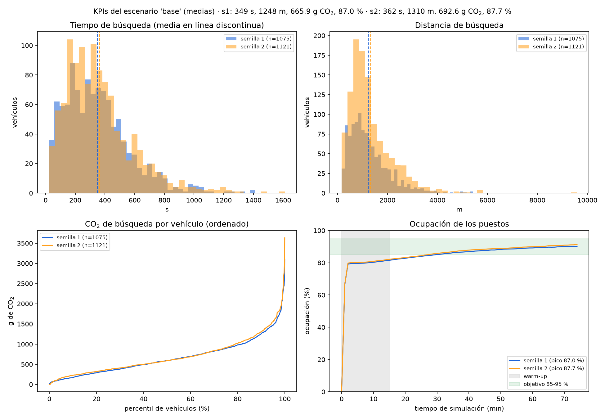

# S2 · Sesión 1 · Tyrone: KPIs de la línea base (búsqueda, distancia, CO2 y ocupación)

## 1. Resumen en 5 líneas

- Se creó el módulo `kpis/`, que convierte las salidas XML de SUMO en los indicadores del proyecto: tiempo, distancia y CO2 de búsqueda por vehículo, y ocupación de los puestos.
- Las definiciones son fijas y están documentadas en `kpis.py`. Los mismos números alimentarán el informe y el visor, por medio del mensaje WS `kpi`.
- En la línea base (búsqueda a ciegas, 1800 veh/h, 2 semillas), un conductor busca en promedio **356 s**, recorre **1280 m** y emite **680 g de CO2** antes de estacionar.
- La ocupación media en la hora pico es de 87,0 % y 87,7 %, dentro de la franja 85–95 %.
- Cada semilla se calcula en 5–8 s, y 13 tests con XML sintéticos comprueban cada definición.

## 2. Conceptos clave

- **KPI (indicador clave).** Es un número que resume el desempeño y se compara entre escenarios. Para la app interesan cuatro: cuánto se tarda en encontrar puesto, cuánto se recorre buscando, cuánto CO2 se emite mientras se busca y qué tan llenos están los puestos.
- **Inicio de la búsqueda.** Es el instante en que el conductor entra a la zona de su destino: el primer edge a menos de 300 m del destino, o el edge de su puesto objetivo, lo que ocurra primero. Antes de eso el conductor "va hacia allá" y no "busca". Se eligió el radio porque, con app, el conductor ya no pasa necesariamente por su puesto objetivo: una definición basada solo en ese edge no serviría para comparar.
- **Fin de la búsqueda.** Es el instante en que empieza su primera parada en un `parkingArea`, según el stop-output de SUMO.
- **exitTimes.** El vehroute-output de SUMO puede escribir, para cada edge de la ruta final, la hora a la que el vehículo salió de él. La entrada a un edge es la salida del anterior. Con eso se sabe qué calles recorrió el vehículo durante la búsqueda.
- **Integral del CO2.** El emission-output escribe cada 10 s la emisión instantánea de cada auto (mg/s). Multiplicar por 10 s y sumar da los gramos emitidos. Se comprobó que esta suma coincide en un 98,8 % con el total exacto que reporta SUMO por viaje.
- **Bootstrap.** Para el intervalo de confianza del 95 % de la media, se toman 1000 remuestreos con reemplazo de los vehículos, se calcula la media de cada uno y se reportan sus percentiles 2,5 y 97,5. No supone ninguna distribución, lo que importa porque los tiempos tienen cola larga.
- **Búsquedas censuradas.** Algunos conductores siguen buscando cuando termina la simulación, así que su tiempo real es desconocido (solo se sabe que es mayor). No entran en las estadísticas y se reportan aparte.
- **Lectura en streaming.** Los XML pesan decenas de MB. `lxml.iterparse` los recorre elemento por elemento y libera la memoria de lo ya leído.

## 3. Cómo se generó cada cosa

Las corridas de SUMO, dentro del contenedor:

```bash
docker exec -w /home/vanet/results/e-sert/semanas/S2/Tyrone/codigo/sumo/demanda van3twin \
    bash -lc "python3 correr_base.py --semillas 1 2"     # ~16 min, en segundo plano
```

Los KPIs y la figura, en la computadora, desde `semanas/S2/Tyrone/codigo/`. Usan el entorno `kpis/.venv`, porque no importan `sumolib` ni `traci`:

```bash
python -m kpis.kpis --salidas sumo/salidas/base_1 --escenario base --semilla 1
python -m kpis.kpis --salidas sumo/salidas/base_2 --escenario base --semilla 2
python -m kpis.graficas --escenario base --salida ../evidencias/s1_kpis-base.png
python -m pytest kpis/tests -q
```

| Resultado | Entrada | Salida |
|---|---|---|
| Salidas de SUMO | centro_base.sumocfg, semilla | sumo/salidas/base_N/ (stops, vehroutes, emisiones, tripinfo) |
| KPIs por vehículo | salidas, red, puestos.csv, destinos.csv, demanda | kpis/salidas/base_N_vehiculos.csv |
| Ocupación | stop-output | kpis/salidas/base_N_ocupacion.csv |
| Resumen | todas las semillas del escenario | kpis/salidas/kpis_base.json |
| Figura 2x2 | lo anterior | evidencias/s1_kpis-base.png |

## 4. Mapa de archivos

| Archivo | Qué contiene | Quién lo usa |
|---|---|---|
| kpis/lectores.py | Lectores XML en streaming que devuelven DataFrame | kpis.py; Freddy en S3-1 |
| kpis/kpis.py | Definiciones, cálculo por corrida y CLI | Tyrone (escenarios S2-3), informe |
| kpis/graficas.py | Figura 2x2 de un escenario | Evidencias |
| kpis/tests/ | 13 tests con XML sintéticos mínimos | Verificación |
| kpis/salidas/kpis_base.json | Los 4 KPIs con media, mediana, p90 e IC 95 % | Visor (S2-2), Freddy (mensaje kpi), informe |
| kpis/salidas/base_N_vehiculos.csv | Un buscador por fila con sus 3 KPIs | Análisis y gráficas |
| sumo/centro_base.sumocfg | Escenario base con route-length en vehroute | Corridas |

## 5. Recorrido del código

- `lectores.py`:
  - `leer_stops`: paradas en `parkingArea` con `started` y `ended` (-1 si no terminó);
  - `leer_vehroutes`: una fila por edge de la ruta final, con su hora de salida;
  - `leer_emisiones`: CO2 por vehículo y periodo, filtrado por los IDs que interesan;
  - `leer_red` y `leer_proyeccion`: longitud y forma de cada edge, y la proyección para ubicar los destinos.
- `kpis.py`:
  - `edges_cerca`: edges con algún segmento a menos del radio del destino (distancia punto-segmento);
  - `inicio_busqueda`, `distancia_busqueda_m` y `co2_busqueda_g`: las tres definiciones por vehículo;
  - `serie_ocupacion`: plazas ocupadas cada 60 s;
  - `resumen_estadistico`: n, media, mediana, p90 e IC bootstrap;
  - `calcular`: junta todo para una corrida;
  - `_resumen_escenario`: arma el JSON con todas las semillas.

Parte central, por vehículo:

```python
objetivo = set(cerca.get(b.destino, set()))      # edges a <= 300 m del destino
objetivo.add(edge_de_pa[b.pa_objetivo])          # o el edge de su puesto objetivo
ini = inicio_busqueda(ruta, objetivo)            # entrada al primero de ellos
fin = float(primera.loc[b.id, "started"])        # primera parada en un parkingArea
filas.append({
    "tiempo_busqueda_s": fin - ini,
    "distancia_busqueda_m": distancia_busqueda_m(ruta, ini, fin, longitudes),
    "co2_busqueda_g": co2_busqueda_g(emis_veh.get(b.id, vacio), ini, fin, 10.0),
})
```

## 6. Cómo se conecta con los demás

- **Consume:** el escenario base de S1 (red, puestos, demanda y `destinos.csv`) y las salidas XML de SUMO.
- **Entrega:**
  - `kpis_base.json` usa en `valores` los nombres reservados del mensaje WS `kpi` del contrato (§6): `busqueda_media_s`, `distancia_busqueda_media_m`, `co2_busqueda_g` y `falsas_liberaciones_100`, este último `null` hasta S3. Freddy puede reenviarlos tal cual, y el servidor de prueba del visor (S2-2) los usa.
  - En S2-3 se aplica el mismo módulo a los escenarios con 20, 50 y 80 % de app, y en S3-1 al ejecutor completo.

## 7. Resultados y evidencias

| KPI | Semilla 1 | Semilla 2 | Ambas (IC 95 %) |
|---|---|---|---|
| Buscadores con KPI | 1075 / 1277 | 1121 / 1369 | 2196 |
| Tiempo de búsqueda medio | 349 s | 362 s | 356 s (347–365) |
| Mediana / p90 del tiempo | | | 319 / 652 s |
| Distancia de búsqueda media | 1248 m | 1310 m | 1280 m (1245–1315) |
| CO2 de búsqueda medio | 666 g | 693 g | 680 g (661–698) |
| Ocupación media hora pico | 87,0 % | 87,7 % | 87,3 % |
| Sin estacionar al final (censurados)* | 114 | 159 | |

\* Corregido en S2-3: la primera versión contaba 201 y 248 porque tomaba como hora válida el exitTime = -1 que SUMO escribe en los edges que un vehículo sin terminar aún no recorrió. Las medias de los 4 KPIs no cambian.

Comparación con el cálculo provisional de S1-3 (230 y 246 s): el tiempo nuevo es 52 % y 47 % mayor. La diferencia viene solo de la definición del inicio: con radio 0 (solo el edge objetivo), `kpis.py` reproduce exactamente 229,9 y 245,6 s.



## 8. Limitaciones y decisiones

- **Radio de 300 m.** Incluye los últimos metros de aproximación al destino, así que ninguna búsqueda dura 0 s (el mínimo ronda 30 s). Se aplica igual en todos los escenarios, así que la comparación es justa.
- **Distancia.** Solo cuenta los edges completos. El tramo del edge donde estaciona se omite, y la distancia se subestima unas decenas de metros por vehículo.
- **CO2 muestreado cada 10 s.** Es exacto en promedio (98,8 % del total de SUMO), pero ruidoso por vehículo. Los ~400 g/km son propios del tráfico con arranques y paradas del modelo HBEFA3.
- **Censurados.** Los 114 y 159 buscadores sin estacionar (media de 288 y 392 s buscando al final) se excluyen, lo que subestima la media de la línea base. Es una subestimación conservadora: favorece a la búsqueda a ciegas, no a la app.
- **IC de la ocupación.** Usa las muestras por minuto, que están correlacionadas en el tiempo, así que su IC es optimista.

## 9. Preguntas que podría hacer el profesor

1. **¿Por qué no medir la búsqueda desde que sale el auto?** Porque el viaje hasta la zona no depende de la app. Lo que la app cambia es lo que pasa cerca del destino.
2. **¿Por qué el tiempo cambió respecto a la semana pasada?** Por la nueva definición del inicio (300 m del destino). Con la definición vieja se obtienen exactamente los mismos números.
3. **¿Cómo saben que el CO2 es correcto?** Se comparó la integral muestreada con el total exacto que SUMO calcula por viaje: coinciden en un 98,8 %, con correlación 0,94.
4. **¿Qué pasa con los autos que no encontraron lugar?** Quedan censurados: se reportan aparte y no entran en la media.
5. **¿Por qué bootstrap y no la fórmula de la t?** Porque los tiempos tienen cola larga y no son normales. El bootstrap no necesita suponer una distribución.
