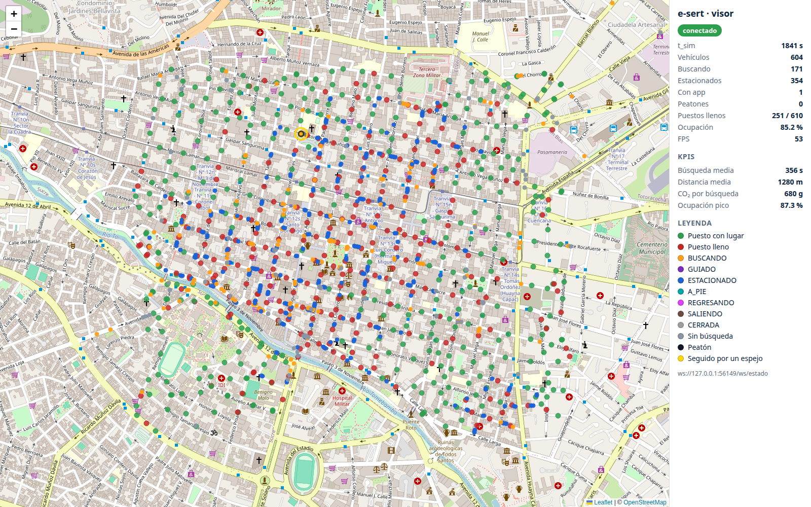

# S2 · Sesión 2 · Tyrone: Visor web Leaflet y servidor WS de prueba

## 1. Resumen en 5 líneas

- Se construyó el visor web del proyecto: un mapa del Centro Histórico con los autos, los peatones y los 610 puestos SERT, que se actualiza en vivo con el WebSocket `/ws/estado` del contrato.
- Los puestos se ven en verde si tienen lugar y en rojo si están llenos. Los autos se colorean por estado, los que tienen app llevan borde grueso y el que sigue un teléfono espejo, un halo amarillo.
- Un servidor de prueba reproduce 15 minutos de hora pico grabados de SUMO, así que el visor no depende del backend de Freddy para avanzar.
- Se probó también contra el backend real de Freddy, servido en `/visor/` como en el despliegue, y no hubo diferencias de formato.
- Con más de 1200 marcadores, el visor mantiene 54 FPS de media, y se reconecta solo si el servidor se cae.

## 2. Conceptos clave

- **WebSocket.** Es una conexión que queda abierta entre el navegador y el servidor, por la que el servidor empuja mensajes sin que el navegador los pida. El contrato define tres mensajes: `snapshot` (estado del mundo, 1 por segundo), `kpi` (indicadores) y `verdad` (ocupación real, solo para depuración).
- **Snapshot.** Es la foto del mundo en un segundo de simulación: cada auto con lat/lon, `estado` y `con_app`; cada peatón; la ocupación de cada puesto; y la lista de vehículos seguidos por un espejo.
- **Leaflet con canvas.** Leaflet es la biblioteca de mapas. Por defecto dibuja cada marcador como un elemento SVG, lo que es lento con más de 1000. Con `preferCanvas` todos se pintan en un solo lienzo, que se redibuja una vez por cuadro.
- **Actualizar por id.** Cada marcador se guarda en un diccionario por su `id`. En cada snapshot solo se mueve (`setLatLng`), se cambia de color si su estado cambió, o se borra si ya no aparece. Recrearlos todos cada segundo sería mucho más caro.
- **Reconexión con espera exponencial.** Si se corta la conexión, el visor reintenta a los 1, 2, 4, 8… segundos, con un máximo de 30. Así no satura un servidor que está arrancando, y vuelve solo sin recargar la página.
- **Mismo origen.** El visor se servirá desde el backend en `https://demo.e-sert.tesisucuenca.com/visor/`, así que por defecto se conecta al WS del mismo servidor (`wss://` si la página es `https`). Todas sus rutas son relativas, para que funcione bajo `/visor/`.

## 3. Cómo se generó cada cosa

La grabación usa TraCI, así que corre dentro del contenedor:

```bash
docker exec -w /home/vanet/results/e-sert/semanas/S2/Tyrone/codigo/visor van3twin \
    bash -lc "python3 grabar_snapshots.py --desde 1800 --duracion 900"   # ~8 min
```

Lo demás corre en la computadora, desde `semanas/S2/Tyrone/codigo/`, con `visor/.venv`:

```bash
python -m visor.servidor_prueba --puerto 8001 --velocidad 5    # abrir http://localhost:8001/visor/
python -m visor.captura --salida ../evidencias/s2_visor-leaflet.png --reconexion
python -m pytest visor/tests -q
```

| Resultado | Entrada | Salida |
|---|---|---|
| Grabación | centro_base.sumocfg, t = 1800–2700 s | visor/datos/snapshots.jsonl (900 snapshots, ~90 MB, ignorado por git) |
| Muestra | los primeros 60 snapshots | visor/datos/snapshots_muestra.jsonl (en git) |
| Servidor de prueba | snapshots, puestos.csv, kpis_base.json | GET /api/v1/puestos, WS /ws/estado, estáticos en /visor/ |
| Captura y FPS | servidor de prueba + Playwright | evidencias/s2_visor-leaflet.png |

## 4. Mapa de archivos

| Archivo | Qué contiene | Quién lo usa |
|---|---|---|
| visor/index.html | Página con el mapa y el panel | Navegador; backend de Freddy en /visor |
| visor/visor.js | Conexión WS, marcadores, panel, reconexión y FPS | index.html |
| visor/estilos.css | Estilos (claro/oscuro, y apilado en pantallas angostas) | index.html |
| visor/grabar_snapshots.py | Graba snapshots del contrato con TraCI | Servidor de prueba, tests |
| visor/servidor_prueba.py | FastAPI que reproduce los snapshots y manda KPIs | Desarrollo del visor; Miguel |
| visor/captura.py | Playwright: captura, FPS y prueba de reconexión | Evidencias, verificación |
| visor/tests/ | 9 tests: contrato, WS, puestos y rutas | Verificación |

## 5. Recorrido del código

- `grabar_snapshots.py`:
  - simula sin grabar hasta t = 1800 s y luego suscribe la posición y el estado de parada de cada vehículo;
  - lat/lon se calculan con pyproj y el netOffset de la red, comprobado contra `convertGeo` con 20 vehículos al iniciar;
  - el `estado` es un MOCK: `ESTACIONADO` si está parqueado, `BUSCANDO` si no, `null` para quien no busca;
  - el espejo es un MOCK: un buscador al azar con `con_app = true`.
- `servidor_prueba.py`: `crear_app()` arma la API de puestos, el WS que reproduce en bucle (un `kpi` cada 30 snapshots) y los estáticos.
- `visor.js`:
  - `actualizarMarcadores()` sincroniza un diccionario de marcadores con la lista del snapshot;
  - `onSnapshot`, `onKpi` y `onVerdad` procesan cada tipo de mensaje;
  - `conectar()` y `reintentar()` hacen la reconexión.

Parte central de la actualización por id:

```javascript
for (const item of lista) {
  vistos.add(item.id);
  let m = mapaIds.get(item.id);
  if (!m) {                                   // nuevo: se crea una vez
    m = L.circleMarker([item.lat, item.lon], opciones).addTo(capa);
    mapaIds.set(item.id, m);
  } else {
    m.setLatLng([item.lat, item.lon]);        // existente: solo se mueve
    if (m._clave !== clave) m.setStyle(opciones);
  }
}
for (const [id, m] of mapaIds)                // los que ya no están se borran
  if (!vistos.has(id)) { capa.removeLayer(m); mapaIds.delete(id); }
```

## 6. Cómo se conecta con los demás

- **Consume:**
  - el contrato §6 (`snapshot`, `kpi`, `verdad`) y §4.3 (`GET /puestos`);
  - `kpis_base.json` de S2-1 para los KPIs del servidor de prueba;
  - el backend de Freddy (S2-1), que sirve el visor en `/visor` y emite `/ws/estado`.
- **Entrega:**
  - a Freddy, un visor que espera `espejos` y `con_app` en cada snapshot;
  - a Miguel, una URL para ver resaltado el auto que sigue su modo espejo: `/visor/` del backend, o el servidor de prueba en el puerto 8001;
  - para el despliegue, una carpeta estática que funciona tal cual bajo `/visor/`.

## 7. Resultados y evidencias

| Medida | Valor |
|---|---|
| Snapshots grabados | 900 (t = 1801–2700 s), 600–700 vehículos en circulación |
| Marcadores en pantalla | ~600 vehículos + 610 puestos |
| FPS (Chromium, 1600×1000) | 54 de media, 49 de mínimo (velocidad 1); 49 de media a velocidad 5 |
| Cambios de color de puestos | 169 en 15 min (111 de verde a rojo) |
| Reconexión | servidor detenido -> "desconectado"; relanzado -> "conectado", sin recargar |
| Detrás de `http.server` | carga en /visor/ con rutas relativas e intenta `ws://<mismo host>/ws/estado` |
| Backend real de Freddy | 40 `snapshot` + 40 `verdad` recibidos por el mismo origen, sin errores |
| Tests | 9 pasados |



## 8. Limitaciones y decisiones

- **Estado y espejo simulados.** Son MOCK hasta que el controlador de Freddy publique sus estados y los espejos reales.
- **Autos de fondo estacionados.** No se envían (~4900 marcadores quietos), porque ya se ven en el color de los puestos. Se envían mientras circulan.
- **Sin peatones.** El escenario base no tiene peatones. El visor los dibuja cuando el backend los mande.
- **pyproj en lugar de `convertGeo`.** Es la misma conversión (se comprueba al iniciar), pero no hace miles de llamadas TraCI por segundo.
- **FPS medidos en Chromium headless.** Se usó `requestAnimationFrame` en Chromium sin pantalla, no la herramienta de DevTools. Es la misma medida de cuadros por segundo, en una máquina sin GPU dedicada para el navegador.
- **Ocupación estimada.** Con el backend real, el mapa muestra la ocupación estimada por sesiones, como dice el contrato. Sin sesiones abiertas todo sale verde. La ocupación real solo se ve con `?verdad=1`.

## 9. Preguntas que podría hacer el profesor

1. **¿Por qué canvas y no SVG?** Con SVG cada marcador es un elemento del DOM, y mover 1200 cada segundo baja los FPS. Con canvas se dibujan todos en un lienzo.
2. **¿Por qué un servidor de prueba?** Para no depender del backend de Freddy, que se construía la misma semana. Reproduce datos reales de SUMO con el mismo formato del contrato.
3. **¿Qué pasa si el servidor se reinicia?** El visor detecta el cierre, reintenta con espera exponencial y vuelve a recibir datos sin recargar la página.
4. **¿Por qué el mapa del backend sale todo verde?** Porque el backend muestra la ocupación que estima a partir de las sesiones de la app, no la real. La diferencia entre ambas es justamente el KPI de precisión del mapa.
5. **¿Cómo se sabe que los datos cumplen el contrato?** Cada uno de los 900 snapshots se valida contra `MensajeSnapshot` de `comun/esquemas.py` en los tests.
