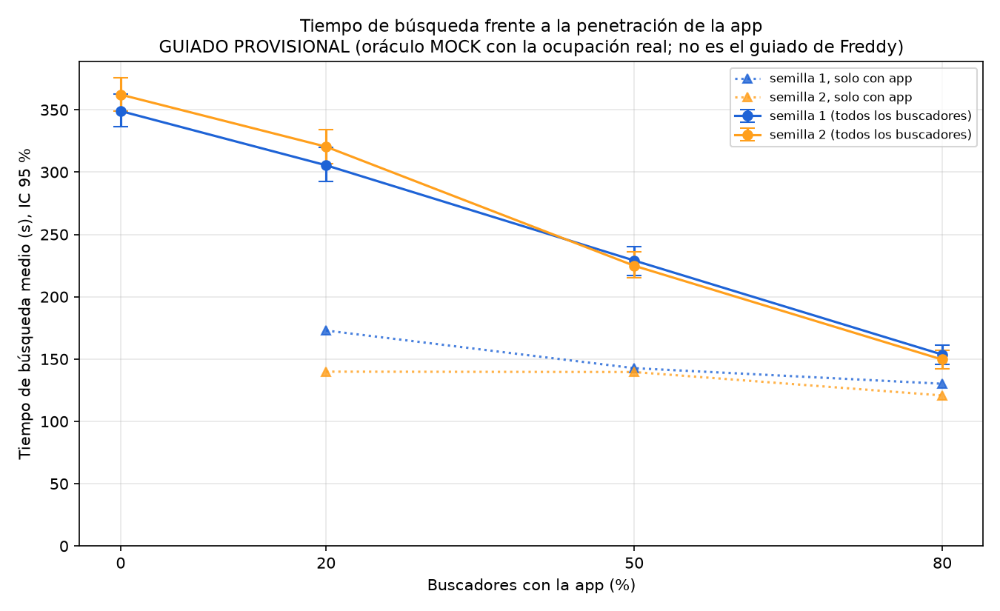
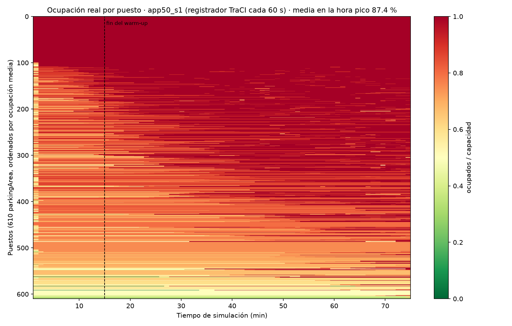

# S2 · Sesión 3 · Tyrone: Escenarios con penetración de app y registro de la ocupación real

## 1. Resumen en 5 líneas

- Se generaron 8 escenarios comparables: búsqueda a ciegas (base) y 20, 50 y 80 % de buscadores con app, con 2 semillas. Dentro de una semilla, la demanda es idéntica y solo cambia quién tiene la app.
- Un registrador TraCI guarda la ocupación real de los 610 puestos cada 60 s. Es la "verdad" contra la que Freddy medirá la precisión del mapa en S3-1, y coincide exactamente con el stop-output de SUMO.
- Para probar el flujo de punta a punta se usó un guiado provisional (oráculo, MOCK), que lleva a cada auto con app al puesto libre más cercano a su destino.
- Con el oráculo, la búsqueda media baja de ~355 s (base) a ~152 s con 80 % de app. La distancia y el CO2 de búsqueda caen ~58 %, sin teletransportes.
- Son cifras provisionales y optimistas: el oráculo conoce la ocupación real al instante. En S3-1 se reemplaza por el guiado de Freddy, que usa el mapa estimado.

## 2. Conceptos clave

- **Penetración de la app.** Es el porcentaje de conductores que buscan parqueo y usan la app. Se prueban 0, 20, 50 y 80 % para ver cómo crece el beneficio, y si los que no tienen app también ganan (menos competencia por los puestos cercanos).
- **Escenarios anidados.** Cada buscador sortea un número u al azar entre 0 y 1 con un generador aparte (`default_rng([semilla, 7])`), y tiene app si u < porcentaje. Así, quien tiene app con 20 % también la tiene con 50 % y con 80 %. Como el sorteo no toca el generador de la demanda, los mismos autos salen a la misma hora en los 4 escenarios: la única diferencia es la app.
- **SHA-256 de la demanda.** Es una huella digital de cada archivo `.rou.xml`. Permite comprobar después que un resultado se calculó con exactamente esa demanda.
- **Hook del Controlador.** El controlador TraCI de Freddy llama, después de cada paso, a las funciones registradas con `agregar_hook`. El registrador de ocupación y el oráculo son hooks, así que se enchufan sin tocar el controlador.
- **Ocupación real frente a stop-output.** SUMO registra cada parada con su inicio (`started`) y su fin (`ended`). Reconstruir la ocupación con esos intervalos debe dar lo mismo que preguntarle a SUMO por TraCI. La lectura de TraCI ocurre al final del paso t, así que la convención que coincide es (started, ended]; con ella la diferencia es 0 en las 8 corridas.
- **Oráculo (MOCK).** Es un guiado ideal: conoce la ocupación real en todo momento. Elige el puesto libre más cercano al destino, contando también los autos que ya van guiados hacia él, y llama a `traci.vehicle.rerouteParkingArea`. Cada 30 s reasigna a quien vio llenarse su puesto.

## 3. Cómo se generó cada cosa

Dentro del contenedor, desde `semanas/S2/Tyrone/codigo/sumo/escenarios/`:

```bash
python3 generar_escenarios.py        # 8 x (.rou.xml + .sumocfg) + escenarios.json, ~4 s
python3 correr_escenarios.py         # 8 corridas, máx. 3 en paralelo, 4-16 min cada una
```

En la computadora, desde `semanas/S2/Tyrone/codigo/` (`kpis/.venv`):

```bash
python -m kpis.resumen_escenarios --calcular --guiado-provisional
```

| Resultado | Entrada | Salida |
|---|---|---|
| Escenarios | generar_demanda.generar con --porc-app 0/20/50/80, semillas 1 y 2 | sumo/escenarios/*.sumocfg, *.rou.xml, escenarios.json |
| Corridas | sumocfg + Controlador + hooks | sumo/salidas/ESCENARIO_sN/ (XML de SUMO, correr.log) |
| Ocupación real | hook RegistradorOcupacion | kpis/salidas/ocupacion_real_ESCENARIO_sN.csv |
| KPIs por corrida | kpis.kpis con --demanda | kpis/salidas/ESCENARIO_N_vehiculos.csv y kpis_ESCENARIO.json |
| Tabla | KPIs de las 8 corridas | kpis/salidas/resumen_escenarios.csv |
| Figuras | tabla y ocupación de app50_s1 | evidencias/s3_penetracion-escenarios.png, s3_ocupacion-real.png |

## 4. Mapa de archivos

| Archivo | Qué contiene | Quién lo usa |
|---|---|---|
| sumo/demanda/generar_demanda.py | --porc-app con sorteo separado; params destino (lat,lon) y destino_nombre | Escenarios; Freddy (espejo, S3-3) |
| sumo/escenarios/generar_escenarios.py | Genera y comprueba los 8 escenarios | Tyrone; ejecutor de S3-1 |
| sumo/escenarios/escenarios.json | Lista con semilla, %, conteos y SHA-256 | Ejecutor de S3-1, informe |
| sumo/escenarios/guiado_oraculo.py | Guiado provisional (MOCK) | Corridas de S2-3; Freddy lo reemplaza en S3-1 |
| sumo/escenarios/correr_escenarios.py | Corre los escenarios con el Controlador de Freddy | Tyrone |
| kpis/registrar_ocupacion.py | Hook de ocupación real y su comprobación | Freddy (precisión del mapa, S3-1) |
| kpis/resumen_escenarios.py | KPIs de los 8 escenarios, tabla y figuras | Informe |
| kpis/salidas/resumen_escenarios.csv | Tabla escenario x semilla | Informe, visor |

## 5. Recorrido del código

- `generar_demanda.generar`: además del generador de la demanda (`random.Random(semilla)`) usa `rng_app = default_rng([semilla, 7])`, que solo se consulta para los buscadores.
- `generar_escenarios.vehiculos_y_app`: extrae `id -> depart` y los ids con app de cada `.rou.xml` para comprobar la igualdad y el anidamiento.
- `RegistradorOcupacion.__call__(ctrl, t)`: cada 60 s escribe una fila por puesto. `comprobar()` la compara con el stop-output.
- `GuiadoOraculo.__call__(ctrl, t)`: asigna al insertarse y reasigna cada 30 s, con las protecciones contra los fallos de SUMO 1.12.

Parte central del sorteo anidado:

```python
rng = random.Random(args.semilla)                    # demanda: igual en los 4 escenarios
rng_app = np.random.default_rng([args.semilla, 7])   # solo decide quién tiene app
...
else:                                                # vehículo que busca
    d = rng.choices(destinos, weights=pesos)[0]
    con_app = int(rng_app.random() < porc_app / 100.0)   # u_i < p: anidado
```

## 6. Cómo se conecta con los demás

- **Consume:** el `Controlador` de Freddy (`proyecto/traci/controlador.py`) para correr y enchufar hooks; los KPIs de S2-1; la red, los puestos y los destinos de S1.
- **Entrega a Freddy:**
  - `kpis/salidas/ocupacion_real_<escenario>_s<N>.csv` (columnas `t_sim,puesto_id,ocupados,capacidad`, cada 60 s), base del KPI de precisión del mapa;
  - el hook `RegistradorOcupacion` para su ejecutor;
  - los escenarios con `con_app`, `destino` y `destino_nombre` para el espejo.

  Su `traci/guiado.py` debe reemplazar a `guiado_oraculo.py` en S3-1.

## 7. Resultados y evidencias

| Escenario | Búsqueda media s1 / s2 | Solo con app | Sin app | Distancia media | CO2 medio | Ocupación pico |
|---|---|---|---|---|---|---|
| base | 349 / 362 s | | 349 / 362 s | 1248 / 1310 m | 666 / 693 g | 87,0 / 87,7 % |
| app20 | 306 / 320 s | 173 / 140 s | 339 / 363 s | 1092 / 1163 m | 586 / 624 g | 87,1 / 87,9 % |
| app50 | 229 / 225 s | 143 / 140 s | 314 / 310 s | 811 / 804 m | 438 / 424 g | 87,4 / 88,2 % |
| app80 | 154 / 150 s | 130 / 121 s | 247 / 263 s | 531 / 525 m | 294 / 289 g | 87,6 / 88,5 % |

- **Comprobaciones:**
  - las 8 corridas llegan a t = 4500 s con 0 teletransportes;
  - la ocupación real coincide con el stop-output en los 75 instantes de cada corrida (diferencia 0);
  - la demanda es idéntica dentro de cada semilla, y los usuarios con app están anidados (253 dentro de 624 dentro de 1018, y 251 dentro de 673 dentro de 1083).
- **Efecto en quienes no tienen app:** también buscan menos (de 349 a 247 s con 80 % de app), porque los guiados dejan de competir por los puestos cercanos al destino.





## 8. Limitaciones y decisiones

- **Guiado provisional y optimista.** El oráculo conoce la ocupación real al instante. Las cifras son una cota superior del beneficio y deben repetirse con el guiado de Freddy en S3-1.
- **Búsqueda cero fuera de la zona.** Si un auto guiado estaciona sin entrar a los 300 m del destino, su búsqueda cuenta como 0 s y 0 m. La caminata extra queda fuera de estos KPIs.
- **Fallos de SUMO 1.12.** El SUMO del contenedor aborta con asserts si `rerouteParkingArea` reasigna:
  - en un cruce;
  - hacia un puesto del edge actual;
  - sin ruta hasta el nuevo puesto.

  El oráculo evita esos casos. Las 6 corridas con app se repitieron con esa versión final, así que las 8 son comparables.
- **Corrección de S2-1.** El lector tomaba como hora válida el `exitTime = -1` que SUMO escribe en los edges no recorridos. Las medias de la base no cambian, pero los censurados correctos son 114 y 159, no 201 y 248.
- **Archivos sin versionar.** Las demandas `.rou.xml` (2,2 MB cada una) y 7 de los 8 CSV de ocupación real no se versionan: se regeneran de forma determinista. En git van los `.sumocfg`, `escenarios.json` con los SHA-256 y el CSV de `app50_s1`.

## 9. Preguntas que podría hacer el profesor

1. **¿Cómo garantizan que la comparación es justa?** Dentro de una semilla, los 4 escenarios tienen los mismos vehículos con las mismas horas de salida; solo cambia `con_app`. Además, los usuarios con app de 20 % están incluidos en los de 50 % y 80 %.
2. **¿Por qué mejoran también los que no tienen app?** Porque los guiados se reparten en puestos libres y dejan de competir por los más cercanos al destino, que quedan para los demás.
3. **¿Estos números son los finales?** No. Usan un guiado ideal que conoce la ocupación real. En S3-1 se repiten con el guiado de Freddy, que usa el mapa estimado y será más realista.
4. **¿Para qué sirve registrar la ocupación real si SUMO ya la tiene?** Para medir la precisión del mapa de la app: el backend estima la ocupación con las sesiones, y se compara con esta verdad puesto por puesto y minuto a minuto.
5. **¿Cómo validaron el registrador?** Reconstruyendo la ocupación con los intervalos del stop-output de SUMO: coincide exactamente en los 75 instantes de las 8 corridas.
