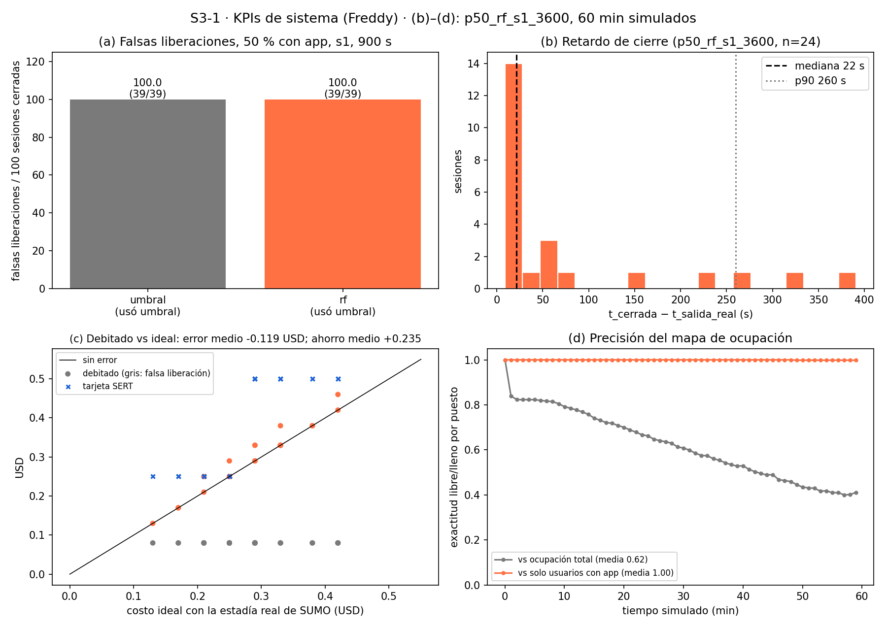
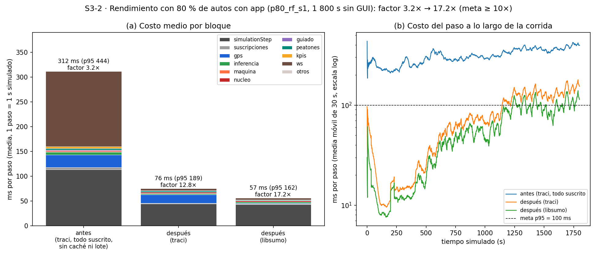
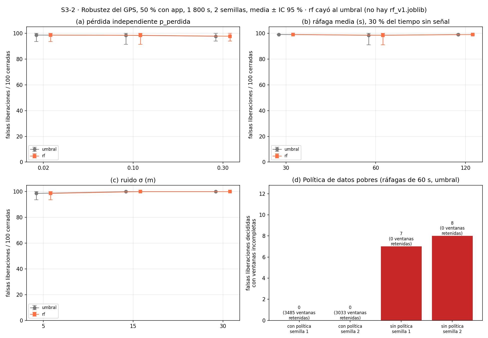
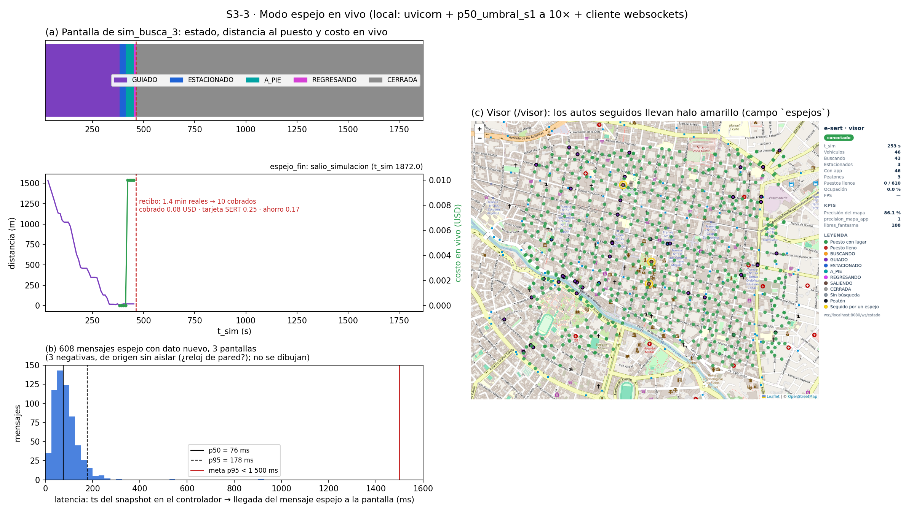

# S3 · Freddy 🍅: resumen semanal

## Sesión 1 · 2026-11-05 · KPIs de sistema: falsas liberaciones, retardo de cierre, facturación y mapa

Los cuatro KPIs que dependen del controlador se miden dentro de la simulación:
- `traci/verdad.py` obtiene la verdad de SUMO a partir del bit de parking de la suscripción;
- `traci/kpis_sistema.py` entrega `KPIsSistema.resumen()`, `detalle_sesiones()` y `serie_mapa()`, la interfaz acordada con Tyrone;
- `traci/correr_kpis.py` corre `p{pen}_{clf}_s{sem}` sobre los escenarios unificados de Tyrone, lo que reemplaza el mock del 50 % de S2;
- se publica `kpi` por la ruta nueva `POST /api/v1/sim/kpi`, y `verdad` ya lleva datos reales.

Cifras con 50 % de autos con app y semilla 1:

| Medida | Resultado |
|---|---|
| Precisión del mapa solo con app (900 s) | 1,00 |
| Precisión del mapa total (900 s) | 0,82 |
| Falsas liberaciones por 100 sesiones | 100 en 900 s; 91 en 3600 s |
| Retardo de cierre, mediana (3600 s) | 21,5 s |
| Error de facturación medio (3600 s) | −0,12 USD |
| Sobrecosto de los KPIs por paso | 1,7–3,6 % |

La corrida `rf` usó en realidad el umbral, porque falta `rf_v1.joblib`.

Explicación: [explicaciones/s1_explicacion.pdf](explicaciones/s1_explicacion.pdf)

## Sesión 2 · 2026-11-05 · Rendimiento y robustez (pérdida de GPS, teléfono apagado y 80 % de penetración)

**Rendimiento con 80 % de autos con app, 1 800 s sin GUI:**
- el controlador pasó de **3,2× a 17,2× el tiempo real** gracias a cuatro cambios: suscribir solo los autos que buscan, caché de parámetros, ocupación contada por eventos (SUMO 1.12 no admite suscribirse a parkingArea) y `libsumo`;
- el p95 por paso queda en 162 ms (meta < 100), porque el propio paso de SUMO tiene un p95 de 142 ms; el controlador tiene un p95 de 30 ms;
- las optimizaciones no cambian los KPIs (lo comprueba un test entre `traci` y `libsumo`).

**Robustez:**
- rejilla de 40 corridas que combina pérdida, ráfagas Gilbert-Elliott y ruido, con umbral y rf y 2 semillas;
- sin `rf_v1.joblib`, las falsas liberaciones quedan en 97–100 por 100 en todas las condiciones: el umbral confunde al peatón con un auto;
- la política de datos pobres elimina las falsas decididas con ventanas incompletas: 0 con la política, frente a 7 y 8 sin ella;
- el teléfono apagado nunca cierra la sesión: se marca `sin_senal` y se cierra con el motivo nuevo `timeout_sin_senal`, propuesto en el contrato v1.2.

**Backend:** con 200 usuarios a 1 Hz, p95 de 22 a 35 ms y 0 errores 5xx.

Explicación: [explicaciones/s2_explicacion.pdf](explicaciones/s2_explicacion.pdf)

## Sesión 3 · 2026-11-06 · Modo espejo en el backend y demo en el VPS

**Estado: parcial (5/6).** El modo espejo (contrato §7) funciona de punta a punta en local. La prueba en el VPS queda pendiente porque la demo corre `main` y el token lo tiene Tyrone.

- **Controlador:** cada snapshot lleva un bloque interno `espejo` (`traci/espejo_publicador.py`) con los candidatos y el detalle de los autos que algún teléfono sigue: estado, posición del teléfono, modo, destino, puesto con la distancia por la red, ruta simplificada a ≤ 200 puntos (`traci/ruta_geo.py`), sesión con el costo en vivo, billetera, avisos y el recibo al cerrar.
- **Backend:**
  - `RegistroEspejo` guarda el bloque sin difundirlo y cuenta las pantallas por auto;
  - `GET /api/v1/espejo/candidatos`;
  - `WS /ws/espejo/{veh_id}`: ≤ 1 Hz con el dato más nuevo, latido cada 2 s, recibo una vez por sesión, `espejo_fin` y cierre 4404/1000;
  - `espejos` en cada snapshot del visor y en la respuesta al controlador.
- **Prueba local (`p50_umbral_s1` a 10×, 3 pantallas):**
  - latencia **p50 = 76 ms y p95 = 178 ms** (meta < 1,5 s), un mensaje por segundo y 0 desconexiones;
  - `sim_busca_3` recorrió GUIADO → ESTACIONADO → A_PIE → REGRESANDO → CERRADA (recibo de 0,08 USD frente a 0,25 USD de la tarjeta SERT) → `espejo_fin`;
  - el cierre a los 1,4 min es una falsa liberación del umbral: sigue faltando `rf_v1`.
- **Hallazgos corregidos:**
  - con los escenarios de Tyrone **ningún auto se guiaba** (`param destino` trae coordenadas; el nombre va en `destino_nombre`), lo que afecta las cifras de S3-1 y S3-2;
  - una posición −2^30 de SUMO volvía inválido el JSON del snapshot y congelaba el visor (fallo desde S2-3).

