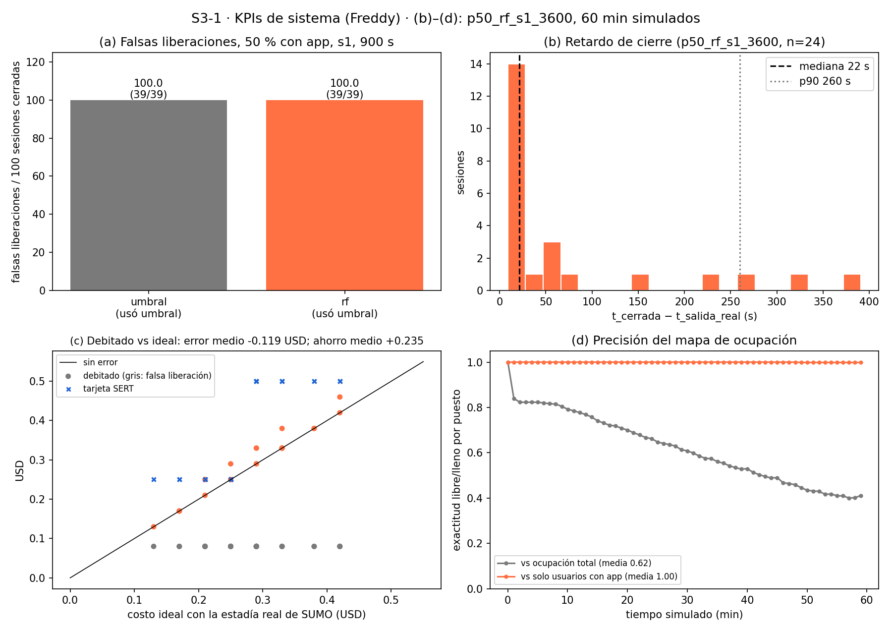

# S3 · Sesión 1 · Freddy: KPIs de sistema (falsas liberaciones, retardo de cierre, facturación y mapa)

## 1. Resumen en 5 líneas
- Se miden dentro de la simulación los cuatro KPIs que dependen del controlador: falsas liberaciones, retardo de cierre, error de facturación y precisión del mapa de ocupación.
- `traci/verdad.py` guarda la "verdad de SUMO": qué autos con app están estacionados de verdad, cuándo llegan y salen, y cuánto ocupa cada puesto.
- `traci/kpis_sistema.py` compara esa verdad con lo que cree el sistema (sesiones del núcleo y `MapaOcupacion`) y entrega `resumen()`, `detalle_sesiones()` y `serie_mapa()` para el ejecutor de experimentos de Tyrone.
- Los KPIs se publican en vivo por WebSocket (`kpi` cada 10 s simulados, mediante la ruta nueva `POST /api/v1/sim/kpi`) y el mensaje `verdad` ya lleva datos reales.
- Resultado: el mapa acierta el 100 % de los puestos si se compara solo con usuarios de la app, pero el clasificador de umbral cierra en falso el 91–100 % de las sesiones.

## 2. Conceptos clave
- **Falsa liberación:** la app cierra la sesión (cree que el auto se fue) mientras el auto sigue estacionado en SUMO. Es el error más caro: el puesto aparece libre y se cobra de menos.
- **Bit de parking de `VAR_STOPSTATE`:** SUMO resume el estado de parada de un vehículo en un entero de bits; el bit 2 indica que está estacionado en un parkingArea. Leerlo desde la suscripción que ya tiene el controlador evita una llamada TraCI por vehículo y paso (`isStoppedParking`). Un test comprueba que ambos coinciden.
- **Retardo de cierre:** cuánto tarda la app en cerrar la sesión después de que el auto sale de verdad. Solo se calcula en cierres correctos.
- **Error de facturación:** lo debitado menos lo que habría costado la estadía real según la tarifa (`tarifa.costo`). Si es negativo, se cobró de menos.
- **Ahorro frente a la tarjeta SERT:** lo que habría costado con tarjetas de papel de 30 min menos lo debitado.
- **Precisión del mapa:** por puesto, si el mapa y la realidad coinciden en "libre" (ocupados < capacidad) o "lleno". Se calcula contra la ocupación total y contra la de usuarios con app. El mapa solo conoce a la app, así que la primera es baja por diseño.
- **Libre fantasma:** puesto que el mapa muestra libre y en realidad está lleno; es el que manda a un conductor a un puesto ocupado.
- **Sobrecosto:** tiempo de pared dentro de los hooks de KPIs dividido entre el resto del tiempo de la corrida, medido en la misma corrida para no depender del ruido entre corridas.

## 3. Cómo se generó cada cosa
Todo lo de SUMO corre dentro del contenedor `van3twin`, desde `semanas/S3/Freddy/codigo`.

| Resultado | Comando | Entradas | Salidas |
|---|---|---|---|
| Escenario `app50_s1` | lo hace `correr_kpis` la primera vez (`preparar_escenario`) | `proyecto/sumo` (con `generar_escenarios.py --porc-app` de Tyrone) | `traci/escenario/tyrone/sumo/escenarios/app50_s1.*` (ignorado por git) |
| JSON de ejemplo | `python3 -m traci.correr_kpis --id p50_rf_s1 --hasta 900` | escenario, `proyecto/ia/inferencia.py` | `traci/salidas_kpi/ejemplo_p50_rf_s1.json`, `traci/salidas/kpis_*_p50_rf_s1.csv` |
| Comparación con umbral | `python3 -m traci.correr_kpis --id p50_umbral_s1 --hasta 900` | igual | `traci/salidas_kpi/ejemplo_p50_umbral_s1.json` |
| Corrida de 1 hora | `python3 -m traci.correr_kpis --id p50_rf_s1 --hasta 3600 --sufijo _3600` | igual | `traci/salidas_kpi/ejemplo_p50_rf_s1_3600.json` y sus CSV |
| Figura | `python3 -m traci.graficas_kpis` | los tres JSON y los CSV de `_3600` | `evidencias/s1_kpis-sistema.png` |
| Tests | `python3 -m pytest -q traci/tests/test_kpis_sistema.py` | — | 8 unitarios + 2 con SUMO |
| OpenAPI | `python -m backend.api.exportar_openapi` (en la computadora) | `backend/api` | `backend/openapi.json` con `/sim/kpi` |

## 4. Mapa de archivos

| Archivo | Qué contiene | Quién lo usa |
|---|---|---|
| traci/verdad.py | `VerdadSUMO`: estado físico de los autos con app y ocupación real por puesto | kpis_sistema, correr_guiado |
| traci/kpis_sistema.py | `KPIsSistema` y `comparar_mapa`; claves acordadas en `CLAVES_RESUMEN` | Tyrone (`kpis/correr_una.py`), correr_kpis |
| traci/correr_kpis.py | CLI de una corrida `p{pen}_{clf}_s{sem}` con guiado, sesiones y KPIs; mide el sobrecosto | Freddy, Tyrone |
| traci/graficas_kpis.py | Figura 2×2 de la evidencia | Freddy |
| traci/puente_nucleo.py | Se añadió el gancho `al_cerrar` y la ruta configurable del `Publicador` | KPIsSistema |
| traci/correr_guiado.py | `PublicadorSnapshots` llena `verdad` si recibe `kpis` | demo en vivo |
| backend/api/rutas/simulacion.py | Ruta nueva `POST /api/v1/sim/kpi` (🔒) | controlador → visor |
| comun/CONTRATO.propuesto.md | Propuesta aditiva para la v1.2 del contrato | unificación |
| traci/tests/test_kpis_sistema.py | `traci` falso, 8 casos unitarios y 2 con SUMO | pytest |

## 5. Recorrido del código

**verdad.py**
- `VerdadSUMO.on_paso`: guarda una vez por vehículo si tiene `con_app = 1` y, con el bit de parking de la suscripción, anota el primer paso estacionado y el primer paso fuera.
- `ocupacion(ctrl, puestos)`: `getVehicleCount` y `getVehicleIDs` filtrados por app, solo cuando se pide.

```python
for veh, datos in ctrl.vehiculos.items():
    if not self.con_app.get(veh):
        continue
    ahora = estacionado(datos.get(var, 0))
    if ahora and veh not in self.t_llegada_real:
        self.t_llegada_real[veh] = t
    elif not ahora and self.parqueado.get(veh) and veh not in self.t_salida_real:
        self.t_salida_real[veh] = t
    self.parqueado[veh] = ahora
```

**kpis_sistema.py**
- `_al_cerrar(fila)`: el núcleo avisa de cada cierre; si `isStoppedParking` sigue en True, es una falsa liberación.
- `medir_mapa`: cada 60 s compara el mapa con la verdad (total y solo app).
- `_filas` / `resumen`: cruza cada sesión con la estadía real y calcula retardo, error y ahorro. Lo que aún no ocurrió (por ejemplo, un auto que sigue estacionado) queda en `NaN` y no entra en las medias.

```python
def _al_cerrar(self, fila: dict) -> None:
    veh = fila["usuario_id"].removeprefix("sim_")
    sigue = veh in self.ctrl.vehiculos and bool(self.ctrl.traci.vehicle.isStoppedParking(veh))
    self.sesiones.append({**fila, "veh": veh, "falsa": sigue})
    if sigue:
        self.falsas_sin_publicar.append(fila["sesion_id"])
```

**correr_kpis.py**
- `preparar_escenario`: copia `proyecto/sumo` y genera la demanda con el `--porc-app` de Tyrone.
- `correr`: arma guiado, peatones, sesiones y KPIs; envuelve los hooks de KPIs con un cronómetro (`_cronometrar`) para medir su costo.

## 6. Cómo se conecta con los demás
- **Consume:** escenarios de Tyrone (`proyecto/sumo/escenarios`), `clasificar` de Pablo (`proyecto/ia/inferencia.py`), núcleo del backend (sesiones, billetera, mapa), tarifa del contrato §5.
- **Entrega a Tyrone:** `from traci.kpis_sistema import KPIsSistema`; `KPIsSistema(controlador, nucleo, intervalo_mapa_s=60)`, que se registra solo en el controlador y en `nucleo.al_cerrar`; al final, `resumen()` con las 12 claves de `CLAVES_RESUMEN`, `detalle_sesiones()` y `serie_mapa()` (DataFrames).
- **Entrega al visor:** mensajes `kpi` (cada 10 s) y `verdad` (ocupación real, estacionados y falsas liberaciones), según §6.

## 7. Resultados y evidencias

| Medida | p50 umbral, 900 s | p50 "rf", 900 s | p50 "rf", 3600 s |
|---|---|---|---|
| Clasificador realmente usado | umbral | umbral (no hay `rf_v1.joblib`) | umbral |
| Falsas liberaciones / 100 | 100,0 (39/39) | 100,0 (39/39) | 91,1 (246/270) |
| Sesiones sin cierre al final | 30 | 30 | 110 |
| Retardo de cierre mediana / p90 | — (ningún cierre correcto) | — | 21,5 s / 260 s |
| Error de facturación medio / máx. abs. | — | — | −0,119 / 0,34 USD |
| Ahorro medio frente a la tarjeta SERT | — | — | +0,235 USD |
| Precisión del mapa (total / solo app) | 0,82 / 1,00 | 0,82 / 1,00 | 0,62 / 0,9997 |
| Libres fantasma por muestra | 111 | 111 | 233 |
| Sobrecosto de los KPIs por paso | 3,6 % | 3,5 % | 1,7 % |



- La precisión del mapa solo con app es prácticamente 1: el mapa refleja bien lo que la app sabe. Contra la ocupación total cae de 0,82 a 0,41 en una hora, porque el 80 % de ocupación de fondo y la mitad de los buscadores no usan la app.
- En el panel (c), los puntos grises son las falsas liberaciones: pagan el mínimo de 10 min (0,08 USD) aunque estuvieron estacionados más tiempo. Por eso el error medio es negativo (se cobra de menos).
- La equivalencia entre el bit de parking y `isStoppedParking` se comprobó en 900 pasos con unos 5 000 vehículos en la red.

## 8. Limitaciones y decisiones
- **`rf_v1.joblib` no existe en el repo** (solo sus metadatos `rf_v1.json`). `p50_rf_s1` usa en la práctica el umbral, y el JSON lo dice en `clasificador_usado`. Hay que repetirla cuando Pablo publique el modelo.
- En 900 s ningún auto con app sale de verdad (las estadías son de 10 a 120 min), así que retardo y error de facturación salen `null` en el JSON de ejemplo. Es esperado: hay `null` (no `NaN`, que no es JSON válido) cuando no hay datos. La corrida de 3600 s da los valores reales.
- `n_sesiones` cuenta las sesiones **cerradas** (denominador de `falsas_lib_100`); las abiertas al final van en `sin_cierre`.
- Los cierres `manual` (el auto salió de la red sin detección) cuentan como cierres correctos con su retardo.
- La verdad se lee de la suscripción `VAR_STOPSTATE` que ya hace el `Controlador` para todos los vehículos, en lugar de una suscripción aparte.
- La ruta `POST /sim/kpi` no está en el contrato v1.1: va como propuesta en `comun/CONTRATO.propuesto.md`.

## 9. Preguntas que podría hacer el profesor
1. **¿Por qué la precisión del mapa contra la ocupación total es tan baja?** Porque el mapa solo cuenta sesiones de la app. Los autos sin app (50 % de los buscadores y todo el fondo) son invisibles. Contra los usuarios de la app es 0,9997, así que el mapa no tiene errores propios; lo que falta es información.
2. **¿Cómo saben que una liberación fue falsa?** En el mismo paso de SUMO en que se cierra la sesión se pregunta `isStoppedParking(veh)`. Si es verdadero, el auto sigue estacionado.
3. **¿Por qué no usar `isStoppedParking` en cada paso?** Serían miles de llamadas TraCI por paso. El bit de parking ya llega en la suscripción; el test demuestra que da lo mismo.
4. **¿Medir los KPIs cambia la simulación o la frena?** No la cambia: solo lee. La frena un 1,7–3,6 % por paso, por debajo del 15 % permitido.
5. **¿Qué significa un error de facturación de −0,12 USD?** Que en promedio se cobra 12 centavos menos que la estadía real. Lo causan las falsas liberaciones, que cobran el mínimo de 10 min.
