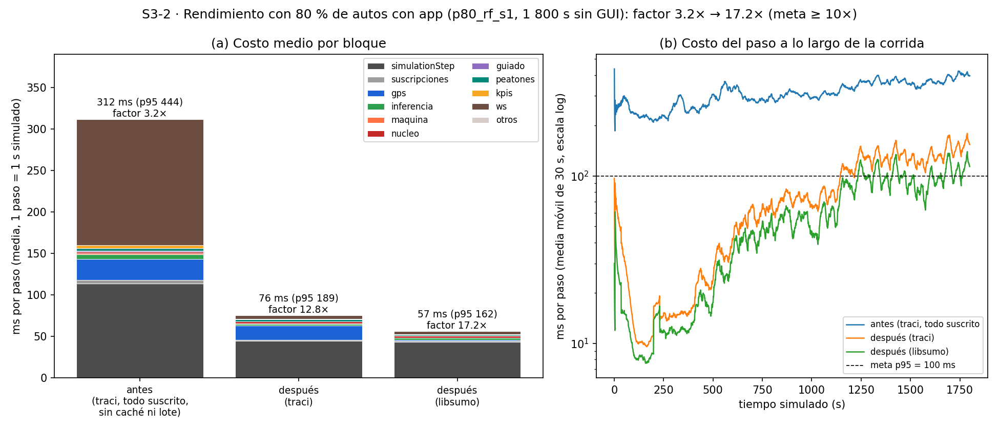
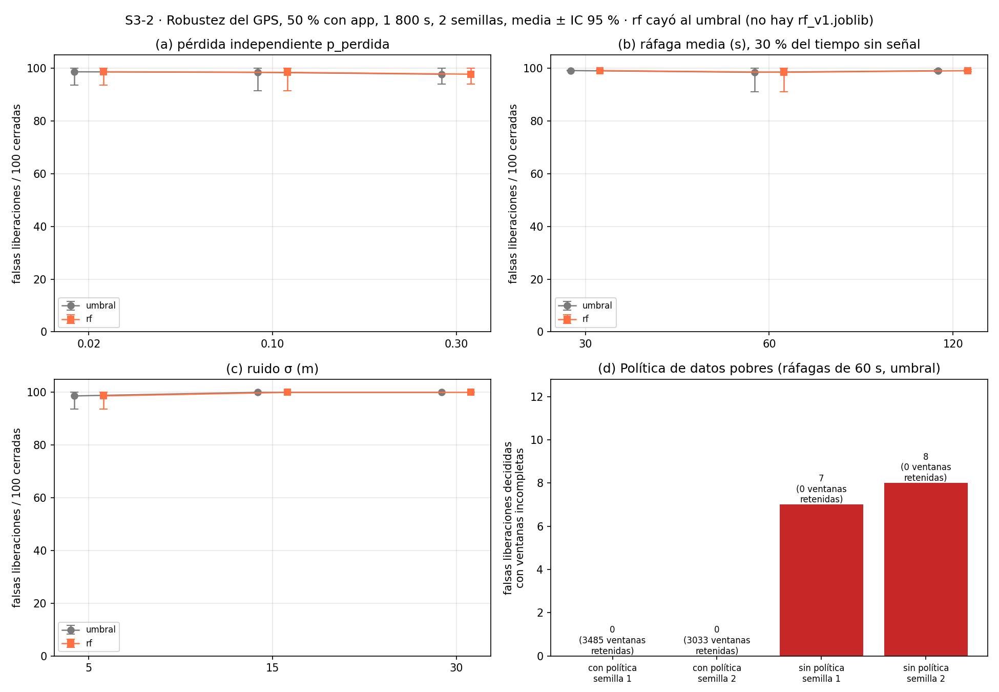

# S3 · Sesión 2 · Freddy: rendimiento y robustez (pérdida de GPS, teléfono apagado y 80 % de penetración)

## 1. Resumen en 5 líneas
- Se midió cuánto cuesta cada paso del controlador con 80 % de autos con app y se optimizó lo que el perfil señaló: de **3,2× a 17,2× el tiempo real** (meta ≥ 10×).
- El p95 por paso queda en 162 ms (meta < 100 ms) porque **el propio paso de SUMO** tiene un p95 de 142 ms en este escenario; la parte del controlador tiene un p95 de 30 ms.
- Se emuló un GPS peor (pérdida independiente, ráfagas tipo Gilbert-Elliott y ruido) y se corrió una rejilla de 40 corridas: sin el modelo `rf_v1` las falsas liberaciones quedan en 97–100 por 100 en todas las condiciones, porque el clasificador de umbral confunde al peatón con un auto.
- Una **política de datos pobres** impide decidir con ventanas incompletas: sin ella, con ráfagas de 60 s, hubo 7 y 8 falsas liberaciones decididas así; con ella, 0.
- El **teléfono apagado** nunca cierra la sesión: tras 120 s sin datos se marca `sin_senal` y se cierra al tope de 120 min con el motivo nuevo `timeout_sin_senal` (propuesto en el contrato). La prueba de carga del backend cumple p95 < 50 ms con 200 usuarios.

## 2. Conceptos clave
- **Factor de tiempo real:** segundos simulados por segundo real. Con 17× se simulan 30 min en menos de 2 min, y la rejilla de Tyrone (24 corridas) se vuelve viable.
- **p95 por paso:** el 95 % de los pasos dura menos que ese valor. Mide los "tirones", no solo la media.
- **Cronómetro exclusivo por bloque:** cada bloque cuenta solo su tiempo propio, sin el de lo que llama. Así la suma de bloques es el paso completo y no se cuenta nada dos veces.
- **libsumo:** SUMO cargado como biblioteca dentro de Python, sin el socket de TraCI. Cada llamada cuesta microsegundos en vez de un viaje por la red local. Funciona sin GUI y con un SUMO por proceso.
- **Suscripción y caché:** en vez de preguntarle a SUMO lo mismo varias veces, se pide una vez y se guarda (posición y estado por suscripción; `clase` y `con_app` en la caché del `Controlador`).
- **Gilbert-Elliott:** modelo de pérdida con dos estados, bueno y malo (sin señal), que alternan con tiempos exponenciales. Reproduce el "cañón urbano": la señal se pierde por rachas, no al azar.
- **Política de datos pobres:** si una ventana de 30 s trae menos del 50 % de las muestras esperadas, o la inferencia cayó al *fallback* con confianza < 0,5, la máquina de estados no se mueve.
- **`sin_senal` y `timeout_sin_senal`:** una marca, no un estado, para sesiones sin datos durante ≥ 120 s, y el motivo de cierre cuando llegan al tope de 120 min sin que la app vea la salida.
- **IC 95 % con 2 semillas:** t de Student con 1 grado de libertad (12,7 · σ/√2). Es muy ancho: con dos semillas solo se puede ver si hay diferencias grandes.

## 3. Cómo se generó cada cosa
Desde `semanas/S3/Freddy/codigo`. Lo de SUMO va dentro del contenedor `van3twin`.

| Resultado | Comando | Entradas | Salidas |
|---|---|---|---|
| Copia de la `ia` de Pablo (S3) | `python traci/obtener_escenario.py --ia` (computadora) | `origin/pablo/s3` | `traci/escenario/pablo/ia/` (ignorada) |
| Perfil antes / después | `python3 -m traci.perfil --id p80_rf_s1 --hasta 1800 --variante antes\|despues\|despues_libsumo` | escenario `app80_s1` de Tyrone | `traci/salidas_kpi/perfil_p80_rf_s1_<variante>.json` |
| Pruebas de opciones de SUMO | `... --variante libsumo_hilos4\|libsumo_astar` | igual | `perfil_p80_rf_s1_libsumo_*.json` |
| Rejilla de robustez | `python3 -m traci.robustez --procesos 6` (segundo plano, ~35 min) | `app50_s1`, `app50_s2` | `traci/salidas_kpi/robustez.csv` (40 corridas, 44 filas) |
| Carga del backend | `python -m pytest -m carga backend/tests` (computadora) | — | `traci/salidas_kpi/carga_backend.json` |
| Evidencias | `python3 -m traci.graficas_s2` | perfiles y `robustez.csv` | `evidencias/s2_rendimiento-80.png`, `evidencias/s2_robustez-perdida-gps.png` |
| Pruebas | `python3 -m pytest traci/tests/test_robustez.py` | — | 9 unitarias + 2 con SUMO |

## 4. Mapa de archivos

| Archivo | Qué contiene | Quién lo usa |
|---|---|---|
| traci/perfil.py | `Perfilador` (cronómetros exclusivos), variantes antes/después, p95 por bloque y del controlador | Freddy |
| traci/robustez.py | Rejilla en paralelo (`spawn`, un proceso por corrida) que se puede reanudar | Freddy, Tyrone |
| traci/correr_kpis.py | `correr()` con opciones de GPS, teléfono apagado, `libsumo`, lote, caché y `instrumentar` | perfil, robustez, Tyrone |
| traci/controlador.py | `libsumo`, `parametro()` con caché, descubrimiento de peatones con libsumo | todos los hooks |
| traci/verdad.py | Ocupación por eventos de parking (en lugar de 1 220 llamadas por segundo) | KPIs, publicador |
| traci/gps.py | Ráfagas Gilbert-Elliott (`rafaga_s`, `frac_rafaga`) | ControlSesiones |
| traci/clasificacion.py | Inferencia de Pablo S3 (`clasificar_lote`, `previo`), cobertura de la ventana | ControlSesiones |
| traci/estados.py | Política de datos pobres, teléfono apagado, `sin_senal`, cierre por tope | correr_kpis |
| comun/esquemas.py, .ts | `MotivoCierre.timeout_sin_senal` | backend, app |
| comun/CONTRATO.propuesto.md | Contrato v1.2 propuesto (completo), con `/sim/kpi` y `timeout_sin_senal` | unificación |
| backend/api/rutas/eventos.py | `/eventos/*` como `async def` | backend |
| backend/tests/test_carga.py | 200 usuarios a 1 Hz y 5 visores, 60 s (`-m carga`) | pytest |
| traci/tests/test_robustez.py | Política, ráfagas, teléfono apagado, `libsumo` = `traci`, conteo por eventos | pytest |

## 5. Recorrido del código

**perfil.py**: `Perfilador.envolver` mide cada bloque y le descuenta el tiempo de los bloques que llama; `instalar` pone los cronómetros sobre las funciones de la corrida sin tocar su código.

```python
def envuelta(*args, **kwargs):
    self._pila.append([bloque, time.perf_counter(), 0.0])
    try:
        return funcion(*args, **kwargs)
    finally:
        _, inicio, hijos = self._pila.pop()
        dur = time.perf_counter() - inicio
        self.total[bloque] += dur - hijos      # tiempo propio
        if self._pila:
            self._pila[-1][2] += dur           # se descuenta al bloque padre
```

**estados.py**: `MaquinaSesion.actualizar` retiene las ventanas pobres; `ControlSesiones` apaga el teléfono al pasar a `A_PIE`, marca `sin_senal` y cierra por tope.

```python
if self.politica_datos_pobres and datos_pobres(cobertura, fuente, confianza):
    self.retenidas += 1
    return []                                  # sin transición: se mantiene el estado
...
if veh in self.sin_senal or veh in self.apagado_desde:
    self.esperando_tope[veh] = self.t_inicio[veh] + self.tiempo_maximo_s
```

**gps.py**: `_avanzar_rafaga`: si está en ráfaga sale con probabilidad `1 − e^(−dt/rafaga_s)`; si no, entra con la tasa que da `frac_rafaga` del tiempo en ráfaga.

**verdad.py**: `_contar` suma y resta autos por puesto con `getParkingStartingVehiclesIDList` y `getParkingEndingVehiclesIDList`. Un test con SUMO comprobó que coincide exactamente con `getVehicleCount` en los 610 puestos.

## 6. Cómo se conecta con los demás
- **Consume:** escenarios `appNN_sN` de Tyrone (`--porc-app`); `clasificar_lote` y *fallback* de Pablo (`origin/pablo/s3`); núcleo del backend; `tiempo_maximo_min` de la tarifa.
- **Entrega a Tyrone:** `correr_kpis.correr(..., libsumo=True)` es unas 1,3 veces más rápido que con `traci` (17,2× frente a 12,8×) y da los mismos KPIs. Además, `robustez.csv` y el perfil.
- **Entrega a Pablo:** la tasa de *fallback* (todas las ventanas usaron el umbral, porque falta `rf_v1.joblib`) y las falsas liberaciones con su inferencia robusta.
- **Entrega a Miguel:** el motivo `timeout_sin_senal` para el recibo.

## 7. Resultados y evidencias

**Rendimiento, `p80_rf_s1`, 1 800 s sin GUI:**

| Variante | ms/paso medio | p95 | Factor | Controlador p95 | SUMO p95 |
|---|---|---|---|---|---|
| antes (traci, todo suscrito, sin caché, sin lote, ocupación con 1 220 llamadas/s) | 312 | 444 | 3,2× | — | — |
| después (traci) | 76 | 189 | 12,8× | 65 ms | 137 ms |
| después (libsumo) | 57 | 162 | 17,2× | 30 ms | 142 ms |
| libsumo + `--device.rerouting.threads 4` | 55 | 160 | 17,8× | — | — |
| libsumo + `--routing-algorithm astar` | 62 | 175 | 15,8× | — | — |

Lo que más pesaba antes era `ws` (151 ms: la ocupación real puesto por puesto cada segundo), `simulationStep` (114 ms: suscribir a los ~5 000 autos encarece el paso de SUMO) y `gps` (26 ms: `convertGeo` por TraCI en cada muestra). Las cuatro corridas de 80 % dan **los mismos KPIs** (169 falsas en 170 cierres), así que optimizar no cambió los resultados. `astar` sí los cambia, y por eso se descartó.



**Robustez (50 % con app, 1 800 s, semillas 1 y 2; media de falsas por 100 cerradas):**

| Familia | Valores → falsas / 100 |
|---|---|
| pérdida p | 0,02 → 98,7 · 0,10 → 98,4 · 0,30 → 97,7 |
| ráfaga (30 % sin señal) | 30 s → 99,1 · 60 s → 98,5 · 120 s → 99,1 |
| ruido σ | 5 m → 98,7 · 15 m → 100 · 30 m → 100 |
| teléfono apagado 10 % | 99,1 |
| ráfaga 60 s sin política | 99,5; 7 y 8 falsas decididas con ventanas incompletas (con la política: 0) |

`rf` dio exactamente lo mismo que `umbral` en las 22 parejas, porque cayó al *fallback*. La política retuvo de 2 000 a 3 500 ventanas por corrida con ráfagas, y 62–139 con 30 % de pérdida independiente.

**Teléfono apagado:** en el 10 % sorteado, se apagaron de verdad 5 y 8 teléfonos (el resto se cerró en falso antes de llegar a `A_PIE`). Se marcaron `sin_senal` 5 y 6 sesiones, y ninguna se cerró por el silencio. En 30 min ninguna llegó al tope de 120 min. Para el auto que se fue sin teléfono, el cobro proyectado al tope fue 0,83 USD mayor que el de su estadía real.

**Carga del backend (60 s, 200 usuarios a 1 Hz, 5 visores):** tres vueltas con p95 de 35, 26 y 22 ms; 0 respuestas 5xx; 59 snapshots por visor a ≤ 1 Hz, sin atraso creciente. El servidor gasta 0,73 ms de CPU por petición.



## 8. Limitaciones y decisiones
- **Meta p95 < 100 ms no cumplida:** el `simulationStep` de SUMO 1.12 en este escenario (≈ 5 000 autos estacionados y *rerouters* de parqueo) tiene un p95 de 142 ms por sí solo, y crece en la segunda mitad de la corrida. El controlador queda en 30 ms. Probé `--device.rerouting.threads 4` y `astar`, y no ayudaron.
- **Sin `rf_v1.joblib`:** la columna `rf` es el umbral de Pablo, y la tasa de falsas está en el techo (97–100). Por eso la rejilla no puede mostrar el efecto de la pérdida de GPS sobre un buen clasificador. Hay que repetirla con el modelo.
- **Adaptaciones a SUMO 1.12:** no hay suscripciones a parkingArea ("Command not implemented"), así que la ocupación se cuenta con eventos. `libsumo` está fuera del `sys.path` y choca con nuestro paquete `traci`, así que se carga con un cambio temporal de `sys.modules`. Además, `getDepartedPersonIDList` no informa de las personas creadas con `person.add`, así que se usa `getIDList`.
- **Teléfono apagado:** en 30 min no se llega al tope de 120 min, así que el error de cobro de `timeout_sin_senal` es una **proyección**. El test unitario sí cubre el cierre real, con un tope de 600 s.
- **Prueba de carga:** cliente y servidor comparten la máquina. Con `httpx` el propio generador inflaba el p95 (45–54 ms); con un cliente HTTP mínimo, el p95 es de 22–35 ms.
- `ejemplo_p50_rf_s1.json` de S3-1 se regeneró con el código de S3-2: 37 falsas en 37 cierres (antes 39 en 39).

## 9. Preguntas que podría hacer el profesor
1. **¿Por qué no se cumple el p95 < 100 ms?** Porque solo el paso de SUMO ya tiene un p95 de 142 ms en este escenario. El controlador, que es lo que podemos optimizar, tiene un p95 de 30 ms. Bajar más exigiría cambiar el escenario (menos autos de fondo o menos *rerouters*), y eso es decisión de Tyrone.
2. **¿Cómo saben que optimizar no cambió los resultados?** Las variantes antes, después y libsumo dan exactamente los mismos KPIs con la misma semilla, y un test lo comprueba entre `traci` y `libsumo`.
3. **¿Por qué la pérdida de GPS casi no cambia las falsas liberaciones?** Porque ya están en el techo: sin el modelo RF, el umbral confunde al peatón que camina con ruido de 5 m con un auto. Con 15 m o más llegan al 100 %.
4. **¿Qué demuestra la política de datos pobres?** Que ninguna liberación se decide con ventanas incompletas. Sin ella, con ráfagas de 60 s hubo 7 y 8 de ese tipo por corrida.
5. **¿Qué pasa si el teléfono se apaga?** La sesión no se cierra, porque el puesto sigue ocupado en el mapa. A los 120 s se marca `sin_senal`, y a los 120 min se cierra con `timeout_sin_senal` cobrando hasta el tope. Eso puede cobrar de más; está documentado como limitación.
