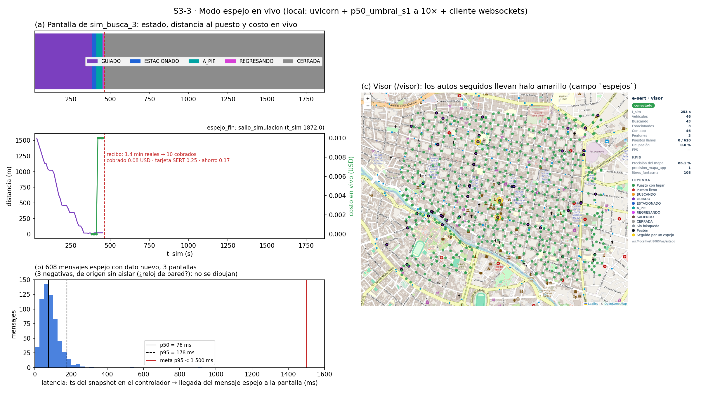

# S3 · Sesión 3 · Freddy: modo espejo en el backend y demo en el VPS

## 1. Resumen en 5 líneas
- El teléfono de la demo no manda GPS: es la **pantalla de un conductor simulado**. Esta sesión hace que el backend sepa qué ve ese conductor y se lo envíe, solo de ese auto, a 1 Hz por `WS /ws/espejo/{veh_id}`.
- El controlador TraCI suma a cada snapshot un **bloque interno `espejo`**: candidatos y el detalle de los autos seguidos (estado, distancia al puesto, ruta, costo en vivo, saldo, avisos y recibo). El backend lo guarda y nunca lo reenvía por `/ws/estado`.
- La respuesta del backend dice qué autos sigue algún teléfono (`espejos`): el controlador arma el detalle solo de esos, y el visor los resalta con un halo amarillo.
- Prueba local de punta a punta: 3 pantallas siguieron autos desde `GUIADO` hasta el recibo y el `espejo_fin`, con latencia **p50 = 76 ms y p95 = 178 ms** (meta < 1,5 s), un mensaje por segundo y ninguna desconexión.
- La prueba en el VPS queda **pendiente**: la demo en línea corre el código de `main` (sin S3-3) y el token del controlador solo lo tiene Tyrone. Quedan pedidos exactos para él.

## 2. Conceptos clave
- **Modo espejo:** el teléfono sigue a un auto de SUMO y muestra lo que vería su conductor. Así se puede enseñar la app en clase sin que nadie se mueva.
- **Bloque interno:** datos que viajan del controlador al backend pero que el backend no difunde a todos. El visor público no debe ver saldos ni recibos de nadie, y los demás teléfonos solo reciben su propio auto.
- **Suscriptores y `espejos`:** el backend cuenta cuántas pantallas siguen cada auto. Esa lista vuelve al controlador en la respuesta y sale en cada snapshot del visor. Calcular el detalle (ruta, distancia por la red, saldo) solo de los autos seguidos mantiene barato el paso.
- **Ritmo de 1 Hz y latido:** el controlador puede publicar 10 snapshots por segundo (si la simulación corre a 10×), pero la pantalla recibe como mucho uno por segundo y siempre el más nuevo. Si no llega nada nuevo, se reenvía el último cada 2 s, porque la app de Miguel reconecta tras 5 s de silencio.
- **Idempotencia del recibo:** el controlador repite el recibo en cada snapshot mientras el auto sigue en la red; el backend lo guarda **una vez por `sesion_id`** y cada pantalla lo recibe una sola vez. Durante 60 s, una pantalla que se reconecta lo vuelve a recibir.
- **Douglas-Peucker:** simplifica una polilínea quitando los vértices que se apartan menos de una tolerancia de la recta entre sus vecinos. Se sube la tolerancia hasta que la ruta tenga ≤ 200 puntos, para que el mensaje siga pequeño.
- **`getDrivingDistance`:** distancia **por la red** (no en línea recta) desde el auto hasta el inicio del `parkingArea`. Es lo que le falta conducir, y baja de forma realista en la gráfica.
- **Latencia de punta a punta:** desde el `ts` que pone el controlador al armar el snapshot hasta que el mensaje llega a la pantalla. Incluye la red local, el backend y el ritmo de 1 Hz.

## 3. Cómo se generó cada cosa
Desde `semanas/S3/Freddy/codigo`, dentro del contenedor `van3twin` (SUMO, backend y cliente en la misma máquina, para compartir el reloj).

| Resultado | Comando | Entradas | Salidas |
|---|---|---|---|
| Backend local | `ESERT_TOKEN_SIM=... python3 -m uvicorn backend.api.main:app --host 0.0.0.0 --port 8080` | `proyecto/visor/`, puestos | API, `/ws/estado`, `/ws/espejo/{veh_id}`, `/visor` |
| Controlador publicando | `python3 -m traci.correr_kpis --id p50_umbral_s1 --hasta 4500 --publicar http://localhost:8080 --ritmo 10` | escenario `app50_s1` de Tyrone | snapshots con el bloque `espejo` |
| Cliente que sigue 3 autos | `python3 -m backend.espejo.seguir --url http://localhost:8080 --pantallas 3 --max-s 600 --salida traci/salidas_kpi/espejo_local.json` | candidatos y WS | `traci/salidas_kpi/espejo_local.json` (líneas de tiempo y latencias) |
| Captura del visor | `chrome-headless-shell --screenshot ... http://localhost:8080/visor/` (en el contenedor) | `/visor` en vivo | `traci/salidas_kpi/visor_espejo_local.png` |
| Evidencia | `python3 -m traci.graficas_espejo` | los dos anteriores | `evidencias/s3_espejo-en-vivo.png` |
| Estado del VPS | `urllib`/`websockets` contra `https://demo.e-sert.tesisucuenca.com` (solo lectura) | — | RTT de `/salud`, WS `/ws/estado` abierto 10 min |
| Tests | `python3 -m pytest backend/tests comun/tests traci/tests` | — | — |

## 4. Mapa de archivos

| Archivo | Qué contiene | Quién lo usa |
|---|---|---|
| `traci/espejo_publicador.py` | `EspejoPublicador`: arma `candidatos` y `detalle`, el recibo al cerrar | `PublicadorSnapshots` (controlador) |
| `traci/ruta_geo.py` | `RutaGeo`, `douglas_peucker`, `simplificar` | `EspejoPublicador` |
| `traci/correr_guiado.py` | `PublicadorSnapshots` (+ bloque `espejo`, `ts` con ms, fin de corrida, posiciones válidas) y `Ritmo` | `correr_guiado`, `correr_kpis` |
| `traci/puente_nucleo.py` | `Publicador.al_responder`: entrega la respuesta `{"espejos": [...]}` | `PublicadorSnapshots` |
| `traci/guiado.py` | `destino_de`: lee el destino en los tres formatos de demanda | `Guia`, `EspejoPublicador` |
| `backend/espejo/registro.py` | `RegistroEspejo`: candidatos, detalle, suscriptores, recibos y salidas | rutas y WS |
| `backend/espejo/rutas.py` | `GET /api/v1/espejo/candidatos` (`no-store`) | app de Miguel |
| `backend/espejo/ws_espejo.py` | `WS /ws/espejo/{veh_id}` y `DifusorEspejo` | app de Miguel |
| `backend/espejo/seguir.py` | cliente de prueba: sigue candidatos y mide la latencia | pruebas local y en el VPS |
| `backend/api/dependencias.py` | `Servicios.publicar_snapshot`: registra y quita el bloque; `espejos` al snapshot | rutas 🔒 |
| `comun/esquemas.py` / `.ts` | `BloqueEspejo`, `DetalleEspejo`, `ReciboEspejo`, `RespuestaSnapshot`, `Salud.ts` | todos |
| `comun/ejemplos/espejo.json` | ejemplo del bloque interno | tests, Miguel, Tyrone |
| `comun/CONTRATO.propuesto.md` | v1.2: §4.4 y §7 del espejo | unificación |
| `backend/tests/test_espejo.py`, `traci/tests/test_espejo_publicador.py` | 15 + 24 tests | CI y verificador |

## 5. Recorrido del código
**`backend/espejo/registro.py` · `RegistroEspejo.aplicar(paso)`.** Se llama en cada `POST /interno/snapshot`. Guarda el detalle por vehículo con una versión creciente y guarda cada recibo una sola vez por `sesion_id`. Devuelve `espejos`.

```python
for veh, det in bloque.detalle.items():
    self._version += 1
    self.detalles[veh] = Entrada(det, paso.ts, ahora, self._version)
    if det.recibo is not None and det.recibo.sesion_id not in self.recibos:
        datos = det.recibo.model_dump(exclude={"sesion_id"})
        self.recibos[det.recibo.sesion_id] = ReciboGuardado(veh, e.Recibo(**datos), ahora)
```

**`backend/espejo/ws_espejo.py` · `_seguir`.** Es el bucle de una pantalla. Envía si hay una versión nueva o un recibo pendiente, respetando 1 s entre mensajes. Si no hay nada nuevo, manda un latido cada 2 s. Cuando el auto sale, envía `espejo_fin` y cierra con 1000.

```python
nuevo = version != version_enviada or pendiente is not None
if nuevo or time.monotonic() - ultimo_envio >= LATIDO_S:
    espera = INTERVALO_MIN_S - (time.monotonic() - ultimo_envio)
    if espera > 0 and motivo is None:
        await asyncio.sleep(espera)
        continue  # vuelve a leer: durante la espera pudo llegar algo más nuevo
```

**`backend/api/dependencias.py` · `publicar_snapshot`.** El bloque va al registro y se borra del paso antes de armar el snapshot. Por eso `/ws/estado` no puede llevarlo.

```python
self.mundo.espejos = set(self.espejo.aplicar(mensaje))
mensaje.espejo = None
difusion = self.mundo.aplicar_paso(mensaje)
```

**`traci/espejo_publicador.py` · `EspejoPublicador.detalle`.** Toma la posición del teléfono (la del peatón si se bajó del auto) y el último `ResultadoModo`. La distancia es por la red mientras conduce y en línea recta al auto cuando ya estacionó. Agrega la sesión con `costo_en_curso`, la billetera, los avisos del núcleo (`ServicioSesiones.avisos`) y el recibo. Un error en el detalle de un auto se cuenta y se salta, sin detener la simulación.

**`traci/ruta_geo.py` · `RutaGeo.desde_aristas`.** Recorre las aristas que faltan (hasta la del puesto) y concatena sus formas con `sumolib`. Luego simplifica con Douglas-Peucker y convierte a `[lat, lon]`. Guarda el resultado en caché por `(ruta, índice, arista del puesto)`: en una corrida de 1 475 s se calcularon 20 rutas para 245 consultas.

**`traci/correr_guiado.py` · `PublicadorSnapshots._posicion`.** Si SUMO da a un auto estacionado la posición inválida −2^30, se usa su última posición válida (ver §8).

## 6. Cómo se conecta con los demás
- **Consume:**
  - de **Tyrone**, el escenario `app50_s1` (`destino_nombre`, `destino` en `"lat,lon"`) y `destinos.csv`; el visor (`proyecto/visor/`), que ya pinta `espejos`;
  - de **Pablo**, el `ResultadoModo` (`modo`, `confianza`) de la inferencia;
  - de **S1-2**, `tarifa.costo` y `tarifa.costo_tarjeta_sert` para el recibo.
- **Entrega:**
  - a **Miguel**, `GET /api/v1/espejo/candidatos` y `WS /ws/espejo/{veh_id}` con los campos exactos de §7, el recibo, `espejo_fin` con su motivo, cierre 4404/1000 y `Salud.ts` con ms, que él había pedido;
  - a **Tyrone**, `espejos` en cada snapshot y el contrato v1.2 propuesto.

## 7. Resultados y evidencias


- **Prueba local (`p50_umbral_s1` a 10×, 3 pantallas, 211 s reales):**
  - 610 mensajes espejo, 608 con dato nuevo y 2 latidos;
  - **latencia p50 = 76 ms, p95 = 178 ms**, máximo 922 ms (meta p95 < 1,5 s);
  - desde la emisión en el backend hasta la pantalla: p50 = 1,1 ms;
  - intervalo entre mensajes: mediana 1,002 s y mínimo 0,999 s;
  - 0 desconexiones;
  - el visor marcó a los 3 autos en ~1 840–1 860 de 1 874 snapshots.
- **Auto `sim_busca_3`:**
  - GUIADO desde t = 20 s; la distancia al puesto baja de 1 536 m a 0;
  - ESTACIONADO en t = 382 s y A_PIE en t = 412 s; costo en vivo de 0,01 USD;
  - **recibo** en t = 462 s: 1,4 min reales, 10 cobrados, 0,08 USD, frente a 0,25 USD con la tarjeta SERT;
  - `espejo_fin` con `salio_simulacion` en t = 1 872 s.
- **Tests:** 15 del backend (candidatos, ≤ 1 Hz con 10 snapshots/s, solo su vehículo, `espejos`, recibo una vez, `espejo_fin`, 4404, 401 y que `/ws/estado` no lleva el bloque) y 24 del publicador, uno de ellos con la red real de SUMO.
- **VPS, sin código nuevo ni token:**
  - `/salud` y `candidatos` responden; RTT de `/salud` p50 = 661 ms (cada pedido abre TLS desde Docker Desktop);
  - `/ws/estado` se mantuvo abierto **10 min sin cortes** a través de Traefik;
  - `/ws/espejo` da 403 porque esa ruta todavía no existe en `main`.

## 8. Limitaciones y decisiones
- **Demo en el VPS pendiente (`parcial`).** El VPS sirve `main`, que no tiene S3-3, y el `ESERT_TOKEN_SIM` lo tiene solo Tyrone. Quedan pedidos `@Tyrone [VPS]` con los comandos exactos. La estabilidad de 10 min con datos móviles debe medirla quien tenga el teléfono.
- **Hallazgo grave de escenario (afecta S3-1 y S3-2).** En los escenarios unificados de Tyrone, `param destino` trae coordenadas (`"-2.8977,-79.0058"`) y el nombre va en `destino_nombre`. La `Guia` buscaba el nombre en `destino`, así que **ningún auto con app fue guiado** en las corridas de S3-1 y S3-2: los 1 277 cayeron en búsqueda a ciegas. Los peatones también eligieron destinos al azar. Ahora se aceptan los tres formatos: en 900 s se guiaron 142 autos. Hay que repetir las cifras de S3-1 y S3-2 que dependen del guiado.
- **Posición −2^30 de SUMO.** Al salir del puesto, un auto estacionado recibió de SUMO una posición inválida. Antes eso producía `inf` en el snapshot; el JSON del cuerpo **entero** quedaba inválido y el backend rechazaba todos los snapshots: el visor y el espejo se congelaban desde t = 1 467 s. El fallo existía desde S2-3, en el snapshot del visor. Ahora se usa la última posición válida.
- **Recibos de falsas liberaciones.** Sin `rf_v1.joblib`, el umbral cierra la sesión a los 0,6–1,4 min, con el auto todavía estacionado. El espejo muestra bien ese recibo (10 min cobrados), pero la sesión es una falsa liberación: el flujo funciona y el clasificador no.
- **Latencias negativas.** 3 de 608 muestras salen negativas (−64, −64 y −1 970 ms). Dos de ellas las ven dos pantallas en el mismo instante y no se repiten en los mismos `t_sim` entre corridas, así que apunta a un ajuste del reloj de pared, pero no se pudo aislar. No cambian el p95.
- **Correcciones tras el verificador independiente:**
  - el aviso de "dato nuevo" se limpia antes de leer el registro, porque antes se podía perder y retrasar 2 s;
  - un recibo no se vuelve a aceptar después de 60 s (se recuerdan los `sesion_id` de la corrida) y el de una sesión vieja no viaja si el auto abrió otra;
  - si no llega ningún snapshot en 30 s, las pantallas reciben `fin_simulacion` (controlador caído sin avisar), y lo mismo si SUMO se relanza;
  - tras CERRADA ya no se envía `puesto`.
- La prueba se hizo a 10× para llegar al recibo en minutos. En la demo se usa `--ritmo 1`, y entonces la pantalla recibe todos los segundos simulados.
- El backend corrió en el contenedor y no en la computadora: desde WSL no se llega al puerto que publica Docker Desktop. Las URLs son las mismas.

## 9. Preguntas que podría hacer el profesor
1. **¿Por qué no mandar por `/ws/estado` lo que ve cada conductor?** Porque `/ws/estado` va a todos: el visor público vería saldos y recibos de todos, y cada teléfono recibiría datos de cientos de autos. El espejo es un canal por vehículo con solo sus datos.
2. **¿Cómo sabe el controlador qué autos detallar?** El backend cuenta las pantallas conectadas a cada `/ws/espejo/{veh_id}` y responde `{"espejos": [...]}` a cada snapshot. El siguiente snapshot ya trae el detalle de esos autos.
3. **¿Qué pasa si el controlador publica 10 veces por segundo?** Cada pantalla recibe como mucho un mensaje por segundo y siempre con el dato más nuevo, sin cola de mensajes viejos. Lo comprueba un test con 10 snapshots por segundo.
4. **¿Y si el snapshot se repite o la pantalla se reconecta?** El recibo se guarda una vez por `sesion_id`, y cada conexión lo recibe una sola vez. Una pantalla que se reconecta dentro de 60 s lo vuelve a ver.
5. **¿La latencia medida incluye la red real?** En local no: es el camino controlador → backend → pantalla en la misma máquina (p95 de 178 ms). En el VPS se suma el RTT a internet (~0,7 s por pedido con TLS nuevo; el WS ya abierto no paga el TLS). La medición en línea queda pendiente.
