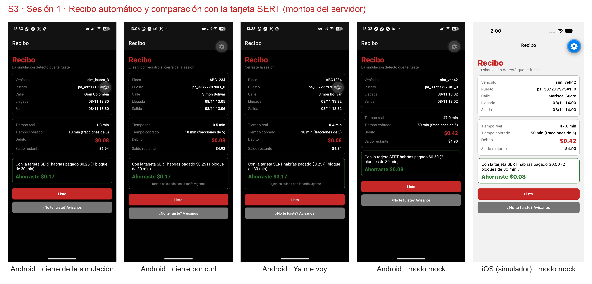

# S3 · Miguel 🔴 · Galería semanal

## Sesión 1 · 2026-11-08 · Cierre automático en la app y recibo comparado con la tarjeta SERT

**Estado:** hecha (5/5 criterios).

- Cuando la **simulación** cierra la sesión del auto espejo, el mensaje `CERRADA` con `recibo` de `WS /ws/espejo` (backend real de Freddy) lleva la app sola al recibo, sin poder volver atrás.
- En una sesión propia, `GET /sesiones/{id}` cada 10 s (y al volver a primer plano) detecta un cierre hecho fuera de la app: con `curl` se vio en **7 s**. También está "Ya me voy" con confirmación.
- El cierre se procesa **una sola vez**, venga del WS, del REST o del botón.
- El recibo muestra placa, puesto, calle, horas en America/Guayaquil, minutos reales y cobrados, débito, saldo y la comparación con la **tarjeta SERT**, con los montos del servidor. Ejemplo: 47 min → $0.42 frente a $0.50 con la tarjeta, ahorro $0.08.
- `tarifa.ts` portada de `tarifa.py` con las cifras de Freddy (50 tests). Jest 204/204, `tsc` sin errores, contrato v1.2 verificado.

Explicación: [explicaciones/s1_explicacion.pdf](explicaciones/s1_explicacion.pdf)
