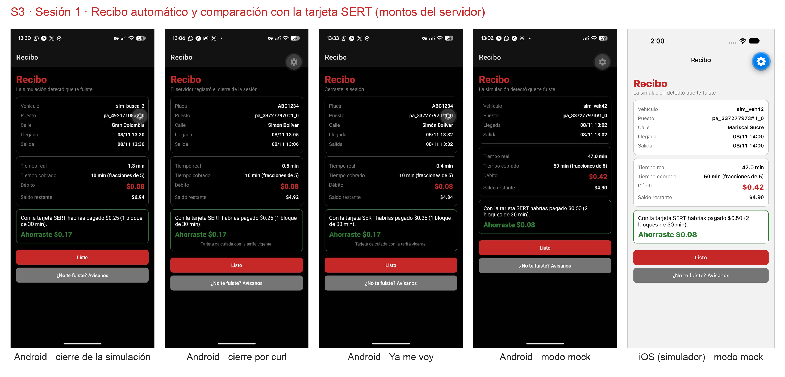

# S3 · Sesión 1 · Miguel: Cierre automático en la app y recibo comparado con la tarjeta SERT

## 1. Resumen en 5 líneas

1. La app ya no espera a que el usuario cierre: cuando la **simulación** decide que el conductor se fue (SALIENDO → CERRADA), el teléfono pasa solo a la pantalla de **recibo**.
2. En el modo espejo el cierre llega por `WS /ws/espejo/{veh_id}` con el `recibo`; en una sesión propia, por `GET /sesiones/{id}` cada 10 s (así también se ve un cierre hecho con `curl`).
3. El recibo muestra placa, puesto, calle, horas de llegada y salida en hora de Ecuador, minutos reales y cobrados, débito y saldo, y **cuánto habría costado con la tarjeta SERT**.
4. La tarifa se portó a TypeScript (`tarifa.ts`) con las mismas cifras que los tests de Freddy; los montos que se muestran son siempre los del servidor y la tarifa local solo comprueba.
5. Se probó en Android contra el backend y la simulación reales de Freddy: cierre por la simulación, por `curl` (detectado en 7 s), con "Ya me voy" y en modo mock, más el recibo en el simulador de iPhone.

## 2. Conceptos clave

- **Cierre automático (simulado):** el teléfono no usa su GPS. El controlador TraCI de Freddy mueve los autos en SUMO, decide cuándo uno se va y cierra su sesión; el teléfono espejo solo recibe el resultado.
- **Recibo del espejo:** al pasar a `CERRADA`, el mensaje `espejo` trae `recibo` con `minutos_reales`, `minutos_cobrados`, `cobrado_usd`, `tarjeta_sert_usd` y `ahorro_usd`. Llega **una sola vez** por conexión; el latido siguiente trae `recibo: null`, por eso la app navega en cuanto lo ve.
- **Respaldo por REST (sondeo):** si no hay WS (sesión propia) o el WS está caído, se pregunta `GET /sesiones/{id}` cada 10 s y al volver la app a primer plano.
- **Candado de una sola vez:** el cierre puede llegar por tres caminos (WS, REST o el botón). Un `DetectorCierre` recuerda si ya cerró; lo que llegue después se ignora, así el recibo se abre una sola vez.
- **`router.replace`:** la app usa expo-router; reemplazar la pantalla (en vez de apilar) impide volver con "atrás" a una sesión que ya terminó.
- **Tarjeta SERT:** se paga por bloques de 30 min por adelantado ($0.25 cada uno); la app cobra por fracciones de 5 min con mínimo de 10. El ahorro es tarjeta − cobrado.
- **Hora de Guayaquil:** Ecuador está en UTC−5 todo el año; se resta 5 h a la hora UTC sin depender de `Intl`.

## 3. Cómo se generó cada cosa

| Resultado | Comando | Entradas | Salidas |
|---|---|---|---|
| Tests de la tarifa | npx jest src/logica | tarifa.ts y cifras de test\_tarifa.py | 50 tests en verde |
| Todos los tests | npx jest y npx tsc --noEmit | código de la app | 204 tests en verde, tsc sin errores |
| Backend local | uvicorn backend.api.main:app --host 0.0.0.0 --port 8000 (desde proyecto/, con ESERT\_TOKEN\_SIM de prueba) | proyecto/backend | API en el puerto 8000 |
| Escenario | python proyecto/traci/obtener\_escenario.py y python3 -m traci.escenario\_app (en el contenedor) | rama de Tyrone y demanda | copia ignorada en traci/escenario/ |
| Simulación publicando | docker exec ... python3 -m traci.correr\_guiado --escenario app50\_s1 --publicar http://host.docker.internal:8000 --ritmo 5 | escenario app50\_s1 | mensajes espejo con recibo |
| Cierre por curl | curl -X POST .../api/v1/sesiones/ID/cerrar | sesión abierta del teléfono | sesión CERRADA |
| Evidencia | python scripts/montaje.py s1\_recibo.png (capturas) | capturas del teléfono y del simulador | s1\_recibo.png |

## 4. Mapa de archivos

| Archivo | Qué contiene | Quién lo usa |
|---|---|---|
| app/src/logica/tarifa.ts | minutosCobrables, costo, costoTarjetaSert, bloques, ahorro, compararConServidor | recibo y tests |
| app/src/servicios/seguimientoSesion.ts | DetectorCierre, usarSeguimientoPropio, usarSeguimientoEspejo, motivoDeducido | sesión activa y espejo |
| app/src/pantallas/Recibo.tsx | Pantalla del recibo y comparación con la tarjeta | ruta /recibo |
| app/app/recibo.tsx | Ruta: lee los datos del cierre y muestra el recibo | expo-router |
| app/src/mocks/cierreMock.ts | Recorrido con CERRADA y recibo 20 s después de ESTACIONADO | modo mock del espejo |
| app/app/sesion/activa.tsx | Sesión activa con "Ya me voy", sondeo y aviso de sesión huérfana | usuario |
| app/app/espejo/[vehId].tsx | Espejo: navega al recibo cuando llega el cierre | usuario |

## 5. Recorrido del código

**`seguimientoSesion.ts`**: `DetectorCierre` recibe mensajes del espejo, respuestas de `GET /sesiones` o el cierre manual, y devuelve un único evento de cierre. También guarda la llegada (primer ESTACIONADO), el puesto, el saldo y el `sesion_id`.

```ts
mensaje(m: MensajeEspejo): Evento {
  if (this.procesado) return null;
  if (m.sesion?.sesion_id) this.sesionId = m.sesion.sesion_id;
  if (m.estado === 'ESTACIONADO' && !this.llegada) this.llegada = m.ts;
  if (m.estado === 'CERRADA' && m.recibo) {
    const r = m.recibo;
    return this.emitir({ motivo: motivoDeducido(r.minutos_reales, this.ultimoEstado, this.base.origen),
      cobrado_usd: r.cobrado_usd, tarjeta_sert_usd: r.tarjeta_sert_usd, ahorro_usd: r.ahorro_usd, ... });
  }
  ...
}
```

`usarSondeo` consulta `GET /sesiones/{id}` cada 10 s y al volver a primer plano; si el servidor responde 404, avisa (sesión huérfana). `usarSeguimientoEspejo` alimenta el detector con los mensajes de `usarEspejo` (el `SocketEspejo` de S2-3) y solo sondea si el WS está caído.

**`Recibo.tsx`**: muestra los montos del servidor. Si el servidor no trae la tarjeta (sesión propia), la calcula con `tarifa.ts` y lo indica. `compararConServidor` avisa con `console.warn` si la tarifa local difiere más de $0.01. "¿No te fuiste? Avísanos" guarda el caso en AsyncStorage.

**`tarifa.ts`**: reutiliza las fórmulas de `src/api/tarifa.ts` (ya portadas de `comun/tarifa.py`):

```ts
export function minutosCobrables(minutosReales: number, t: Tarifa = TARIFA): number {
  return minutosCobrados(minutosReales, t);
}
export function costo(minutosReales: number, t: Tarifa = TARIFA): number {
  return costoMinutos(minutosCobrables(minutosReales, t), t);
}
export function bloquesTarjetaSert(minutosReales: number, t: Tarifa = TARIFA): number {
  return Math.max(1, Math.ceil(Math.max(0, minutosReales) / t.tarjeta_bloque_min - EPS));
}
```

**`cierreMock.ts`**: toma el recorrido de S1-3 y comprime la sesión a 20 mensajes, de modo que CERRADA con recibo llegue 20 s después de ESTACIONADO.

## 6. Cómo se conecta con los demás

- **Freddy:** se consume `WS /ws/espejo/{veh_id}` (contrato §7, v1.2: recibo una vez, latido de 2 s, cierres 1000 y 4404), `GET /sesiones/{id}`, `POST /sesiones/{id}/cerrar` y `GET /billetera/{id}`. La simulación se corrió con su `correr_guiado` publicando al backend local.
- **Contrato:** la copia de `comun/esquemas.ts` se actualizó a v1.2 (`timeout_sin_senal`, `Salud.ts`) y se verificó por hash.
- **Tyrone:** se usó su escenario (copia ignorada por git) y su `puestos.csv` para la calle.
- **Entrega:** recibo automático listo para la demo; los reclamos guardados quedan para S4.

## 7. Resultados y evidencias

- Jest: **204/204** (50 de la tarifa, 10 del seguimiento y el mock, 4 del recibo); `tsc` sin errores; contrato v1.2 verificado.
- Cierre por `curl`: cerrado a las 18:06:24 UTC, el teléfono lo vio a las 18:06:31 (**7 s**) y abrió el recibo una sola vez (después solo pidió billetera y puestos).
- Cierre por la simulación: recibos reales de Freddy, p. ej. 1.3 min → 10 min cobrados → **$0.08**; tarjeta **$0.25**; ahorro **$0.17**.
- Modo mock: 47 min → 50 min → **$0.42**; tarjeta 2 bloques **$0.50**; ahorro **$0.08**, igual en Android y en el simulador de iPhone.



## 8. Limitaciones y decisiones

- **Rutas adaptadas:** el prompt pide `navigation.replace("Recibo")`; la app usa expo-router, así que es `router.replace('/recibo')` con la pantalla en `src/pantallas/Recibo.tsx`.
- **Sesiones simuladas sin REST:** el controlador de Freddy crea las sesiones de los autos simulados en su propia base en memoria, así que `GET /sesiones/{id}` del backend responde 404 para ellas. En el espejo el único origen del recibo es el WS.
- **Sin motivo en el contrato:** ni `GET /sesiones` ni el recibo del espejo traen el motivo del cierre. La app lo deduce: tope de tiempo → falta de señal; auto del espejo → la simulación lo detectó; si no, "El servidor registró el cierre".
- **Sesiones muy cortas en la simulación:** se cerraban en 0.6–4 min simulados y pasaban de A_PIE a CERRADA sin mostrar SALIENDO (ritmo acelerado). Es del controlador, no de la app.
- **iPhone solo en simulador:** no hubo iPhone físico. La captura de iOS usa un enlace de desarrollo (`/recibo?demo=mock`) que pasa el recorrido del mock por el mismo detector.
- **Bandera del modo mock:** el prompt nombra `EXPO_PUBLIC_MOCK=1`; la app ya usaba `EXPO_PUBLIC_USE_MOCK` y el ajuste de la app. Ahora acepta las dos variables.
- **Correcciones tras el verificador:** el sondeo se pausa mientras se envía "Ya me voy" (para no perder el motivo manual), el primer mensaje con recibo se retiene por si React agrupa estados, y "Avísanos" avisa si no pudo guardar.
- **Sesión huérfana:** una sesión guardada de otro backend quedaba "activa" para siempre. Ahora, si el servidor responde 404, la app ofrece "Descartar sesión".

## 9. Preguntas que podría hacer el profesor

1. **¿Quién decide que el conductor se fue?** La simulación: el controlador TraCI ve que el auto sale del puesto y cierra la sesión; el teléfono solo lo recibe.
2. **¿Qué pasa si el recibo llega por el WS y también por REST?** El detector ya cerró con el primero y descarta el segundo: el recibo se abre una vez.
3. **¿Por qué no se puede volver atrás a la sesión activa?** Se reemplaza la pantalla y se desactiva el gesto y el botón de volver: la sesión ya terminó.
4. **¿Por qué mostrar los montos del servidor y no los de la app?** El cobro real lo hace el backend; la tarifa local solo comprueba y calcula la tarjeta cuando el servidor no la envía.
5. **¿Cuánto ahorra un conductor?** Depende de la estadía: a 47 min, $0.42 contra $0.50 con la tarjeta (ahorra $0.08); a 120 min, lo mismo con ambos.
