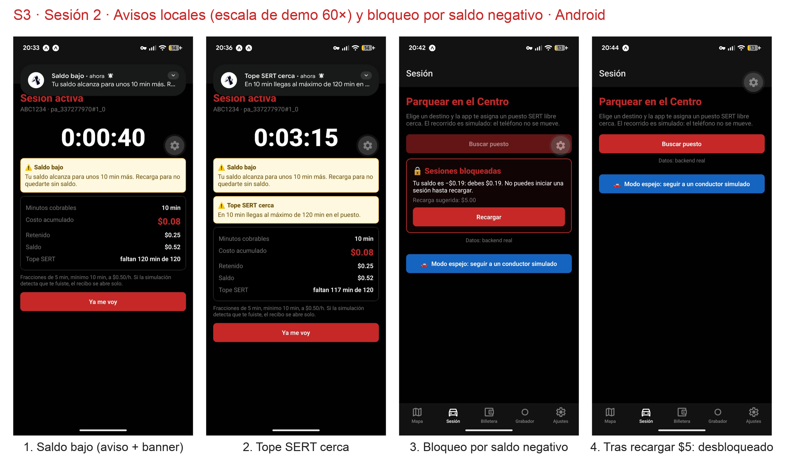

# S3 · Sesión 2 · Miguel: Avisos de saldo bajo, tiempo máximo y bloqueo por saldo negativo

## 1. Resumen en 5 líneas

1. Al empezar una sesión, la app calcula cuándo se va a quedar sin saldo y cuándo llega al tope SERT de 120 min, y programa **notificaciones locales** para avisar 10 min antes.
2. Con la app abierta, además aparece un **banner amarillo** dentro de la pantalla (en iPhone la app hace poco en segundo plano) y la notificación sale a la hora exacta.
3. Al cerrar la sesión se **cancelan** todas las notificaciones pendientes; tras una recarga se reprograman, porque el aviso de saldo bajo se mueve.
4. Con **saldo negativo** no se puede buscar puesto: se muestra la deuda y el botón Recargar (Payphone de S2-2); al recargar se desbloquea.
5. Con una escala de demo (1 min = 1 s) se probó todo en Android contra el backend real: avisos a los ~50 s y ~110 s, cancelación al cerrar y bloqueo/desbloqueo con una recarga de $5.

## 2. Conceptos clave

- **Notificación local:** la programa el propio teléfono para una fecha; no necesita servidor. En Expo Go son las únicas que funcionan (las *push* remotas no).
- **Minutos cubiertos:** cuántos minutos alcanza el disponible a $0.50/h: `disponible / (0.50 / 60)`. Con $0.25, 30 min; el aviso sale 10 min antes, a los 20.
- **Combinar avisos:** si saldo bajo y tope caen a menos de 1 min de la regla, se manda uno solo con los dos textos (con $1.00 ambos caen a los 110 min).
- **Escala de demo:** `EXPO_PUBLIC_ESCALA_TIEMPO=60` divide los tiempos de la regla entre 60, también la ventana de combinación, para mostrar los avisos en la exposición.
- **Alarmas inexactas de Android:** desde Android 12 las notificaciones con fecha se agrupan para ahorrar batería y llegan tarde (10 s a 1 min en la prueba). Con la app abierta, al vencer el aviso se cancela el programado y se dispara uno inmediato.
- **Bloqueo (reglas 1 y 5):** saldo < 0 bloquea nuevas sesiones; disponible menor que el bloque mínimo ($0.25) obliga a recargar al menos $5.
- **Sin duplicados con el espejo:** los avisos del mensaje `espejo` y los calculados comparten un registro con la clave tipo + sesion_id.

## 3. Cómo se generó cada cosa

| Resultado | Comando | Entradas | Salidas |
|---|---|---|---|
| Tests | npx jest app/src/logica y npx jest | calcularAvisos.ts, avisos.ts | 232 tests en verde |
| Tipos | npx tsc --noEmit | código de la app | sin errores |
| Backend local | uvicorn backend.api.main:app --host 0.0.0.0 --port 8000 (desde proyecto/) | proyecto/backend | API en el puerto 8000 |
| App con escala | EXPO\_PUBLIC\_ESCALA\_TIEMPO=60 en .env y npx expo start --lan | .env | Expo Go por Tailscale |
| Saldo de prueba | sesiones con hora de inicio atrasada, cerradas por la API | billetera del teléfono | saldo $0.76 y luego −$0.19 |
| Evidencia | python scripts/montaje.py s2\_avisos.png (capturas) | capturas del teléfono | s2\_avisos.png |

## 4. Mapa de archivos

| Archivo | Qué contiene | Quién lo usa |
|---|---|---|
| app/src/logica/calcularAvisos.ts | calcularAvisos, escalaTiempo, estadoBloqueo | avisos.ts, Bloqueo, tests |
| app/src/servicios/avisos.ts | programarAvisos, cancelarAvisos, dispararSiVencio, avisosVencidos, avisarUnaVez | confirmar, activa, recarga, espejo |
| app/src/pantallas/Bloqueo.tsx | usarBloqueo (lee la billetera al tomar el foco) y la tarjeta de bloqueo | pestaña Sesión |
| app/app/sesion/confirmar.tsx | Programa los avisos al confirmar la llegada | flujo de sesión |
| app/app/sesion/activa.tsx | Banner, disparo en primer plano y cancelación al cerrar | usuario |
| app/app/recarga.tsx | Reprograma tras recargar con una sesión abierta | usuario |
| app/jest.setup.js | Mock oficial de AsyncStorage para Jest | tests |

## 5. Recorrido del código

**`calcularAvisos.ts`**: calcula las dos fechas, las combina si están a menos de 1 min de la regla y adelanta a "ahora" las que ya pasaron.

```ts
const minutosCubiertos = Math.max(0, billetera.disponible) / (tarifa.valor_hora_usd / 60);
const minSaldo = minutosCubiertos - tarifa.aviso_saldo_min;
const minTope = tarifa.tiempo_maximo_min - tarifa.aviso_tiempo_min;
...
Math.abs(a.cuando.getTime() - b.cuando.getTime()) < VENTANA_COMBINAR_MS / escala
  ? [{ tipo: 'saldo_bajo_y_tiempo_maximo', cuando: ..., cuerpo: `${a.cuerpo} ${b.cuerpo}` }]
  : [...avisos].sort(...)
```

`estadoBloqueo` devuelve si está bloqueado, el motivo (saldo negativo o disponible insuficiente), la deuda y la recarga sugerida.

**`avisos.ts`**: `programarAvisos` cancela lo anterior, programa cada aviso con un disparador de fecha y guarda los IDs en AsyncStorage (así se cancelan aunque la app se reinicie). `cancelarAvisos` los cancela todos. `dispararSiVencio`, con la app abierta, cambia la notificación inexacta por una inmediata.

```ts
const id = await Notifications.scheduleNotificationAsync({
  content: { title: a.titulo, body: a.cuerpo, data: { sesion_id, tipo: a.tipo } },
  trigger: { type: Notifications.SchedulableTriggerInputTypes.DATE, date: fecha, ...canal },
});
```

**`Bloqueo.tsx`**: `usarBloqueo` relee la billetera cada vez que la pestaña toma el foco (por ejemplo al volver de Recarga) y la tarjeta muestra la deuda y el botón Recargar.

## 6. Cómo se conecta con los demás

- **Freddy:** se usan `GET /billetera/{id}` (`saldo`, `disponible`, `bloqueada`), `POST /sesiones` (`SESIONES_BLOQUEADAS`) y los parámetros de `tarifa.json`. El parámetro `aviso_tiempo_min` ya cumple el papel de `aviso_tope_antes_min`.
- **Espejo (S2-3):** los avisos del mensaje `espejo` (§7) pasan por el mismo registro, sin duplicar.
- **Payphone (S2-2):** el botón Recargar del bloqueo usa el flujo de recarga, y al volver se reprograma o se desbloquea.

## 7. Resultados y evidencias

- Jest **232/232**, `tsc` sin errores.
- Android con escala 60: "Saldo bajo" a los ~40–50 s y "Tope SERT cerca" a ~110 s, con banner dentro de la app y notificación.
- Cerrar a los 15 s: `canceladas 2 … programadas que quedan: 0` y ninguna notificación después.
- Saldo −$0.19: "Buscar puesto" desactivado y la deuda en pantalla; tras recargar $5 por Payphone (mock), saldo $4.81 y desbloqueado.



## 8. Limitaciones y decisiones

- **Fórmula del aviso de saldo:** el prompt pide `disponible / (valor_hora/60)`; el núcleo de Freddy usa `saldo − costo en curso`. Se siguió el prompt y se anota para unificar.
- **Retraso de Android:** en segundo plano la notificación puede llegar hasta ~1 min tarde (alarmas inexactas, Expo Go sin permiso de alarma exacta). En primer plano se dispara a tiempo.
- **Canal "avisos":** Expo Go en Android rechaza crear canales; se usa el canal por defecto.
- **Saldo de prueba:** para la demo se ajustó el saldo del teléfono con sesiones de inicio atrasado cerradas por la API del backend local (con las reglas reales de cobro), no editando la base.
- **Retención de la sesión:** el aviso de saldo se calcula con el disponible después de retener el bloque de esta sesión ($0.25 = 30 min), así que sale unos 30 min de la regla antes que el del núcleo. Se dejó así porque el prompt pide el disponible; queda para unificar con Freddy.
- **Correcciones del verificador:** al reprogramar tras una recarga ya no se repiten los avisos que vencieron; al volver a primer plano no se duplica un aviso que Android ya mostró; y confirmar espera a programar antes de navegar.
- **Errores encontrados en la prueba:** la ventana de combinación no se escalaba (en demo combinaba avisos a 59 s) y el banner no se mostraba porque se leía una sola vez; ambos se corrigieron y tienen test.

## 9. Preguntas que podría hacer el profesor

1. **¿Por qué notificaciones locales y no del servidor?** En Expo Go no hay *push* remotas, y el teléfono ya sabe la hora de inicio y el saldo: puede programarlas solo.
2. **¿Qué pasa si recargo a mitad de la sesión?** Se cancelan las programadas y se recalculan: el aviso de saldo bajo se mueve más tarde.
3. **¿Y si cierro antes de que lleguen?** Se cancelan todas; en la prueba quedaron 0 programadas.
4. **¿Por qué un banner además de la notificación?** En iPhone la app hace poco en segundo plano y en Android pueden llegar tarde; con la app abierta, el banner está siempre a tiempo.
5. **¿Cuándo se desbloquea?** Cuando el saldo vuelve a ser ≥ 0 y el disponible cubre el bloque mínimo; al volver de la recarga se relee la billetera.
