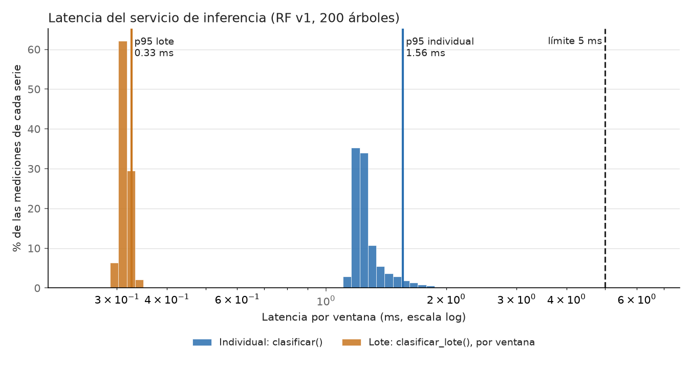
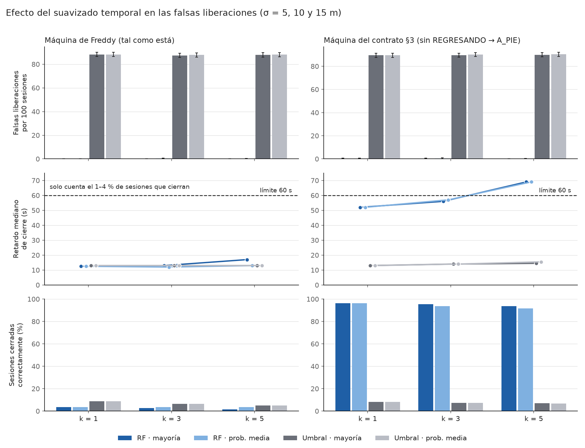
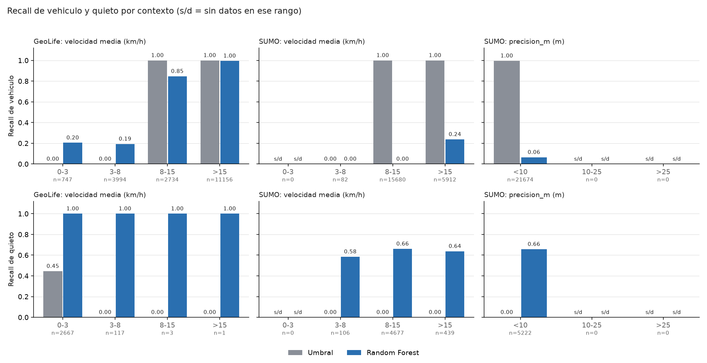
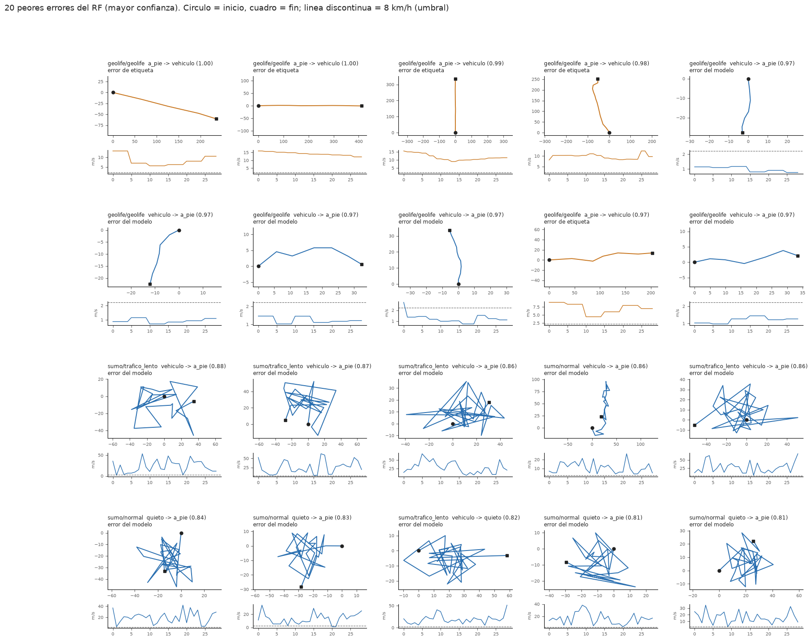
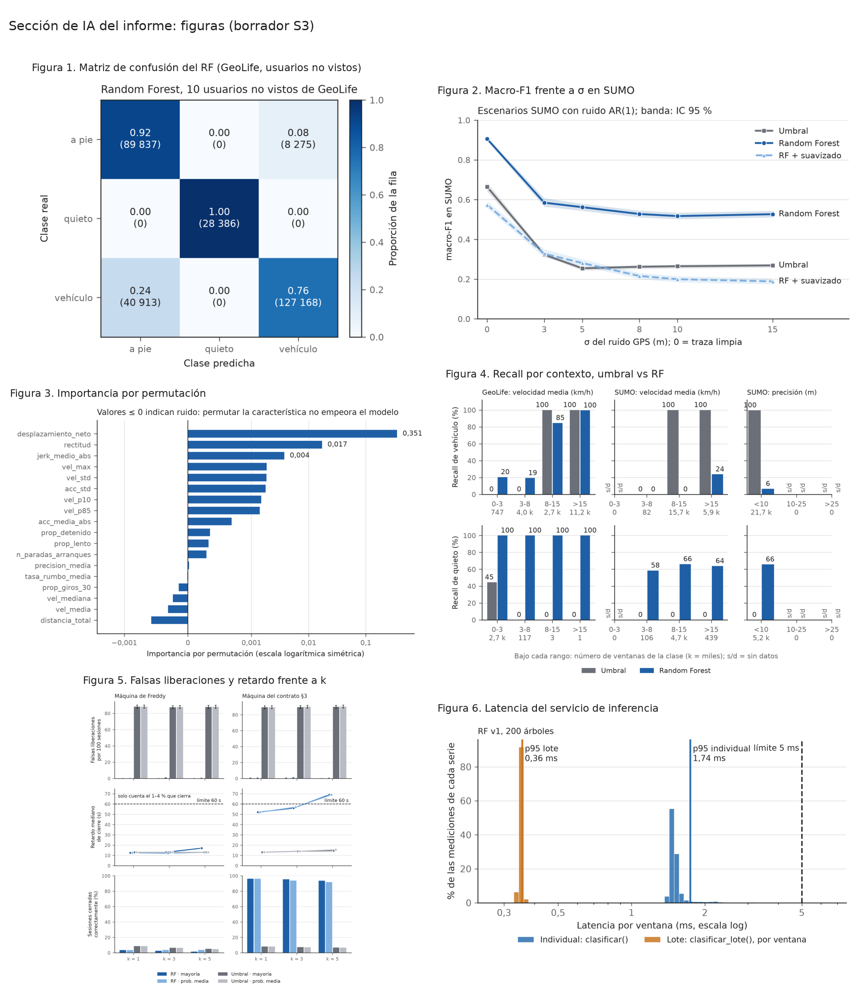

# S3 · Pablo 🟢 · Resumen semanal

## Sesión 1 · Servicio de inferencia robusto: huecos, latencia menor a 5 ms y fallback

`clasificar` ahora limpia la ventana (duplicados, NaN, precisión > 50 m, saltos imposibles,
huecos), degrada con elegancia (RF → umbral → resultado previo) y nunca lanza por datos. Para
la latencia se compiló el Random Forest de 200 árboles a arrays de numpy: mismas predicciones
que sklearn, pero ~14 veces más rápido.

| Medida (10 000 ventanas) | p50 | p95 | p99 |
|---|---|---|---|
| `clasificar` individual (ms) | 1,23 | 1,56 | 1,84 |
| `clasificar_lote` (ms por ventana) | 0,313 | 0,326 | 0,334 |

**Tests:** 49/49 en `test_inferencia.py` (300 ejemplos de hypothesis por propiedad).

## Sesión 2 · Análisis de errores y efecto del suavizado en las falsas liberaciones

Se simularon 300 sesiones completas de SUMO (5 semillas, ruido GPS σ = 5, 10 y 15 m) con 12
combinaciones de suavizado. El umbral del contrato produce 88 falsas liberaciones por 100 sesiones;
el RF, casi ninguna (0,0–0,3). Suavizar no mejora nada y suma retardo (52 → 69 s de k = 1 a 5 con la
máquina del contrato), así que se recomienda **k = 1**. Hallazgo: la regla `REGRESANDO → A_PIE` de la
máquina de Freddy (no está en el contrato) deja sin cerrar ~97 % de las sesiones.

## Sesión 3 · Borrador de la sección de IA del informe

Se escribió `informe/pablo.md` (3 109 palabras, 9 subsecciones) con 6 figuras a 300 dpi, tres tablas,
12 referencias BibTeX verificadas y un comprobador (`verificar_cifras.py`) que verifica 190 cifras contra
sus archivos fuente, sin huérfanas; un auditor independiente contrastó unas 110 a mano. Hallazgos al redactar:
las curvas frente a σ muestran que el ruido sí es el factor dominante (0,906 sin ruido contra 0,562 con
σ = 5 m), lo contrario de lo que decía el texto de S2-3. La Sección 8 (efecto en el sistema) queda con
marcadores `[PENDIENTE]` porque las cifras de Tyrone aún no existen.

