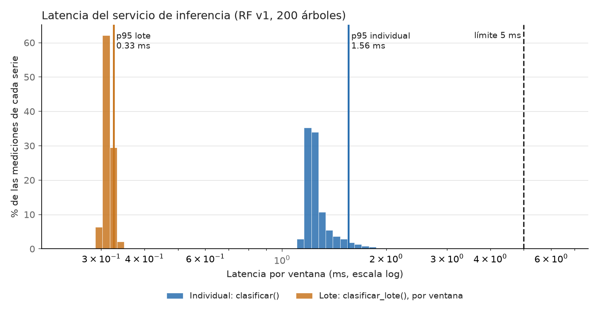

# S3 · Sesión 1 · Pablo: Servicio de inferencia robusto (huecos, latencia < 5 ms y fallback)

## 1. Resumen en 5 líneas

`ia/inferencia.py` es la pieza que dice si un usuario va `a_pie`, `quieto` o en `vehiculo`, y
desde S3 corre dentro de TraCI con cientos de usuarios y detrás del modo espejo del backend.
Lo rehice para que **nunca falle por datos sucios** (huecos, duplicados, NaN, precisión mala)
y para que sea **rápido**: p95 de 1,56 ms por ventana (antes ~21 ms) y 0,33 ms por ventana
en lote. Si faltan datos o el modelo, cae a la regla de umbral del contrato y lo indica en
`fuente`. La firma `clasificar(ventana)` sigue siendo la del contrato; solo se añade `previo`
como parámetro opcional.

## 2. Conceptos clave

- **Limpieza (`validacion.limpiar`)**: antes de clasificar se ordena por tiempo, se quitan
  duplicados, coordenadas NaN o fuera de rango, puntos con `precision_m > 50` y saltos que
  implican más de 50 m/s; luego se remuestrea a 1 Hz interpolando huecos de hasta 5 s. Produce
  también `Calidad` (cobertura, hueco máximo, precisión mediana).
- **Cobertura**: fracción de segundos de la ventana que quedan con dato válido. Con cobertura
  ≥ 0,6 y hueco máximo ≤ 10 s el RF es confiable; con menos, mejor la regla simple.
- **Escalera de degradación**: RF → umbral (con confianza × cobertura) → `previo` con confianza
  × 0,5 → umbral con confianza 0. Así la respuesta siempre es válida y la confianza refleja
  cuánto se sabe.
- **Bosque plano**: sklearn evalúa 200 árboles uno por uno en Python (~20 ms por ventana). Se
  copian los árboles a arrays de numpy y se recorren **todos a la vez**, un nivel de
  profundidad por paso. Da las mismas probabilidades (diferencia máxima 5e-9) en ~0,4 ms.
- **Lote**: `clasificar_lote` agrupa las ventanas, calcula sus características en bloque y hace
  una sola llamada a `predict_proba`, de modo que el costo fijo se reparte entre las ventanas.
- **Fallback con aviso único**: si el modelo no carga o `predict` lanza, se usa el umbral y se
  emite un `warnings.warn` una sola vez, para no inundar los registros de TraCI.

## 3. Cómo se generó cada cosa

| Resultado | Comando | Entradas → salidas |
|---|---|---|
| Referencia de equivalencia con S2 | `python3 -m ia.datos.generar_referencia_inferencia` | 150 ventanas de GeoLife de usuarios no vistos + ruta original (pandas + `extraer` + pipeline sklearn) → `ia/tests/datos/referencia_s2.json` |
| Tests | `python3 -m pytest ia/tests/test_inferencia.py -q` | 49 tests, 4 de ellos con 300 ejemplos de `hypothesis` |
| Benchmark y gráfica | `python3 -m ia.bench_inferencia --png ../evidencias/s1_latencia-inferencia.png` | 10 000 ventanas (5 000 GeoLife de prueba + 5 000 SUMO σ=5) → `ia/reportes/bench_inferencia.json` y el PNG |

El SHA-256 y la versión de scikit-learn de `ia/modelos/rf_v1.meta.json` se calcularon sobre
`rf_v1.joblib` (55 MB, no se sube al repo por `.gitignore`).

## 4. Mapa de archivos

| Archivo | Qué contiene | Quién lo usa |
|---|---|---|
| `ia/validacion.py` | `limpiar()` y `Calidad` | `inferencia.py`, tests |
| `ia/inferencia.py` | `clasificar`, `clasificar_lote`, `ClasificadorConEstado` | Freddy (TraCI, espejo) |
| `ia/bosque_plano.py` | `BosquePlano`: RF compilado a numpy | `inferencia.py` |
| `ia/modelos/rf_v1.meta.json` | Orden de características, sklearn, SHA-256, métricas S2 | `inferencia.py` (avisos) |
| `ia/bench_inferencia.py` | Benchmark individual y en lote + gráfica | Informe |
| `ia/datos/ventanas_prueba.py` | Carga de ventanas de GeoLife de prueba y de SUMO | Benchmark, referencia |
| `ia/tests/test_inferencia.py` | 49 tests (bordes, fallback, lote, propiedades) | CI |
| `ia/reportes/bench_inferencia.json` | Percentiles medidos | Informe |

## 5. Recorrido del código

**`validacion.limpiar(ventana, precision_max_m=50)`** devuelve `(array[t, lat, lon, precision], Calidad)`.
Sin bucles de Python salvo la eliminación de saltos (solo si los hay). Si la ventana ya está a
1 Hz sin huecos, se salta el remuestreo.

```python
seg = np.clip(np.searchsorted(t, t_grid, side="right") - 1, 0, len(t) - 2)
en_hueco = (t_grid > t[seg]) & (dts[seg] > HUECO_INTERP_MAX_S)   # no inventar datos en huecos > 5 s
```

**`inferencia.clasificar(ventana, previo=None)`**: valida el tipo (`TypeError` si no es lista de
puntos), limpia, elige RF o umbral según cobertura y hueco, y captura cualquier excepción de
`predict_proba` para caer al umbral.

**`inferencia._features_2d(t, lat, lon, prec)`**: las 18 características para B ventanas de
N puntos a la vez (arrays `(B, N)`). El caso individual es B=1, así que lote e individual usan
exactamente el mismo código.

**`BosquePlano.predict_proba`**: el corazón de la velocidad.

```python
nodo = np.broadcast_to(self._raices, (n, self.n_arboles)).copy()
for _ in range(self._prof):                       # 20 niveles
    xv = X[filas, self._feat[nodo]]
    nodo = np.where(xv <= self._umbral[nodo], self._izq[nodo], self._der[nodo])
return self._valor[nodo].mean(axis=1)
```

Las hojas apuntan a sí mismas (umbral infinito), así que los árboles menos profundos esperan
sin cambiar. La imputación de `precision_media` usa las medianas del `SimpleImputer` original.

**`caracteristicas._mediana_movil`**: versión vectorizada de la mediana de 3 (el bucle original
con `np.median` costaba ~1 ms por ventana).

## 6. Cómo se conecta con los demás

- **Consume**: `rf_v1.joblib` de S2-2, `umbral.py` (8 y 0,5 km/h del contrato §2) y
  `suavizado.py` para `ClasificadorConEstado`.
- **Entrega a Freddy**: `clasificar(ventana, previo=None)` y `clasificar_lote(ventanas, previos=None)`
  con la misma forma de `ResultadoModo` del contrato; `fuente` indica si fue `rf` o `umbral`.
  Para TraCI con 80 % de penetración conviene `clasificar_lote` por paso de simulación.
- **Miguel**: la precisión máxima aceptada es 50 m (`precision_max_m`) por si valida grabaciones.

## 7. Resultados y evidencias

| Medida (10 000 ventanas, 100 de calentamiento descartadas) | p50 | p95 | p99 |
|---|---|---|---|
| `clasificar` individual (ms) | 1,23 | 1,56 | 1,84 |
| `clasificar_lote` (ms por ventana, bloques de 500) | 0,313 | 0,326 | 0,334 |

Referencia antes del cambio: ~21 ms por ventana (sklearn 19,6 ms + características 1,9 ms).
Equivalencia: las 150 ventanas de referencia coinciden al 100 % en modo y a 1e-4 en confianza.



## 8. Limitaciones y decisiones

- **No se redujo el modelo**: la meta de latencia se cumplió compilando el bosque, sin tocar
  `n_estimators` ni `max_depth`, por lo que **no hay pérdida de macro-F1** (mismas predicciones).
  No hizo falta `skl2onnx`/`onnxruntime`, que añadirían una dependencia.
- El bosque plano ocupa ~100 MB en RAM al cargarse (2,7 M de nodos); se construye una vez por
  proceso. Cargarlo tarda unos segundos.
- Los tiempos dependen de la máquina; con otros programas abiertos el p95 del lote llegó a
  variar (una corrida dio 0,55 ms por un pico de carga; la mediana siempre fue ~0,31 ms).
- Dos tests de S2 afirmaban "menos de 10 puntos → umbral"; se actualizaron a la nueva regla
  (cobertura y huecos) en la copia de S3.
- La brecha de dominio GeoLife→SUMO de S2-3 sigue ahí: este trabajo hace el servicio rápido y
  robusto, no más preciso en SUMO.

## 9. Preguntas que podría hacer el profesor

**¿Por qué no basta con `RandomForestClassifier.predict_proba`?** Con 200 árboles y 2,7 M de
nodos cuesta ~20 ms por ventana por la sobrecarga de recorrer cada árbol; con cientos de
usuarios por segundo en TraCI no alcanza.

**¿Cómo se garantiza que el bosque plano da lo mismo?** Se compara contra sklearn: diferencia
máxima de probabilidad 5e-9 y mismo argmax en el 100 % de las pruebas.

**¿Qué pasa si el GPS se pierde 15 s?** La cobertura baja o el hueco supera 10 s: no se usa el
RF, se usa el umbral con confianza reducida; si hay menos de 5 puntos, se devuelve el resultado
previo con la confianza a la mitad.

**¿Por qué descartar puntos con precisión > 50 m?** Un punto tan impreciso puede desplazar la
posición decenas de metros y simular movimiento; es preferible interpolar entre puntos buenos.

**¿Cómo se sabe que nunca lanza una excepción?** Hay pruebas de propiedades con `hypothesis`
(300 ejemplos por propiedad) con NaN, infinitos, tiempos absurdos, duplicados y precisiones
extremas; solo se lanza `TypeError` si la entrada no es una lista de puntos.
