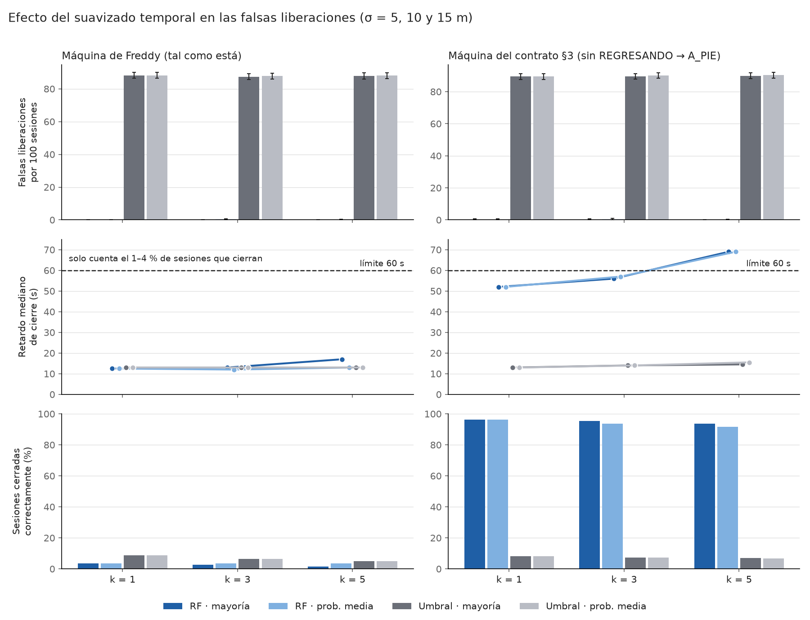
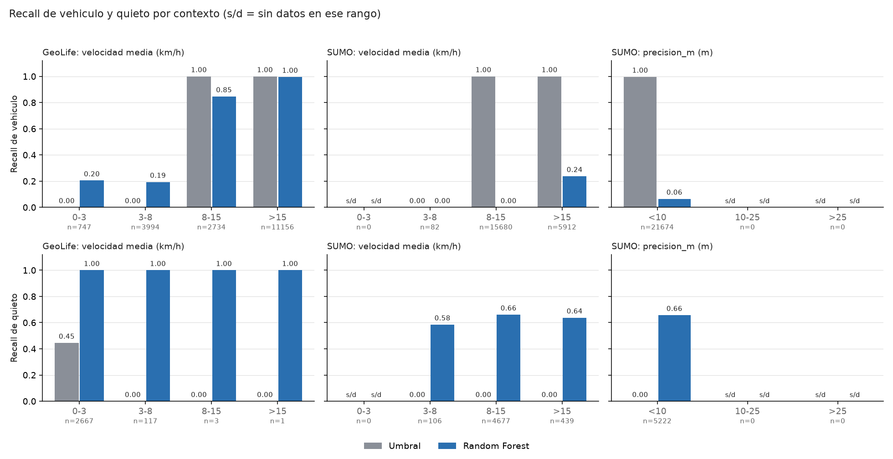
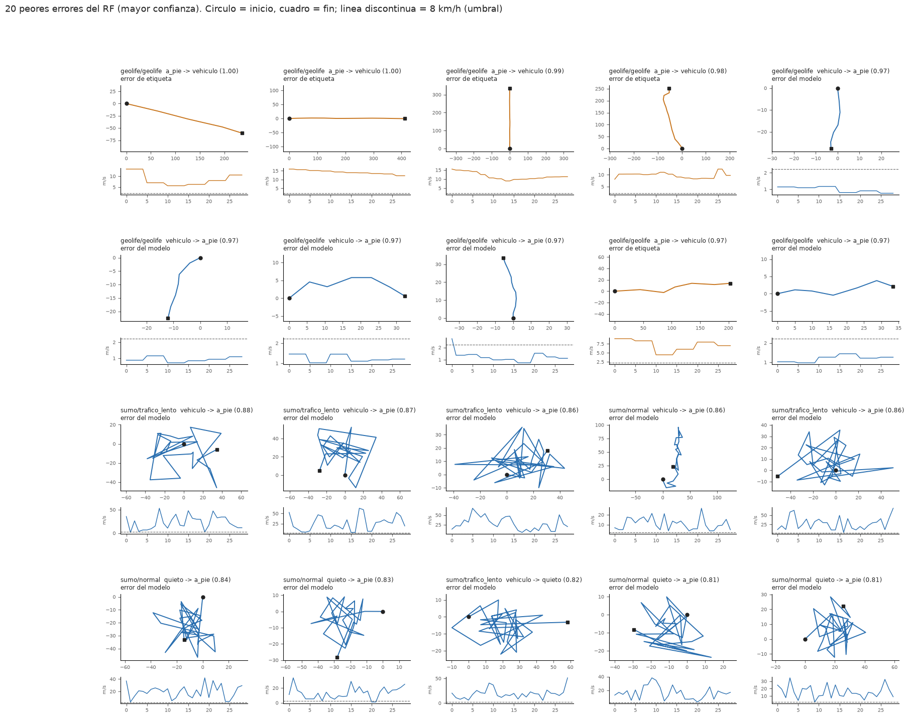

# S3 · Sesión 2 · Pablo: Análisis de errores y efecto del suavizado en las falsas liberaciones

## 1. Resumen en 5 líneas

El sistema no se juzga por la exactitud por ventana sino por cuántas sesiones se cierran mientras el
auto sigue estacionado (**falsa liberación**). Se analizó dónde se equivoca el clasificador (por
velocidad, precisión, σ, escenario y cercanía a cambios de modo) y se simularon 300 sesiones
completas de SUMO con ruido GPS de 5, 10 y 15 m para comparar 12 combinaciones de suavizado
(k = 1, 3, 5 × mayoría o probabilidad media × umbral o RF). El umbral del contrato falla con ruido
(88 falsas por 100 sesiones); el RF casi no libera en falso (≈ 0) y suavizar no mejora nada, solo
suma retardo, así que se recomienda **k = 1**. Además se encontró que la máquina de estados de
Freddy deja sin cerrar ~97 % de las sesiones por una transición que no está en el contrato.

## 2. Conceptos clave

- **Falsa liberación:** la sesión pasa a `CERRADA` (puesto libre) mientras el modo real no es
  `vehiculo`. Para cerrar hacen falta dos ventanas seguidas clasificadas `vehiculo` con el teléfono a
  más de 20 m del puesto, así que un solo error suelto no basta.
- **Suavizado temporal por voto de mayoría:** el modo que sale es el más votado en las últimas `k`
  ventanas (en empate, el más reciente). Con `k = 1` no cambia nada.
- **Suavizado por probabilidad media:** se promedian las probabilidades de las últimas `k` ventanas y
  se toma la clase más probable. En el umbral (sin probabilidades) se usa un vector de una sola clase.
- **Retardo de cierre:** instante del cierre menos el instante en que el auto sale de verdad. Cada
  ventana extra de suavizado añade hasta 5 s.
- **Bootstrap sobre sesiones:** se remuestrean sesiones completas con reemplazo (2 000 veces) y el
  percentil 2,5 y 97,5 de la métrica da el intervalo de confianza del 95 %. Las tres σ de una misma
  sesión se remuestrean juntas porque no son independientes.
- **Máquina de estados del contrato vs. de Freddy:** la de Freddy tiene una regla extra
  (`REGRESANDO → A_PIE`, "se volvió a alejar") que no figura en la tabla del contrato §3.

## 3. Cómo se generó cada cosa

| Resultado | Comando | Entradas → salidas |
|---|---|---|
| Episodios de parqueo de SUMO | `docker exec -w /home/vanet/results/e-sert/semanas/S3/Pablo/codigo van3twin bash -lc "python3 ia/grabar_episodios.py --semilla 101 --hasta 4800"` (semillas 101–105) | escenario de Tyrone + peatones de Freddy → `ia/sumo/salidas/episodios_s<semilla>.csv` (ignorado por git, 160 MB c/u) |
| Simulación de falsas liberaciones | `python3 -m ia.simular_falsas --max-sesiones 300` | episodios + `ia/ruido.py` + `rf_v1` → `ia/reportes/suavizado_k.csv` y `suavizado_k_contrato.csv` |
| Análisis de errores | `python3 -m ia.analisis_errores` | GeoLife de prueba + escenarios SUMO → `errores_contexto.csv`, `errores_confusion.csv`, `peores_errores.csv` |
| Gráfica de suavizado | `python3 -m ia.graficar_suavizado` | los dos CSV de suavizado → `evidencias/s2_suavizado-falsas-liberaciones.png` |

## 4. Mapa de archivos

| Archivo | Qué contiene | Quién lo usa |
|---|---|---|
| `ia/suavizado.py` | `Suavizador(k, metodo)` con estado por usuario | `simular_falsas.py`, Freddy |
| `ia/grabar_episodios.py` | hook de SUMO que guarda trazas limpias de cada sesión | simulación |
| `ia/simular_falsas.py` | ruido → clasificador → suavizador → máquina → métricas, rejilla de 12 | informe, Tyrone |
| `ia/analisis_errores.py` | recall por contexto y 20 peores errores | informe |
| `ia/graficar_suavizado.py` | figura de evidencia | informe |
| `ia/reportes/conclusiones_s3.md` | tablas y conclusiones con cifras | informe (S3-3) |
| `ia/tests/test_suavizado_falsas.py`, `test_analisis_errores.py` | tests del suavizador, de la simulación y de los contextos | CI |

## 5. Recorrido del código

**`Suavizador.actualizar(resultado, probas)`** recibe un `ResultadoModo` y devuelve otro. Con
`mayoria` guarda los últimos `k` modos; con `prob_media` los últimos `k` vectores de probabilidad.

```python
for modo in reversed(self._historial_modos):  # empate: gana el mas reciente
    if votos[modo] == mejor:
        return modo
```

**`simular_falsas.simular_sesion(ep, w, sistema, metodo, k, maquina)`** recorre las ventanas de
una sesión, suaviza y alimenta la máquina de estados. Devuelve 1 (falsa liberación), 0 (cierre
correcto, con su retardo) o −1 (sin cierre).

```python
for tr in maq.actualizar(modo, float(w.dist_m[j]), float(w.t_fin[j])):
    if tr.hacia == "CERRADA":
        if CLASES[w.modo_real[j]] != "vehiculo":
            return 1, np.nan                     # falsa liberación
        return 0, float(w.t_fin[j]) - ep.t_salida  # cierre correcto: retardo
```

**`MaquinaContrato`** hereda de la máquina de Freddy y le quita `REGRESANDO → A_PIE`, para medir
el efecto de esa regla. **`clasificar_episodios`** clasifica por tandas (umbral vectorizado; RF con
`clasificar_lote`) para no llenar la memoria.

## 6. Cómo se conecta con los demás

- **Consume de Freddy:** `proyecto/traci/estados.py` (`MaquinaSesion`), el controlador y los
  peatones (`GestorPeatones`). **De Tyrone:** el escenario SUMO. **De S3-1:** `clasificar_lote` con
  probabilidades.
- **Entrega:** k recomendado (1, sin suavizado) y el hallazgo sobre `REGRESANDO → A_PIE` a Freddy;
  la tabla de 12 combinaciones y las figuras a la sección de IA del informe (S3-3).

## 7. Resultados y evidencias

Con la máquina de Freddy: umbral 88 falsas /100 [86; 90]; RF 0,0 a 0,3 /100; RF cierra bien solo el
1,4–3,7 % de las sesiones. Con la máquina del contrato: RF cierra bien el 96,2 % (k = 1) con retardo
mediano de 52 s (k = 1), 56 s (k = 3) y 69 s (k = 5, supera los 60 s).







## 8. Limitaciones y decisiones

- El ruido es AR(1) (sin multitrayecto real) y el buffer del teléfono empieza al estacionar, como
  en `ControlSesiones`.
- Se usaron sesiones completas (las que vuelven a manejar) y una muestra de 300 de 1 784.
- No se validó k en la corrida `p50_rf_s1` de 1 800 s: el controlador no tiene parámetro de
  suavizado y las estadías duran mediana 43 min; queda como pedido a Freddy.
- El retardo del RF con la máquina de Freddy (12–17 s) solo cuenta las pocas sesiones que cierran,
  por lo que no es comparable con el de la máquina del contrato.
- El retardo y la gráfica van en paneles separados (no en un segundo eje) para no mezclar escalas.
- No se pudo medir el efecto de `precision_m` en SUMO: vale siempre 4–7,5 m.

## 9. Preguntas que podría hacer el profesor

**¿Por qué las falsas liberaciones y no la exactitud?** Porque liberar un puesto ocupado cuesta al
sistema; una ventana mal clasificada no lo hace si no se repite y el auto no está lejos del puesto.

**¿Por qué el umbral falla tanto aquí si en GeoLife funciona?** El ruido GPS autocorrelacionado
hace que un teléfono quieto parezca moverse a más de 8 km/h; con σ = 10 o 15 m todas las sesiones
tienen una falsa liberación.

**¿Por qué no se eligió k = 3 o 5?** Con RF las falsas liberaciones ya son ≈ 0 con k = 1; suavizar
solo añade retardo (52 → 69 s) y baja los cierres correctos. Se elige el menor k dentro del IC.

**¿Qué significa el hallazgo de `REGRESANDO → A_PIE`?** Cuando el auto arranca, la ventana de 30 s
aún parece caminata y la distancia pasa de 30 m, la sesión vuelve a `A_PIE` y ya no puede cerrarse.
Con la tabla literal del contrato cierra el 96,2 %.

**¿Qué tan fiables son los intervalos?** Son bootstrap sobre 300 sesiones; el RF tiene intervalos
estrechos (≤ 1 por 100) pero dependen del modelo de ruido AR(1), que no captura el multitrayecto real.
