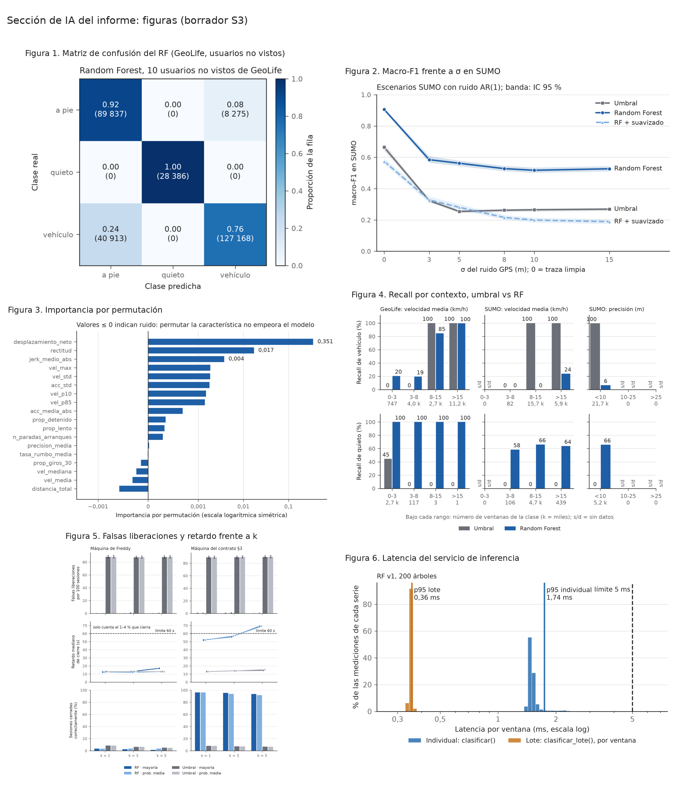

# S3 · Sesión 3 · Pablo: Borrador de la sección de IA del informe

## 1. Resumen en 5 líneas

Se escribió el borrador de la sección de IA del informe del proyecto (`informe/pablo.md`, unas 3 100
palabras, 9 subsecciones, 6 figuras, 2 tablas de resultados y una de clases por fuente). Cada cifra lleva al
lado un comentario con el archivo de donde sale, y un script (`verificar_cifras.py`) comprueba que
existan, para que el informe sea verificable y no dependa de la memoria de nadie. También se armó la
bibliografía (12 referencias comprobadas) y se regeneraron las figuras a 300 dpi. Las cifras del sistema
completo son de Tyrone y aún no existen: quedan como marcadores `[PENDIENTE]`, sin inventar números.

## 2. Conceptos clave

- **Trazabilidad de cifras:** cada párrafo o tabla con datos termina en `<!-- fuente: archivo -->`.
  El comentario no se ve al leer el informe, pero permite comprobar mecánicamente que el número está
  en el archivo de resultados. Así, si cambia un resultado, el script avisa de qué frase quedó vieja.
- **Cifra huérfana:** un número del texto que no aparece en la fuente declarada. El script las lista.
- **Comparación con redondeo:** `0,874` coincide con `0.8743` porque, redondeado a tres decimales, es
  igual; los enteros deben coincidir exactos, y los porcentajes pueden salir de una fracción por 100.
- **Falsa liberación y retardo de cierre:** son las métricas que importan al sistema (ver S3-2).
- **Marcador `[PENDIENTE]`:** señal visible de que falta una cifra de otra persona; evita rellenar con
  números supuestos.

## 3. Cómo se generó cada cosa

| Resultado | Comando | Entradas → salidas |
|---|---|---|
| Tabla de clases por fuente y resumen de sensibilidad | `python3 informe/tabla_clases.py` | parquet de S2 y métricas → `ia/reportes/clases_por_fuente.csv`, `sensibilidad_resumen.csv` |
| Figuras 1 a 6 (PNG y PDF, 300 dpi) | `python3 informe/figuras/ia/generar_figuras.py --latencia` | reportes de `ia/reportes/` → `informe/figuras/ia/fig*.png/.pdf` (con `--latencia` repite el benchmark, ≈ 2 min) |
| Bibliografía | (verificación manual contra Crossref y editoriales) | → `informe/referencias_ia.bib`, `informe/verificacion_referencias.md` |
| Comprobación de cifras | `python3 informe/verificar_cifras.py` | `informe/pablo.md` + fuentes → lista de huérfanas, imágenes rotas y claves inexistentes |
| Montaje de figuras | `python3 informe/montaje_figuras.py` | las 6 figuras → `evidencias/s3_informe-ia-figuras.png` |

## 4. Mapa de archivos

| Archivo | Qué contiene | Quién lo usa |
|---|---|---|
| `informe/pablo.md` | Sección de IA del informe (borrador) | Editor del informe, S4 |
| `informe/verificar_cifras.py` | Comprobador de cifras, imágenes y citas | Pablo, auditor |
| `informe/referencias_ia.bib` | 12 referencias BibTeX verificadas | Informe |
| `informe/verificacion_referencias.md` | Qué se comprobó de cada referencia | Revisión |
| `informe/figuras/ia/` | 6 figuras, PNG y PDF, y su script | Informe |
| `informe/tabla_clases.py`, `montaje_figuras.py` | Tablas derivadas y montaje | Esta sesión |

## 5. Recorrido del código

**`verificar_cifras.py`.** `bloques()` parte el documento en párrafos y tablas; `cifras()` extrae los números
comprobables (ignora años, enteros menores que 10, código entre comillas, enlaces y citas);
`numeros_fuente()` lee todos los números del archivo fuente; `coincide()` decide si uno de ellos iguala a
la cifra del texto con el redondeo y la escala correctos.

```python
def coincide(v, dec, fuentes):
    tol = 1e-9 if dec == 0 else 0.5 * 10 ** (-dec) + 1e-9
    for t in fuentes:
        for escala in (1.0, 100.0, 0.01):      # fracción, porcentaje, puntos
            if abs(t * escala - v) <= tol:
                return True
    return False
```

**`tabla_clases.py`** cuenta las ventanas por clase en los parquet y resume la sensibilidad a σ.
**`figuras/ia/generar_figuras.py`** dibuja las 6 figuras a partir de los reportes; la de latencia repite el
benchmark de S3-1.

## 6. Cómo se conecta con los demás

- **Consume** de S2 y S3-1/S3-2 (mis propios reportes) y, para la Sección 8, de Tyrone:
  `hallazgos.md` y `tabla_kpis.md` de `tyrone/s3`, que todavía no existen (por eso los `[PENDIENTE]`).
- **Entrega** a la edición del informe en S4: un borrador con el mismo formato de trazabilidad que deben
  seguir las secciones de Freddy y Miguel.

## 7. Resultados y evidencias

El borrador tiene 3 109 palabras, 190 cifras comprobadas sin huérfanas, 6 figuras y 12 referencias.



## 8. Limitaciones y decisiones

- Las cifras del sistema completo (Sección 8) quedan pendientes de Tyrone.
- No hay `pandoc` en el equipo: se renderizó con la biblioteca `markdown` de Python para comprobar
  imágenes y tablas; el render con citas (`--citeproc`) queda para S4.
- La rama `main` aún tenía la versión anterior de los reportes de S2-3; se tomaron los definitivos de
  `origin/pablo/s2` y se copiaron a mi módulo.
- Al redactar se detectó que una frase de S2-3 ("el ruido no es el factor dominante") contradice
  sus propias curvas; el informe la corrige.
- Se corrigió en `FUENTES.md` el DOI de Jun et al. (2006) y se aclaró que Groves (2011) es un artículo.

## 9. Preguntas que podría hacer el profesor

**¿Cómo sabe que las cifras del informe son correctas?** Cada una apunta al archivo del que sale y un
script comprueba que esté; además un auditor independiente las contrastó a mano.

**¿Por qué no hay cifras del sistema completo?** Son de otra persona (Tyrone) y aún no se generan; se
dejaron marcadores en lugar de inventar números.

**¿Qué cambió respecto a lo dicho en S2-3?** Las curvas frente a σ muestran que el ruido sí es el factor
dominante (0,906 sin ruido contra 0,56 con σ = 5 m), contra lo que decía el texto.

**¿Qué falta para S4?** Confirmar las cifras de Tyrone, repetir las métricas de SUMO con etiquetas
corregidas y decidir si se reentrena el modelo con datos de SUMO.
