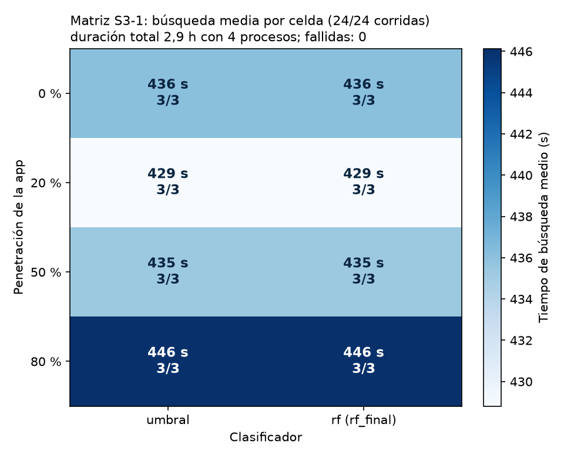
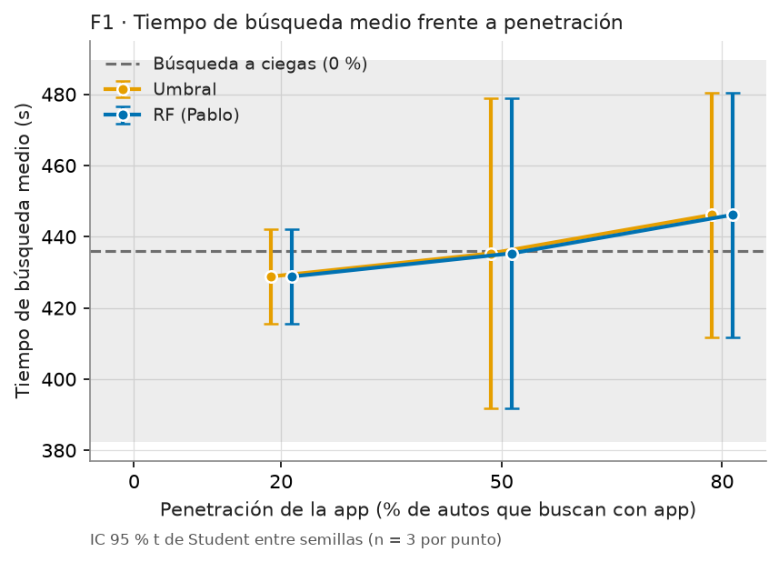
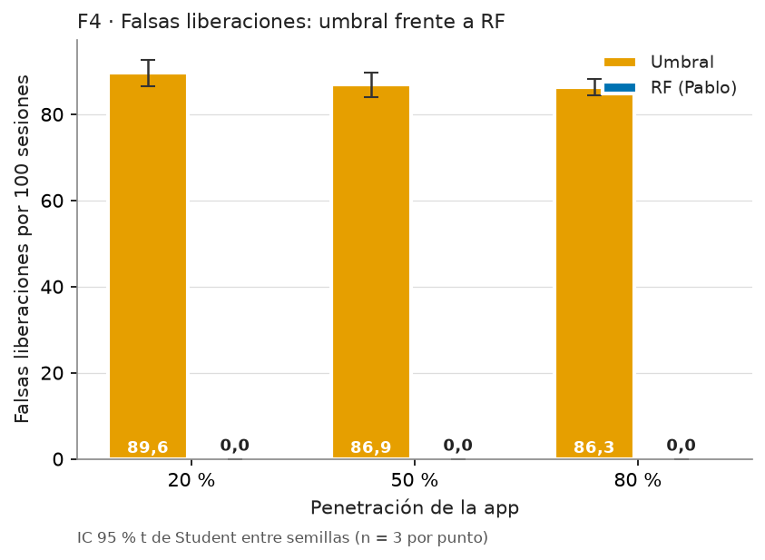
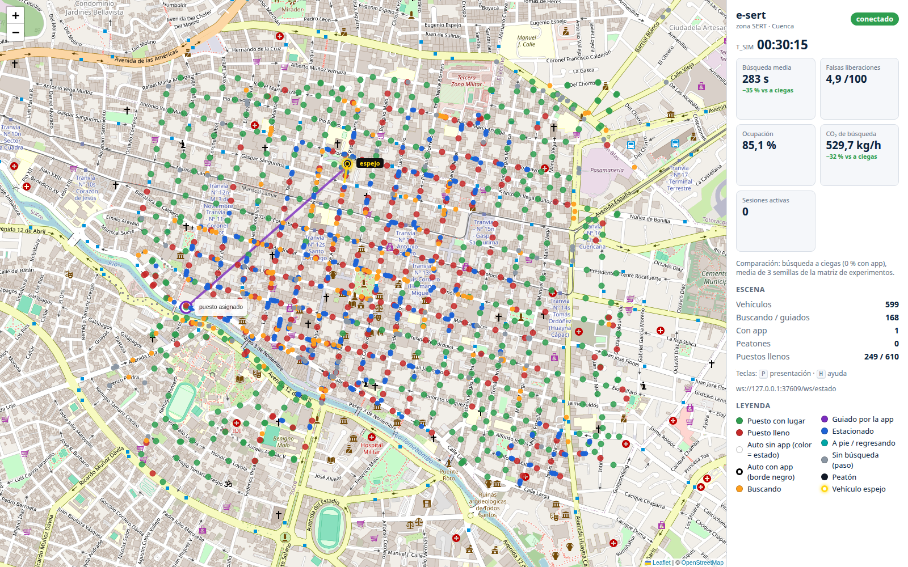
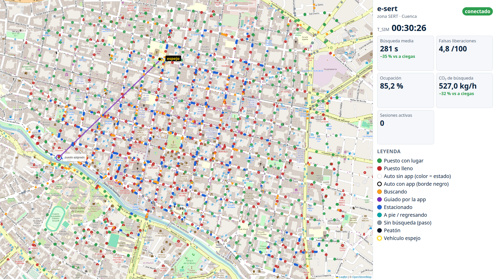
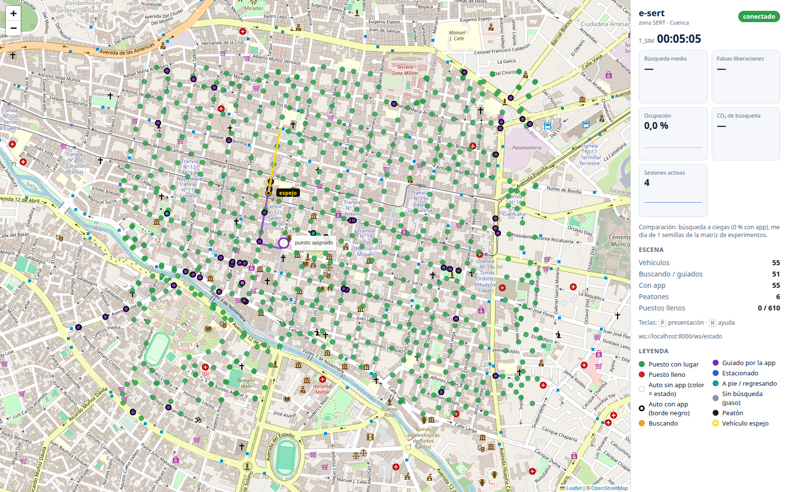

# Resumen S3 · Tyrone 🔵

## Sesión 1 · Ejecutor de experimentos: penetración × clasificador × semillas

`kpis/experimentos.py` corre la matriz {0, 20, 50, 80} % × {umbral, rf} × semillas {1, 2, 3} sobre el
controlador real de Freddy (guiado, peatones, GPS, sesiones y `KPIsSistema`) y el `rf_final` de
Pablo, exportado a numpy porque el contenedor no tiene scikit-learn 1.9.1.

- **24/24 corridas**, 0 fallidas, en 2,9 h con 4 procesos y libsumo. *Speedup* de 3,5× (240,7 s → 68,7 s).
- Reanudable por `hash_config`: al relanzar, "0 pendientes de 24". `--rapida` tarda 60,3 s.
- 7 tests en el contenedor: anidamiento de usuarios con app por semilla, hash, 0 % umbral = rf,
  determinismo y relanzar sin repetir.
- **Hallazgo:**
  - con el guiado actual, la búsqueda no baja con la app, y umbral y rf dan exactamente la misma
    búsqueda;
  - el guiado usa el mapa del sistema, que solo ve a los usuarios con app; con 87 % de ocupación
    real, guía a puestos que ya están llenos.

```bash
docker exec -w /home/vanet/results/e-sert/semanas/S3/Tyrone/codigo van3twin bash -lc "python3 -m kpis.experimentos --procesos 4"
```



[Explicación (PDF)](explicaciones/s1_explicacion.pdf)

## Sesión 2 · Análisis estadístico, figuras y tablas

`kpis/analisis.py` produce la tabla de KPIs (md y LaTeX), 10 hallazgos con IC 95 % y la base del
visor. `kpis/figuras.py` regenera F1–F8 (PNG + PDF) en 13 s.

- **Búsqueda a ciegas:** 436 s (IC 95 % 382–490, n = 3).
- **Δ pareado frente a a ciegas**, todos con IC que cruza el cero:

  | Penetración | Δ búsqueda |
  |---|---|
  | 20 % | −1,5 % |
  | 50 % | −0,1 % |
  | 80 % | +2,4 % |

- **Falsas liberaciones por 100 sesiones:** umbral 86–90, **rf 0,0** (Holm, p < 0,001).
- **Error de facturación:** umbral −0,15 USD por sesión (cierra antes y cobra de menos); rf +0,015 USD.
- 8 tests de análisis.





[Explicación (PDF)](explicaciones/s2_explicacion.pdf)

## Sesión 3 · Visor final: panel de KPIs, vehículo espejo y modo presentación

Pantalla de la demo:
- panel de KPIs comparado con la búsqueda a ciegas (`base.json` de la matriz real);
- halo del vehículo espejo con rastro, ruta y puesto asignado;
- modo presentación con las teclas `P`, `E`, `T` y `H`;
- reconexión automática.

Probado con el servidor de prueba y con el backend real de Freddy.

- **800 vehículos:** p95 por cuadro de 16,8 ms. Reconexión en 5,7 s. Retiro del halo 5,1 s después.
- 12 tests de node y 11 de pytest; QR de la demo; enlace "Demo en vivo" en el roadmap.








[Explicación (PDF)](explicaciones/s3_explicacion.pdf) · [Resumen semanal (PDF)](evidencias/resumen_S3_Tyrone.pdf)
