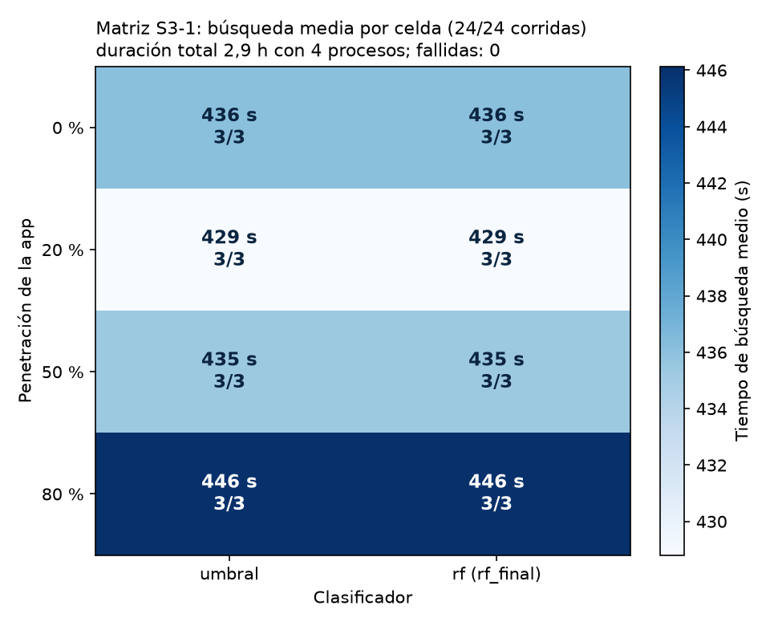

# S3 · Sesión 1 · Ejecutor de experimentos: penetración × clasificador × semillas

## 1. Resumen en 5 líneas

`kpis/experimentos.py` corre la matriz completa: penetración {0, 20, 50, 80} % × clasificador
{umbral, rf} × semillas {1, 2, 3} = 24 corridas de 75 min simulados. Lo hace en paralelo (4
procesos, *speedup* de 3,5×) y es reanudable: si se interrumpe, no repite lo ya escrito. Cada corrida
usa el controlador real de Freddy (guiado, peatones, GPS, clasificación y sesiones), calcula los KPIs
de búsqueda de S2-1 y los KPIs de sistema de Freddy. El resultado es `experimentos.csv`, una fila por
corrida, más `metadatos.json` para reproducirlo. De este CSV salen las figuras de S3-2 y la corrida
final de S4.

## 2. Conceptos clave

- **Números aleatorios comunes:** la demanda depende solo de la semilla. Los usuarios con app salen
  de un sorteo `u_i ~ U(0,1)` por buscador (`con_app = u_i < pen/100`), así 20 % ⊂ 50 % ⊂ 80 %. Las
  diferencias entre escenarios se deben a la app, no al azar de la demanda. Esto permite comparar
  **pareado por semilla** en S3-2.
- **`spawn` y `maxtasksperchild=1`:** TraCI y libsumo guardan estado global por proceso. Cada corrida
  necesita un intérprete nuevo, y `spawn` es además el único modo que existe en Windows.
- **Reanudable con `hash_config`:** cada corrida escribe `corridas/<id>.json` de forma atómica (`.tmp`
  + `os.replace`). El JSON lleva un SHA-256 del cfg canónico más los hashes de la red, los parqueos,
  la demanda de la semilla y el modelo. Al relanzar se saltan las corridas con JSON y el mismo hash.
  Si cambia una entrada, se repite solo lo afectado. Al 0 % el modelo no entra en el hash, porque no
  hay a quién clasificar.
- **libsumo:** SUMO enlazado dentro del proceso de Python, sin socket TraCI. Da los mismos KPIs que
  TraCI (comprobado con `p50_rf_s1`, 600 s) y es más rápido (perfil de Freddy en S3-2).
- **RF exportado a numpy (`kpis/modelo_plano.py`):** el contenedor tiene Python 3.10 y no existe
  scikit-learn 1.9.1 para esa versión. En la computadora se carga `rf_final.joblib` y se guardan los
  arrays del `BosquePlano` de Pablo en un `.npz`. En el contenedor se reconstruye sin sklearn, con las
  mismas probabilidades (diferencia máxima de 5·10⁻⁹ en 500 ventanas) y la misma clase en el 100 %
  de los casos.
- **Warm-up:** los primeros 15 min llenan la red y los puestos. Solo cuentan los buscadores que
  estacionan en [900 s, 4500 s].

## 3. Cómo se generó cada cosa

Desde `semanas/S3/Tyrone/codigo`; lo que usa SUMO va dentro del contenedor:
`docker exec -w /home/vanet/results/e-sert/semanas/S3/Tyrone/codigo van3twin bash -lc "<comando>"`.

| Resultado | Comando | Entradas → salidas |
|---|---|---|
| Demandas de las semillas 1–5 | `cd sumo/escenarios && python3 generar_escenarios.py --semillas 1 2 3 4 5` | red y destinos → `*_s<N>.rou.xml` (ignorados), `escenarios.json` |
| RF exportado (computadora) | `proyecto/ia/.venv/bin/python -m kpis.modelo_plano exportar --joblib kpis/externo/ia/modelos/rf_final.joblib --salida kpis/externo/rf_final.plano.npz` | `rf_final.joblib` (SHA-256 `1bdac0d7…`) → `.npz` |
| Corrida rápida | `python3 -m kpis.experimentos --rapida` | 600 s × 2 corridas → `resultados/rapida/experimentos.csv` |
| *Speedup* | `python3 -m kpis.experimentos --speedup` | 8 corridas cortas con 1 y 4 procesos → `resultados/speedup.json` |
| Matriz completa | `python3 -m kpis.experimentos --procesos 4` | 24 corridas → `resultados/corridas/*.json`, `experimentos.csv`, `metadatos.json`, `progreso.log` |
| Tests | `python3 -m pytest kpis/tests/test_experimentos.py` (contenedor) | 7 pruebas (anidamiento por semilla incluido) |
| Evidencia | `kpis/.venv/bin/python -m kpis.evidencia_matriz` | `experimentos.csv` + `metadatos.json` → `evidencias/s1_matriz-progreso.png` |

## 4. Mapa de archivos

| Archivo | Qué contiene | Quién lo usa |
|---|---|---|
| `kpis/matriz.yaml` | la matriz: penetraciones, clasificadores, semillas, duración, modelo, timeout | `experimentos.py` |
| `kpis/correr_una.py` | `correr(cfg) -> dict`: una corrida aislada (también `--publicar`/`--gui` para la demo) | ejecutor, demo de S4 |
| `kpis/experimentos.py` | pool, hash, reanudación, reintento, log, CSV y metadatos | Tyrone S3-2 y S4-2 |
| `kpis/modelo_plano.py` | exportar e instalar el RF sin sklearn | `correr_una.py` |
| `kpis/resultados/experimentos.csv` | una fila por corrida | `kpis/analisis.py`, `kpis/figuras.py` |
| `kpis/resultados/corridas/<id>.json` | fila + KPIs de sistema + `hash_config` | reanudación, S4-2 |
| `kpis/resultados/vehiculos/<id>.csv.gz` | detalle por vehículo (ignorado por git) | CDF de S3-2 |
| `kpis/resultados/sesiones/<id>.csv.gz` | detalle por sesión de `KPIsSistema` | figura de retardo de cierre |
| `kpis/resultados/metadatos.json` | fecha, commit, SUMO, Python, hashes, procesos, duración y fallidas | informe |

## 5. Recorrido del código

- **`correr_una.correr(cfg)`:** fija `ESERT_CLASIFICADOR` y el paquete `ia`, instala el RF si
  `clf == rf`, redirige el escenario de Freddy a esta copia de `sumo/`
  (`ck.preparar_escenario = lambda …: sumocfg`) y pasa las salidas XML a `sumo/salidas/<id>/` con
  argumentos de SUMO. Si se pidió rf y la inferencia no usó ventanas `rf`, falla en voz alta (así no
  repite lo de S3, donde se cayó al umbral sin aviso).

```python
res = ck.correr(ident, hasta=duracion, con_kpis=True, gps_semilla=sem, args_sumo=args_sumo,
                libsumo=bool(cfg.get("libsumo", False)) and not cfg.get("gui"), guardar_csv=True,
                publicar=cfg.get("publicar"), ritmo=cfg.get("ritmo"))
sistema = res.get("kpis") or {}
fuentes = res.get("ventanas_por_fuente", {})
if clf == "rf" and pen > 0 and not fuentes.get("rf"):
    raise RuntimeError(f"{ident}: se pidió rf pero la inferencia usó {fuentes}")
vehs, serie, info = kp.calcular(salidas, dir_sumo=rutas["sumo"], ruta_demanda=rou)
vehs = vehs[(vehs["fin_s"] >= warm) & (vehs["fin_s"] <= duracion)]
```

- **`experimentos.hash_config`:** SHA-256 de `{cfg sin carpetas, hashes, demanda}`.
- **`experimentos.ejecutar`:** rondas de `Pool(spawn, maxtasksperchild=1)` con `apply_async` y
  `get(timeout)`. Una corrida que falla deja `<id>.error.json`, vuelve a la cola una vez y no frena a
  las demás.
- **`experimentos.consolidar`/`metadatos`:** escriben el CSV en el orden de la matriz y los
  metadatos. Como el contenedor no tiene `git`, el commit se lee de `.git/HEAD`.

## 6. Cómo se conecta con los demás

- **Freddy:** `proyecto/traci/correr_kpis.correr` (controlador, guiado, peatones, sesiones) y
  `KPIsSistema.resumen()`: `falsas_lib_100`, `retardo_cierre_mediana_s`, `error_fact_medio_usd` y
  `precision_mapa`. Se usan tal cual, sin mock.
- **Pablo:** `rf_final` de `origin/pablo/s4` (congelado; SHA-256 comprobado contra
  `rf_final.json`) y su `ia/inferencia.py` (`clasificar_lote`).
- **Entrega:** `experimentos.csv` para S3-2 (análisis y figuras), `base.json` para el visor y la
  base de la corrida final de S4-2.

## 7. Resultados y evidencias

| Criterio | Medida |
|---|---|
| Matriz completa | 24/24 corridas, 0 fallidas, 0 reintentos; 2,9 h (10 320 s) con 4 procesos y libsumo |
| Duración por corrida | 1 321–2 175 s reales por 4 500 s simulados (media de 1 670 s, con 4 en paralelo) |
| `--rapida` | 2 corridas de 600 s (`p00_umbral_s1`, `p50_rf_s1`): 60,3 s con 1 proceso (meta < 5 min) y deja `resultados/rapida/experimentos.csv` |
| *Speedup* | 8 corridas de 600 s: 240,7 s con 1 proceso y 68,7 s con 4 → 3,5× |
| Reanudación | relanzar con las 24 hechas: "0 pendientes de 24", consolida en 0,1 s |
| Teletransportes | máximo 0,12 % de los vehículos insertados |
| rf real, no umbral | `p50_rf_s1`: 179 161 ventanas clasificadas por `rf` (15 por umbral de respaldo y 14 sin datos) |
| Tests | 7 en el contenedor (anidamiento por semilla, hash, 0 % umbral = rf, determinismo y relanzar sin repetir) |

**Lo que muestran las cifras** (detalle e IC en S3-2):
- **La búsqueda no baja con la app.** A ciegas, la búsqueda media es de 436 s; al 20, 50 y 80 % de usuarios es de 429, 435 y 446 s, y todos los IC pareados cruzan el cero.
- **Umbral y rf dan la misma búsqueda.** A igual penetración y semilla, la fila de búsqueda es idéntica con los dos clasificadores. Solo cambian las falsas liberaciones: unas 87 por 100 sesiones con umbral frente a 0 con rf.
- **La causa es el guiado de Freddy (`Guia`, fuente `"mapa"`).**
  - Recomienda puestos según el mapa del sistema, que solo cuenta las sesiones de la app.
  - Con 87 % de ocupación real, casi toda de autos sin app, el mapa ve libres puestos que están llenos. El auto guiado llega a un puesto ocupado y busca igual.
  - Una falsa liberación solo suma un libre en un mapa que ya los ve libres, así que nunca cambia la recomendación.
  - Es lo mismo que Freddy midió en S2 ("búsqueda con app menor que sin app: no se cumple con la fuente del sistema y sí con la ocupación real").
  - En S4-2 se añade un escenario de sensibilidad con el guiado viendo la ocupación real (oráculo).



## 8. Limitaciones y decisiones

- **`rf_v1` → `rf_final`:** `rf_v1.joblib` no está en el repo (`*.joblib` está en `.gitignore`) y
  sklearn 1.9.1 no existe para el Python 3.10 del contenedor. Por eso en S3 Freddy corrió "rf" que en
  realidad era umbral. Se usó `rf_final` (el modelo congelado de S4 de Pablo) exportado a numpy, así
  la matriz de S3 ya mide el modelo final.
- **El sorteo de `con_app`** usa `numpy.default_rng([semilla, 7])` (S2-3) en lugar de
  `random.Random(semilla)`. Cumple la misma propiedad (anidamiento, comprobado por test) y no obliga
  a regenerar los escenarios.
- **Timeout de 3600 s en lugar de 1800 s:** con 4 corridas a la vez en 4 núcleos, una corrida
  completa tarda unos 26–30 min, al borde de los 1800 s.
- **El *speedup* se midió con TraCI y corridas de 600 s;** la matriz completa usa libsumo.

## 9. Preguntas que podría hacer el profesor

1. **¿Por qué solo 3 semillas?** Cada corrida dura ~26 min con 4 en paralelo. 24 corridas son ~3 h
   de cómputo; la corrida final de S4 amplía a 5 semillas. Con n = 3, los IC t son anchos y así se
   reportan.
2. **¿Cómo sabe que umbral y rf no difieren por azar al 0 %?** Al 0 % no hay usuarios que clasificar
   y la simulación es determinista con la misma semilla: la corrida completa dio filas idénticas
   (test de determinismo).
3. **¿Qué pasa si se corta la luz a mitad de la matriz?** Se relanza el mismo comando: las corridas
   con JSON y el mismo hash se saltan (test `test_relanzar_tras_interrupcion_no_repite`).
4. **¿Por qué el *speedup* no es 4×?** Hay 4 núcleos y el proceso padre, el sistema y la E/S de los
   XML compiten con los 4 hijos: 3,5× es el 88 % del ideal.
5. **¿Por qué la búsqueda a ciegas da más que en S2?** El controlador de Freddy añade peatones,
   guiado y sesiones, y ahora solo cuentan los autos que estacionan después del *warm-up* (en S2
   contaban todos). La definición de búsqueda es la misma.
