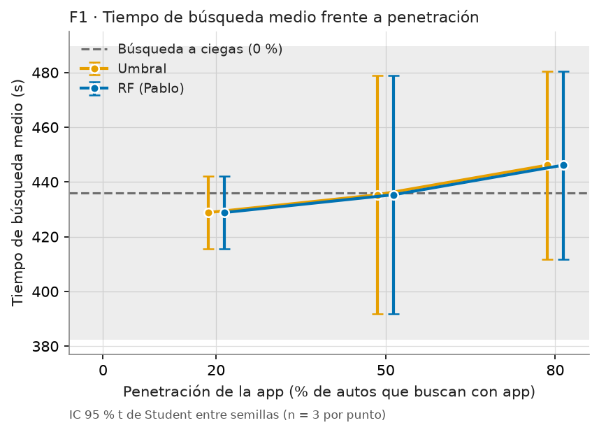
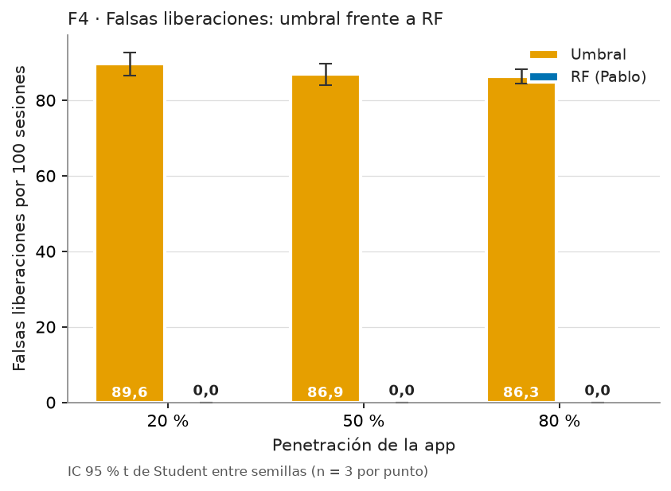

# S3 · Sesión 2 · Análisis estadístico, figuras y tablas de la matriz

## 1. Resumen en 5 líneas

`kpis/analisis.py` convierte las 24 corridas de `experimentos.csv` en tablas (`tabla_kpis.md` y
`.tex`), en 10 hallazgos con cifras e IC 95 % (`hallazgos.md`) y en la línea base del visor
(`base.json`). `kpis/figuras.py` regenera las 8 figuras F1–F8 en PNG y PDF en 13 s. El resultado
principal: con el guiado actual, la app **no** reduce la búsqueda (todos los IC pareados cruzan el
cero), pero el RF de Pablo elimina las falsas liberaciones: 0 por 100 sesiones frente a ~87 con el
umbral. Pablo y Freddy usan las figuras y los hallazgos en el informe.

## 2. Conceptos clave

- **La réplica es la semilla.** Cada semilla es una demanda distinta. Los vehículos de una misma
  corrida no son independientes: comparten tráfico y puestos. Por eso el IC principal es t de
  Student entre las medias de las 3 semillas: `media ± t(0,975; 2) · s/√3`, con t = 4,303. Es ancho
  y así se reporta.
- **Bootstrap BCa sobre vehículos:** IC complementario (10 000 remuestreos, semilla 0) que junta los
  vehículos de las 3 semillas. Es más estrecho porque ignora la correlación dentro de la corrida. Va
  solo en la tabla, rotulado.
- **Comparación pareada (números aleatorios comunes):** como la demanda de la semilla s es la misma
  en todas las penetraciones, `d_s = KPI(p, s) − KPI(0, s)` quita la variabilidad entre semillas. Se
  reporta la media de `d` con su IC t y el cambio relativo en %.
- **Holm:** al comparar umbral con rf en 3 penetraciones con `ttest_rel`, se corrigen los 3 valores p
  (`multipletests(method="holm")`) para no encontrar diferencias por azar.
- **Paleta apta para daltónicos (Okabe-Ito):** rf en azul `#0072B2`, umbral en naranja `#E69F00` y la
  línea base en gris discontinuo con su banda IC. La CDF usa un solo tono, de claro a oscuro.

## 3. Cómo se generó cada cosa

Desde `semanas/S3/Tyrone/codigo`, en la computadora (no usa SUMO):

| Resultado | Comando | Entradas → salidas |
|---|---|---|
| Tablas, hallazgos y base del visor | `kpis/.venv/bin/python -m kpis.analisis` | `experimentos.csv` → `tabla_kpis.md`, `tabla_kpis.tex`, `hallazgos.md`, `visor/datos/base.json` |
| Figuras F1–F8 | `kpis/.venv/bin/python -m kpis.figuras` (13,3 s) | `experimentos.csv`, `vehiculos/*.csv.gz`, `sesiones/*.csv.gz` → `kpis/figuras/F*.png` y `.pdf` |
| Tests | `PYTEST_DISABLE_PLUGIN_AUTOLOAD=1 kpis/.venv/bin/python -m pytest kpis/tests/test_analisis.py` | 8 pruebas |
| Evidencias | copia de F1 y F4 | `evidencias/s2_busqueda-vs-penetracion.png`, `s2_falsas-liberaciones.png` |

## 4. Mapa de archivos

| Archivo | Qué contiene | Quién lo usa |
|---|---|---|
| `kpis/analisis.py` | `ic95`, `resumen`, `bootstrap_vehiculos`, `pareado`, `umbral_vs_rf`, tablas, hallazgos, `exportar_base` | `figuras.py`, informe |
| `kpis/figuras.py` | F1–F8 con estilo único (6,4 × 4 in, 10 pt) | informe, diapositivas |
| `kpis/resultados/tabla_kpis.md` / `.tex` | media ± semiancho, Δ pareado y bootstrap por escenario | informe (Pablo) |
| `kpis/resultados/hallazgos.md` | 10 frases con cifras e IC | sección de IA (Pablo) |
| `kpis/figuras/F*.{png,pdf}` | las 8 figuras | informe |
| `visor/datos/base.json` | medias de la búsqueda a ciegas | panel del visor (S3-3) |
| `kpis/tests/test_analisis.py` | `ic95`, pareado sintético, figuras con 24 filas y con `NaN` | CI |

## 5. Recorrido del código

- **`ic95(valores)`:** descarta `NaN` y devuelve media, semiancho, `lo`, `hi` y el `n` real.
- **`pareado(df, kpi)`:** empareja cada corrida con la de penetración 0 de la misma semilla (solo
  semillas comunes sin `NaN`) y calcula la diferencia y el cambio relativo con su IC.

```python
def pareado(df: pd.DataFrame, kpi: str) -> pd.DataFrame:
    base = linea_base(df, kpi)
    filas = []
    for (pen, clf), g in df[df["penetracion"] > 0].groupby(["penetracion", "clasificador"], sort=True):
        g = g.set_index("semilla")[kpi]
        comunes = [s for s in g.index if s in base.index and not pd.isna(g[s]) and not pd.isna(base[s])]
        d = [g[s] - base[s] for s in comunes]
        rel = [100 * (g[s] - base[s]) / base[s] for s in comunes if base[s] != 0]
        icd, icr = ic95(d), ic95(rel)
        filas.append({"penetracion": pen, "clasificador": clf, "kpi": kpi, "n": icd["n"],
                      "dif_media": icd["media"], "dif_lo": icd["lo"], "dif_hi": icd["hi"],
                      "rel_media_pct": icr["media"], "rel_lo_pct": icr["lo"], "rel_hi_pct": icr["hi"],
                      "ic_cruza_cero": bool(icd["n"] < 2 or (icd["lo"] <= 0 <= icd["hi"]))})
    return pd.DataFrame(filas)
```

- **`umbral_vs_rf`:** `ttest_rel` por penetración sobre las semillas comunes y corrección de Holm.
- **`hallazgos`:** escribe la frase y añade "El IC cruza el cero: no hay mejora demostrada" cuando
  corresponde.
- **`figuras.generar`:** F1–F3, F6 y F7 comparten `figura_vs_penetracion` (puntos con barras IC y
  la banda de la línea base); `f4_falsas` dibuja barras agrupadas; `f5_retardo`, cajas por sesión
  más la media de medianas; `f8_cdf`, la CDF por vehículo.

## 6. Cómo se conecta con los demás

- **Consume:** `experimentos.csv` y el detalle por vehículo y por sesión de S3-1. Los KPIs de
  sistema (`falsas_lib_100`, `retardo_cierre_mediana_s`, `error_fact_medio_usd`, `precision_mapa`)
  son los de `KPIsSistema.resumen()` de Freddy.
- **Entrega:** a Pablo, F4, F7 y `hallazgos.md` para la sección de IA; a Freddy, F5–F7 para que
  revise que interpretan bien sus KPIs; al visor, `base.json`.

## 7. Resultados y evidencias

| KPI (media de 3 semillas) | 0 % | 20 % | 50 % | 80 % |
|---|---|---|---|---|
| Búsqueda media (s) | 436 ± 54 | 429 ± 13 | 435 ± 44 | 446 ± 34 |
| Δ pareado vs a ciegas | — | −1,5 % [−16,7; +13,8] | −0,1 % [−8,8; +8,6] | +2,4 % [−2,5; +7,2] |
| Falsas liberaciones /100, umbral | — | 89,6 ± 3,1 | 86,9 ± 2,8 | 86,3 ± 1,9 |
| Falsas liberaciones /100, rf | — | 0,0 | 0,0 | 0,0 |
| Retardo de cierre, rf (s) | — | 18,8 ± 13,4 | 18,0 ± 2,5 | 18,7 ± 2,9 |
| Error de facturación, rf (USD) | — | 0,013 | 0,016 | 0,015 |
| Error de facturación, umbral (USD) | — | −0,161 | −0,155 | −0,142 |

- **La búsqueda no mejora con la app** con el guiado actual: los tres IC pareados cruzan el cero. La
  causa está explicada en S3-1: el guiado usa el mapa del sistema, que solo ve a los usuarios con
  app.
- **El RF elimina las falsas liberaciones** (t pareada con Holm, p < 0,001). Con el umbral, casi 9
  de cada 10 sesiones se cierran antes de tiempo, y el error de facturación es negativo: se cobra
  ~0,15 USD de menos.
- **La ocupación (87,4–87,5 %) y la búsqueda son idénticas con umbral y rf**: la clasificación no
  cambia el tráfico porque no cambia ninguna recomendación del guiado.





## 8. Limitaciones y decisiones

- **n = 3 semillas:** los IC t son anchos (±54 s a ciegas). La corrida final de S4 usa 5.
- **Precisión del mapa ≈ 58 % incluso al 0 %:** `KPIsSistema` compara el mapa del sistema (que al 0 %
  ve todo libre) con la ocupación real. Con 87 % de ocupación real, la precisión no puede subir
  mucho si solo se conocen los autos con app. Es la misma causa del guiado.
- **CO₂ en kg/h de la zona:** suma del CO₂ de búsqueda de los vehículos que estacionan en la hora
  medida (definición de S2-1), no por vehículo. La corrida final reporta también g por vehículo.
- **Sin subagentes para `figuras.py` y tablas:** se escribieron en la misma sesión, sobre la interfaz
  ya fijada de `analisis.py`.

## 9. Preguntas que podría hacer el profesor

1. **¿Por qué el IC principal es entre semillas y no entre vehículos?** Los vehículos de una corrida
   comparten tráfico y puestos; tratarlos como independientes daría IC falsamente estrechos. El
   bootstrap por vehículos se muestra aparte, rotulado.
2. **¿Entonces la app no sirve?** Con el guiado actual, no reduce la búsqueda: el sistema solo
   conoce los puestos que ocupan sus usuarios. El escenario de oráculo de S4 mide cuánto ganaría con
   información de ocupación completa.
3. **¿Por qué umbral y rf dan la misma búsqueda si sus falsas liberaciones son tan distintas?** Una
   falsa liberación libera un puesto en un mapa que ya lo veía libre; nunca cambia la recomendación.
   Sí cambia el cobro y el cierre de las sesiones.
4. **¿Qué significa un error de facturación negativo?** Que la sesión se cerró antes de que el
   conductor volviera: se cobra menos tiempo del real (lo que hace el umbral).
5. **¿Cómo se reproduce todo?** `python -m kpis.analisis` y `python -m kpis.figuras` desde
   `experimentos.csv`, en unos 15 s y sin SUMO.
