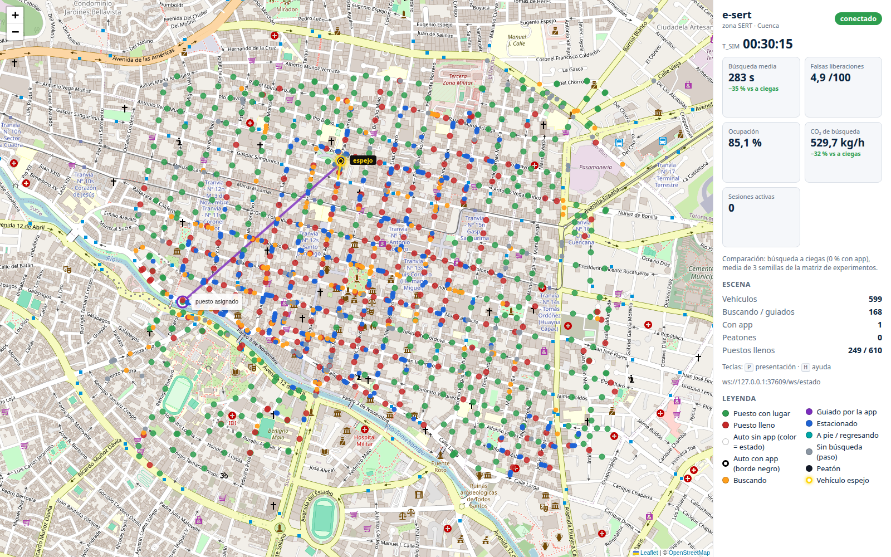
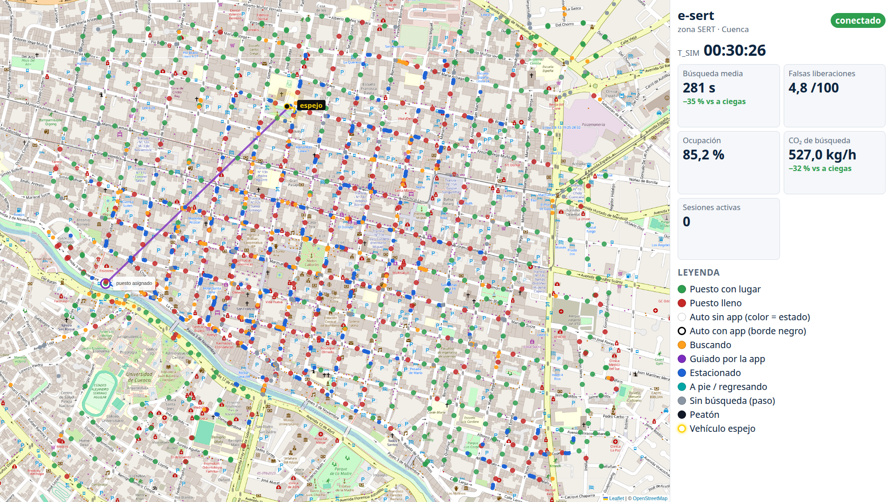
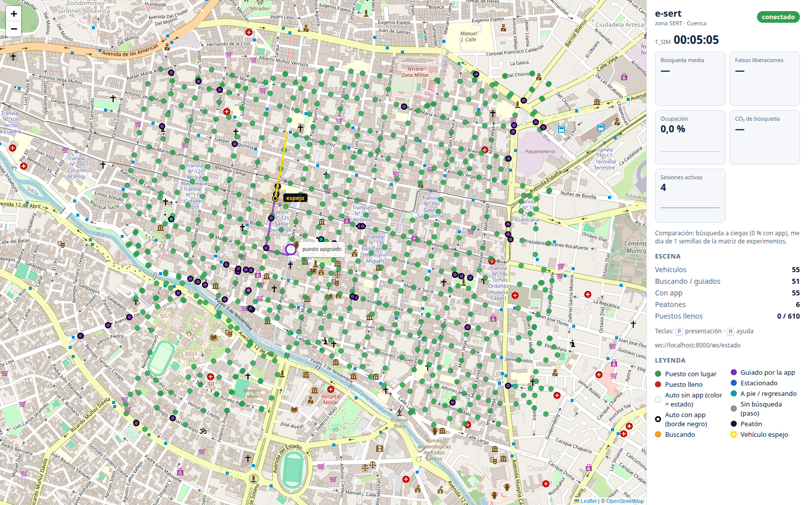

# S3 · Sesión 3 · Visor final: panel de KPIs, vehículo espejo y modo presentación

## 1. Resumen en 5 líneas

El visor de S2 pasó a ser la **pantalla de la demo**. Ahora tiene un panel de KPIs en vivo que se
compara con la búsqueda a ciegas, resalta con un halo el vehículo que sigue el teléfono espejo
(con su rastro, su ruta y el puesto asignado) y tiene un modo presentación para el proyector (teclas
`P`, `E`, `T` y `H`). Funciona con el servidor de prueba y con el backend real de Freddy. Se
reconecta solo si se corta el WebSocket y dibuja 800 vehículos con un p95 de 16,8 ms por cuadro.

## 2. Conceptos clave

- **Mensaje `kpi` (contrato §6):** el backend difunde `{"tipo":"kpi","valores":{...}}`. Los nombres
  están reservados (`busqueda_media_s`, `falsas_liberaciones_100`…). El panel acepta también nombres
  alternativos y, si un valor no llega, muestra "—" en lugar de inventarlo.
- **Estado derivado del snapshot:** la ocupación y las sesiones activas se calculan en el navegador
  con cada `snapshot`, porque el backend no las manda en `kpi`.
- **Comparación con la búsqueda a ciegas:** `kpis/analisis.py` exporta `visor/datos/base.json` con
  las medias de penetración 0 de la matriz de experimentos. El panel muestra "−X % vs a ciegas" en
  verde si mejora y en rojo si empeora.
- **Redibujo limitado a 2 Hz:** los mensajes solo marcan "hay cambios"; `requestAnimationFrame` pinta
  como mucho cada 500 ms (`Limitador`). Las minigráficas usan Chart.js 4.4.1 sin animación.
- **Vehículo espejo:** es un auto simulado cuya pantalla muestra el teléfono de Miguel. Todo es
  simulado: ningún teléfono manda su GPS. Su ID llega en `snapshot.espejos`. Si el conductor se bajó,
  el halo pasa a su peatón (`ped_<veh>`). Cuando el ID sale de la lista o llega `espejo_fin`, el halo
  se retira a los 5 s (`SeguimientoEspejos`).
- **`L.canvas` y `L.circleMarker`:** con canvas, miles de marcadores no crean elementos del DOM. Las
  posiciones se actualizan en el sitio (`setLatLng`) y no se recrean capas.
- **Reconexión exponencial:** tras un corte, los reintentos van cada 1, 2, 4, 8, 16 y luego 30 s.

## 3. Cómo se generó cada cosa

Comandos desde `semanas/S3/Tyrone/codigo`:

| Resultado | Comando | Entradas → salidas |
|---|---|---|
| Tests de lógica pura | `node --test visor/tests/*.test.mjs` | `visor/js/logica.js` → 12 tests |
| Tests del servidor y estáticos | `visor/.venv/bin/python -m pytest visor/tests` | servidor de prueba → 11 tests |
| `visor/datos/base.json` | `kpis/.venv/bin/python -m kpis.analisis` | `kpis/resultados/experimentos.csv` → base de penetración 0 |
| Capturas y pruebas en el navegador | `visor/.venv/bin/python -m visor.captura todo` | servidor de prueba + Chromium → `evidencias/s3_visor-*.png` y medidas |
| Rendimiento con 800 vehículos | `python -m visor.captura rendimiento --vehiculos 800` | relleno sintético → p95 por cuadro |
| Prueba contra el backend real | backend de Freddy (`uvicorn backend.api.main:app`) + `python3 -m kpis.correr_una --id p50_rf_s1 --publicar http://<gw>:8000 --ritmo 4` en el contenedor | → `evidencias/s3_visor-backend-real.png` |
| QR de la demo | `qrcode` → `evidencias/s3_qr-demo.png` | `https://demo.e-sert.tesisucuenca.com/visor` |

## 4. Mapa de archivos

| Archivo | Qué contiene | Quién lo usa |
|---|---|---|
| `visor/index.html` | página: mapa, panel, ayuda; Leaflet y Chart.js desde CDN | proyector, profesor, teléfono |
| `visor/js/principal.js` | mapa, puestos, autos, conexión WS, depuración (`D`) | el navegador |
| `visor/js/panel_kpis.js` | tarjetas, "−X % vs a ciegas", minigráficas | `principal.js` |
| `visor/js/capa_espejo.js` | halo, rastro de 60 s, ruta y puesto por `/ws/espejo` | `principal.js`, Miguel en el ensayo |
| `visor/js/presentacion.js` | `P`, `E`, `T`, `H`, encuadre de la zona SERT | `principal.js` |
| `visor/js/logica.js` | lógica pura (formato, retiro, −X %, espera) | módulos y tests de node |
| `visor/css/visor.css` | estilos, halo pulsante, modo presentación ×1,5 | `index.html` |
| `visor/servidor_prueba.py` | reproductor de snapshots, `kpi` cada 5 s, espejos y `/ws/espejo` (MOCK) | tests, plan B de la demo |
| `visor/captura.py` | pruebas con Playwright y capturas | evidencias |
| `visor/datos/base.json` | medias de la búsqueda a ciegas | panel de KPIs |
| `roadmap/templates/base.html` | enlace "Demo en vivo" | roadmap |

## 5. Recorrido del código

- **`SeguimientoEspejos` (`logica.js`)** guarda, por cada ID, el instante en que debe retirarse.
  Volver a aparecer en `espejos` cancela el retiro.

```js
actualizar(espejos, ahoraS) {
  const lista = new Set(espejos || []);
  for (const id of lista) this.activos.set(id, { retirarEn: null });
  for (const [id, e] of this.activos) {
    if (!lista.has(id) && e.retirarEn === null) e.retirarEn = ahoraS + this.retiroS;
  }
  return this.purgar(ahoraS);
}
```

- **`CapaEspejo.onSnapshot`:** usa `posicionEspejo` (vehículo o su peatón), mueve el `L.marker` con
  `L.divIcon` (anillo con animación CSS) y alarga el rastro (`recortarRastro`, 60 s).
- **`CapaEspejo.onEspejo`:** con `?espejo=<veh>` pinta la `ruta` restante (línea morada), una línea
  punteada al puesto y el marcador "puesto asignado". El *popup* muestra el estado, el destino, el
  puesto, el costo y el recibo.
- **`PanelKpis.cada_cuadro`:** solo trabaja si el `Limitador` lo permite (2 Hz); calcula
  `cambioVsBase` y actualiza las minigráficas con `chart.update("none")`.
- **`Presentacion`:** `requestFullscreen`, la clase `presentacion` en `body` (variable CSS
  `--escala: 1.5`), `fitBounds` de los puestos, `panTo` cada segundo con `E` y `flyTo` cada 20 s con
  `T`.
- **`Reproductor` (`servidor_prueba.py`):** un solo reloj para todos los clientes, así el visor y
  `/ws/espejo` ven el mismo instante. Los espejos MOCK son 1 o 2 autos que buscan y quedan marcados
  con app.

## 6. Cómo se conecta con los demás

- **Consume:** `/ws/estado` (`snapshot`, `kpi`, `verdad`), `/api/v1/puestos`,
  `/api/v1/espejo/candidatos` y `/ws/espejo/{veh}` del backend de Freddy (contrato v1.2, §6 y §7);
  también `kpis/analisis.py` (`base.json`).
- **Entrega:** la pantalla de la demo (el backend la sirve en `/visor/`) y el parámetro
  `?espejo=<veh_id>` para el ensayo con el teléfono de Miguel.

## 7. Resultados y evidencias

| Criterio | Medida |
|---|---|
| Panel con mensajes `kpi` | servidor de prueba: `kpi` cada 5 s; backend real: 3 `kpi` en 15 s (Freddy los manda cada 10 s simulados) |
| Espejo resaltado, rastro, ruta y puesto | `sim_busca_0` con su ruta de 7 puntos y el puesto `pa_567060339#0_0` (backend real) |
| Retiro del resaltado | 5,1 s después de dejar de seguirlo |
| Teclas | `P` (entra y sale), `H`, `E` (cámara a 7 m del espejo), `T` (zona → Parque Calderón) |
| Reconexión | 5,7 s tras 8 s con el servidor apagado, sin recargar la página |
| Rendimiento con 800 vehículos | cuadro: media de 18,2 ms y p95 de 16,8 ms; snapshot: p95 de 31,9 ms (meta < 33 ms) |
| Tests | 12 de node y 11 de pytest (1 saltado: falta la grabación grande, ignorada por git) |








## 8. Limitaciones y decisiones

- **URL pública:** `demo.e-sert.tesisucuenca.com/visor` sirve el visor de `main`, que se despliega
  solo al hacer push a `main`. Este visor llega ahí con la unificación del domingo. Mientras tanto
  se verificó servido por el backend local en `/visor/`.
- **El `kpi` del backend no trae búsqueda media ni CO₂:** `KPIsSistema` de Freddy manda solo las
  métricas de sesión y de mapa. Esas tarjetas muestran "—" con el backend real (pedido a Freddy).
- **La ocupación del panel es la estimada por el sistema** (solo autos con app), no la real de SUMO.
  Por eso al inicio de una corrida puede marcar 0 %.
- Los espejos y `/ws/espejo` del servidor de prueba son MOCK, marcados así en el código.
- Las pruebas se hicieron con Chromium *headless*. No se pudo probar en un teléfono físico ni en el
  proyector: queda para el ensayo de S4-3.

## 9. Preguntas que podría hacer el profesor

1. **¿Por qué canvas y no SVG?** Con 800 autos y 610 puestos, SVG crea más de 1400 nodos en el DOM.
   Canvas pinta todo en un solo lienzo: p95 de 16,8 ms por cuadro.
2. **¿Qué pasa si se cae la red durante la exposición?** El visor reintenta cada 1, 2, 4… hasta
   30 s y se reconecta solo (5,7 s en la prueba). Además, el servidor de prueba puede reproducir una
   grabación.
3. **¿El vehículo resaltado es el teléfono?** No. Es un auto simulado; el teléfono solo muestra su
   pantalla (modo espejo). Ningún GPS real entra al sistema.
4. **¿De dónde sale el "−38 % vs a ciegas"?** Del valor en vivo frente a la media de penetración 0
   de la matriz de experimentos (`base.json`, exportado por `kpis/analisis.py`).
5. **¿Por qué 2 Hz para el panel?** Los KPIs cambian lento (Freddy los publica cada 10 s
   simulados). Redibujar a 60 Hz solo gastaría CPU que necesita el mapa.
