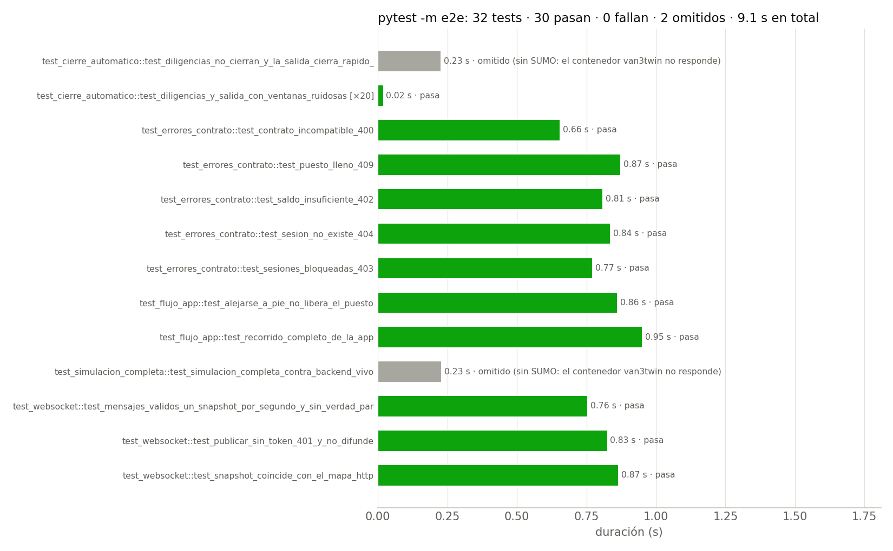

# S4 · Freddy 🍅: resumen semanal

## Sesión 1 · 2026-11-13 · Pruebas de punta a punta (`pytest -m e2e`)

Suite e2e que levanta el backend **real** (uvicorn en un puerto libre, SQLite temporal) y lo prueba como un cliente:
- **Recorrido de la app** (`test_flujo_app.py`): con saldo 0 no se puede estacionar (`SALDO_INSUFICIENTE`) → recarga por el adaptador Payphone mock de Miguel si está presente → `/guia` → sesión `ESTACIONADO` con $0,25 retenidos → 40 m a pie, vuelta y salida en vehículo → `CERRADA` sola (`traci/cierre_remoto.py`), con el cobro de `tarifa.json` y la retención liberada. Caso trampa: alejarse a pie no libera el puesto.
- **WebSocket**: cada mensaje se valida con `MensajeWS`; llega como máximo 1 snapshot por segundo simulado; `verdad` nunca llega a `rol=publico`.
- **Errores del contrato**: 402, 409, 404 y 403, cada uno con su formato exacto.
- **Con SUMO**: `test_simulacion_completa.py` (p20, semilla 1, 300 s, modo espejo e invariantes del libro) y `test_cierre_automatico.py`. Esta máquina no tiene Docker, así que se saltan limpio.

| Comando | Resultado |
|---|---|
| `pytest -m e2e` | 30 pasan · 2 omitidas (SUMO) · 9,1 s |
| `pytest` en `backend/tests` | 118 pasan · ~38 s |
| `pytest` en `traci/tests` | 72 pasan · 12 omitidas · ~8 s |
| `pytest -m vps` (demo) | 4 pasan · **2 fallan**: la demo acepta snapshots sin token (falta `ESERT_TOKEN_SIM`) |

Explicación: [explicaciones/s1_explicacion.pdf](explicaciones/s1_explicacion.pdf)
