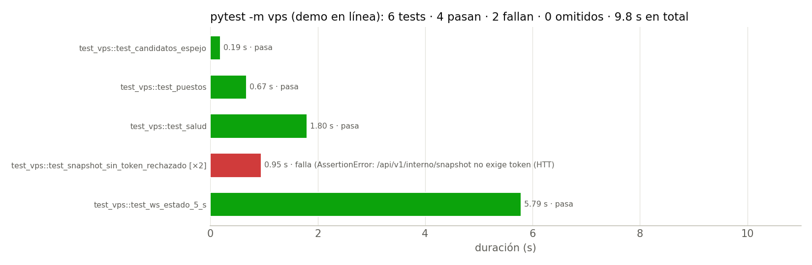
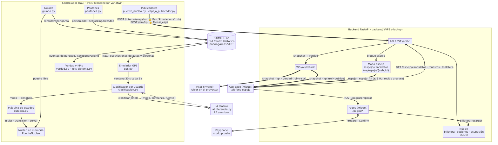
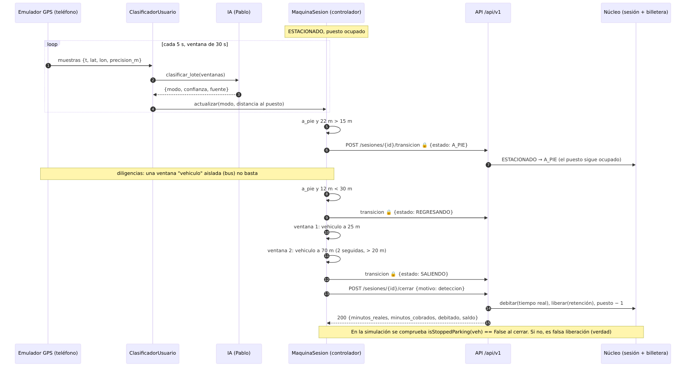

# S4 · Freddy 🍅: resumen semanal

## Sesión 1 · 2026-11-13 · Pruebas de punta a punta (`pytest -m e2e`)

Suite e2e que levanta el backend **real** (uvicorn en un puerto libre, SQLite temporal) y lo prueba como un cliente:
- **Recorrido de la app** (`test_flujo_app.py`): con saldo 0 no se puede estacionar (`SALDO_INSUFICIENTE`) → recarga por el adaptador Payphone mock de Miguel si está presente → `/guia` → sesión `ESTACIONADO` con $0,25 retenidos → 40 m a pie, vuelta y salida en vehículo → `CERRADA` sola (`traci/cierre_remoto.py`), con el cobro de `tarifa.json` y la retención liberada. Caso trampa: alejarse a pie no libera el puesto.
- **WebSocket**: cada mensaje se valida con `MensajeWS`; llega como máximo 1 snapshot por segundo simulado; `verdad` nunca llega a `rol=publico`.
- **Errores del contrato**: 402, 409, 404 y 403, cada uno con su formato exacto.
- **Con SUMO** (contenedor `van3twin`):
  - `test_simulacion_completa.py`: p20, semilla 1, **1 800 s**, porque en 300 s no se abre ninguna sesión. Libro, mapa y espejo cumplen, pero **35 de 35 cierres son falsas liberaciones**.
  - `test_cierre_automatico.py`: 4 de 5 cierres son falsas liberaciones.
  - Causa: falta `rf_v1.joblib`, así que la IA usa el umbral de velocidad, y con el ruido del GPS (σ = 5 m) toma a los peatones por vehículos. Con σ ≤ 2 m: 0 falsas liberaciones y retardo de cierre de 12-13 s. Queda como pedido a Pablo.
  - Sin Docker, estas pruebas se saltan limpio.

| Comando | Resultado |
|---|---|
| `pytest -m e2e` sin SUMO | 30 pasan · 2 omitidas · 9,1 s |
| `pytest -m e2e` con SUMO | 30 pasan · **2 fallan** (falsas liberaciones) · 3-4 min |
| `pytest` en `backend/tests` | 118 pasan · ~38 s |
| `pytest` en `traci/tests` | 72 pasan · 12 omitidas · ~8 s |
| `pytest -m vps` (demo) | 4 pasan · **2 fallan**: la demo acepta snapshots sin token (falta `ESERT_TOKEN_SIM`) |

Explicación: [explicaciones/s1_explicacion.pdf](explicaciones/s1_explicacion.pdf)

## Sesión 2 · 2026-11-13 · Documentación técnica, arquitectura y diagramas de secuencia

Documentación técnica autocontenida en `comun/docs/`:
- [`arquitectura.md`](codigo/comun/docs/arquitectura.md): visión general, tabla de componentes, los 9 diagramas y las cifras medidas.
- **9 diagramas Mermaid** en `diagramas/` (componentes, despliegue, estados y 6 secuencias), renderizados a PNG y SVG con `generar_diagramas.py` (mermaid-cli 10.9.1 por npx o Docker).
- **Verificación de la API**: `verificar_contrato_api.py` compara `app.openapi()` con la tabla §4.3 y genera `openapi.json` y `api.md`. Única diferencia: `Salud.ts`, aprobado en v1.2 pero ausente de la tabla; queda propuesto en `CONTRATO.propuesto.md` (v1.3, editorial).
- `decisiones.md` (D1–D6) y `operacion.md` (cómo levantar cada pieza, variables, logs y fallas comunes).

| Cifra (medida con `medir_cifras.py`) | Valor |
|---|---|
| TraCI, 80 % de penetración | 30,2 ms/paso |
| Latencia de la API p50 / p95 | 3,0 / 4,5 ms |
| Mensajes WS por segundo (visor) | 2,12 (1,01 snapshot · 1,01 verdad · 0,09 kpi) |

Explicación: [explicaciones/s2_explicacion.pdf](explicaciones/s2_explicacion.pdf)

