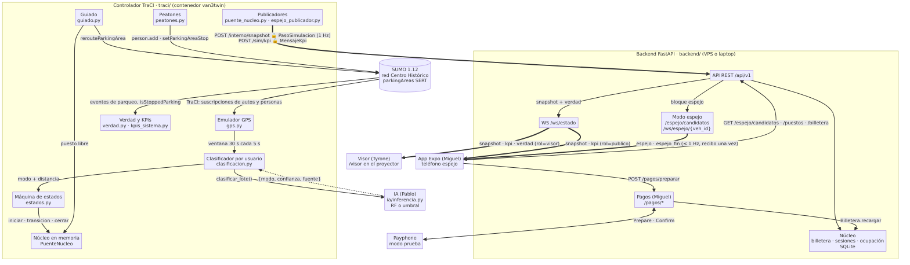
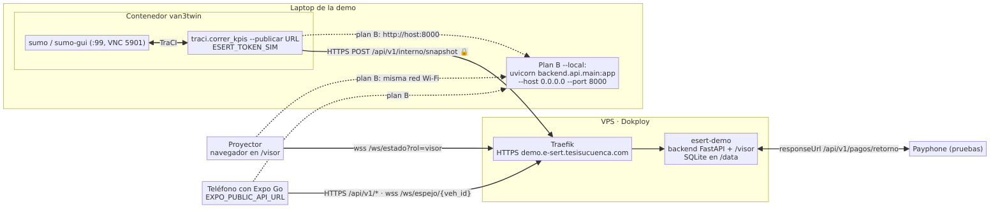
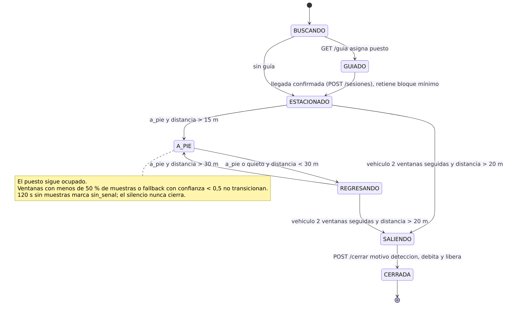
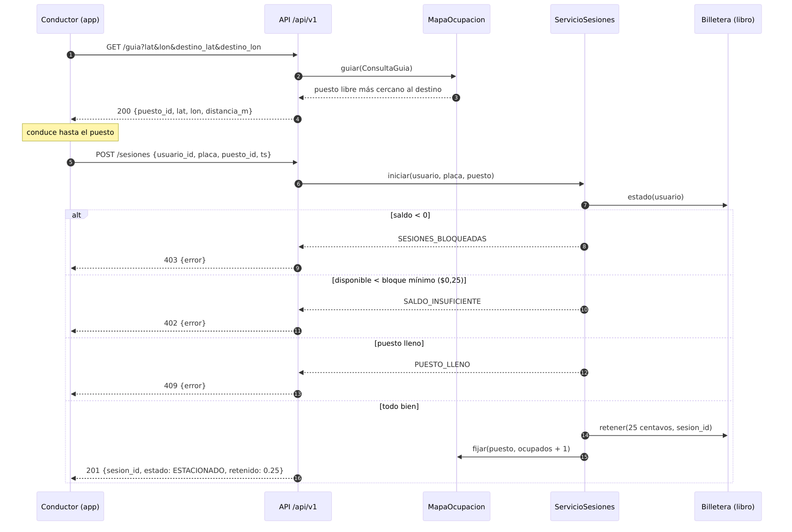
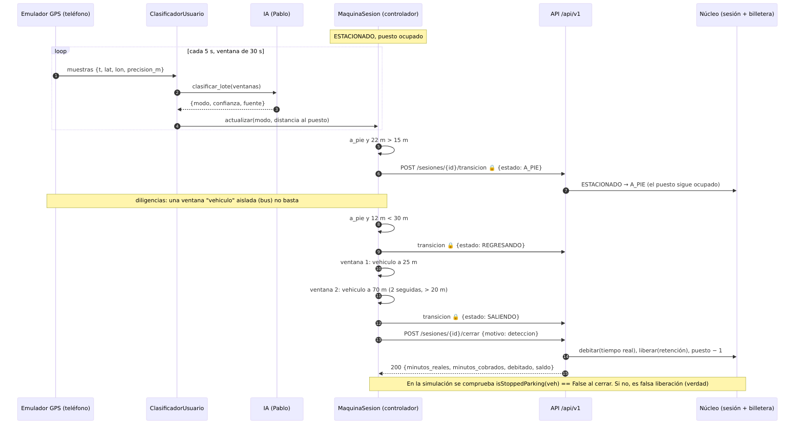
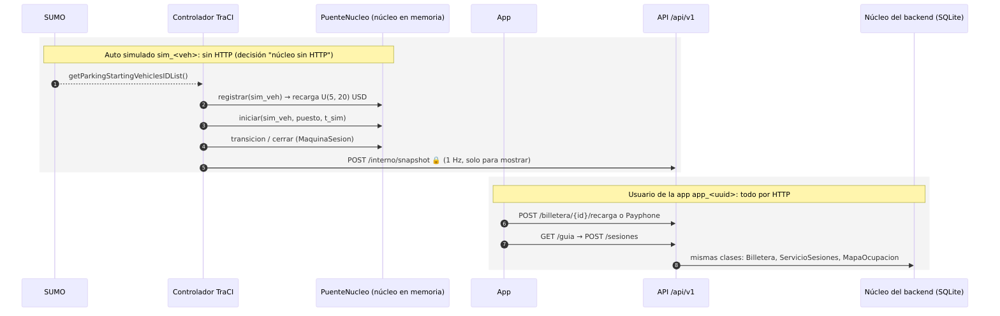
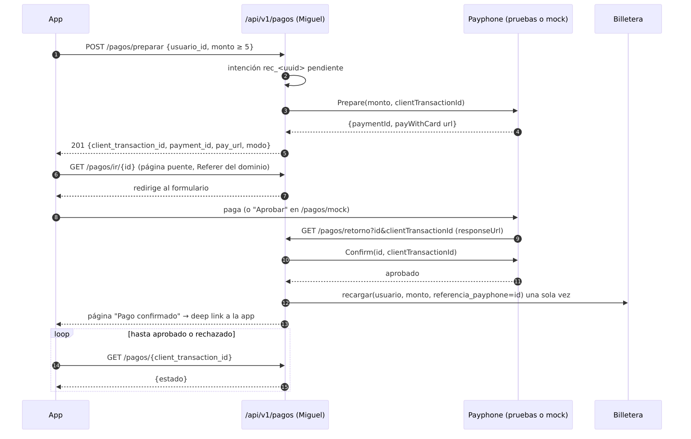
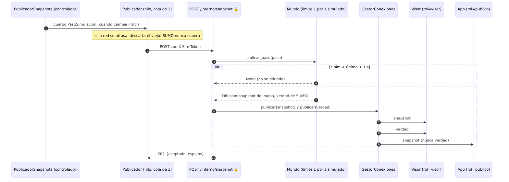
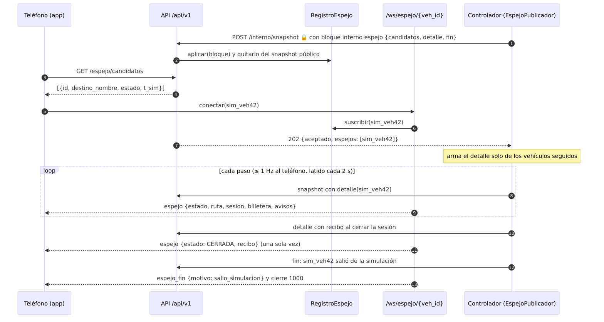

# Arquitectura de e-sert

e-sert es una app de parqueo para la zona SERT del Centro Histórico de Cuenca. Guía al
conductor a un puesto libre, cobra el tiempo real de estadía y detecta sola que el auto se fue,
sin que el conductor tenga que hacer nada. Todo se demuestra sobre una simulación en SUMO: el
teléfono de la demo no manda su GPS, sino que **sigue a un conductor simulado** (modo espejo).

Documentos relacionados:

- [`api.md`](api.md): referencia de la API, generada desde `openapi.json`.
- [`decisiones.md`](decisiones.md): por qué se diseñó así.
- [`operacion.md`](operacion.md): cómo levantar cada pieza y qué hacer si falla.
- El contrato de interfaces: `docs/CONTRATO.md`.

Los diagramas son texto Mermaid en `diagramas/*.mmd`. Para regenerarlos:
`python comun/docs/generar_diagramas.py`, que usa mermaid-cli 10.9.1.

## 1. Visión general

El sistema tiene tres grandes bloques, y entre ellos solo viajan los mensajes del contrato:

1. **Simulación** (contenedor `van3twin`): SUMO y el **controlador TraCI**. El controlador hace de «mundo real» y de «teléfono»:
   - mueve autos y peatones;
   - emula el GPS de cada conductor con app;
   - clasifica su modo de movimiento con la IA;
   - decide las transiciones de cada sesión con la máquina de estados.
2. **Backend** (FastAPI, en el VPS o en la laptop). Es la fuente de verdad de billeteras, sesiones y ocupación:
   - **guarda** y **valida** las transiciones y **cobra**;
   - difunde el estado por WebSocket;
   - el **backend no deduce la salida del auto**: se la informa el controlador.
3. **Clientes:**
   - el **visor** del proyector, que ve el mapa del sistema y la verdad de SUMO;
   - la **app Expo**, que actúa como teléfono espejo de un conductor simulado;
   - **Payphone** en modo prueba, para las recargas.

En la demo, SUMO y el controlador corren en la laptop, porque necesitan `sumo-gui` visible.
Publican al backend del VPS (`demo.e-sert.tesisucuenca.com`, detrás de Traefik en Dokploy). El
visor y el teléfono se conectan por internet. **Plan B (`--local`):** el mismo backend con
`uvicorn` en la laptop y todo en la misma red Wi-Fi.

## 2. Componentes

| Componente | Responsabilidad | Entradas | Salidas | Archivo principal |
|---|---|---|---|---|
| SUMO 1.12 | Tráfico, parkingAreas y peatones de la red del Centro | `.sumocfg` de `sumo/escenarios/` | Estado por TraCI | `sumo/escenarios/generar_escenarios.py` (Tyrone) |
| Controlador TraCI | Avanza la simulación y ejecuta los *hooks* en orden: peatones → guiado → sesiones → registro → verdad y KPIs → publicador | Suscripciones de TraCI | Snapshots, KPIs y CSV | `traci/controlador.py`, `traci/correr_kpis.py` |
| Peatones | Al estacionar, el conductor baja, hace diligencias y vuelve | Llegadas a parkingArea | `person.add`, `setParkingAreaStop` | `traci/peatones.py` |
| Guiado | Asigna el puesto libre más cercano al destino y reasigna si se llena (máximo 3 veces) | Mapa de ocupación | `rerouteParkingArea` | `traci/guiado.py` |
| Emulador GPS | Posición del teléfono (auto o peatón) con ruido σ = 5 m, pérdidas y ráfagas | Posiciones de SUMO | Muestras `{t, lat, lon, precision_m}` a 1 Hz | `traci/gps.py` |
| Clasificador por usuario | Ventana de 30 s cada 5 s, en lote | Muestras GPS | `{modo, confianza, fuente, cobertura}` | `traci/clasificacion.py` |
| IA (Pablo) | `a_pie` / `quieto` / `vehiculo` con Random Forest, o con umbral de velocidad si falta el modelo | Ventanas | `ResultadoModo` | `ia/inferencia.py` |
| Máquina de estados | Reglas del §3 (15 m, 30 m, 20 m, 2 ventanas) y política de datos pobres | Modo y distancia al puesto | Transiciones y cierres | `traci/estados.py` |
| Núcleo en memoria | Las mismas reglas de cobro que el backend, sin HTTP (D1) | Llamadas de la máquina y del guiado | Sesiones y libro | `traci/puente_nucleo.py` |
| Verdad y KPIs | Ocupación real, falsas liberaciones, retardo de cierre, error de cobro y precisión del mapa | Eventos de parqueo | `verdad`, `kpi` y `KPIsSistema.resumen()` | `traci/verdad.py`, `traci/kpis_sistema.py` |
| API REST | Rutas del §4.3, errores del §4.2 y token del simulador | HTTP | JSON del contrato | `backend/api/main.py`, `backend/api/rutas/` |
| Núcleo | Billetera (libro), sesiones y mapa de ocupación sobre SQLite | Llamadas de la API | Estado persistente | `backend/nucleo/` |
| WS `/ws/estado` | Difusión de `snapshot`, `kpi` y `verdad` (esta última solo al visor), como mucho 1 snapshot por segundo simulado | `POST /interno/snapshot` | Mensajes `MensajeWS` | `backend/api/ws.py`, `backend/nucleo/mundo.py` |
| Modo espejo | Candidatos y detalle del conductor seguido (≤ 1 Hz, recibo una vez) | Bloque interno `espejo` del snapshot | `espejo`, `espejo_fin` | `backend/espejo/` |
| Pagos (Miguel) | Recarga con Payphone en modo prueba o mock | App | `Billetera.recargar` | `backend/pagos/` |
| Visor (Tyrone) | Mapa en vivo: sistema frente a verdad | `/ws/estado?rol=visor` | Proyector | `visor/` |
| App (Miguel) | Teléfono espejo, billetera y recarga | API y `/ws/espejo/{veh_id}` | Pantalla | `app/` |

## 3. La sesión de parqueo

La sesión existe desde `ESTACIONADO`. Antes, `BUSCANDO` y `GUIADO` son estados del vehículo y
todavía no tienen `sesion_id`.

### Llegada: guía, confirmación y retención

### Cómo sabe el sistema que el auto se fue

Es la pregunta clave del proyecto. Cada 5 s, la IA clasifica los últimos 30 s del GPS del
teléfono. Alejarse a pie solo lleva a `A_PIE`, y **el puesto sigue ocupado**. La sesión solo se
cierra con **dos ventanas seguidas en `vehiculo` a más de 20 m del puesto**, partiendo de
`ESTACIONADO` o `REGRESANDO`. Una ventana aislada de bus o de taxi no basta.

En la simulación se comprueba con `isStoppedParking` que el auto ya no estaba estacionado.
Medido en S4-1 en el escenario mínimo: con GPS de σ ≤ 2 m, **0 falsas liberaciones** y un
**retardo de cierre de 12–13 s**. Con σ = 5 m y sin el modelo RF, el umbral de reserva de la IA
confunde caminar con ir en auto y casi todos los cierres son falsos. Por eso hace falta el
modelo RF (`rf_v1.joblib`), que es un pedido a Pablo.

### Dos caminos al mismo núcleo

### Recarga con Payphone

## 4. Difusión en vivo

### Del controlador al visor y a la app

### Modo espejo

## 5. Cifras medidas

Medidas el 2026-11-13 con `python comun/docs/medir_cifras.py`. El resultado está en
[`cifras.json`](cifras.json). La máquina es una laptop con WSL2 y Docker Desktop, y el
contenedor `van3twin` corre SUMO 1.12 con TraCI por socket (sin libsumo).

| Cifra | Valor | Cómo se midió |
|---|---|---|
| **Tiempo por paso de TraCI, 80 % de penetración** | **30,2 ms/paso** (900 pasos en 27,2 s; 101 sesiones) | `traci.correr_kpis --id p80_rf_s1 --hasta 900`, sin publicar, con todos los *hooks* y KPIs |
| **Latencia de la API, p50 / p95** | **3,0 ms / 4,5 ms** | uvicorn real, 300 pedidos por ruta por loopback y uno a la vez: `GET /puestos` (610 puestos) 3,7/5,0 ms; `GET /guia` 2,6/3,5 ms; `POST /eventos/ubicacion` 1,7/3,0 ms; `GET /billetera/{id}` 3,2/4,6 ms |
| **Mensajes WS por segundo (visor)** | **2,12 msg/s**: 1,01 `snapshot`, 1,01 `verdad` y 0,09 `kpi` | `/ws/estado?rol=visor` durante 78 s, con el controlador a ritmo real (`--ritmo 1`) y 80 % de penetración |

Cómo leer las cifras:

- **Velocidad de la simulación:** con 30 ms por paso de 1 s simulado, la simulación corre unas
  **33 veces más rápido que el tiempo real**. Para la demo en vivo se frena con `--ritmo`.
- **Latencia:** está muy por debajo de lo que nota una persona. En el VPS hay que sumar la red
  (TLS y la distancia hasta el servidor).
- **Carga del WebSocket:** unos 2 mensajes por segundo para el visor. La app (`rol=publico`)
  recibe uno menos por segundo, porque no le llega `verdad`. Esto confirma el límite de un
  snapshot por segundo simulado del §6.

## 6. Dónde está cada cosa

| Necesito… | Archivo |
|---|---|
| El formato de un mensaje | `comun/esquemas.py` (Pydantic) y `comun/esquemas.ts`; ejemplos en `comun/ejemplos/` |
| La tarifa | `comun/tarifa.json` y `comun/tarifa.py` |
| Saber si la API cumple el contrato | `python comun/docs/verificar_contrato_api.py` |
| Probar todo junto | `pytest -m e2e` (`backend/tests/e2e/`, `traci/tests/e2e/`) |
| Medir de nuevo las cifras | `python comun/docs/medir_cifras.py` |
| Regenerar los diagramas | `python comun/docs/generar_diagramas.py` |
