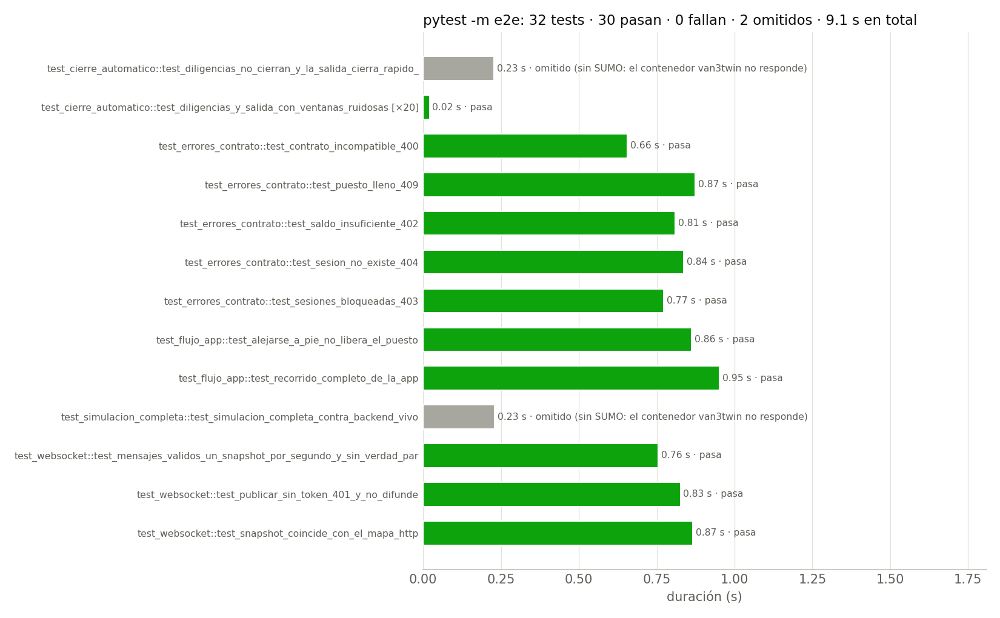
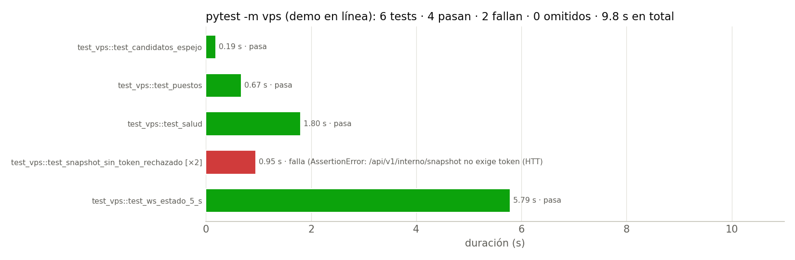

# S4 · Sesión 1 · Freddy: pruebas de punta a punta (`pytest -m e2e`)

## 1. Resumen en 5 líneas

Hasta S3 cada pieza (backend, controlador TraCI y contrato) tenía sus propias pruebas unitarias. Faltaba probar que **todas juntas** cumplen el contrato. Esta sesión añade una suite `pytest -m e2e` con estas partes:

- un backend **real**: `uvicorn` en un puerto libre, con SQLite temporal;
- el recorrido completo de la app por HTTP;
- el WebSocket `/ws/estado` con un cliente de verdad;
- los cuatro errores de negocio del contrato;
- una corrida de SUMO contra ese backend vivo, que se salta limpio si no hay contenedor;
- una prueba de humo, `pytest -m vps`, contra la demo en línea.

La demo del lunes 16 y la unificación del domingo correrán esta suite.

## 2. Conceptos clave

- **Prueba de punta a punta (e2e):** ejercita el sistema como lo usa un cliente real. Hay red, un servidor HTTP de verdad y un WebSocket de verdad. No hay `TestClient` en memoria. Así aparecen errores que una prueba unitaria no ve: serialización, cabeceras, el hilo del gestor de WebSocket o el arranque y la parada del servidor.
- **Marcadores de pytest (`e2e`, `vps`):** etiquetan las pruebas lentas.
  - `pytest.ini` tiene `addopts = -m "not e2e and not vps"`, así que un `pytest` normal sigue rápido (unos 38 s).
  - `pytest -m e2e` corre solo la suite larga, porque el `-m` de la línea de comandos manda sobre `addopts`.
- **Fixture:** función de pytest que prepara un recurso y lo libera al terminar. Por ejemplo, `servidor` levanta `uvicorn` en un hilo y lo apaga con `should_exit`.
- **Salto limpio (`pytest.skip`):** si falta `docker` o el contenedor `van3twin`, las pruebas con SUMO quedan como *omitidas* con el motivo. No aparecen como error, y las pruebas HTTP siguen corriendo.
- **Cierre automático:** el backend **no** decide cuándo termina una sesión.
  - El backend guarda los eventos y acepta las transiciones que le informa el controlador (contrato §3).
  - Quien decide es la máquina de estados `MaquinaSesion` de `traci/estados.py`, con estos umbrales: 15 m para pasar a A_PIE, 30 m para REGRESANDO, y 2 ventanas en vehículo a más de 20 m para SALIENDO.
  - Para probar el recorrido de la app por HTTP se creó `traci/cierre_remoto.py`. Hace el papel del controlador para un usuario: publica los eventos, aplica la máquina y, cuando corresponde, informa la transición o el cierre con el token del simulador.
- **Falsa liberación:** cerrar una sesión mientras el auto sigue estacionado en SUMO, es decir, con `isStoppedParking(veh) == True` en el paso del cierre. `KPIsSistema` la marca como `falsa` en ese mismo paso.
- **Invariante del libro:** para cada usuario se cumple `saldo = Σ recargas − Σ débitos`, y ningún saldo baja de `−saldo_negativo_max_usd` (−$0,50).

## 3. Cómo se generó cada cosa

Todo se corre desde `semanas/S4/Freddy/codigo/`, con el entorno `backend/.venv`:

```bash
python -m venv backend/.venv
backend/.venv/bin/pip install -r backend/requirements.txt pyproj numpy pandas

# Suite normal (rápida); cada módulo usa su pytest.ini
backend/.venv/bin/python -m pytest backend/tests -q        # 118 pasan, ~38 s
backend/.venv/bin/python -m pytest traci/tests -q          # 72 pasan, 12 omitidas (SUMO), ~8 s

# Suite e2e (backend + traci) con JUnit
backend/.venv/bin/python -m pytest -c backend/pytest.ini backend/tests traci/tests -m e2e \
    --junitxml=e2e.xml --durations=0

# Prueba de humo contra la demo (URL por ESERT_URL_PUBLICA)
backend/.venv/bin/python -m pytest backend/tests -m vps --junitxml=vps.xml

# Evidencia
backend/.venv/bin/python -m backend.graficas.e2e_resultados e2e.xml ../evidencias/s1_e2e-resultados.png
backend/.venv/bin/python -m backend.graficas.e2e_resultados vps.xml ../evidencias/s1_vps-humo.png \
    --titulo "pytest -m vps (demo en línea)"
```

Con SUMO, en una máquina donde `docker exec van3twin which sumo` funciona, la misma orden `-m e2e` lanza el controlador dentro del contenedor:

```bash
docker exec -w /home/vanet/results/e-sert/<codigo> -e ESERT_TOKEN_SIM=e2e-token van3twin \
  bash -lc "python3 -m traci.correr_kpis --id p20_rf_s1 --hasta 300 --publicar http://<host>:<puerto> \
            --sufijo _e2e --volcar traci/salidas/e2e_<id>.json"
```

## 4. Mapa de archivos

| Archivo | Qué contiene | Quién lo usa |
|---|---|---|
| `backend/pytest.ini`, `traci/pytest.ini` | marcadores `e2e` y `vps`, y `addopts` que los excluye por defecto | todos, la CI y la unificación |
| `backend/tests/e2e/conftest.py` | fixtures `servidor`, `cliente`, `token_sim`, `requiere_sumo`, `usuario_app` y `nuevo_usuario` | las pruebas e2e |
| `backend/tests/e2e/test_flujo_app.py` | recorrido de la app y caso trampa | suite e2e |
| `backend/tests/e2e/test_websocket.py` | validación de mensajes, 1 snapshot/s y que `verdad` no llega a la app | suite e2e |
| `backend/tests/e2e/test_errores_contrato.py` | 402, 409, 404 y 403 con su formato exacto, más 400 `CONTRATO_INCOMPATIBLE` | suite e2e |
| `backend/tests/e2e/test_simulacion_completa.py` | SUMO de 300 s contra el backend vivo, espejo e invariantes | suite e2e con SUMO |
| `backend/tests/e2e/test_vps.py` | humo de la demo: `/salud`, puestos, candidatos, WS de 5 s y rechazo sin token | `pytest -m vps` |
| `backend/graficas/e2e_resultados.py` | barras por test leídas del JUnit XML | evidencia |
| `traci/cierre_remoto.py` | `CierreRemoto`: la máquina de estados del controlador, por HTTP | `test_flujo_app.py` |
| `traci/correr_kpis.py` (nueva opción `--volcar`) | JSON con el libro de billeteras y las sesiones cerradas, con la marca `falsa` | `test_simulacion_completa.py` |
| `traci/tests/e2e/escenario_cierre.py` | escenario mínimo de 5 autos con peatones de diligencia | `test_cierre_automatico.py` |
| `traci/tests/e2e/test_cierre_automatico.py` | las diligencias no cierran y la salida cierra en menos de 30 s (con y sin SUMO) | suite e2e |
| `traci/tests/test_volcado.py` | el volcado cuadra con el núcleo (sin SUMO) | suite normal |
| `traci/tests/test_guiado.py` (arreglo) | usa `proyecto/sumo` si falta la copia del escenario | suite normal |

## 5. Recorrido del código

**`conftest.py` · `arrancar_servidor`.** Fábrica que crea la app con `crear_app(Config(...))` y la sirve con `uvicorn.Server` en un hilo. Espera a que `GET /api/v1/puestos` responda 200 y, al final, la apaga y comprueba que el hilo terminó. Para la prueba con SUMO escucha en `0.0.0.0`, porque el contenedor tiene que alcanzarla.

```python
server = uvicorn.Server(uvicorn.Config(app, host=host, port=port, log_level="warning", lifespan="on"))
hilo = threading.Thread(target=server.run, daemon=True); hilo.start()
while True:
    if httpx.get(f"{url}/api/v1/puestos", headers=CONTRATO, timeout=1).status_code == 200:
        break
```

**`UsuarioApp.recargar`.** Si `backend/pagos` (de Miguel) está montado, hace el pago completo en modo `mock`:

1. `POST /pagos/preparar`;
2. «Aprobar» en `/pagos/mock/decidir`;
3. la redirección a `/pagos/retorno` acredita el saldo;
4. `GET /pagos/{id}` debe responder `aprobado`.

Si no está montado, usa `POST /recarga` con `referencia_payphone="PRUEBA"`, marcado `# MOCK`.

**`CierreRemoto.ventana`.** Una ventana de 5 s. Publica la ubicación y el modo, calcula la distancia haversine al puesto y aplica la máquina de estados:

```python
nuevas = self.maquina.actualizar(modo, distancia, t_sim, fuente=self.fuente, confianza=confianza)
for tr in nuevas:
    if tr.hacia == "CERRADA":
        r = self.cliente.post(f"/sesiones/{self.sesion_id}/cerrar", headers=self.token,
                              json={"ts": ts, "t_sim": t_sim, "motivo": "deteccion"})
    else:
        r = self.cliente.post(f"/sesiones/{self.sesion_id}/transicion", headers=self.token,
                              json={"estado": tr.hacia, "ts": ts, "t_sim": t_sim})
```

**`test_websocket.py`.** Abre tres clientes reales:

- `rol=publico`;
- `rol=publico&verdad=1`;
- `rol=visor`.

Luego publica 11 pasos con `t_sim` muy juntos (100,0; 100,2; …; 104,5) y un KPI centinela. Comprueba tres cosas:

- cada cliente recibe como mucho un snapshot por segundo simulado;
- los dos clientes tipo app no reciben `verdad`, aunque la pidan;
- el visor sí la recibe.

**`test_simulacion_completa.py`.** Lanza `correr_kpis` con `docker exec` y, mientras corre:

- toma hasta 6 vehículos de `GET /espejo/candidatos` y sigue cada uno en un hilo por `/ws/espejo/{veh}`;
- escucha `/ws/estado` como app.

Al terminar lee el volcado y comprueba:

- que ninguna sesión es `falsa`;
- el invariante del libro;
- que `precision_mapa_app ≥ 0,95`;
- que cada vehículo seguido aparece en `espejos` y recibe el recibo una sola vez;
- que el log no tiene excepciones.

**`e2e_resultados.py`.** Lee el JUnit XML y dibuja una barra por test. Los casos parametrizados se agrupan en una sola barra «×N». El estado va escrito junto a cada barra, para no depender solo del color.

## 6. Cómo se conecta con los demás

- **Usa el contrato v1** (`comun/esquemas.py`):
  - la unión discriminada `MensajeWS`, para validar cada mensaje del WebSocket;
  - `HTTP_POR_CODIGO` y `CuerpoError`, para los errores;
  - `tarifa.json`, para el cobro esperado.
- **Miguel:** si su router `backend/pagos/` está junto al backend, la recarga pasa por su adaptador en modo `mock`. Se comprobó en una copia temporal con su carpeta: las 10 pruebas HTTP pasan y la recarga queda con la `referencia_payphone` del pago.
- **Tyrone:**
  - los puestos de `proyecto/sumo/parqueos/puestos.csv` (610) y su escenario `p20` para la corrida con SUMO;
  - el comando para su `verificar_demo.py`;
  - el VPS de la prueba de humo.
- **Entrega:** la suite e2e, que la unificación y la demo corren tal cual desde `proyecto/`. Las rutas salen de `Path(__file__)` y no son absolutas.

## 7. Resultados y evidencias

**`pytest -m e2e`:** 32 tests, 30 pasan, 0 fallan y 2 se omiten (no hay SUMO en esta máquina). Tarda **9,1 s**, muy por debajo de los 5 min.



**`pytest -m vps`** contra `https://demo.e-sert.tesisucuenca.com`: 6 tests, 4 pasan y 2 fallan.

- Pasan `/salud`, `GET /puestos` (los 610 puestos válidos), `GET /espejo/candidatos` y el WebSocket de 5 s.
- Fallan `/interno/snapshot` y `/sim/paso`, porque **aceptan snapshots sin token**: el VPS no tiene configurado `ESERT_TOKEN_SIM`. Es un problema real de configuración del despliegue, no de la prueba, y queda como pedido a Tyrone.



**Suite normal (sin marcador):**

| Módulo | Pasan | Omitidas | Tiempo |
|---|---|---|---|
| `backend` | 118 | 1 | ~38 s |
| `traci` | 72 | 12 (SUMO) | ~8 s |

En `traci` ya no hay fallos: los 5 tests de `test_guiado.py` que fallaban fuera del contenedor ahora usan `proyecto/sumo`.

## 8. Limitaciones y decisiones

- **SUMO no se pudo correr en esta sesión.** En esta distro WSL no está activa la integración de Docker Desktop, así que `test_simulacion_completa` y `test_cierre_automatico[sumo]` están escritos pero se saltaron. El criterio «`pytest -m e2e` pasa completo con SUMO» queda **sin verificar**.
- **Riesgo conocido:** en S3, `p50_rf_s1` dio 47 falsas liberaciones de 47 sesiones en 900 s (con el umbral, porque falta el modelo RF). La aserción «ninguna sesión `falsa`» es la que pide el prompt y puede fallar con SUMO. Si falla, no se va a aflojar: es justamente el defecto que la suite debe mostrar.
- **`/guia` no exige recargar.** En el contrato `GET /guia` no recibe el usuario ni revisa el saldo. La exigencia de recargar la impone `POST /sesiones` con `SALDO_INSUFICIENTE`. La prueba sigue el contrato y se propone a Tyrone ajustar el prompt.
- **Precisión del mapa.** Se compara `precision_mapa_app`: S3 dio 1,00, así que el umbral es 0,95. La precisión total depende de la penetración: con 20 % el mapa no ve al 80 % de los autos. Ya en S3 se advirtió que `precision_mapa_app` sale cerca de 1 casi por construcción, así que este criterio es débil.
- **Oscilación de la máquina de estados.** Al alejarse entre 15 y 30 m pasa A_PIE → REGRESANDO → A_PIE, porque los umbrales se cruzan. No afecta el cobro, y la prueba lo acepta explícitamente.
- **Cambio en la demo durante el desarrollo.** La primera versión de la prueba del token mandó un paso de ejemplo válido a la demo, que lo aceptó por falta de token. La versión final manda un cuerpo inválido: con token configurado responde 401 antes de validar, y sin token da 422. En ningún caso escribe estado. Un `t_sim` menor reinicia el reloj de la demo, así que la siguiente corrida real no queda bloqueada.

## 9. Preguntas que podría hacer el profesor

1. **¿Por qué no usar `TestClient` también en e2e?** `TestClient` corre la app dentro del mismo proceso y no usa sockets. Con `uvicorn` real se prueban el protocolo WebSocket, las cabeceras, el *lifespan* y el apagado. Eso es lo que verán la app y el visor.
2. **¿Cómo se garantiza que `pytest` normal siga rápido?** `addopts = -m "not e2e and not vps"` en `pytest.ini`. Las pruebas e2e solo corren cuando se piden con `-m e2e`.
3. **¿Quién cierra la sesión: la app, el backend o el controlador?** El controlador. Clasifica las ventanas del teléfono y, tras 2 ventanas en vehículo a más de 20 m, informa `SALIENDO` y cierra con el motivo `deteccion`. La app no cierra nada.
4. **¿Qué es una falsa liberación y cómo se mide?** Cerrar la sesión con el auto todavía estacionado. Se mide con `traci.vehicle.isStoppedParking(veh)` en el mismo paso del cierre.
5. **¿Qué encontró la prueba de humo del VPS?** Que la demo acepta snapshots sin token. Cualquiera podría publicar un estado falso en el visor, así que hay que configurar `ESERT_TOKEN_SIM` en Dokploy.
