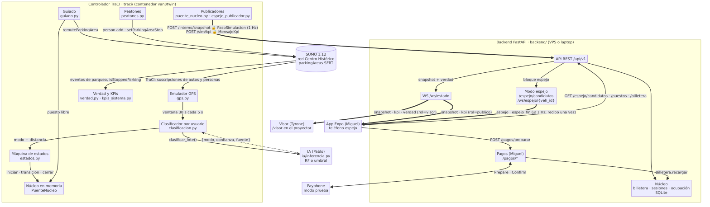
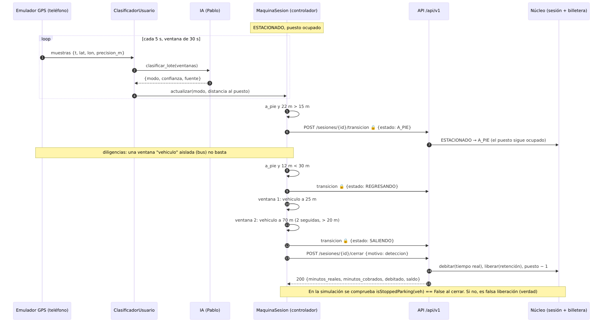

# S4 · Sesión 2 · Freddy: documentación técnica, arquitectura y diagramas de secuencia

## 1. Resumen en 5 líneas

En `comun/docs/` quedó una documentación técnica autocontenida de e-sert:

- **arquitectura:** componentes, despliegue y tres cifras medidas hoy;
- **9 diagramas Mermaid**, escritos como texto y renderizados a PNG y SVG con una versión fija;
- **referencia de la API**, generada desde `openapi.json` y **verificada automáticamente** contra la tabla §4.3 del contrato;
- un **registro de seis decisiones** y una **guía de operación** con una tabla de fallas comunes.

Le sirve a Pablo para el informe, a Tyrone para la diapositiva de arquitectura y al profesor para entender «cómo sabe el sistema que el auto se fue».

## 2. Conceptos clave

- **Diagramas como código (Mermaid):** el diagrama es un archivo de texto (`.mmd`) que se versiona en git, se revisa en un diff y se regenera con un comando. Se eligió frente a dibujar a mano porque no se desactualiza en silencio y cualquiera lo puede corregir.
- **Versión fija del renderizador:** `mermaid-cli 10.9.1`. Cada versión dibuja un poco distinto; fijarla hace que los PNG sean reproducibles.
  - En la computadora no hay Node, y el contenedor trae Node 12, demasiado viejo.
  - Por eso se usa la imagen Docker oficial de esa misma versión, con autorización del usuario.
- **Diagrama de secuencia:** muestra qué mensaje manda quién, en qué orden y con qué condiciones (`alt`, `loop`). Sirve para explicar protocolos como el cierre de sesión o el pago.
- **`stateDiagram-v2`:** la máquina de estados de la sesión, con los umbrales del contrato en las flechas.
- **OpenAPI:** la descripción formal que FastAPI genera de su propia API (`app.openapi()`). Compararla con el contrato escrito detecta que el código y el documento se separaron.
- **Registro de decisiones (ADR):** para cada decisión importante se anotan el contexto, la decisión, las alternativas descartadas y las consecuencias. Así se responde «¿por qué no usaron PostgreSQL?» sin depender de la memoria.
- **Percentiles p50 y p95:** el p50 es la latencia típica; el p95, la de 1 de cada 20 pedidos, es decir, los casos lentos que sí nota un usuario.

## 3. Cómo se generó cada cosa

Todo se corre desde `semanas/S4/Freddy/codigo/`, con `backend/.venv`.

| Resultado | Comando | Entradas → salidas |
|---|---|---|
| PNG y SVG de los diagramas, más las evidencias | `python comun/docs/generar_diagramas.py --evidencias ../evidencias` | `diagramas/*.mmd` → `diagramas/*.png` y `*.svg`; copia `s2_arquitectura.png` y `s2_secuencia-cierre.png` |
| `openapi.json` y `api.md`, y la verificación del contrato | `python comun/docs/verificar_contrato_api.py` | `app.openapi()` y `docs/CONTRATO.md` §4.3 → `openapi.json`, `api.md` y la lista de diferencias (código 0 o 1) |
| Las tres cifras | `python comun/docs/medir_cifras.py` | backend real y `docker exec van3twin … correr_kpis --id p80_rf_s1` → `cifras.json` |
| Arquitectura, decisiones y operación | escritos a mano a partir del inventario de puntos de entrada | `arquitectura.md`, `decisiones.md`, `operacion.md` |

## 4. Mapa de archivos

| Archivo | Qué contiene | Quién lo usa |
|---|---|---|
| `comun/docs/arquitectura.md` | Visión general, tabla de componentes, los 9 diagramas y las cifras | Pablo (informe), Tyrone (diapositiva), profesor |
| `comun/docs/diagramas/*.mmd` (+ `.png`, `.svg`) | Componentes, despliegue, estados y 6 secuencias | Todos |
| `comun/docs/generar_diagramas.py` | Render con mermaid-cli 10.9.1 (npx o Docker) | Quien cambie un diagrama |
| `comun/docs/verificar_contrato_api.py` | Compara la API con la §4.3 y genera `openapi.json` y `api.md` | Freddy y la unificación |
| `comun/docs/api.md`, `openapi.json` | Referencia de cada endpoint con un ejemplo | Miguel (app), Tyrone (visor) |
| `comun/docs/medir_cifras.py`, `cifras.json` | Cómo se midieron las cifras y su resultado | `arquitectura.md` |
| `comun/docs/decisiones.md` | D1–D6 | Informe y defensa |
| `comun/docs/operacion.md` | Cómo levantar cada pieza, variables, base de datos, logs y fallas | Quien prepare la demo |
| `comun/CONTRATO.propuesto.md` | v1.3, corrección editorial: `Salud.ts` en la tabla §4.3 | La unificación del domingo |
| `comun/ejemplos/salud.json` | Ahora con `ts` | Pruebas y `api.md` |

## 5. Recorrido del código

**`verificar_contrato_api.py`.** Tiene cuatro piezas:

- `leer_tabla_rutas` parsea la tabla Markdown de la §4.3. De cada fila saca el método, la ruta, la marca 🔒, el código de éxito, los modelos `A → B` y los campos escritos como `{a, b?}` (el `?` marca un campo opcional).
- `comparar` busca cada fila en `openapi.json` y revisa:
  - que la ruta exista;
  - que la marca 🔒 coincida con que la ruta responda 401;
  - el código de éxito;
  - los modelos y los campos (los que faltan, los que sobran y si son obligatorios).
- También lista las rutas de la app que el contrato no menciona.
- Si hay diferencias, mira si `comun/CONTRATO.propuesto.md` las cubre todas. En ese caso sale con 0 y avisa de que queda pendiente para la unificación.

```python
def comparar_campos(nombre, lado, contrato, esquema, con_requeridos):
    reales = set(esquema.get("properties", {}))
    requeridos = set(esquema.get("required", []))
    if faltan := sorted(set(contrato) - reales):
        salida.append(f"{nombre}: {lado} sin los campos del contrato {faltan}")
    if sobran := sorted(reales - set(contrato)):
        salida.append(f"{nombre}: {lado} con campos que el contrato no lista {sobran}")
```

Para comprobar que no es trivial, se probó con un contrato alterado a propósito. Detectó los siete errores introducidos: una ruta inexistente, un 🔒 cambiado, un campo de más, un campo de menos, un campo obligatorio marcado como opcional, un código de éxito equivocado y una ruta de la app sin documentar.

**`generar_diagramas.py`.** Elige el motor: `npx` si hay Node ≥ 18, Docker si no. Si no hay ninguno, sale con 2 y explica qué instalar. No cae a Graphviz, porque Graphviz no interpreta Mermaid. Llama a mermaid-cli dos veces por diagrama, una para el PNG (`-s 2`, fondo blanco) y otra para el SVG.

**`medir_cifras.py`.** Levanta el backend con uvicorn y mide la latencia con 300 pedidos por ruta. Luego conecta un visor por WebSocket mientras el controlador publica a ritmo real durante 90 s, y cuenta mensajes por segundo descartando los primeros 10 s. Por último lee `ms_por_paso` de una corrida p80 de 900 s.

## 6. Cómo se conecta con los demás

- **Consume:**
  - `docs/CONTRATO.md` (§0, §3, §4.3, §6 y §7);
  - el código de `backend/`, `traci/` y `comun/`;
  - el inventario de puntos de entrada que hizo un subagente Explore;
  - el escenario de Tyrone (`p80`) y la IA de Pablo, para las cifras.
- **Entrega:**
  - `componentes.png` para la diapositiva de Tyrone;
  - los diagramas para el informe de Pablo;
  - `seq_recarga_payphone.mmd` para que Miguel lo valide;
  - la propuesta v1.3 del contrato para la unificación.

## 7. Resultados y evidencias

- **9 diagramas** renderizados, con PNG y SVG, en `comun/docs/diagramas/`. `generar_diagramas.py` sale con 0.
- **Verificación de la API:** 16 rutas del contrato comparadas con 17 operaciones de la app. Hay una sola diferencia: `GET /salud` devuelve `ts`, aprobado en v1.2 pero ausente de la tabla. Queda propuesta en `CONTRATO.propuesto.md` y el script sale con 0.
- **Cifras medidas:**

| Cifra | Valor |
|---|---|
| Tiempo por paso de TraCI, 80 % de penetración | 30,2 ms (unas 33 veces más rápido que el tiempo real) |
| Latencia de la API | p50 3,0 ms / p95 4,5 ms |
| Mensajes WS por segundo en el visor | 2,12: 1,01 `snapshot`, 1,01 `verdad` y 0,09 `kpi` |

Arquitectura:



Cómo se cierra la sesión sin falsa liberación:



## 8. Limitaciones y decisiones

- **Render con Docker.** Requiere la imagen `minlag/mermaid-cli:10.9.1`. Sin Docker ni Node ≥ 18, el script avisa y no genera nada. GitHub y mermaid.live muestran los `.mmd` igualmente.
- **Latencia medida por loopback**, sin red: en el VPS hay que sumar TLS y la distancia hasta el servidor.
- **Las cifras usan el umbral de la IA**, porque falta `rf_v1.joblib`. Con el RF, el tiempo por paso puede subir un poco, porque la inferencia es más cara.
- **`seq_recarga_payphone.mmd`** se basa en el README y en las rutas de Miguel. Falta su validación.
- **El verificador compara la §4.3**, no las §6 y §7 (WebSocket). Esos mensajes ya los validan las pruebas e2e con `MensajeWS`.

## 9. Preguntas que podría hacer el profesor

1. **¿Cómo sabe el sistema que el auto se fue?** Cada 5 s, la IA clasifica los últimos 30 s del GPS del teléfono. Con dos ventanas seguidas en «vehículo» a más de 20 m del puesto, el controlador informa `SALIENDO` y cierra la sesión. Caminar lejos solo lleva a `A_PIE` y el puesto sigue ocupado.
2. **¿Por qué el controlador no usa la API HTTP?** Para que los experimentos no dependan de la red y cada paso de SUMO no espere. Usa el mismo núcleo como biblioteca (D1), así que las reglas de cobro son un único código.
3. **¿Cómo se asegura que la documentación de la API no miente?** `verificar_contrato_api.py` compara el `openapi.json` real con la tabla del contrato y falla si hay diferencias. Se probó con errores introducidos a propósito.
4. **¿Qué tan rápido es el sistema?** TraCI tarda 30 ms por paso con 80 % de autos con app, unas 33 veces el tiempo real. La API responde en 3 ms en la mediana y 4,5 ms en el p95, y el visor recibe unos 2 mensajes por segundo.
5. **¿Por qué SQLite y no PostgreSQL?** Es una demo de un solo proceso en un VPS liviano. SQLite no necesita otro servicio, y con SQLAlchemy cambiar de base es solo cambiar la URL (D2).
