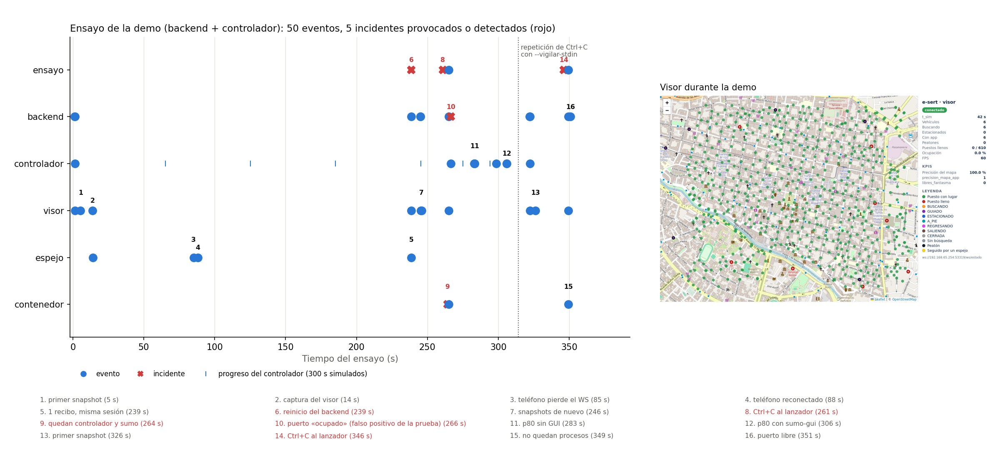

# S4 · Sesión 3 · Freddy: sección backend y TraCI del informe y ensayo de la demo

## 1. Resumen en 5 líneas

Se escribió `informe/freddy.md`, la sección del informe final sobre arquitectura, controlador
TraCI, emulador GPS, máquina de estados, guiado, backend, indicadores y pruebas. **Todas sus
cifras se midieron en esta sesión** y cada una apunta a su archivo de origen.

También se ensayó la demo desde el lado del backend y del controlador, con cinco pruebas de
robustez. Se encontró y arregló un fallo real: al cortar el lanzador con Ctrl+C, SUMO quedaba
vivo dentro del contenedor.

## 2. Conceptos clave

- **Trazabilidad de cifras:** cada número del informe lleva un comentario
  `<!-- fuente: archivo.json -->`. El verificador de Pablo comprueba que el número esté de verdad
  en ese archivo. Así no se cuelan cifras inventadas o desactualizadas, y el revisor encontró dos
  errores de transcripción.
- **Proceso AR(1) del GPS:** el error de posición de cada segundo es 0,8 veces el anterior más
  ruido nuevo. Así el error «se arrastra», como en un GPS real en una calle con edificios.
- **Velocidad derivada:** el teléfono calcula la velocidad dividiendo la distancia entre dos
  posiciones **con error** por el tiempo. Con 5 m de error, un peatón que va a 4 km/h parece ir a
  15 km/h, y esa es la causa de las falsas liberaciones.
- **Matriz de confusión de ventanas:** de las ventanas de 30 s en que alguien caminaba, cuántas
  clasificó el sistema como «vehículo». Con σ = 5 m fueron 84,3 %; con σ = 2 m, 0 %.
- **Señales en Docker:** `docker exec` sin terminal (`-t`) no reenvía Ctrl+C al proceso del
  contenedor. Si el lanzador muere, el proceso de adentro sigue.
- **Detenerse entre pasos:** interrumpir un proceso a mitad de un mensaje de red deja el protocolo
  a medias. Es más seguro marcar «detente» y revisar esa marca entre dos pasos de la simulación.

## 3. Cómo se generó cada cosa

Todo se corre desde `semanas/S4/Freddy/codigo/`, con `backend/.venv`.

| Resultado | Comando |
|---|---|
| `informe/datos/freddy/corridas.json` (ms/paso y KPIs con 0/20/50/80 %) | `python informe/freddy_cifras.py corridas` (SUMO en `van3twin`, unos 8 min) |
| `cierre_sigma.json` (escenario controlado con σ = 5 y 2 m) | `python informe/freddy_cifras.py cierre` |
| `pruebas.json` (tests y cobertura) | `python informe/freddy_cifras.py pruebas` |
| `cobro_47min.json` | `python informe/freddy_cifras.py cobro` |
| Figuras `informe/figuras/freddy/f01–f04` y `traza_gps.json` | `python informe/figuras/freddy/generar_figuras.py` |
| Ensayo: `comun/docs/ensayo/resultados.json`, eventos, logs y capturas | `python comun/docs/ensayo_demo_freddy.py` (y `--solo-ctrl-c`) |
| Evidencia `s3_ensayo-demo-freddy.png` | `python -m comun.docs.grafica_ensayo ../evidencias/s3_ensayo-demo-freddy.png` |

## 4. Mapa de archivos

| Archivo | Qué contiene | Quién lo usa |
|---|---|---|
| `informe/freddy.md` | Sección del informe, entre 1 500 y 2 500 palabras | Pablo, que integra el informe |
| `informe/figuras/freddy/*.png` | Componentes, traza GPS, rendimiento y estados, a 300 dpi | El informe |
| `informe/datos/freddy/*.json` | Fuentes de cada cifra | El verificador de cifras |
| `informe/freddy_cifras.py` | Mide y escribe esas fuentes | Quien quiera repetir las cifras |
| `comun/docs/ensayo_demo_freddy.md` | Tabla del ensayo: prueba, resultado, causa, arreglo y responsable | Tyrone (demo) |
| `comun/docs/ensayo_demo_freddy.py`, `grafica_ensayo.py` | El ensayo automatizado y su gráfica | Repetir el ensayo con `demo/` |
| `traci/correr_kpis.py` | Opciones nuevas `--vigilar-stdin`, `--gui` y `--captura`, y detención entre pasos | `demo/` de Tyrone |
| `backend/tests/test_espejo.py` | Prueba de 1 Hz más robusta | La suite |

## 5. Recorrido del código

**`correr_kpis.py`, detención limpia.** Ctrl+C, o el cierre de stdin con `--vigilar-stdin`, solo
activan `DETENER`. Un *hook* corta la corrida entre pasos y `main` sale con 130:

```python
def _detener_entre_pasos(ctrl, t):
    if DETENER.is_set():
        raise CorridaDetenida(f"detenida en t={int(t)} s")

def pedir_detencion(signum=None, frame=None):
    if DETENER.is_set():
        raise KeyboardInterrupt      # segundo Ctrl+C: cortar ya
    DETENER.set()
```

**`ensayo_demo_freddy.py`.** Arranca el backend real como proceso y el controlador con
`docker exec -i`, conecta un visor y un teléfono espejo, y registra cada evento con su hora en
`eventos.jsonl`. Luego ejecuta las cinco pruebas en orden: arranque, captura del visor,
reconexión del espejo, reinicio del backend, Ctrl+C y GUI con 80 %.

**`freddy_cifras.py`, `cierre`.** Corre el escenario mínimo guardando los CSV de ventanas y cuenta
cuántas ventanas con `modo_real = a_pie` se clasificaron como `vehiculo`.

## 6. Cómo se conecta con los demás

- **Usa:**
  - la guía de estilo y el verificador de cifras de Pablo (`origin/pablo/s4`, sin editarlos);
  - la calibración de ruido `proyecto/ia/calibracion/ruido_literatura.json`;
  - los escenarios de Tyrone (`proyecto/sumo`) y su visor (`proyecto/visor`).
- **Faltaron dos piezas de Tyrone:** no hay `origin/tyrone/s4`, así que no estaban ni `demo/` ni
  `kpis/resultados/final/resumen.csv`. El ensayo usó el lanzamiento de `docs/DESPLIEGUE.md`, y los
  indicadores salieron de corridas propias. Las dos cosas quedan como pedido.
- **Entrega:**
  - a Pablo, la sección `freddy.md` con sus figuras;
  - a Tyrone, la forma correcta de lanzar el controlador desde `demo/` (`docker exec -i … --vigilar-stdin`).

## 7. Resultados y evidencias

- **Rendimiento:** 56,1, 60,1, 74,2 y 70,3 ms por paso con 0, 20, 50 y 80 % de penetración, en
  1 800 s simulados.
- **Indicadores:** 99 a 100 falsas liberaciones por 100 sesiones, con la regla de reserva.
- **Escenario controlado:** con σ = 2 m, 0 falsas liberaciones y retardo de 12 a 13 s.
- **Ensayo:**
  - primer snapshot a los 3,89 s;
  - el controlador sobrevive al reinicio del backend (7,17 s sin snapshots);
  - el espejo se reconecta a la misma sesión, con 1 recibo;
  - con GUI al 80 %: 35,9 ms/paso;
  - Ctrl+C: falla y luego arreglado.



## 8. Limitaciones y decisiones

- Los indicadores son los del peor caso: sin el Random Forest y con σ = 5 m, una sola semilla.
- No se ensayó el `demo/` real de Tyrone, porque no está publicado.
- No se ensayó la reconexión del espejo **a través** de un reinicio del backend: el registro del
  espejo vive en memoria.
- La prueba intermitente de 1 Hz se hizo tolerante al corrimiento de un mensaje, sin dejar de
  exigir 1 Hz.

## 9. Preguntas que podría hacer el profesor

1. **¿Por qué hay tantas falsas liberaciones?** Sin el modelo RF, el modo se decide por la
   velocidad, y con 5 m de error de GPS un peatón parece ir a más de 8 km/h en el 84 % de las
   ventanas. Con 2 m de error no hubo ninguna falsa liberación.
2. **¿Qué pasa si se cae el backend durante la demo?** El controlador sigue: descarta los envíos
   que fallan y no espera a la red. Al volver el backend, los snapshots regresan en unos 7 s.
3. **¿Qué pasa si el teléfono pierde la conexión?** Al reconectarse sigue el mismo vehículo y la
   misma sesión, y el recibo llega una sola vez.
4. **¿Cómo se sabe que las cifras del informe son reales?** Cada una tiene un comentario con su
   archivo de origen, y un verificador comprueba que el número esté en ese archivo.
5. **¿La precisión del mapa mejora con más usuarios?** Contra la ocupación total no: queda en
   0,745, porque el mapa no ve a los autos sin la app. Contra los usuarios de la app es casi
   perfecta, aunque esa métrica no detecta las falsas liberaciones.
