# Bitácora completa de Freddy: repaso para la presentación

Este documento resume, sesión por sesión, todo lo que hice en las cuatro semanas del proyecto e-sert. Está escrito para repasar antes de la presentación: primero el papel general, después cada sesión y al final las cifras, los problemas y las preguntas probables.

## 1. Mi papel en el proyecto

Me encargué de tres piezas que conectan la simulación con la app:

1. **El controlador TraCI.** Es un programa en Python que maneja la simulación de SUMO paso a paso. En cada segundo simulado lee dónde está cada auto y cada peatón, genera un GPS con error para los usuarios con app, decide en qué estado está cada sesión de parqueo y publica el resultado al backend.
2. **El backend.** Es el servidor (FastAPI) que guarda los usuarios, la billetera, las sesiones de parqueo y el mapa de puestos libres. Lo usan la app de Miguel, el visor de Tyrone y el controlador.
3. **El contrato y los esquemas compartidos.** Son las reglas escritas de qué mensajes se envían entre las piezas, con qué campos y con qué errores. Yo era el responsable de mantenerlo.

El flujo completo es este:

- SUMO mueve los autos y los peatones.
- El controlador lee sus posiciones, les agrega error de GPS y le pide a la IA de Pablo que diga si la persona va en auto, camina o está quieta.
- Con eso decide si el conductor estacionó, se bajó, volvió o se fue.
- Cuando el auto se va, cierra la sesión y el backend cobra el tiempo real.
- El backend envía el mapa de puestos al visor y a la app por WebSocket.

## 2. Vocabulario que hay que dominar

- **SUMO:** simulador de tráfico. Tyrone armó la red del Centro Histórico y la demanda de autos.
- **TraCI:** la interfaz para controlar SUMO desde Python mientras corre (leer posiciones, mover autos, cambiar rutas).
- **parkingArea:** zona de parqueo definida en SUMO, con una capacidad de autos.
- **Sesión de parqueo:** el registro de una estadía, desde que el auto estaciona hasta que se va. Tiene un costo y se cobra de la billetera.
- **Máquina de estados:** las reglas que deciden en qué etapa está la sesión: ESTACIONADO, A_PIE, REGRESANDO, SALIENDO y CERRADA.
- **Ventana:** los últimos 30 s de puntos GPS de una persona. Cada 5 s se le pasa una ventana a la IA para que la clasifique como `vehiculo`, `a_pie` o `quieto`.
- **Falsa liberación:** el sistema cierra la sesión y marca el puesto como libre, pero en SUMO el auto sigue estacionado. Es el error más grave del sistema, porque cobra mal y muestra un puesto libre que no existe.
- **Retardo de cierre:** cuánto tarda el sistema en cerrar la sesión después de que el auto realmente salió.
- **Retención:** al estacionar se "separa" $0,25 del saldo. Al cerrar se cobra el tiempo real y se devuelve lo separado.
- **Libro de movimientos:** la billetera no guarda un número de saldo; guarda cada recarga, retención y débito. El saldo se calcula sumando el libro, así nunca queda desincronizado.
- **Snapshot:** la foto del estado del sistema que se publica una vez por segundo simulado (puestos, vehículos, estados).
- **Verdad:** la ocupación real que sabe SUMO. Solo existe en la simulación y solo la recibe el visor, para comparar con lo que estima el sistema.
- **Modo espejo:** un teléfono real sigue a un auto simulado y ve en vivo lo que vería su conductor: ruta, puesto, costo y recibo.
- **KPI:** indicador para medir qué tan bien funciona el sistema.
- **p50 y p95:** el valor que no superan el 50 % y el 95 % de las mediciones. El p95 muestra los casos lentos.

## 3. Reglas de cobro (tarifa)

Valores de `comun/tarifa.json`:

| Parámetro | Valor |
|---|---|
| Precio por hora | $0,50 |
| Cobro mínimo | 10 min |
| Fracción de cobro | cada 5 min |
| Retención al estacionar | 30 min = $0,25 |
| Saldo negativo máximo | -$0,50 |
| Tiempo máximo | 120 min |
| Recarga mínima | $5,00 |
| Tarjeta SERT de comparación | bloques de 30 min |

Fórmula: minutos cobrados = el mayor entre 10 y los minutos reales redondeados hacia arriba a múltiplos de 5. Ejemplo: 47 min reales se cobran como 50 min = $0,42. Con la tarjeta SERT de papel serían 2 tarjetas de 30 min = $0,50. El ahorro es $0,08.

El dinero se calcula en centavos enteros para no acumular errores de decimales.

## 4. Reglas de la máquina de estados

| Paso | Cuándo ocurre |
|---|---|
| ESTACIONADO | El auto llega al puesto. Se crea la sesión y se retienen $0,25. |
| ESTACIONADO a A_PIE | La IA dice "a pie" y la persona está a más de 15 m del auto. El puesto sigue ocupado. |
| A_PIE a REGRESANDO | La persona vuelve a menos de 30 m del auto. |
| REGRESANDO a SALIENDO | La IA dice "vehículo" en 2 ventanas seguidas y está a más de 20 m del puesto. |
| SALIENDO a CERRADA | Se cobra el tiempo real y el puesto queda libre. |

Regla clave: **alejarse caminando nunca libera el puesto.** Solo se libera cuando la persona vuelve y se va en auto. Así se evita marcar como libre un puesto cuyo dueño solo fue a hacer una diligencia.

## 5. Semana 1: bases

### S1 · Sesión 1 · Contrato v1 y esquemas compartidos (hecha, 4/4)

**Qué hice:** escribí la versión completa del contrato entre las piezas. Definí:

- quién cierra las sesiones: el controlador, no el backend;
- el formato de los errores (15 códigos, por ejemplo saldo insuficiente);
- las cabeceras de versión y el token de la simulación;
- la ruta por la que el controlador envía cada paso (`/sim/paso`);
- las fórmulas de cobro y el formato de las trazas GPS.

También programé los esquemas en Python (41 modelos con Pydantic) y su copia en TypeScript para la app de Miguel, la tarifa y 29 ejemplos JSON.

**Por qué:** si cada uno inventa sus mensajes, las piezas no se entienden. Con el contrato y los esquemas, un mensaje mal formado se rechaza automáticamente.

**Resultado:** 163 pruebas automáticas pasan, incluida una que verifica que Python y TypeScript tengan los mismos campos.

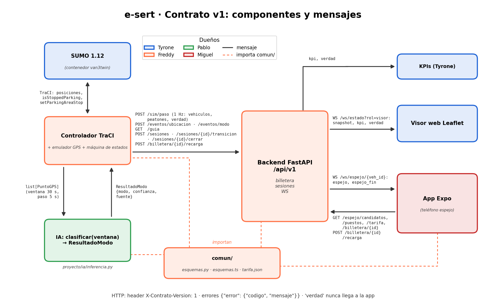

### S1 · Sesión 2 · Núcleo del backend (hecha, 4/4)

**Qué hice:** programé la lógica central del backend, sin servidor web todavía:

- base de datos SQLite con usuarios, movimientos, sesiones y puestos;
- billetera como libro de movimientos: recargar, retener, debitar y liberar;
- servicio de sesiones: iniciar, cambiar de estado, cerrar, avisos y recibo;
- mapa de ocupación con los puestos libres cerca de un destino.

**Decisiones importantes:**

- El saldo se calcula del libro, no se guarda aparte.
- La regla "un auto por lugar" y "una sesión abierta por usuario" la hace cumplir la base de datos dentro de la transacción, para que dos procesos no llenen el mismo puesto a la vez.
- Si la sesión tiene la hora de SUMO, el cobro usa ese reloj.

**Resultado:** 63 pruebas y 99 % de cobertura. El verificador encontró 2 errores (se podía sobrellenar un puesto y liberar la sesión de otro usuario); los corregí con pruebas nuevas. La tarjeta SERT cobra en promedio $0,10 más por estadía (19,3 %) que el cobro por minutos.

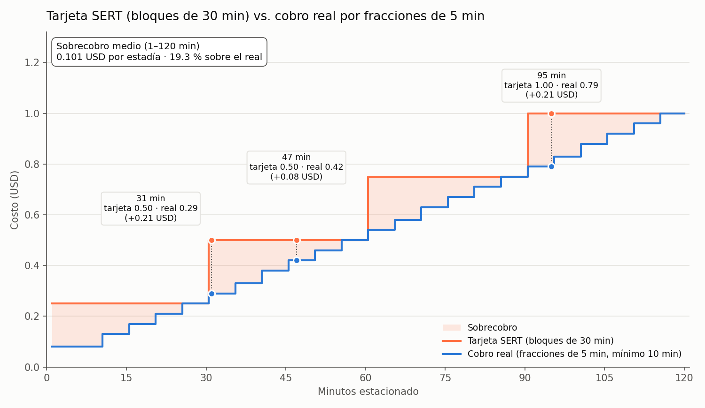

### S1 · Sesión 3 · Controlador TraCI y emulador de GPS (hecha, 4/4)

**Qué hice:**

- El controlador: arranca SUMO, avanza paso a paso y lee posición, velocidad y estado de parqueo de todos los vehículos. Otras partes se "enganchan" con funciones que se ejecutan en cada paso.
- El emulador de GPS: a la posición real le suma un error de unos 5 m. El error de un segundo depende del anterior (modelo AR(1) con correlación 0,8), porque así se comporta un GPS real: el error se mueve poco a poco, no salta al azar. También pierde el 2 % de las muestras.
- Generé trazas GPS de 30 min con 3 semillas, con 150 peatones propios (el escenario de Tyrone no tenía peatones), para que Pablo entrenara la IA.

**Problemas resueltos:** nuestro paquete se llama `traci`, igual que la librería de SUMO, y la tapaba; la cargué por otro nombre. En SUMO 1.12 la velocidad de un tipo se fija con `maxSpeed` y no con `speed`: los peatones "rápidos" no lo eran hasta que lo corregí.

**Resultado:** 19 pruebas.

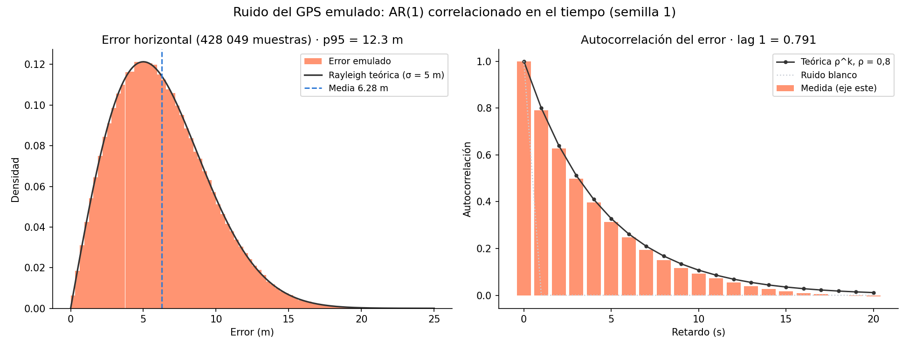

## 6. Semana 2: la simulación con sesiones y cobro

### S2 · Sesión 1 · API FastAPI, WebSocket y Swagger (parcial, 5/6)

**Qué hice:** puse el servidor web sobre el núcleo:

- las 14 rutas del contrato bajo `/api/v1` (puestos, guía, sesiones, billetera, simulación);
- errores con el formato del contrato;
- WebSocket `/ws/estado`, que envía un snapshot por segundo simulado;
- el visor recibe además la "verdad"; el público no;
- documentación Swagger en `/docs` con ejemplos;
- el `Dockerfile` para el VPS.

**Resultado:** 102 pruebas con 99 % de cobertura. Quedó parcial solo porque en esa máquina no había Docker para construir la imagen.

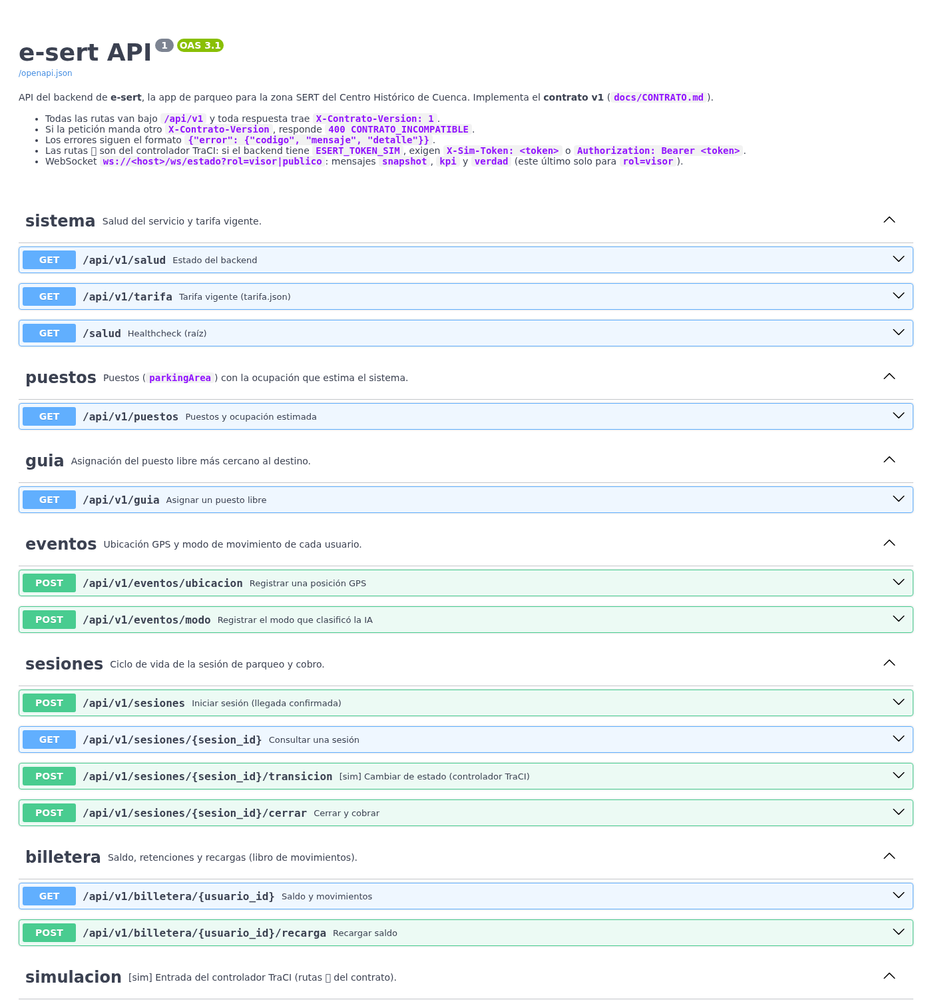

### S2 · Sesión 2 · Máquina de estados y peatones de diligencia (parcial, 4/5)

**Qué hice:**

- Cada auto que estaciona crea un peatón que camina a un destino, hace su diligencia, vuelve y se lleva el auto. Incluí casos difíciles: regresos cortos (15 %) y conductores que esperan en el auto (10 %).
- La máquina de estados por usuario, con su GPS emulado y clasificación cada 5 s.

**Problemas resueltos:** SUMO 1.12 se caía sin mensaje cuando el peatón caminaba hasta el carril del parqueo o terminaba en un cruce. Lo aislé probando por partes y lo corregí haciendo que el peatón salga y vuelva a la acera más cercana.

**Resultado:** las pruebas pasan. No se cumplió "95 % de peatones vuelve en 30 min": las estadías duran de 10 a 120 min, así que en 30 min casi nadie pudo terminar. Ningún peatón se pierde. Hubo 62 falsas liberaciones por 100 sesiones, porque la IA de respaldo confunde el ruido del GPS con movimiento.

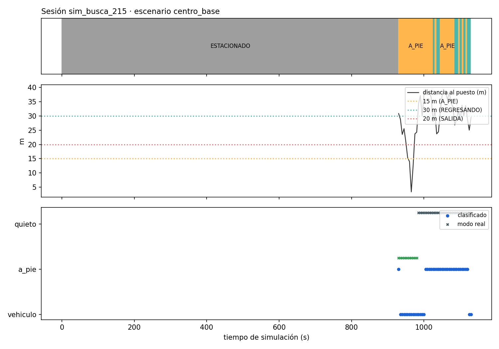

### S2 · Sesión 3 · Guiado, sesiones y cobro en la simulación (parcial, 6/7)

**Qué hice:**

- El guiado: a un auto con app se le asigna el puesto libre más cercano a su destino y SUMO lo reencamina allí. Se revisa cada 10 s; si el puesto se llena, se reasigna (máximo 3 veces).
- Conecté la simulación con el núcleo del backend: recarga inicial, apertura, cambios de estado, cierre y cobro.
- Una auditoría que comprueba que cada billetera cuadra.

**Resultado (75 min simulados, 50 % de autos con app):**

| Medida | Con el mapa del sistema | Con la ocupación real |
|---|---|---|
| Búsqueda media con app / sin app | 11,3 / 10,8 min | 10,0 / 10,7 min |
| Libro de billeteras | cuadra en 638 usuarios | cuadra |

Conclusión: el guiado sí acorta la búsqueda cuando el mapa es correcto. Con el mapa del sistema no, porque las falsas liberaciones muestran puestos libres que no existen.

**Reverificación (14 de noviembre):** agregué un cortacircuitos para que la simulación no se frene si el servidor no responde (ahora va igual de rápido con la URL caída) y la liquidación de las sesiones abiertas al terminar la corrida (retención final 0). Queda 6/7.

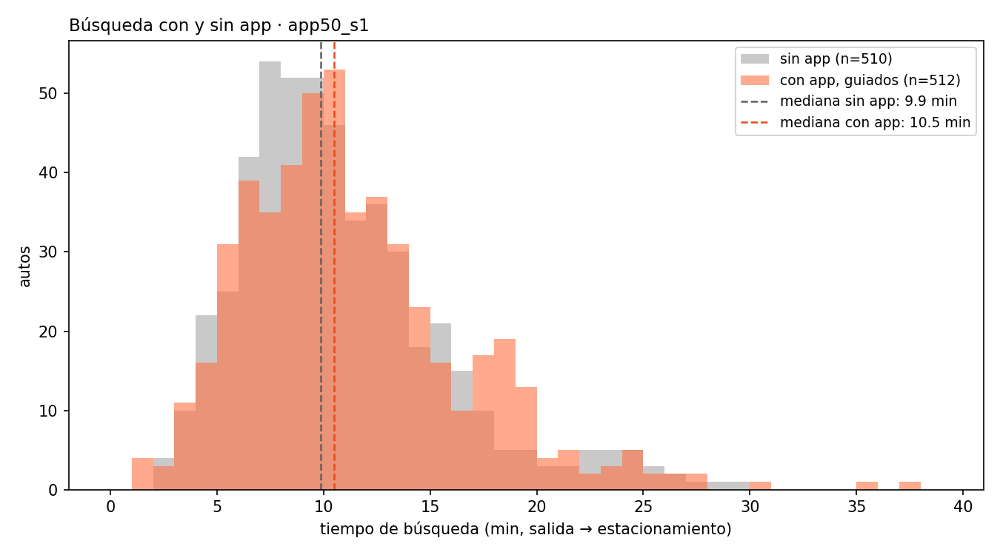

## 7. Semana 3: medición, rendimiento y modo espejo

### S3 · Sesión 1 · KPIs del sistema (hecha, 5/5)

**Qué hice:** medí dentro de la simulación cuatro indicadores, comparando lo que cree el sistema con lo que pasa realmente en SUMO:

1. falsas liberaciones por cada 100 sesiones;
2. retardo de cierre;
3. error de facturación (lo cobrado contra lo que se debió cobrar);
4. precisión del mapa (si el puesto que el sistema muestra libre está realmente libre).

Agregué la ruta `POST /sim/kpi` para mostrar los KPIs en vivo en el visor, y le entregué a Tyrone la clase `KPIsSistema` para sus corridas finales.

**Resultado (50 % con app):** entre 91 y 100 falsas liberaciones por 100 sesiones con la IA de respaldo; precisión del mapa 0,82 en total; el cálculo de KPIs suma entre 1,7 % y 3,6 % de tiempo por paso.

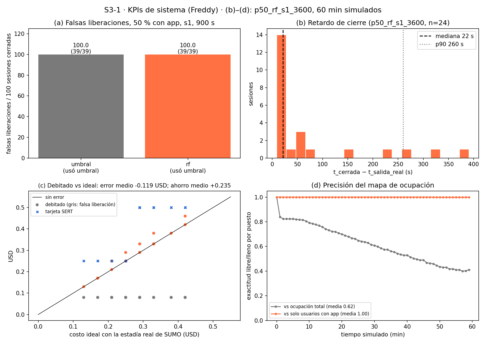

### S3 · Sesión 2 · Rendimiento y robustez (hecha, 5/5)

**Qué hice:**

- **Rendimiento con 80 % de autos con app.** Pasé de 3,2 a 17,2 veces más rápido que el tiempo real con estas medidas:
  - leer solo los autos que buscan parqueo y no los ~5000 estacionados de fondo;
  - contar la ocupación con los eventos de entrada y salida y no consultando cada puesto;
  - convertir coordenadas en Python y no con llamadas a SUMO;
  - clasificar todas las ventanas en lote;
  - usar libsumo, que corre SUMO dentro del mismo proceso.
- **Robustez:** 40 corridas variando la pérdida de GPS, las ráfagas de pérdida, el ruido y los teléfonos apagados.
- **Política de datos pobres:** si una ventana tiene menos de la mitad de las muestras, o la IA tiene poca confianza, la sesión no cambia de estado.
- **Teléfono apagado:** tras 120 s sin señal la sesión queda `sin_senal`, y si llega al tiempo máximo se cierra con el motivo `timeout_sin_senal`.
- **Prueba de carga del backend:** 200 usuarios enviando 1 vez por segundo y 5 visores.

**Resultado:** el controlador gasta 30 ms por paso (p95). La meta de 100 ms por paso no se cumple porque solo el paso de SUMO ya tarda 142 ms en el p95. Con la política de datos pobres hay 0 cierres decididos con ventanas incompletas, contra 7-8 sin ella. El backend respondió con p95 de 17-35 ms.

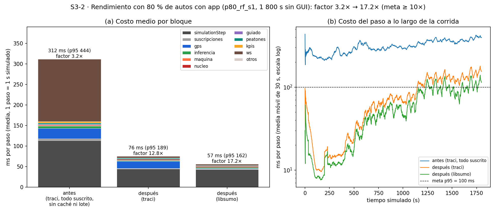

### S3 · Sesión 3 · Modo espejo y prueba con el VPS (parcial, 5/6)

**Qué hice:**

- El controlador agrega a cada snapshot la lista de autos que se pueden seguir y el detalle de los autos que un teléfono está siguiendo: estado, ruta, puesto, distancia, costo en curso, avisos y recibo.
- El backend tiene `GET /espejo/candidatos` y el WebSocket `/ws/espejo/{veh_id}`, que envía como máximo 1 mensaje por segundo y un latido cada 2 s.
- Un cliente de prueba que hace de teléfono y mide la latencia.

**Errores encontrados y corregidos:**

- Ningún auto se guiaba, porque en los escenarios de Tyrone el destino venía como coordenadas y el nombre en otro campo. Ahora se aceptan los dos.
- SUMO entregaba una posición inválida al salir de un parqueo, lo que dañaba el JSON de todo el snapshot y congelaba el visor. Ahora se usa la última posición válida.

**Resultado en local:** 3 pantallas siguieron autos desde que fueron guiados hasta el recibo, con latencia p50 = 76 ms, p95 = 178 ms y 0 desconexiones. En el VPS el WebSocket del visor estuvo abierto 10 min sin cortes. Queda parcial porque la prueba completa en línea necesitaba el token del VPS, que tiene Tyrone.

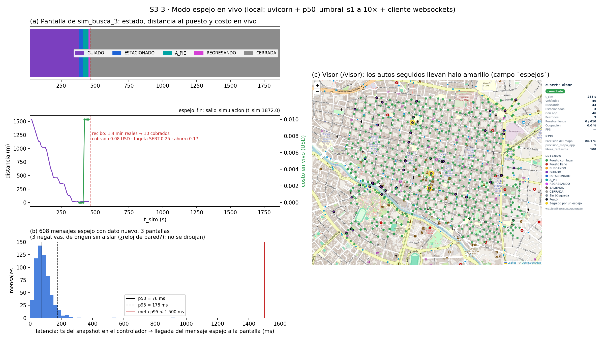

## 8. Semana 4: pruebas, documentación e informe

### S4 · Sesión 1 · Pruebas de punta a punta (parcial, 4/6)

**Qué hice:** una batería de pruebas que levanta el backend real y, cuando hace falta, SUMO real:

- flujo de la app: saldo 0, error de saldo, recarga, guía, estacionar, caminar, volver, irse, cierre automático y cobro correcto;
- caso trampa: alejarse caminando no libera el puesto;
- WebSocket: mensajes válidos, máximo 1 snapshot por segundo y la "verdad" nunca llega al público;
- errores del contrato: 402, 409, 404, 403 y 400;
- simulación completa de 1800 s contra el backend;
- prueba de humo contra el VPS.

**Resultado:** 30 pruebas pasan y 2 fallan, en 3-4 min. Las 2 que fallan exigen 0 falsas liberaciones y hubo 35 de 35. La causa está comprobada: sin el modelo de IA, con un error de GPS de 5 m la mayoría de las ventanas de alguien caminando salen como "vehículo". Con un error de 2 m o menos hay 0 falsas liberaciones y el cierre tarda 12-13 s, así que la máquina de estados funciona bien. Las billeteras, el mapa y el espejo cumplen. También detecté que el VPS aceptaba snapshots sin token.

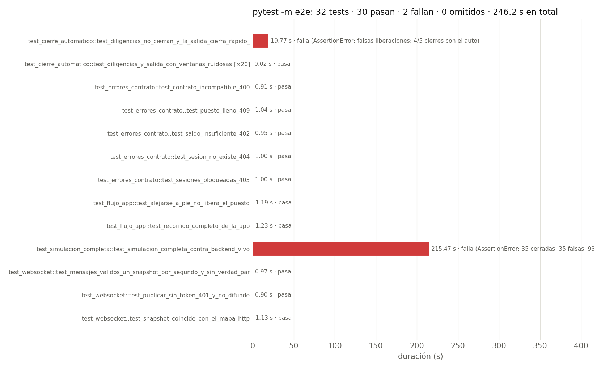

### S4 · Sesión 2 · Documentación técnica (hecha, 5/5)

**Qué hice:**

- 9 diagramas: componentes, despliegue, estados de la sesión y secuencias (llegada, falsa liberación evitada, recarga con Payphone, snapshot y espejo).
- Un verificador automático que compara la API real con el contrato; encontró una diferencia menor, que dejé propuesta.
- Guías de arquitectura, operación (cómo levantar cada pieza y 14 fallas comunes) y 6 decisiones de diseño:

| Decisión | Qué dice |
|---|---|
| D1 | El controlador usa el núcleo del backend directamente, sin HTTP, para no frenar la simulación. |
| D2 | SQLite como base de datos: basta para la demo y no necesita un servidor aparte. |
| D3 | Suscripciones de TraCI en lugar de muchas consultas sueltas, por velocidad. |
| D4 | El guiado usa la ocupación actual, no una predicción. |
| D5 | La billetera es un libro de movimientos. |
| D6 | La "verdad" existe solo en la simulación; en la vida real no se conoce. |

**Cifras medidas:** 30,2 ms por paso con 80 % de autos con app; API p50 = 3,0 ms y p95 = 4,5 ms; 2,12 mensajes WebSocket por segundo.

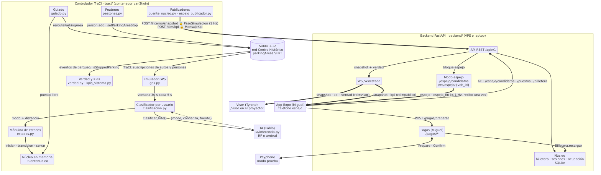

### S4 · Sesión 3 · Sección del informe y ensayo de la demo (hecha, 6/6)

**Qué hice:**

- La sección `informe/freddy.md` (2488 palabras, 87 cifras, cada una con su archivo de origen). El verificador de Pablo la aprobó, y un revisor que leyó como el profesor encontró 25 puntos que corregí.
- Ensayo de la demo:

| Prueba | Resultado |
|---|---|
| Arranque en frío | primer snapshot a los 3,89 s |
| Reinicio del backend | el controlador sigue vivo; vuelve a publicar a los 7,17 s |
| Reconexión del teléfono espejo | mismo auto, misma sesión, 1 solo recibo |
| 80 % con interfaz gráfica de SUMO | 35,9 ms por paso |
| Ctrl+C | dejaba SUMO vivo; corregido con `--vigilar-stdin` |

Rendimiento por porcentaje de autos con app (1800 s simulados):

| Autos con app | 0 % | 20 % | 50 % | 80 % |
|---|---|---|---|---|
| ms por paso | 56,1 | 60,1 | 74,2 | 70,3 |

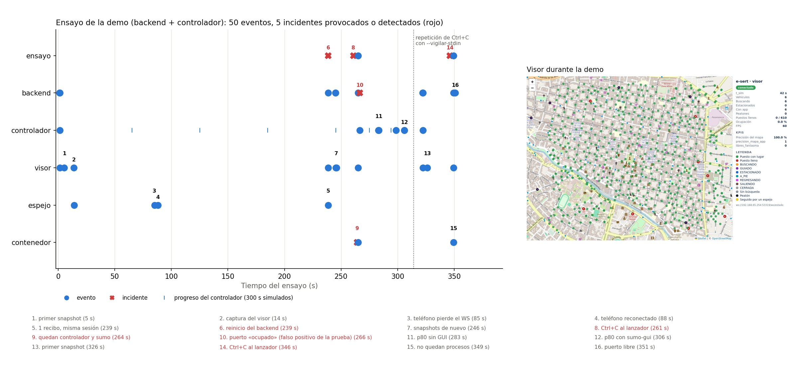

## 9. Cifras para recordar

| Tema | Cifra |
|---|---|
| Pruebas automáticas | backend 118, comun 169, traci 74; e2e 30 de 32 |
| Latencia de la API | p50 3,0 ms / p95 4,5 ms |
| Latencia del modo espejo | p50 76 ms / p95 178 ms |
| Velocidad de la simulación | hasta 17,2 veces el tiempo real con 80 % de app |
| Costo del controlador | 30 ms por paso (p95) |
| Búsqueda con mapa correcto | 10,0 min con app frente a 10,7 min sin app |
| Sobrecobro de la tarjeta SERT | $0,10 por estadía (19,3 %) |
| Falsas liberaciones con GPS de 5 m sin modelo | 91-100 por 100 sesiones |
| Falsas liberaciones con GPS de 2 m | 0, con cierre en 12-13 s |

## 10. Lo que no salió y por qué

1. **Falsas liberaciones altas.** Mis corridas se hicieron sin el modelo entrenado de Pablo (el archivo `.joblib` no estaba en el repositorio), así que la IA usó una regla de velocidad. Con 5 m de error de GPS, un teléfono quieto aparenta moverse a unos 4 m/s y la regla lo toma como auto. Con un GPS más preciso hay 0 falsas, lo que demuestra que la máquina de estados está bien. El modelo `rf_final.joblib` ya está en `main`; falta repetir las corridas con él.
2. **"95 % de peatones vuelve en 30 min".** No se puede cumplir con estadías de 10 a 120 min. Ningún peatón se pierde; lo propuse a Tyrone como cambio de criterio.
3. **p95 menor a 100 ms por paso.** El límite lo pone el propio SUMO (142 ms), no mi código (30 ms).
4. **Prueba completa en el VPS.** Necesita el token de la simulación, que solo maneja Tyrone. También quedó pedido configurar ese token, porque el VPS aceptaba snapshots sin él.

## 11. Preguntas probables del profesor

**¿Por qué el backend no decide cuándo se va el auto?**
Porque el que tiene el GPS y la IA es el controlador. El backend valida, guarda y cobra; el controlador decide los cambios de estado y llama a `/cerrar`.

**¿Por qué el puesto no se libera cuando el conductor se aleja caminando?**
Porque el auto sigue estacionado. Solo se libera cuando la persona vuelve y la IA detecta movimiento en vehículo durante 2 ventanas seguidas a más de 20 m.

**¿Por qué el GPS emulado usa AR(1) y no ruido al azar?**
Porque el error de un GPS real cambia poco de un segundo a otro. Con ruido independiente, el teléfono parecería saltar y la velocidad calculada sería irreal.

**¿Cómo saben que el cobro es correcto?**
El saldo sale del libro de movimientos, el dinero se maneja en centavos enteros y una auditoría comprueba en cada corrida que saldo = recargas menos débitos para cada usuario (638 de 638 cuadran).

**¿Por qué hay tantas falsas liberaciones?**
Porque la IA funcionó en modo de respaldo sin el modelo entrenado. Con GPS de 2 m hay 0 falsas, así que el problema está en la clasificación con ruido, no en la lógica de sesiones.

**¿Cómo evitan saturar la red?**
Se publica como máximo 1 snapshot por segundo simulado. Si el servidor no responde, el controlador deja de armar mensajes y solo prueba cada 5 s, para que la simulación no se frene.

**¿Qué pasa si el teléfono se apaga?**
Tras 120 s sin datos la sesión pasa a `sin_senal` y no cambia de estado. Si llega al tiempo máximo de 120 min se cierra con el motivo `timeout_sin_senal`.

## 12. Dónde está cada cosa

| Qué | Dónde |
|---|---|
| Contrato y esquemas | `proyecto/comun/` |
| Núcleo del backend | `proyecto/backend/nucleo/` |
| API y WebSocket | `proyecto/backend/api/` y `proyecto/backend/espejo/` |
| Controlador, GPS, estados, guiado, KPIs | `proyecto/traci/` |
| Diagramas y documentación | `proyecto/comun/docs/` |
| Sección del informe | `proyecto/informe/freddy.md` |
| Evidencias por sesión | `semanas/S1..S4/Freddy/evidencias/` |
| Explicaciones en PDF | `semanas/S1..S4/Freddy/explicaciones/` |
| Bitácora detallada | `bitacoras/freddy.md` |
