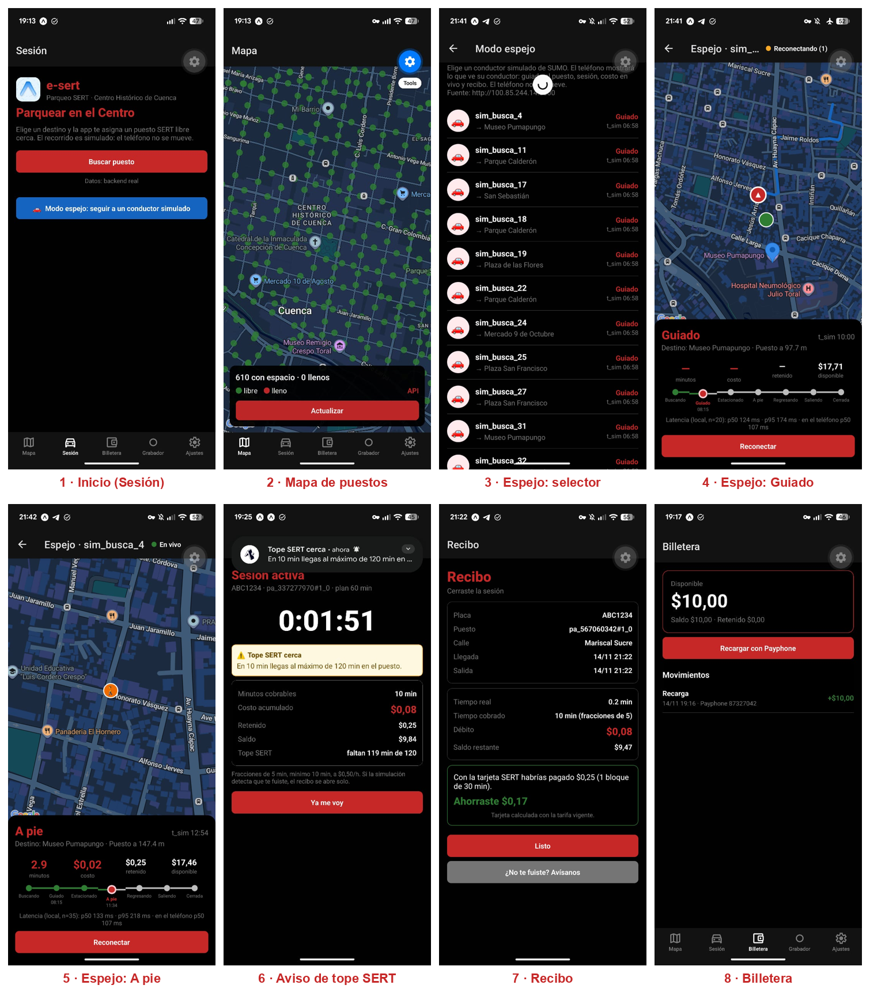
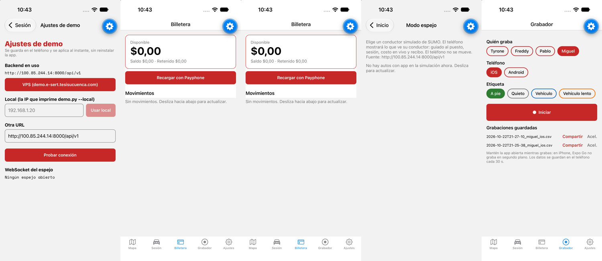
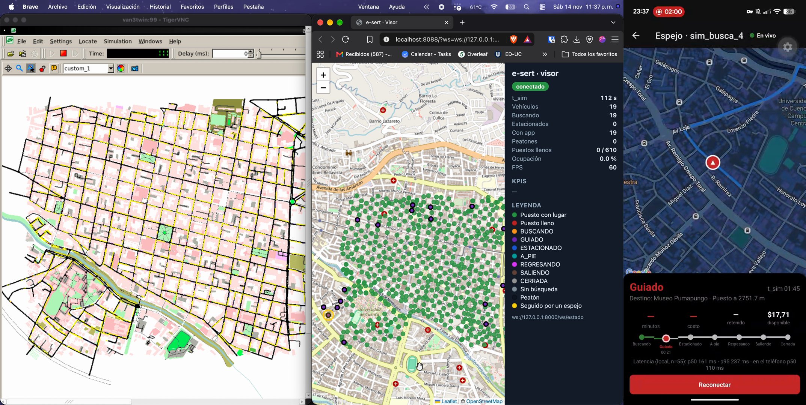
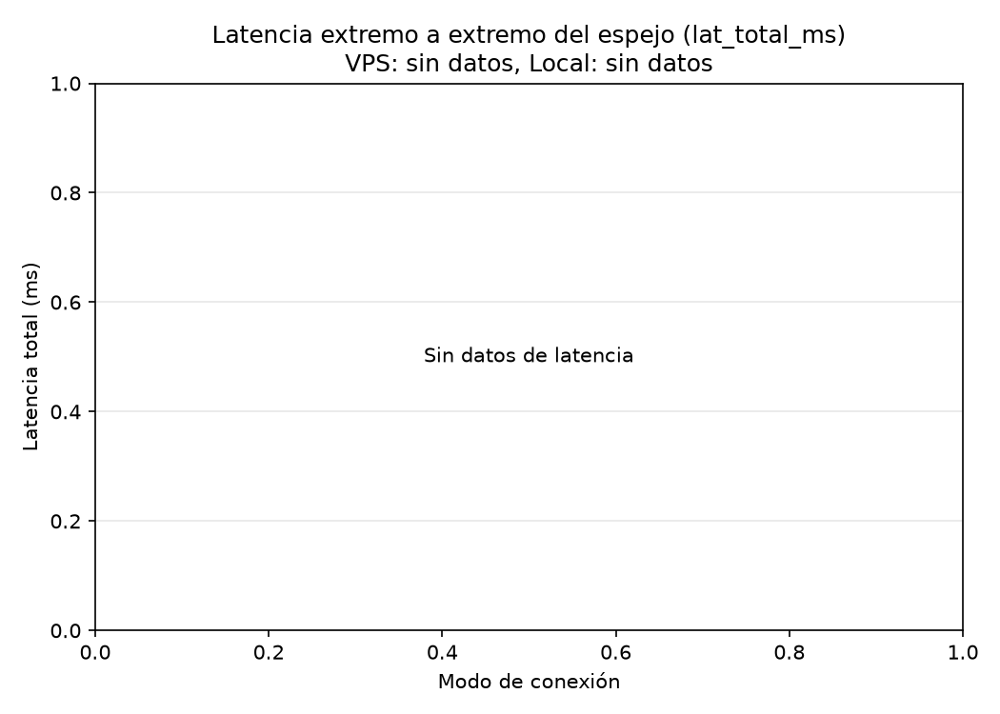

# S4 · Miguel

## Sesión 1 · Pulido final de la app y manual de usuario (parcial, 5/6)

La app quedó lista para la demo final:

- **Errores:** todo error se muestra en español con un botón de acción, y nunca aparece texto técnico.
- **Ajustes de demo:** pantalla oculta (pulsación larga de 3 s en el logo) para cambiar entre el VPS y un backend local sin reinstalar, con la latencia de `/salud`, candidatos y el WebSocket.
- **QA:** batería de 19 casos en Android contra el backend local y la simulación de Freddy en `van3twin`.
  - Pasan 18; el 6 queda con una observación.
  - Encontró 3 fallas, que quedaron corregidas: el formato del puesto, la recarga sin conexión sin botón y los decimales con punto.
- **iPhone:** solo en el simulador de iOS. Por eso el criterio "ambos teléfonos" queda parcial.
- **Manual:** `codigo/app/MANUAL.md`, con 8 capturas.
- **Calidad:** ESLint configurado (0 errores), `tsc` sin errores y Jest 254/254.

[Explicación (PDF)](explicaciones/s1_explicacion.pdf) · [Checklist de QA](codigo/app/CHECKLIST_QA.md) · [Manual](codigo/app/MANUAL.md)

## Sesión 2 · Ensayo general de la demo con el teléfono espejo y video de respaldo (parcial)

- Guion cronometrado de 7 tomas (6 min 45 s) y checklist previa.
- Ensayo en local:
  - backend + visor + sumo-gui en la laptop;
  - el Android siguió a `sim_busca_4` por el modo espejo;
  - el modo avión provocó una reconexión, que se recuperó sola.
- **Ensayo contra el VPS:** bloqueado. `demo.py --remoto` necesita `ESERT_TOKEN_SIM`, que solo tiene Tyrone.
- **Guion:** no se cumplió con ±30 s, porque el auto elegido tarda más que las tomas 4–6.
- **Video:** las grabaciones de la laptop y del teléfono están combinadas con ffmpeg, fuera de git.
- **Latencia en pantalla (local, n=55):** p50 de 161 ms y p95 de 237 ms.
- **CSV:** no se pudo exportar, porque Expo Go se reinicia al compartir.

[Explicación (PDF)](explicaciones/s2_explicacion.pdf) · [Guion](codigo/app/ensayo/guion_demo.md) · [Registro](codigo/app/ensayo/registro_ensayo.md)
