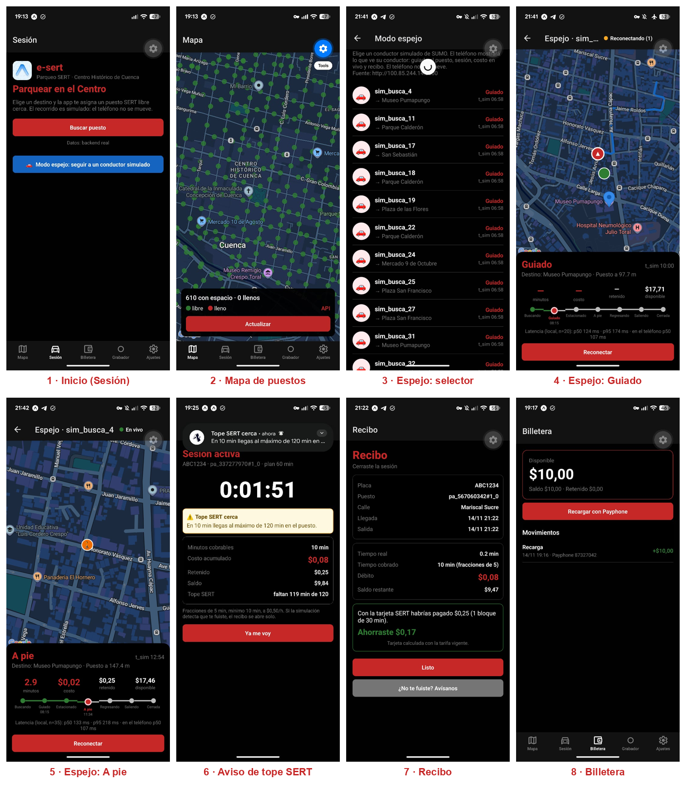
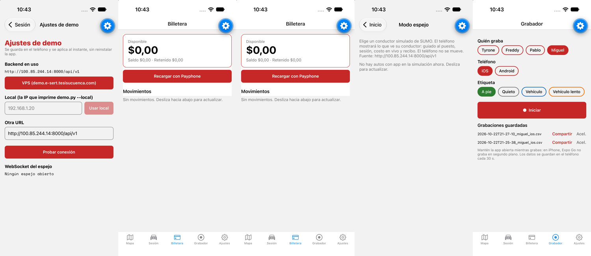

# S4 · Sesión 1 · Miguel: Pulido final de la app y manual de usuario

## 1. Resumen en 5 líneas

1. Se dejó la app lista para la demo final: todo error (del contrato, de red o desconocido) se muestra en español con un botón que dice qué hacer, y nunca aparece texto técnico.
2. Se añadió una pantalla oculta, **Ajustes de demo** (pulsación larga de 3 s en el logo), para cambiar entre el backend del VPS y el de una computadora local sin reinstalar la app, y para medir la latencia.
3. Se corrió una batería de QA de 19 casos en el Android de Miguel, contra el backend local y la simulación de Freddy en el contenedor `van3twin`. Algunos casos se repitieron en el simulador de iOS.
4. La batería encontró 3 fallas, que quedaron corregidas: el puesto mal escrito daba "dato no válido" sin botón, la recarga sin conexión no tenía botón y había decimales con punto.
5. Se escribió `MANUAL.md` con las 8 pantallas principales y se configuró ESLint (0 errores). `tsc` no da errores y Jest pasa 254/254.

## 2. Conceptos clave

- **Traducción de errores con acción:** el backend responde los errores con un código del contrato (por ejemplo `PUESTO_NO_EXISTE`). La app los convierte en una tabla `código → {mensaje, acción}`. La acción es un botón: Recargar, Buscar otro puesto, Reintentar, Revisar conexión o Volver al inicio. Lo que no esté en la tabla da un mensaje genérico, y el detalle técnico solo va al registro.
- **Validación en el cliente:** la app comprueba el formato de la placa y del puesto antes de enviarlos, con el mismo patrón que el backend. Así el usuario recibe una ayuda concreta en lugar de "Algún dato no es válido".
- **Configuración en caliente:** la URL del backend se guarda en AsyncStorage y manda sobre la variable `EXPO_PUBLIC_API_URL`. Cambiarla no obliga a reinstalar.
- **QA guiado por la simulación:** el teléfono no se mueve. SUMO, con el controlador TraCI `correr_guiado`, mueve los autos y publica los eventos en el backend local. El teléfono los sigue en el modo espejo.
- **`espejo_fin`:** mensaje del WebSocket del espejo cuando el auto sale de la simulación o termina la corrida. Si la sesión del auto cierra antes, la app va al recibo y este mensaje no se ve. Por eso el caso 11 necesitó una corrida corta.
- **Tailscale:** red privada que da a la computadora una IP fija (100.85.244.14). Con ella, el teléfono llega al backend tanto por Wi-Fi como por datos móviles.

## 3. Cómo se generó cada cosa

| Resultado | Comando | Entradas | Salidas |
|---|---|---|---|
| Backend local | `uvicorn backend.api.main:app --host 0.0.0.0 --port 8000` en `proyecto/`, con `PAYPHONE_MODO=mock` y una base SQLite nueva | `proyecto/backend`, `puestos.csv` | API y WS del espejo en :8000 |
| Simulación | `docker exec -w …/proyecto van3twin bash -lc "python3 -m traci.correr_guiado --escenario app50_s1 --publicar http://host.docker.internal:8000 --ritmo 5 --hasta 7200"` | escenario `app50_s1` de Tyrone | 50 autos con la app; eventos publicados (7201 enviados, 0 fallidos) |
| Corrida corta (caso 11) | lo mismo con `--ritmo 1 --hasta 180` | lo mismo | autos todavía en Guiado al final → `espejo_fin` |
| App | `REACT_NATIVE_PACKAGER_HOSTNAME=100.85.244.14 npx expo start --lan` | `.env` (no versionado) | Expo Go en el teléfono |
| Saldo negativo (caso 13) | `POST /sesiones` con `ts` de hace 20 h y `POST /sesiones/{id}/cerrar` (`motivo: manual`) en la API local | usuario de prueba del teléfono | saldo −$0,57, `bloqueada: true` |
| Calidad | `npx tsc --noEmit`, `npx jest`, `npm run lint` | código de la app | 0 errores; 254 tests; 0 errores de lint |
| Montaje | script con Pillow (rejilla 4×2 con los nombres) | las 8 capturas | `evidencias/s1_app-pantallas.png` |
| iOS | `xcrun simctl openurl booted exp://…/--/<ruta>` y `simctl io booted screenshot` | Expo Go en el simulador | `evidencias/s1_ios-simulador.png` |

## 4. Mapa de archivos

| Archivo | Qué contiene | Quién lo usa |
|---|---|---|
| `codigo/app/src/errores.ts` | tabla de códigos → mensaje y acción; `describirError`, `ErrorParaUsuario` | todas las pantallas |
| `codigo/app/src/ui/AvisoError.tsx` | caja roja con el mensaje y el botón de la acción | mapa, buscar, confirmar, billetera, recarga, espejo |
| `codigo/app/src/config/demo.ts` | URL del VPS, IP local, `probarConexion`, `probarWsEspejo`, estado del WS | `app/demo.tsx`, `AjustesContexto` |
| `codigo/app/app/demo.tsx` | pantalla oculta "Ajustes de demo" | quien presenta la demo |
| `codigo/app/src/componentes/LogoESert.tsx` | logo con pulsación larga de 3 s → `/demo` | pestañas Sesión y Ajustes |
| `codigo/app/src/sesion/placa.ts` | patrones de placa y puesto del contrato | `sesion/confirmar.tsx` |
| `codigo/app/eslint.config.js` | ESLint con `eslint-config-expo` | `npm run lint` |
| `codigo/app/CHECKLIST_QA.md` | los 19 casos con resultado y evidencia | el grupo antes de la demo |
| `codigo/app/MANUAL.md` y `capturas/` | manual de usuario con 8 capturas | profesor y usuarios |

## 5. Recorrido del código

- **`describirError(error)`** (`src/errores.ts`):
  - Si el error es `ErrorParaUsuario`, usa su texto.
  - Si es `ErrorApi` con un código conocido, toma la tabla.
  - Si es `HTTP_xxx`, da un mensaje sin el HTML del proxy.
  - En cualquier otro caso, da el genérico.

```ts
export function describirError(error: unknown): ErrorUsuario {
  if (error instanceof ErrorParaUsuario) return conEtiqueta({ mensaje: error.message, accion: error.accion });
  if (error instanceof ErrorApi) {
    const conocido = ERRORES[error.codigo as CodigoError | CodigoCliente];
    if (conocido) return conEtiqueta(conocido);
    if (error.codigo.startsWith('HTTP_')) {
      return conEtiqueta({ mensaje: `El servidor respondió con un error (${error.estado}).`, accion: 'reintentar' });
    }
  }
  console.warn('[errores] error sin traducir:', error);
  return GENERICO;
}
```

- **`AvisoError`** (`src/ui/AvisoError.tsx`): llama a `describirError` y convierte la acción en navegación. `buscar_otro` lleva a `/buscar`, `ajustes` a `/demo` y `recargar` a `/recarga`; `reintentar` llama a la función que le pasa la pantalla.
- **`probarConexion(url)`** (`src/config/demo.ts`): mide `GET /salud` y `GET /api/v1/espejo/candidatos` con un tiempo límite de 6 s. `probarWsEspejo` abre `WS /ws/espejo/{veh_id}` y mide el primer mensaje.
- **`esPuestoValido`** (`src/sesion/placa.ts`): `^pa_.+_\d+$`, el mismo patrón que valida el backend.

## 6. Cómo se conecta con los demás

- **Consume:**
  - de Freddy: la API del backend (`/sesiones`, `/billetera`, `/pagos/*`), el WebSocket `/ws/espejo/{veh_id}` y el controlador `correr_guiado`;
  - de Tyrone: el escenario `app50_s1`, `puestos.csv` y la URL del VPS. El modo local sigue a `demo.py --local` de Tyrone, que usa el puerto 8000.
- **Entrega:**
  - la app pulida, en `semanas/S4/Miguel/codigo/app/`;
  - `MANUAL.md`;
  - `CHECKLIST_QA.md`, con las fallas del backend para Freddy.

## 7. Resultados y evidencias

- **QA:**
  - Android pasa 18 de 19 casos; el 6 (saldo bajo) queda ⚠️ porque no se repitió en la batería.
  - En el simulador de iOS se probaron los casos que no necesitan tocar la pantalla: 8, 18, 19 y los banners de 6 y 7.
- **Latencias del espejo por Tailscale:**
  - p50 ≈ 124–158 ms de extremo a extremo;
  - p95 ≈ 174–218 ms.
- **Ajustes de demo:** `/salud` en 197 ms y candidatos en 26 ms.
- **Recibo del espejo:** 65,8 min se cobran como 70 min = $0,58. Con la tarjeta SERT habrían sido $0,75.





## 8. Limitaciones y decisiones

- **Sin iPhone físico:**
  - el simulador no deja tocar la pantalla, así que los casos con toques quedan "n/a" en iOS;
  - hay que repetirlos con un iPhone antes de la demo.
- **La copia de la app parte de `origin/miguel/s3`, no de `proyecto/app`:**
  - la unificación de S3 se hizo sin la rama de Miguel, así que `proyecto/app` no tiene S2-3 ni S3;
  - está pedido a Tyrone fusionar `miguel/s3`.
- **El saldo negativo del caso 13 se creó a propósito** con una sesión de prueba fechada 20 h atrás en la API local. No se tocó el VPS.
- **`espejo_fin`** solo se ve si la corrida termina con el auto en camino. Es el comportamiento correcto del contrato, no una falla.
- **ESLint:** tres reglas nuevas del React Compiler se dejaron como avisos, porque cambiar esos efectos antes de la demo era riesgoso.

## 9. Preguntas que podría hacer el profesor

1. **¿Qué pasa si el backend se cae en plena demo?**
   La app no se cierra: muestra "No hay conexión con el servidor" con "Revisar conexión". Desde Ajustes de demo se cambia al VPS o a otra computadora sin reinstalar.
2. **¿Cómo sabe el usuario qué hacer ante un error?**
   Cada código del contrato tiene un mensaje en español y una acción (un botón). Lo desconocido da un mensaje genérico, y el detalle técnico va solo al registro.
3. **¿Por qué el teléfono no se mueve?**
   El alcance es simulado: SUMO mueve los autos y el modo espejo muestra en el teléfono lo que vería un conductor simulado. No hay pruebas en la calle.
4. **¿Cómo se probó la reconexión?**
   Con el modo avión 15 s mientras se seguía un auto. La app pasó a "Reconectando" y volvió sola a "En vivo".
5. **¿Cuánto ahorra el usuario?**
   Paga por fracciones de 5 min en lugar de bloques de 30 min. En la prueba, 65,8 min costaron $0,58 frente a $0,75 con tarjetas SERT.
