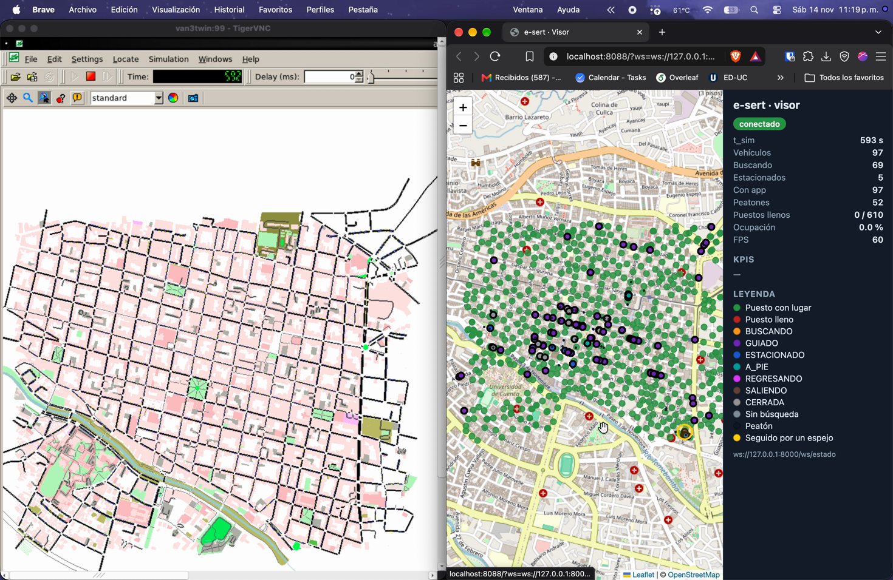
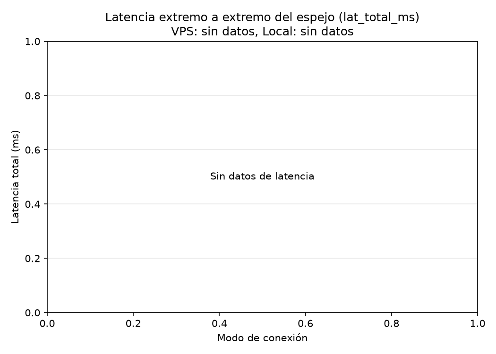

# S4 · Sesión 2 · Miguel: Ensayo general de la demo con el teléfono espejo y video de respaldo

## 1. Resumen en 5 líneas

1. Se escribió el guion cronometrado de la demo (7 tomas, 6 min 45 s) y la checklist previa.
2. Se ensayó en local: backend, visor y sumo-gui en la laptop, y el teléfono Android siguiendo a un auto simulado por el modo espejo.
3. El ensayo contra el VPS no se pudo hacer completo: publicar la simulación en el VPS requiere `ESERT_TOKEN_SIM`, que solo tiene Tyrone.
4. Se probó la reconexión del espejo con el modo avión, se grabó la pantalla de la laptop y se escribió `analizar_ensayo.py`. El script calcula las latencias, las reconexiones, los tiempos de cada toma y si los recibos cuadran con la tarifa.
5. Quedaron pendientes el video combinado con el del teléfono y cumplir el guion con ±30 s: el auto elegido tarda más que las tomas 4–6.

## 2. Conceptos clave

- **Ensayo general:** correr la demo completa con cronómetro, tal como se presentará, para encontrar fallas antes del día.
- **Plan B local:** si el VPS o internet fallan, todo corre en la laptop. El teléfono apunta a la IP de la laptop desde Ajustes de demo.
- **Latencia evento → pantalla:** tiempo entre el `ts` con que el servidor emite un mensaje del espejo y el momento en que el teléfono lo pinta. Se corrige el desfase de reloj con el algoritmo de Cristian contra `/salud` (S2-3).
- **Reconexión exponencial:** si se corta el WebSocket, la app reintenta con esperas crecientes y vuelve a "En vivo" sin reiniciarse.
- **`espejo_fin`:** fin del espejo. El botón "Exportar CSV" solo aparece entonces, por eso hace falta una corrida que termine con el auto en camino.

## 3. Cómo se generó cada cosa

| Resultado | Comando | Salida |
|---|---|---|
| Simulación con GUI | `docker exec -w …/proyecto -e DISPLAY=:99 van3twin bash -lc "python3 -m traci.correr_guiado --escenario app50_s1 --gui --publicar http://host.docker.internal:8000 --ritmo 5 --hasta 1800"` | sumo-gui en VNC y eventos en el backend (1801 enviados, 0 fallidos) |
| Visor | `python3 -m http.server 8088` en `proyecto/visor` | `http://localhost:8088/?ws=ws://127.0.0.1:8000/ws/estado` |
| Análisis | `python ensayo/analizar_ensayo.py` (con pandas y matplotlib) | `resultados_ensayo.json`, `evidencias/s2_latencias-ensayo.png` |
| Fotograma | `ffmpeg -ss 150 -i <grabación de la laptop> -frames:v 1` | `evidencias/s2_ensayo-montaje.png` |

## 4. Mapa de archivos

| Archivo | Qué contiene | Quién lo usa |
|---|---|---|
| `codigo/app/ensayo/guion_demo.md` | tabla toma / duración / quién / qué se ve / qué se dice, más las fallas y qué hacer | todo el grupo el día de la demo |
| `codigo/app/ensayo/checklist_previa.md` | casillas para 15 min antes | quien presenta |
| `codigo/app/ensayo/registro_ensayo.md` | horas, desviaciones e incidencias | Tyrone (ajuste de la demo) |
| `codigo/app/ensayo/analizar_ensayo.py` | análisis de latencias, reconexiones, tomas y recibos | S4-3 |
| `codigo/app/ensayo/resultados_ensayo.json` | resultados del análisis | S4-3, informe |
| `codigo/app/plan_b/crudo/LEEME.md` | dónde están los videos crudos y cómo combinarlos | S4-3 (edición) |

## 5. Recorrido del código

- **`analizar_ensayo.py`** lee `latencias/*.csv` (columnas `modo,t_sim,lat_total_ms,lat_cliente_ms`) y, si existe, `eventos_ensayo.json` con las reconexiones, las tomas y los recibos.
  - Calcula p50, p95 y el máximo por modo.
  - Para cada reconexión, calcula los segundos entre el corte y la recuperación.
  - Compara la duración de cada toma con el guion (±30 s en total).
  - Recalcula el cobro con `tarifa.json`: fracciones de 5 min, mínimo 10 min y $0,50/h, con tolerancia de ±$0,01.
  - Dibuja las cajas VPS frente a local. Si falta un dato, escribe null y una nota, sin fallar.

## 6. Cómo se conecta con los demás

- **Usa:**
  - el backend y el controlador `correr_guiado` de Freddy;
  - el visor y la configuración de `demo.py` de Tyrone;
  - la app de S4-1.
- **Entrega:**
  - el guion y la checklist para la demo;
  - los videos crudos y el registro para S4-3.

## 7. Resultados y evidencias

- **Simulación:** 3 corridas locales, todas con 0 eventos fallidos.
- **Reconexión:** el WebSocket del espejo se recuperó solo tras el modo avión (2 conexiones aceptadas por corrida en el log del backend).
- **Latencia del espejo en S4-1, por Tailscale:** p50 de 124–158 ms y p95 de 174–218 ms.

## 8. Limitaciones y decisiones

- **Sin ensayo contra el VPS:** sin `ESERT_TOKEN_SIM` el VPS no recibe la simulación. Lo pide `@Tyrone [VPS]`.
- **`demo.py` no se pudo correr sin editarlo** desde una carpeta temporal: busca `CLAUDE.md` y `kpis/correr_una.py`, que solo están en `tyrone/s4`. Se usaron las mismas piezas a mano.
- **OBS no estaba instalado:** se grabó con la herramienta de macOS (Cmd+Shift+5).
- **Guion:** las tomas 5 y 6 no cupieron, porque el auto elegido tarda ~14 min de reloj a ritmo 5. Para la demo hay que elegir un auto ya estacionado.
- **Tiempo:** la sesión se hizo en la última hora del plazo, así que el ensayo se redujo a lo esencial.

## 9. Preguntas que podría hacer el profesor

1. **¿Qué pasa si falla internet en la demo?**
   Se usa el plan B local: la laptop corre todo y el teléfono cambia de URL en Ajustes de demo, sin reinstalar.
2. **¿Cuánto tarda el teléfono en mostrar un evento?**
   Por Tailscale, unos 120–160 ms de mediana, con el reloj corregido contra `/salud`.
3. **¿Qué pasa si el teléfono pierde la red?**
   El espejo muestra "Reconectando" y vuelve a "En vivo" solo, con reintentos exponenciales.
4. **¿Por qué hay un video de respaldo?**
   Para que la demo se pueda mostrar aunque fallen la red, el VPS o el teléfono. Va fuera de git por su tamaño.
