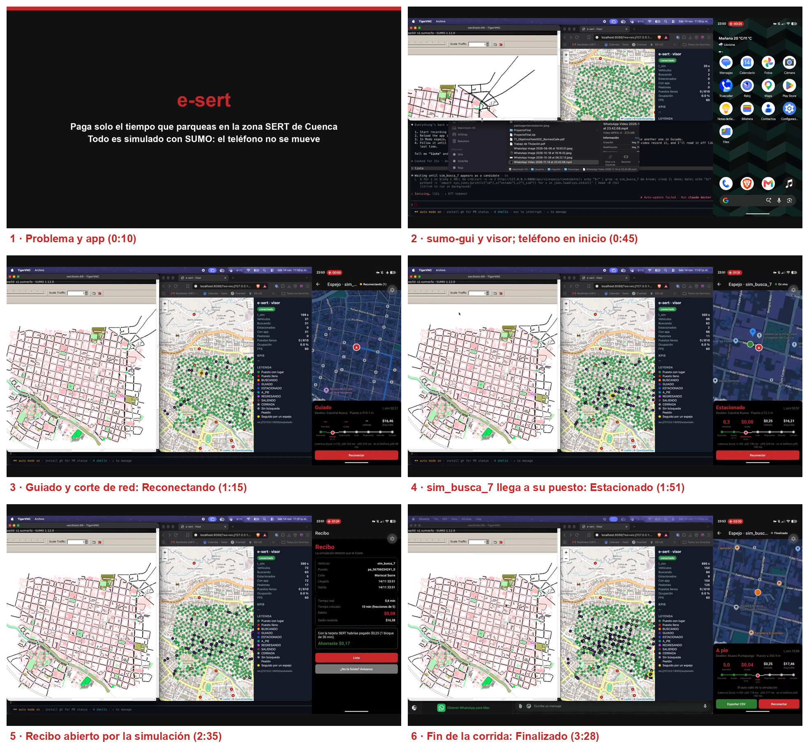

# S4 · Sesión 3 · Miguel: Sección de la app en el informe y plan B de la demo en video

## 1. Resumen en 5 líneas

1. Se escribió `informe/miguel.md` (unas 2 000 palabras). Cubre el diseño de la app, el modo espejo, la sesión y el cierre automático, la billetera y Payphone en modo de prueba, las reglas SERT verificadas, el Grabador y el ensayo de la demo con cifras reales.
2. Cada cifra lleva su fuente (`<!-- fuente: ... -->`), y las figuras se regeneran con `informe/figuras/miguel/generar_figuras.py`.
3. Se editó el video del plan B (3 min 40 s, 1080p, 16,3 MB, con subtítulos en español) a partir de la corrida 4 del ensayo de S4-2: laptop y teléfono lado a lado.
4. El video no va en git. `plan_b/ENLACE_VIDEO.md` trae su duración, tamaño y SHA-256; falta subirlo a la carpeta del grupo.
5. Un revisor sin contexto comparó las cifras y el guion con las fuentes y los fotogramas.

## 2. Conceptos clave

- **Trazabilidad de cifras:** cada número del informe apunta al archivo del que sale, para que el verificador de Pablo lo compare.
- **Plan B en video:** si la demo en vivo falla (red, VPS o teléfono), se proyecta el video.
- **Edición sin pérdida de verdad:**
  - el video solo muestra lo que pasó en el ensayo;
  - lo que no se vio se dice en el guion: el puesto en rojo y los KPIs;
  - el recibo, que en la grabación dura 4 s, se congela 22 s para que se pueda leer.
- **Subtítulos como pista de texto (`mov_text`)**, además del `.srt`: el `ffmpeg` de la Mac no trae `drawtext` ni `libass` para quemarlos en la imagen.
- **SHA-256:** huella del archivo, para comprobar que la copia de la USB o de la laptop de Tyrone es idéntica.

## 3. Cómo se generó cada cosa

| Resultado | Comando | Salida |
|---|---|---|
| Base combinada | `ffmpeg -i laptop.mov -i telefono.mp4 -filter_complex "[0:v]scale=-2:1080[l];[1:v]scale=-2:1080[t];[l][t]hstack,scale=1920:-2,pad=1920:1080…"` | `base.mp4` (215 s) |
| Tarjetas | `python plan_b/tarjeta.py t1.png "e-sert" "…"` | tarjetas 1920×1080 |
| Cortes | `ffmpeg -ss <t> -t <d> -i base.mp4 …` para cada toma, más `concat` | 220 s |
| Video final | `ffmpeg -i unido.mp4 -i video_plan_b.srt -c:v copy -c:s mov_text` | `plan_b/crudo/e-sert_demo_plan_b.mp4` |
| Fotogramas | `ffmpeg -ss <t> -i … -frames:v 1 fotogramas/toma_<n>.png` | 6 PNG y `evidencias/s3_plan-b-fotogramas.png` |
| Figuras del informe | `python informe/figuras/miguel/generar_figuras.py` | `m00`, `m05`, `m09`, `m10` |

## 4. Mapa de archivos

| Archivo | Qué contiene | Quién lo usa |
|---|---|---|
| `codigo/informe/miguel.md` | sección de la app del informe | Pablo (armado del informe) |
| `codigo/informe/figuras/miguel/` | figuras y su script | Pablo |
| `codigo/app/plan_b/guion_video.md` | tomas, tiempos y subtítulos | quien presenta |
| `codigo/app/plan_b/video_plan_b.srt` | subtítulos en español | reproductor del video |
| `codigo/app/plan_b/ENLACE_VIDEO.md` | duración, tamaño y SHA-256 del video | Tyrone (plan B) |
| `codigo/app/plan_b/fotogramas/` | un fotograma por toma | informe y evidencia |

## 5. Recorrido del código

- **`plan_b/tarjeta.py`:** dibuja una tarjeta de título con Pillow (fondo oscuro, franja roja y texto centrado). Reemplaza a `drawtext` de ffmpeg.

```python
def main(salida: str, titulo: str, sub: str) -> None:
    im = Image.new("RGB", (1920, 1080), "#111111")
    d = ImageDraw.Draw(im)
    d.rectangle([0, 0, 1920, 18], fill=ROJO)
    for texto, tam, y, color in ((titulo, 96, 400, ROJO), (sub, 44, 560, "white")):
        ...
```

- **`informe/figuras/miguel/generar_figuras.py`:** copia las evidencias a 300 dpi y arma las tiras de capturas de la app y del espejo.

## 6. Cómo se conecta con los demás

- **Usa:**
  - la guía de estilo de Pablo;
  - las capturas y el checklist de S4-1;
  - el ensayo de S4-2;
  - las reglas SERT verificadas en S1.
- **Entrega:**
  - a Pablo, la sección y sus figuras;
  - a Tyrone, el video del plan B y su huella.

## 7. Resultados y evidencias

- **Video:** 220 s, 1920×1080, 16,3 MB.
- **Informe:** unas 2 000 palabras. Las cifras de latencia (p50 161 ms, p95 237 ms), las de reconexión (21–26 s) y los recibos ($0,08 y $0,58) salen de los JSON y las capturas.



## 8. Limitaciones y decisiones

- **El video aún no está subido:** Miguel tiene que subirlo a la carpeta del grupo y poner el enlace en `ENLACE_VIDEO.md`.
- **Lo que el video no muestra:**
  - el puesto rojo durante A_PIE: el visor marcó 0/610 llenos;
  - REGRESANDO y SALIENDO: el cierre de `sim_busca_7` es casi inmediato;
  - los KPIs del visor: aparecían como "—".
- **La terminal de la laptop se ve** en las tomas 2 y 3.
- **Plazo:** la sesión se hizo después de las 23:59 del sábado. Llega a la unificación de las 09:00 del domingo, pero no cumple el plazo de commits.

## 9. Preguntas que podría hacer el profesor

1. **¿Por qué el teléfono no usa su GPS?**
   Porque no hay pruebas de campo: sigue a un conductor simulado por WebSocket y muestra lo que vería.
2. **¿Qué pasa si se corta la red durante la demo?**
   El espejo detecta el corte en 5 s y vuelve solo a "En vivo" 3–4 s después de recuperar la red.
3. **¿Cómo se sabe que el cobro es correcto?**
   El recibo se recalcula con `tarifa.json`: fracciones de 5 min, mínimo 10 min y $0,50/h. Cuadra al centavo.
4. **¿Y si la demo en vivo falla?**
   Se proyecta el video del plan B, de 3 min 40 s y con subtítulos.
