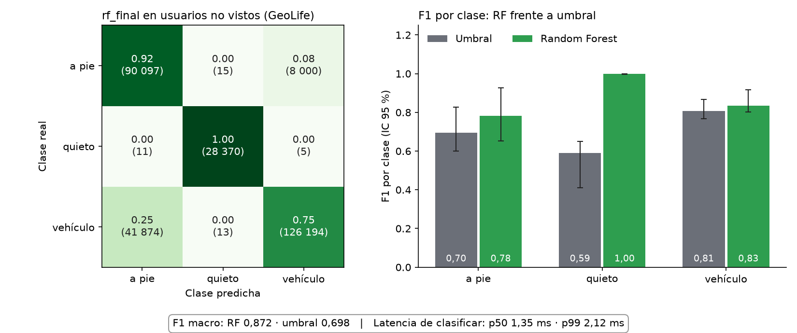
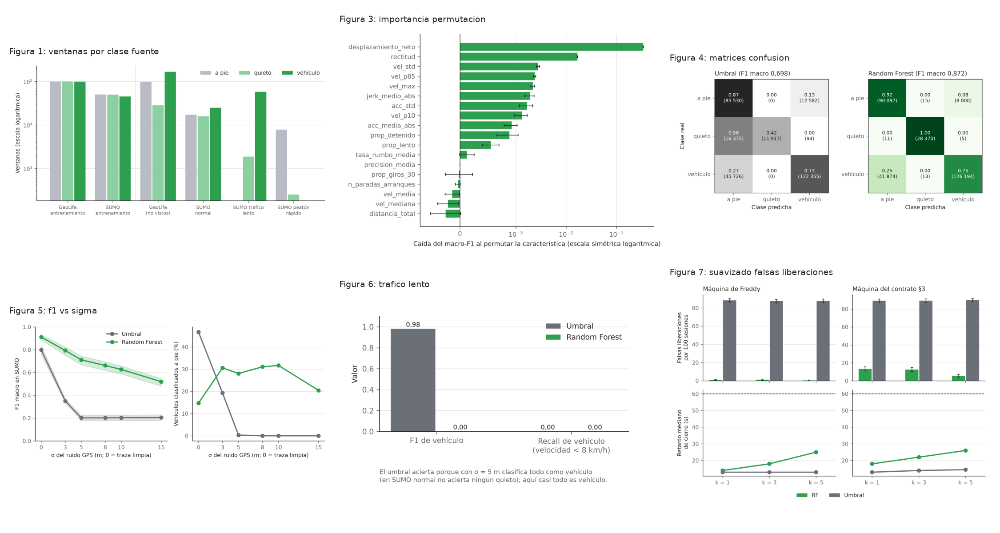
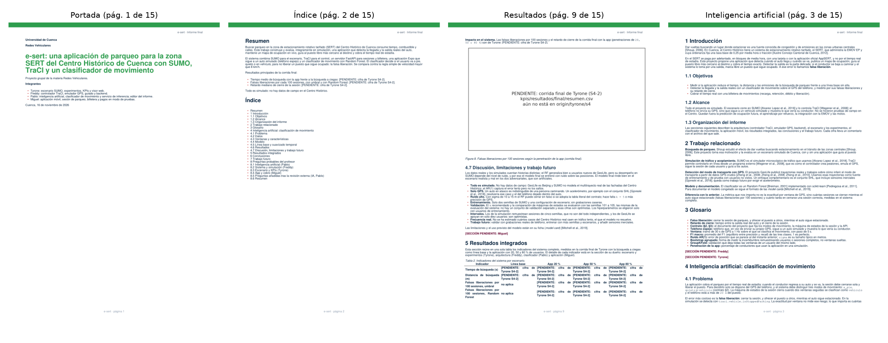

# S4 · Pablo 🟢 · Resumen semanal

## Sesión 1 · Modelo final congelado y model card

Se entrenó y congeló `rf_final` (Random Forest de 100 árboles, 48 MB) con ruido GPS AR(1) aplicado a las
posiciones y episodios reales de SUMO (semillas 201 y 202); dos entrenamientos dan el mismo SHA-256. En usuarios
no vistos de GeoLife el F1 macro es 0,872 (umbral 0,698); en SUMO normal sube de 0,562 (`rf_v1`) a 0,738. La
latencia de `clasificar` es de 1,35 ms (p50) y 2,12 ms (p99). `ia/inferencia.py` carga el modelo por defecto,
verifica el hash y cae al umbral si falla. Con σ de 10 a 15 m el RF puede liberar en falso si se adopta la tabla
literal del contrato; se recomienda `k = 5` en ese caso.

## Sesión 2 · Sección de IA final y preguntas probables del profesor

La sección de IA se reescribió con 2 657 palabras: todas las cifras salen de `rf_final` y llevan su comentario de fuente
(128 comprobadas por script y unas 85 por un auditor independiente). `ia/figuras_informe.py` regenera las ocho figuras a 300 dpi.
Se añadió el anexo con 37 preguntas del profesor. Hallazgo honesto: un árbol que solo usa el desplazamiento neto obtiene 0,775 de F1 macro
en SUMO normal (el Random Forest, 0,738) y 0,750 en GeoLife no vistos (el Random Forest, 0,872): el modelo aporta en datos reales, pero
no supera a esa regla en SUMO. Faltan las cifras del sistema completo (Tyrone).

## Sesión 3 · Integración del informe completo

Quedó lista la maquinaria del informe: partes comunes, glosario, 16 referencias verificadas, el maestro, el armado por script
(`--fuentes proyecto` y `--fuentes ramas`) y el verificador, con 19 pruebas. Hoy el armado genera un PDF de 14 páginas con la sección
de IA completa; las secciones de Freddy, Tyrone y Miguel y las cifras de la corrida final aparecen como pendientes y el verificador falla
solo por eso. La unificación del domingo repetirá el armado con las secciones ya fusionadas.

