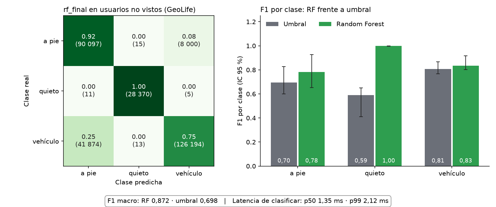

# Model card: `rf_final`

> **MODELO CONGELADO.** A partir de esta sesión (S4-1) el modelo no cambia. Cualquier cambio posterior sería
> `rf_final_v2` y se avisa con un pedido a Tyrone, Freddy y Miguel. SHA-256 del archivo:
> `1bdac0d7e277da328246ad45e68ad4eb3961ea91c66c5fe33a4bf0224fd013e2`. <!-- fuente: ia/modelos/rf_final.json:sha256_modelo -->

## 1. Detalles del modelo

- **Qué es:** clasificador Random Forest de scikit-learn 1.9.1 que, a partir de una ventana de
  `30 s` de GPS a 1 Hz (con paso de `5 s`), decide si el usuario va `a_pie`, `quieto` o en `vehiculo`
  (contrato §2). <!-- fuente: ia/modelos/rf_final.json -->
- **Hiperparámetros:** 100 árboles, profundidad máxima 20, mínimo 5 muestras por
  hoja, `sqrt` características por división, pesos de clase `balanced`, `random_state` 42.
  Parten del mejor resultado de S2-2 (`ia/reportes/cv_rf_v1.json`: 200 árboles y hoja mínima 3); con las ventanas ruidosas ese modelo pesaba
  106,6 MB, así que se redujo a 100 árboles y hoja mínima 5 para quedar bajo 50 MB. <!-- fuente: ia/modelos/rf_final.json -->
- **Entrada:** 18 características por ventana (velocidad, aceleración, *jerk*, rumbo, paradas, geometría y precisión), en el orden
  de `rf_final.json`. **Salida:** `ResultadoModo = {modo, confianza, fuente}`.
- **Archivo:** `ia/modelos/rf_final.joblib` (`compress=3`, 48,0 MB), con su hash en `rf_final.json`.
  `ia/inferencia.py` lo carga por defecto, verifica el SHA-256 y, si no coincide o falta, cae al umbral del contrato con un aviso
  en el registro. En ejecución se convierte a arreglos de NumPy (`ia/bosque_plano.py`) para bajar la latencia.
- **Suavizado y *fallback*:** `k = 1` (sin suavizar) con la máquina de estados de Freddy actual y `k = 5` si se adopta la tabla literal del contrato (Sección 8); el RF solo se usa con cobertura de al menos
  `0.6` y huecos de `10 s` o menos; con menos de `5`
  puntos se devuelve el resultado previo o el umbral con confianza 0.
- **Autor:** Pablo Calle (proyecto e-sert, Redes Vehiculares, Universidad de Cuenca). **Fecha:** 2026-11-07.

## 2. Uso previsto

- **Uso principal:** detectar la **salida real del auto** para no liberar el puesto de parqueo antes de tiempo. La máquina de estados
  de la sesión cierra cuando dos ventanas seguidas son `vehiculo` y el teléfono está a más de `20 m` del puesto.
- **Usuarios previstos:** el controlador TraCI y el modo espejo del backend (simulación), y la app de parqueo en la zona SERT.
- **Condiciones:** GPS a `1 Hz` (se remuestrea si hace falta), ventanas de `30 s`, ruido de posición de pocos metros.

## 3. Usos fuera de alcance

- Otros modos de transporte (bicicleta, bus, tren): GeoLife se filtró a caminar y vehículo.
- Distinguir un auto en atasco a paso de peatón de una persona caminando: con solo GPS es indistinguible (Sección 8).
- Vigilancia o seguimiento de personas, o decisiones sancionatorias a partir de la clase detectada.
- Uso en campo sin validación previa: **todo el entrenamiento y la evaluación son simulados** o de otra ciudad.
- GPS de baja frecuencia (menos de 1 Hz) o ventanas de otra duración.

## 4. Factores

Velocidad de la ventana, nivel de ruido GPS (σ), precisión reportada, escenario (normal, tráfico lento, peatón rápido) y
cercanía a un cambio de modo. El análisis por contexto está en `ia/reportes/errores_contexto.csv`.

## 5. Métricas

F1 macro (promedio del F1 de las tres clases), precisión y *recall* por clase, matriz de confusión e intervalo de confianza del
95 % por *bootstrap* agrupado (1000 remuestreos de usuarios o trayectorias). A
nivel de sistema, falsas liberaciones por 100 sesiones y retardo de cierre (S3-2).

## 6. Datos de evaluación

Solo datos nunca vistos en el entrenamiento: los 10 usuarios de GeoLife de `ia/particion_usuarios.json` y las semillas de SUMO
101 a 105 (escenarios `normal`, `trafico_lento` y `peaton_rapido`, σ = 5 m; curvas con σ de 0 a 15 m). Grabaciones caseras: no
disponibles. Las etiquetas de SUMO se calculan por tramos de modo constante.

## 7. Datos de entrenamiento

- **GeoLife** (Beijing): 38 usuarios que no están en la partición de prueba; la mitad de las ventanas recibe ruido AR(1)
  (σ de 3 a 15 m, ρ = 0,8) aplicado a las posiciones; la clase `quieto` se deriva (velocidad mediana < 0,3 m/s y desplazamiento
  neto < 10 m).
- **SUMO:** episodios de parqueo (estacionar, caminar, volver, manejar) de las semillas 201, 202, con ruido
  AR(1) en el 90 % de las ventanas.
- Las características se recalculan sobre las posiciones ruidosas con el mismo código de inferencia, y las ventanas se muestrean por clase
  (hasta 100 000 de GeoLife y 50 000 de SUMO por clase). Total: 445 607 ventanas.

*Ventanas de entrenamiento por origen y clase.*

| Origen | Clase | Ventanas |
|---|---|---|
| geolife | a_pie | 100 340 |
| geolife | quieto | 100 119 |
| geolife | vehiculo | 99 677 |
| sumo | a_pie | 50 255 |
| sumo | quieto | 49 873 |
| sumo | vehiculo | 45 343 |

<!-- fuente: ia/modelos/rf_final.json:entrenamiento -->

## 8. Resultados

*F1 macro por fuente (IC 95 % del RF por *bootstrap* agrupado).*

| Fuente | Ventanas | Umbral | RF final |
|---|---|---|---|
| GeoLife, usuarios no vistos | 294 579 | 0,698 | 0,872 [0,818; 0,946] |
| SUMO normal (σ = 5 m) | 58 005 | 0,204 | 0,738 [0,712; 0,760] |
| SUMO tráfico lento (σ = 5 m) | 60 039 | 0,327 | 0,051 [0,046; 0,056] |
| SUMO peatón rápido (σ = 5 m) | 8 082 | 0,000 | 0,453 [0,439; 0,465] |

<!-- fuente: ia/reportes/metricas_rf_final.json -->

En usuarios no vistos de GeoLife la diferencia RF menos umbral es de 0,183 puntos de F1 macro
(IC 95 %: 0,156 a 0,224). <!-- fuente: ia/reportes/metricas_rf_final.json -->

*Precisión y *recall* por clase en GeoLife (usuarios no vistos).*

| Clase | Precisión umbral | Recall umbral | Precisión RF | Recall RF | F1 RF | Soporte |
|---|---|---|---|---|---|---|
| a_pie | 0,579 | 0,872 | 0,683 | 0,918 | 0,783 | 98 112 |
| quieto | 1,000 | 0,420 | 0,999 | 0,999 | 0,999 | 28 386 |
| vehiculo | 0,906 | 0,728 | 0,940 | 0,751 | 0,835 | 168 081 |

<!-- fuente: ia/reportes/metricas_rf_final.json -->

*F1 macro frente a σ (SUMO, escenario normal).*

| σ (m) | Umbral | RF final |
|---|---|---|
| 0 | 0,798 | 0,911 |
| 3 | 0,350 | 0,793 |
| 5 | 0,202 | 0,711 |
| 8 | 0,202 | 0,661 |
| 10 | 0,203 | 0,627 |
| 15 | 0,205 | 0,519 |

<!-- fuente: ia/reportes/curvas_sigma_final.csv -->

**Escenarios difíciles.** Frente a `rf_v1`, `rf_final` empeora en tráfico lento (el RF clasifica el 64 % de los vehículos a paso de peatón como `a_pie`) y en peatón rápido (*recall* de `a_pie` de 0,86), a cambio de mejorar en SUMO normal. <!-- fuente: ia/reportes/metricas_rf_final.json -->

**Tráfico lento.** El F1 de `vehiculo` es 0,001 con el RF y 0,982 con el umbral; el *recall*
de `vehiculo` con velocidad menor que 8 km/h es 0,000 y 0,000. <!-- fuente: ia/reportes/metricas_rf_final.json -->

**Falsas liberaciones (S3-2, repetido con `rf_final`; 300 sesiones de SUMO, σ de 5, 10 y 15 m).** El umbral cierra en falso
89,4 sesiones por 100. Con la máquina de Freddy tal como está, el RF libera en falso 0,8 por 100 con `k = 1`, pero cierra
bien solo el 48,3 % de las sesiones. Con las transiciones literales del contrato cierra bien el 86,6 % (retardo mediano
18 s), pero libera en falso 13,1 por 100 con `k = 1` y 5,4 con `k = 5`. Por nivel de ruido (contrato, `k = 1`): 1,0,
10,7 y 27,7 por 100 con σ de 5, 10 y 15 m. Esas liberaciones ocurren muy antes de la salida real (mediana
1502 s antes), es decir, son liberaciones genuinas y no cierres anticipados por segundos. <!-- fuente: ia/reportes/suavizado_k_final_contrato.csv; ia/reportes/suavizado_k_final.csv -->

**Latencia de `clasificar`** en 9 900 llamadas: p50 1,35 ms, p95 1,43 ms y p99 2,12 ms
(meta: menos de 5 ms). <!-- fuente: ia/reportes/metricas_rf_final.json -->



## 9. Consideraciones éticas y privacidad

Las trazas de GeoLife son un conjunto público anonimizado; las de SUMO son simuladas. En un despliegue real el servicio solo necesita
ventanas de 30 s de ubicación: conviene clasificar en el dispositivo o descartar las coordenadas tras clasificar, y guardar solo el
modo, la confianza y la hora. Una trayectoria permite inferir hábitos y domicilio, por lo que no debe conservarse más de lo necesario.

## 10. Limitaciones y sesgos

1. **GeoLife es Beijing:** otro tráfico, otra geometría urbana y otros hábitos de movilidad que un centro histórico andino.
2. **Con ruido de 10 a 15 m el RF sí libera en falso** (Sección 8): hace falta `k = 5` con la tabla del contrato, o más precisión de GPS.
3. **Todo es simulado y no hay datos de campo:** SUMO no modela el multitrayecto real de las fachadas del Centro Histórico.
4. **El ruido es un AR(1) calibrado con literatura** (σ de 3 a 15 m, ρ = 0,8): captura el error lento y correlacionado, no los saltos
   del multitrayecto; los valores exactos son una elección del proyecto.
5. **Tráfico lento:** un auto a paso de peatón es indistinguible de una persona caminando solo con GPS.
6. **Teléfono dentro del auto o en mano:** el modelo no sabe dónde está el teléfono; si queda en el auto, la sesión se cierra cuando
   el auto sale aunque el dueño no esté. Un acelerómetro ayudaría.
7. **Pocas semillas de SUMO en el entrenamiento** (201, 202) y una sola configuración de escenario.
8. **Sin grabaciones caseras:** no hay validación con GPS real de un teléfono.
9. **Etiqueta `quieto` derivada en GeoLife:** depende de los umbrales de velocidad y desplazamiento elegidos.

## 11. Cómo reproducirlo

```bash
# 1) episodios de SUMO de entrenamiento (en el contenedor van3twin; una semilla por corrida)
docker exec -w /home/vanet/results/e-sert/semanas/S4/Pablo/codigo van3twin bash -lc "python3 ia/grabar_episodios.py --semilla 201 --hasta 4800"
# 2) ventanas con ruido sobre las posiciones y 3) entrenamiento determinista (dos corridas dan el mismo SHA-256)
python3 -m ia.datos.construir_entrenamiento_final
python3 -m ia.entrenar_final
# 4) evaluación final y tests
python3 -m ia.evaluar_final
python3 -m pytest ia/tests -q
```

Entradas con su SHA-256 en `ia/modelos/rf_final.json:entrenamiento.sha256_entradas`.
