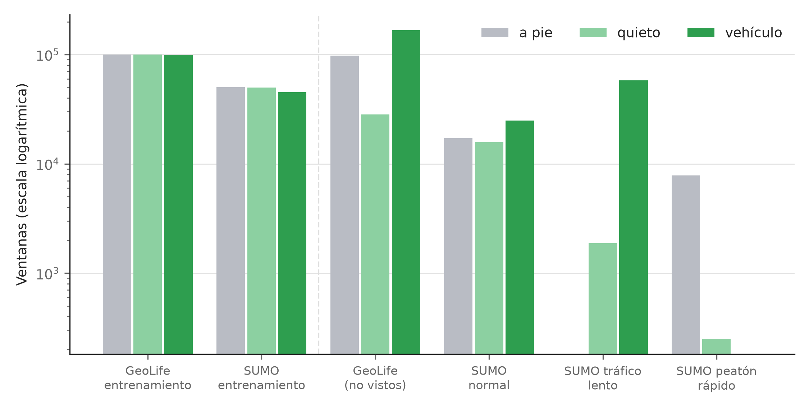
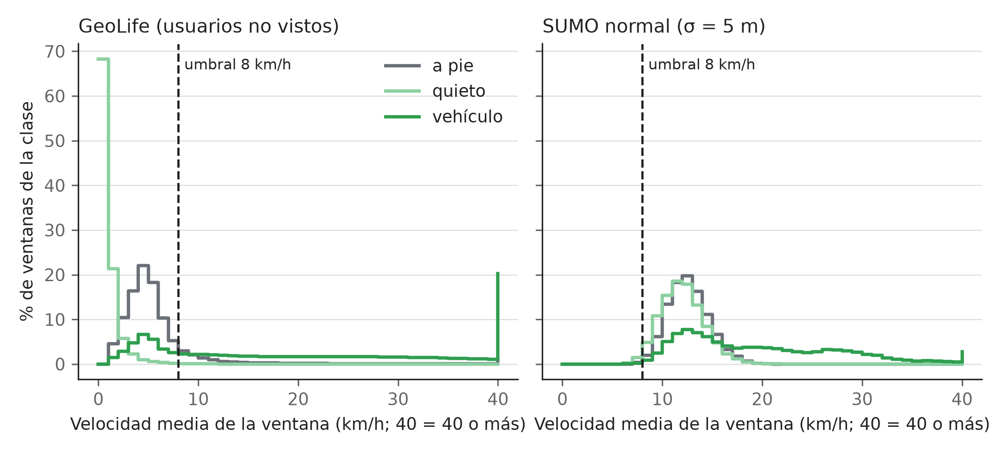
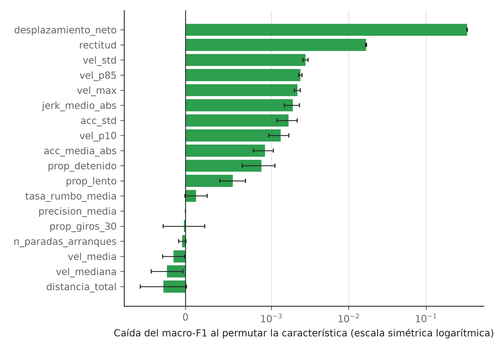
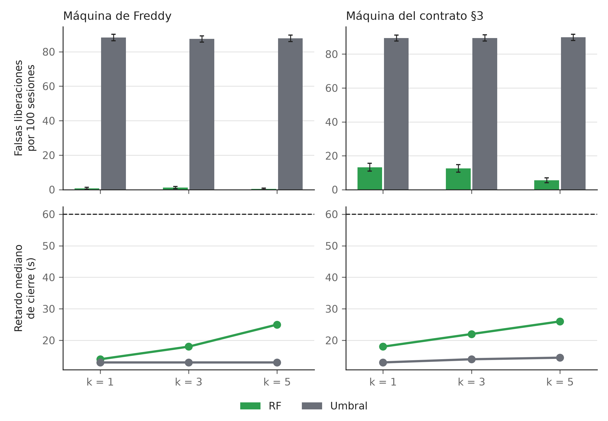
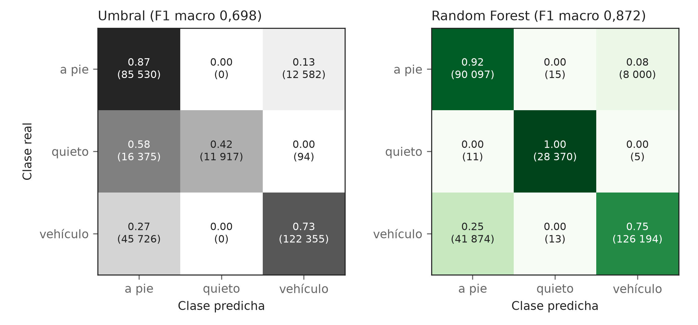
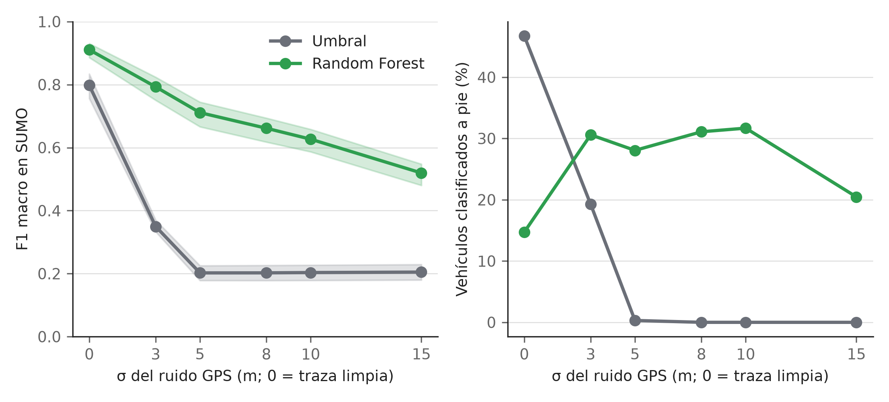
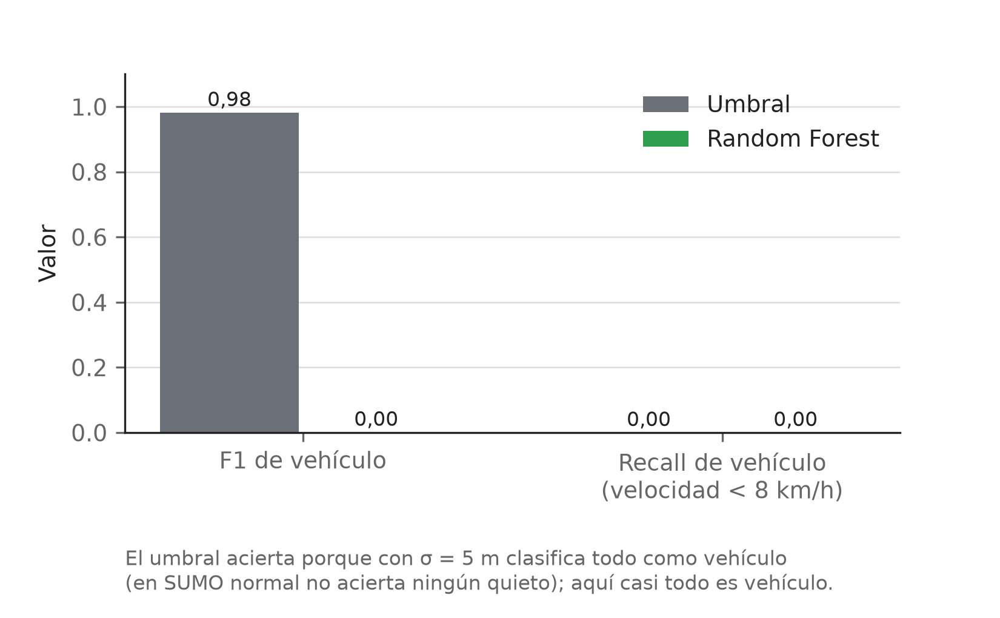
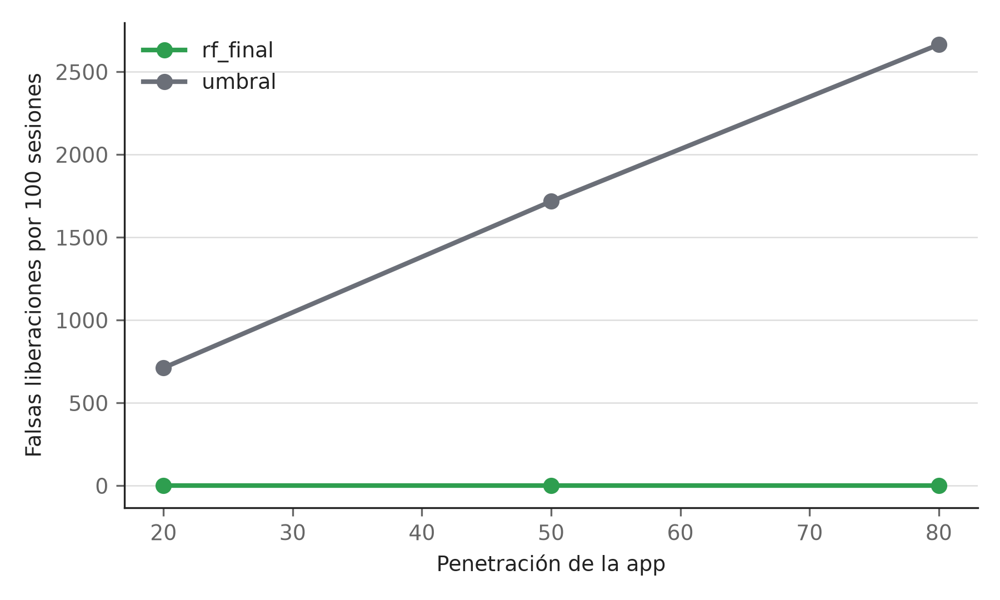
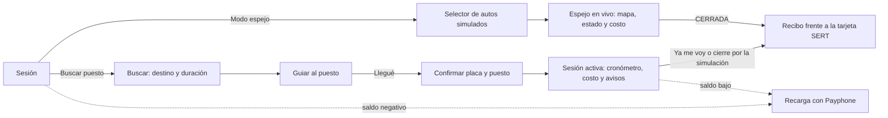

<!-- inicio-seccion: comun/00_portada.md -->

**Universidad de Cuenca**

**Redes Vehiculares**

# e-sert: una aplicación de parqueo para la zona SERT del Centro Histórico de Cuenca con SUMO, TraCI y un clasificador de movimiento

Proyecto grupal de la materia Redes Vehiculares.

**Integrantes**

- Tyrone: escenario SUMO, experimentos, KPIs y visor web.
- Freddy: controlador TraCI, emulador GPS, guiado y backend.
- Pablo: inteligencia artificial, clasificador de movimiento y servicio de inferencia; editor del informe.
- Miguel: aplicación móvil, sesión de parqueo, billetera y pagos en modo de pruebas.

Cuenca, 16 de noviembre de 2026

<!-- fin-seccion: comun/00_portada.md -->

<!-- salto -->

<!-- inicio-seccion: comun/01_resumen.md -->

## Resumen

Buscar parqueo en la zona de estacionamiento rotativo tarifado (SERT) del Centro Histórico de Cuenca consume tiempo, combustible y calles. Este trabajo construye y evalúa, íntegramente en simulación, una aplicación que detecta la llegada y la salida reales del auto, mantiene un mapa de ocupación en vivo, guía al puesto libre más cercano al destino y cobra el tiempo real de estadía.

El sistema combina SUMO para el escenario, TraCI para el control, un servidor FastAPI para sesiones y billetera, una aplicación Expo que sigue a un auto simulado (teléfono espejo) y un clasificador de movimiento con Random Forest. El clasificador decide si el usuario va a pie, quieto o en vehículo, para no liberar un puesto que sigue ocupado: la falsa liberación. Se compara contra la regla simple de velocidad mayor que 8 km/h.

Resultados principales de la corrida final:

- Tiempo medio de búsqueda a ciegas de 432,7 s; con la app sube a 434,3 s (20 %), 438,2 s (50 %) y 450,7 s (80 %), sin mejora medible en la demanda simulada.
- Falsas liberaciones por cada 100 sesiones, con umbral, 88,9 (20 %), 87,2 (50 %) y 86,6 (80 %); con Random Forest, 0 en las tres penetraciones.
- Retardo mediano de cierre de la sesión con Random Forest: 22,7 s (20 %), 18,8 s (50 %) y 18,4 s (80 %).

Todo es simulado: no hay datos de campo en el Centro Histórico.

<!-- fin-seccion: comun/01_resumen.md -->

## Índice

- Resumen
- 1 Introducción
  - 1.1 Objetivos
  - 1.2 Alcance
  - 1.3 Organización del informe
- 2 Trabajo relacionado
- 3 Glosario
- 4 Arquitectura, controlador TraCI y backend
  - 4.1 Arquitectura
  - 4.2 Controlador TraCI
  - 4.3 Emulador GPS
  - 4.4 Máquina de estados de la sesión
  - 4.5 Guiado
  - 4.6 Backend: núcleo y billetera
  - 4.7 Indicadores del sistema
  - 4.8 Pruebas
  - 4.9 Limitaciones
- 5 Escenario de simulación y resultados experimentales
  - 5.1 Escenario SUMO
  - 5.2 Diseño experimental
  - 5.3 Resultados
  - 5.4 Controles de cordura
  - 5.5 Discusión
  - 5.6 Limitaciones
- 6 Inteligencia artificial: clasificación de movimiento
  - 6.1 Problema
  - 6.2 Datos
  - 6.3 Ventanas y características
  - 6.4 Modelo
  - 6.5 Línea base y suavizado temporal
  - 6.6 Resultados
  - 6.7 Discusión, limitaciones y trabajo futuro
- 7 La app móvil y el teléfono espejo
  - 7.1 Diseño de la app
  - 7.2 Modo espejo
  - 7.3 Sesión y cierre automático
  - 7.4 Billetera y Payphone en modo de prueba
  - 7.5 Reglas SERT verificadas
  - 7.6 Grabador de sensores
  - 7.7 Ensayo de la demo
  - 7.8 Usabilidad y limitaciones
- 8 Resultados integrados
- 9 Conclusiones
- 10 Trabajo futuro
- 11 Preguntas probables del profesor
  - 11.1 Inteligencia artificial (Pablo)
  - 11.2 Sistema y simulación (Freddy)
  - 11.3 Escenario y KPIs (Tyrone)
  - 11.4 App y cobro (Miguel)
  - 11.5 Preguntas añadidas tras la revisión externa (IA, Pablo)
  - 11.6 Resumen

<!-- salto -->

<!-- inicio-seccion: comun/02_introduccion.md -->

## 1 Introducción

Dar vueltas buscando un lugar donde estacionar es una fuente conocida de congestión y de emisiones en las zonas urbanas centrales [@shoup2006cruising]. En Cuenca, el Centro Histórico tiene un sistema de estacionamiento rotativo tarifado, el SERT, que administra la EMOV EP y cuya ordenanza fija una tasa base de 0,25 por media hora o fracción [@concejo2012sert]. <!-- fuente: informe/referencias.bib -->

En el SERT se paga por adelantado, en bloques de media hora, con una tarjeta o con la aplicación oficial AppSERT, y no por el tiempo real de estadía. <!-- fuente: proyecto/app/docs/sert_reglas.md --> Este proyecto propone una aplicación que detecta cuándo el auto llega y cuándo se va, publica un mapa de ocupación, guía al puesto libre más cercano al destino y cobra el tiempo exacto. Detectar la salida es la parte delicada: si el conductor se baja a caminar y el sistema lo toma por una salida, marca libre un puesto que sigue ocupado. A ese error lo llamamos **falsa liberación**.

### 1.1 Objetivos

- Medir si la aplicación reduce el tiempo, la distancia y las emisiones de la búsqueda de parqueo frente a una línea base sin ella.
- Detectar la llegada y la salida reales con un clasificador de movimiento sobre el GPS del teléfono, y medirlo por sus falsas liberaciones y su retardo de cierre.
- Cobrar el tiempo real con una billetera de movimientos (recarga, retención, débito y liberación).

### 1.2 Alcance

Todo el proyecto es simulado. El escenario corre en SUMO [@lopez2018sumo] y lo controla TraCI [@wegener2008traci]; el teléfono no envía su GPS, sino que sigue a un vehículo simulado y muestra lo que vería su conductor. No se hicieron pruebas de campo en el Centro. Quedan fuera la predicción de ocupación futura, el aprendizaje por refuerzo, la integración con la EMOV y las motos.

### 1.3 Organización del informe

Las secciones siguientes describen la arquitectura (controlador TraCI, emulador GPS, backend), el escenario y los experimentos, el clasificador de movimiento, la aplicación móvil, los resultados integrados, las conclusiones y el trabajo futuro. Cada cifra lleva un comentario con el archivo del que sale.

<!-- fin-seccion: comun/02_introduccion.md -->

<!-- inicio-seccion: comun/03_trabajo_relacionado.md -->

## 2 Trabajo relacionado

**Búsqueda de parqueo.** Shoup estudió el efecto de dar vueltas buscando estacionamiento en el tránsito de las zonas centrales [@shoup2006cruising]. Este proyecto toma esa motivación y la evalúa en un escenario simulado de Cuenca, con y sin una aplicación que guía al puesto libre.

**Simulación de tráfico y acoplamiento.** SUMO es el simulador microscópico de tráfico que usamos [@lopez2018sumo]. TraCI permite controlarlo en línea desde un programa externo [@wegener2008traci], que es como el controlador crea peatones, emula el GPS, sigue la sesión de cada usuario y guía a los autos.

**Detección del modo de transporte con GPS.** El proyecto GeoLife publicó trayectorias reales y trabajos sobre cómo inferir el modo de transporte a partir de datos GPS crudos [@zheng2008learning; @zheng2008understanding; @zheng2010geolife]. Usamos esas trayectorias como fuente de entrenamiento y de prueba con usuarios no vistos. Un enfoque complementario es el conjunto SHL, que incluye sensores inerciales [@gjoreski2018shl]; queda como trabajo futuro por exigir el acelerómetro.

**Modelo y documentación.** El clasificador es un Random Forest [@breiman2001random] implementado con scikit-learn [@pedregosa2011scikit]. Para documentar el modelo congelado se sigue el formato de las *model cards* [@mitchell2019modelcards].

**Diferencia con lo anterior.** La métrica que nos importa no es la exactitud por ventana de GPS, sino cuántas sesiones se cierran mientras el auto sigue estacionado (falsas liberaciones por 100 sesiones) y cuánto tarda en cerrarse una sesión correcta, medidas en el sistema completo.

<!-- fin-seccion: comun/03_trabajo_relacionado.md -->

<!-- inicio-seccion: comun/05_glosario.md -->

## 3 Glosario

- **Falsa liberación:** cerrar la sesión de parqueo, y ofrecer el puesto a otros, mientras el auto sigue estacionado.
- **Retardo de cierre:** tiempo entre la salida real del auto y el cierre de la sesión.
- **Contrato (§2, §3):** el documento del proyecto que fija los modos de movimiento, la máquina de estados de la sesión y la API.
- **Teléfono espejo:** teléfono que, en vez de enviar su propio GPS, sigue a un auto simulado y muestra lo que vería su conductor.
- **Ventana:** tramo de 30 s de GPS a 1 Hz sobre el que se clasifica el movimiento, con paso de 5 s.
- **F1 macro:** promedio del F1 (equilibrio entre precisión y *recall*) de las tres clases; 1 es perfecto.
- **Ruido AR(1):** error de posición que se parece al del instante anterior; `σ` es su tamaño típico en metros.
- **Bootstrap agrupado:** forma de medir la incertidumbre remuestreando usuarios o sesiones completos, no ventanas sueltas.
- **GroupKFold:** validación que deja todas las ventanas de un usuario del mismo lado.
- **Penetración de la app:** porcentaje de conductores que usan la aplicación en una simulación.

<!-- fin-seccion: comun/05_glosario.md -->

<!-- inicio-seccion: freddy.md -->

## 4 Arquitectura, controlador TraCI y backend

Esta sección describe el controlador que conecta SUMO con el resto del sistema, el emulador GPS,
la máquina de estados que decide cuándo termina una sesión y el backend que cobra, y presenta los
indicadores medidos y las pruebas. El contrato está en `docs/CONTRATO.md` y la documentación
técnica, en `comun/docs/`.

### 4.1 Arquitectura

*Figura 1. Componentes de e-sert y el mensaje del contrato que viaja por cada flecha.*

El sistema tiene tres bloques, y entre ellos solo viajan los mensajes del contrato:

- **Simulación.** SUMO [@lopez2018sumo] y el **controlador TraCI** [@wegener2008traci] corren
  juntos en el contenedor `van3twin`. El controlador hace dos papeles: es el mundo real y es el
  teléfono. Mueve autos y peatones, emula el GPS de cada conductor con la app, clasifica su modo
  de movimiento con la IA y decide las transiciones de cada sesión.
- **Backend** (FastAPI). Guarda billeteras, sesiones y mapa de ocupación, valida las
  transiciones, cobra y difunde el estado por WebSocket.
- **Clientes:** el visor del proyector, la app Expo como «teléfono espejo» de un conductor
  simulado y Payphone en modo de pruebas.

El **backend no deduce por su cuenta que un auto se fue**. Lo decide el controlador, que es
quien tiene las posiciones y el clasificador, y se lo informa con `POST /sesiones/{id}/cerrar`.
Las razones de cada decisión están en `comun/docs/decisiones.md`.

### 4.2 Controlador TraCI

El controlador (`traci/controlador.py`) avanza SUMO en pasos de `1 s`. En cada paso ejecuta, en
este orden, unas funciones enganchadas al bucle (*hooks*): peatones, guiado, sesiones, registro,
verdad y KPIs y, si hay backend, el publicador de snapshots.

El estado se lee con **suscripciones** de TraCI, que entregan todas las variables de un objeto
en una sola respuesta por paso, y solo de los autos que buscan parqueo. SUMO 1.12 no permite
suscribirse a un `parkingArea`, así que la ocupación real se cuenta con los eventos de inicio y
fin de parqueo.

Cuando un auto estaciona, `traci/peatones.py` crea con `person.add` a su conductor. El conductor
camina hasta el destino del viaje, hace sus diligencias y vuelve, mientras `setParkingAreaStop`
mantiene el auto detenido. Hay dos variantes:

- una fracción `0,10` de los conductores se queda esperando dentro del auto;
- de los que salen, una fracción `0,15` hace una diligencia, vuelve al auto, espera `60 s` y sale
  a otra.

Estos peatones ponen a prueba al sistema: alejarse caminando **no** debe liberar el puesto.

El costo por paso se midió con los escenarios de Tyrone, con todo su tráfico de fondo, `1 800 s`
simulados, semilla `1`, TraCI por socket y todos los *hooks* y KPIs activos.

*Costo del controlador por paso simulado según la penetración de la app.* <!-- fuente: informe/datos/freddy/corridas.json -->

| Penetración | ms por paso | Tiempo de cómputo (s) | Sesiones iniciadas |
|---:|---:|---:|---:|
| 0 % | 56,1 | 101,0 | 0 |
| 20 % | 60,1 | 108,1 | 56 |
| 50 % | 74,2 | 133,5 | 172 |
| 80 % | 70,3 | 126,5 | 270 |

*Figura 2.*
*Milisegundos por paso de 1 s simulado con 0, 20, 50 y 80 % de penetración.* <!-- fuente: informe/datos/freddy/corridas.json -->

Aun en el peor caso, 74,2 ms por paso, la simulación corre más de diez veces más rápido que el
tiempo real. Para la demo en vivo se frena con `--ritmo 1`. Sin ningún usuario de la app el paso
ya cuesta 56,1 ms, así que la mayor parte del costo es el tráfico mismo. <!-- fuente: informe/datos/freddy/corridas.json -->
Hay una sola corrida por penetración, así que no se puede separar el efecto de la app de la
variación entre corridas; en particular, no se interpreta la baja de 50 a 80 %.

### 4.3 Emulador GPS

El teléfono de cada conductor con la app se emula en `traci/gps.py` a partir de la posición
verdadera que da SUMO: la del auto si va manejando y la del peatón si camina.

El error de un GPS urbano no salta al azar de un segundo al siguiente: se arrastra, porque
depende de qué satélites ve el receptor y de los reflejos en los edificios. Por eso se modela en
cada eje como un proceso autorregresivo de orden 1:

$$e_t = \rho\, e_{t-1} + \sqrt{1-\rho^2}\,\sigma\,\varepsilon_t, \qquad \varepsilon_t \sim \mathcal{N}(0,\,1),$$

donde $\sigma$ es la desviación estacionaria del error en metros y $\rho$ es la autocorrelación
entre muestras a `1 Hz`. El factor $\sqrt{1-\rho^2}$ mantiene la varianza en $\sigma^2$. Si falta
una muestra, el proceso avanza igual, con $\rho^k$ para un hueco de $k$ segundos.

La calibración de Pablo toma estos valores de la literatura:

- **Ruido $\sigma$:** de 3 m con cielo abierto [@zandbergen2009accuracy] a 15 m en un cañón
  urbano profundo [@groves2011shadow]. <!-- fuente: proyecto/ia/calibracion/ruido_literatura.json -->
  Para el Centro Histórico, los valores más representativos son 8 a 10 m
  [@zandbergen2011positional; @merry2019smartphone]. <!-- fuente: proyecto/ia/calibracion/ruido_literatura.json -->
- **Autocorrelación:** $\rho = 0{,}8$ [@zandbergen2011positional; @jun2006smoothing]. <!-- fuente: proyecto/ia/calibracion/ruido_literatura.json -->
- **Pérdida de muestras:** con probabilidad de 0,02 a 0,1 por segundo [@groves2011shadow]. <!-- fuente: proyecto/ia/calibracion/ruido_literatura.json -->

Las corridas de esta sección usan `sigma_m = 5` y `p_perdida = 0,02`, el extremo favorable del
rango. Por eso sus resultados son **optimistas** para el Centro Histórico; la sensibilidad al
ruido está en la sección de Pablo. La precisión que reporta el teléfono es
$\sigma \cdot U(0{,}8;\,1{,}5)$.

Igual que en un teléfono, la velocidad no viene de SUMO: se **deriva** de dos posiciones ruidosas
consecutivas.

*Figura 3. Peatón de SUMO: traza verdadera frente a la que emite el emulador con σ = 5 y 10 m (a) y velocidad derivada por el teléfono frente al umbral de 8 km/h (b).*

Esa decisión explica el principal resultado negativo de esta sección. En la figura, el peatón
camina a 3,95 km/h de media, pero con $\sigma = 5$ m el teléfono le calcula 14,74 km/h, y el
77 % de sus muestras de un segundo supera el umbral de vehículo de `8 km/h`. Con $\sigma = 10$ m
lo supera el 93,3 %. <!-- fuente: informe/datos/freddy/traza_gps.json -->
La regla de reserva del clasificador no usa muestras sueltas, sino la velocidad suavizada media
de la ventana de `30 s`. Aun así, en el escenario controlado descrito más abajo, con
$\sigma = 5$ m, 59 de las 70 ventanas en que el conductor caminaba (84,3 %) salieron `vehiculo`;
con $\sigma = 2$ m, ninguna. <!-- fuente: informe/datos/freddy/cierre_sigma.json -->

### 4.4 Máquina de estados de la sesión

*Figura 4. Máquina de estados de la sesión con los umbrales del contrato.*

La sesión existe desde que el auto queda `ESTACIONADO`. Cada `5 s`, el clasificador recibe los
últimos `30 s` del GPS y devuelve un modo: `a_pie`, `quieto` o `vehiculo`. La distancia se mide
hasta el punto exacto donde se detuvo el auto, no al centro del `parkingArea`, que mide unos
`100 m`. Con el modo y la distancia, `traci/estados.py` aplica la primera regla de esta tabla
que se cumpla, en orden.

*Tabla 1. Transiciones de la sesión y sus umbrales (contrato §3 y `traci/estados.py`).*

| Desde | Hacia | Condición |
|---|---|---|
| `ESTACIONADO` o `REGRESANDO` | `SALIENDO` | modo `vehiculo` en `2` ventanas seguidas y distancia > `20 m` |
| `ESTACIONADO` | `A_PIE` | modo `a_pie` y distancia > `15 m` |
| `A_PIE` | `REGRESANDO` | modo `a_pie` o `quieto` y distancia < `30 m` |
| `REGRESANDO` | `A_PIE` | modo `a_pie` y distancia > `30 m` |
| `SALIENDO` | `CERRADA` | en el mismo paso: `POST /cerrar` con motivo `deteccion` |

En `A_PIE`, **el puesto sigue ocupado**. Alejarse del auto no significa que el auto se fue: el
conductor puede estar haciendo diligencias a dos cuadras.

Solo un movimiento sostenido en vehículo desde `ESTACIONADO` o desde `REGRESANDO`, nunca desde
`A_PIE`, indica una salida. Así, un bus o un taxi tomado lejos del puesto no cierra la sesión.

Una ventana con menos del `50 %` de las muestras esperadas, o con la regla de reserva y
confianza < `0,5`, no produce transiciones. En las corridas de esta sección esa protección no
retuvo ninguna ventana, porque la regla de reserva informa como confianza la cobertura de la
ventana. <!-- fuente: informe/datos/freddy/corridas.json -->

Tras `120 s` sin muestras, la sesión se marca `sin_senal`. El silencio no la cierra: solo se
cierra al llegar al tiempo máximo de `120 min`, con motivo `timeout_sin_senal`.

### 4.5 Guiado

`traci/guiado.py` recomienda **el puesto con plazas libres ahora más cercano al destino**, según
el mapa del sistema y no una ocupación predicha, y desvía el auto con `rerouteParkingArea`. Si el
puesto se llena en el camino (se revisa cada `10 s`), reasigna otro con ruta (`findRoute`), hasta
`3` veces; después el conductor busca a ciegas. `GET /guia` del backend usa el mismo criterio.

### 4.6 Backend: núcleo y billetera

El controlador importa como biblioteca el mismo **núcleo** del backend (`backend/nucleo/`, Python
puro), sin HTTP: los experimentos no dependen de la red y las reglas de cobro son un solo código.

La billetera es un **libro de movimientos** (`recarga`, `retencion`, `debito` y `liberacion`), en
centavos enteros. Los saldos no se guardan, se derivan:

$$\text{saldo} = \sum \text{recargas} - \sum \text{débitos}, \quad \text{retenido} = \sum \text{retenciones} - \sum \text{liberaciones}, \quad \text{disponible} = \text{saldo} - \text{retenido}.$$

Al estacionar se **retiene** el bloque mínimo de `30 min`. Al cerrar se **debita** el tiempo
real, redondeado hacia arriba a fracciones de `5 min` y con un mínimo de `10 min`, y se libera la
retención. La tarifa es de `0,50 USD` por hora (`comun/tarifa.json`).

*Ejemplo de cobro de una estadía de 47 min con una recarga de 5 USD.* <!-- fuente: informe/datos/freddy/cobro_47min.json -->

| Concepto | Valor |
|---|---:|
| Retención al estacionar (USD) | 0,25 |
| Disponible durante la sesión (USD) | 4,75 |
| Minutos cobrados (10 fracciones de 5 min) | 50 |
| Débito al salir (USD) | 0,42 |
| Saldo final (USD) | 4,58 |
| Tarjeta SERT de papel, 2 bloques de 30 min (USD) | 0,50 |
| Ahorro frente a la tarjeta (USD) | 0,08 |

Con la tarjeta de papel se paga la media hora completa aunque se use una parte; la app cobra el
tiempo usado en fracciones de 5 min.

### 4.7 Indicadores del sistema

Los indicadores comparan lo que cree el sistema con la verdad de SUMO (`traci/kpis_sistema.py`).

Sea $S$ el conjunto de sesiones cerradas de autos con la app. Para cada sesión $s$, $t^{c}_s$ es
la hora de cierre y $t^{\mathrm{lleg}}_s$ y $t^{\mathrm{sal}}_s$ son la llegada y la salida reales.

- **Falsas liberaciones por 100 sesiones:** sesiones cerradas mientras el auto seguía estacionado,
  $F_{100} = 100 \cdot |\{s \in S : \texttt{isStoppedParking}(s, t^{c}_s)\}| \,/\, |S|$.
- **Retardo de cierre:** $t^{c}_s - t^{\mathrm{sal}}_s$, solo en cierres correctos (mediana).
- **Error de facturación:** $\text{debitado}_s - \text{costo}\big((t^{\mathrm{sal}}_s - t^{\mathrm{lleg}}_s)/60\big)$,
  en las sesiones con estadía real conocida (media).
- **Precisión del mapa:** cada `60 s`, la fracción de puestos cuyo estado libre o lleno coincide
  con la realidad. Se calcula contra la ocupación total y contra la de los usuarios de la app.
  Su complemento son los **libres fantasma**: puestos libres en el mapa pero llenos en la realidad.

Los valores vienen de las corridas de esta sección (escenarios de Tyrone, `1 800 s`, semilla `1`),
con el clasificador disponible al medir.

*Indicadores del sistema por penetración de la app.* <!-- fuente: informe/datos/freddy/corridas.json -->

| Indicador | 0 % | 20 % | 50 % | 80 % |
|---|---:|---:|---:|---:|
| Sesiones cerradas | 0 | 35 | 120 | 172 |
| Falsas liberaciones por 100 sesiones | — | 100 | 99,17 | 99,42 |
| Cierres correctos | 0 | 0 | 1 | 1 |
| Retardo de cierre (s) | — | — | 12 | 15 |
| Sesiones con estadía real conocida | 0 | 1 | 5 | 6 |
| Error de facturación medio (USD) | — | −0,050 | −0,072 | −0,062 |
| Precisión del mapa, ocupación total | 0,745 | 0,743 | 0,746 | 0,745 |
| Precisión del mapa, usuarios de la app | 1,0 | 1,0 | 1,0 | 0,9998 |
| Libres fantasma por muestra (de 610 puestos) | 155,3 | 156,7 | 154,7 | 155,3 |

Estos valores **no describen el sistema terminado**. El modelo Random Forest de Pablo
(`ia/modelos/rf_v1.joblib`) no estaba en el repositorio, así que todas las ventanas se
clasificaron con la regla de reserva por velocidad, y casi toda sesión se cerró mientras el auto
seguía estacionado.

Con 0 o 1 cierres correctos por corrida, el retardo es el de una sola sesión, y el error de
facturación se promedia sobre 1 a 6 sesiones: son ilustrativos, no estadísticos.

La **precisión contra la ocupación total** ya vale 0,745 sin ningún usuario de la app, y no
cambia con la penetración. Sus errores son libres fantasma, cerca del 25,5 % de los puestos:
lugares ocupados por autos sin la app, que el mapa no puede ver. <!-- fuente: informe/datos/freddy/corridas.json -->
Contra los usuarios de la app es casi perfecta, pero tampoco refleja las falsas liberaciones: un
puesto solo cuenta como lleno cuando todas sus plazas están ocupadas.

Para separar la máquina de estados del clasificador se usó un escenario controlado
(`traci/tests/e2e/escenario_cierre.py`): cinco autos con estadías de 4 a 8 min cuyos conductores
hacen diligencias y vuelven, con la misma regla de reserva.

- Con $\sigma = 5$ m se cerraron 4 de 5 sesiones en falso. <!-- fuente: informe/datos/freddy/cierre_sigma.json -->
- Con $\sigma = 2$ m, cuando la velocidad derivada ya no engaña a la regla, hubo 0 falsas
  liberaciones en 5 sesiones, con retardos de cierre de 12 a 13 s (mediana de 12 s). <!-- fuente: informe/datos/freddy/cierre_sigma.json -->

La máquina de estados cierra bien y rápido cuando el modo que recibe es correcto. El cuello de
botella es la clasificación del modo bajo ruido urbano. Si el Random Forest lo resuelve se evalúa
en la sección de inteligencia artificial.

### 4.8 Pruebas

Además de las pruebas unitarias, una suite **de punta a punta** (`pytest -m e2e`) levanta el
backend real y prueba el recorrido de la app por HTTP, el WebSocket, los cuatro errores del
contrato y una corrida de SUMO contra el backend vivo (libro de cada billetera, mapa, modo espejo
y falsas liberaciones).

*Pruebas automáticas y cobertura del núcleo.* <!-- fuente: informe/datos/freddy/pruebas.json -->

| Conjunto | Pasan | Fallan | Omitidos | Duración (s) |
|---|---:|---:|---:|---:|
| Unitarias del backend | 118 | 0 | 1 | 37,3 |
| Unitarias del controlador | 72 | 0 | 12 | 8,5 |
| Unitarias del contrato (`comun`) | 169 | 0 | 0 | 0,6 |
| Punta a punta, con SUMO | 30 | 2 | 0 | 216,3 |

La cobertura de líneas de `backend/nucleo/` es del 99 % (4 de 547 líneas sin cubrir).
<!-- fuente: informe/datos/freddy/pruebas.json:cobertura_nucleo -->
Las omitidas necesitan SUMO (`pytest -m sumo`). Las 2 de punta a punta que fallan exigen cero
falsas liberaciones: fallan por la causa descrita arriba y se dejaron estrictas a propósito.

### 4.9 Limitaciones

- **Clasificador de reserva y ruido favorable.** Los indicadores se midieron sin el Random Forest
  y con $\sigma = 5$ m. Hay que repetirlos con el modelo, con $\sigma$ de 8 a 10 m y con la corrida
  final de Tyrone, que no estaba publicada al cerrar esta sección.
- **Una sola semilla y una corrida por penetración.**
- **Peatones simplificados:** no entran a edificios, donde el GPS se pierde; las ráfagas sin señal
  de `traci/gps.py` no estuvieron activas.
- **El mapa solo ve a los usuarios de la app.** Aun con un clasificador perfecto, la precisión
  contra la ocupación total tiene un techo que depende de la penetración.
- **Simulación, no campo.** No se probó con un GPS real en el Centro Histórico.
- **Un solo backend con SQLite:** basta para la demo, no para una ciudad.

<!-- fin-seccion: freddy.md -->

<!-- inicio-seccion: tyrone.md -->

## 5 Escenario de simulación y resultados experimentales

<!-- Plantilla: las cifras de resultados son marcadores que se rellenan desde
     kpis/resultados/final/resumen.csv con
     demo/.venv/bin/python demo/presentacion/generar_diapositivas.py --plantilla informe/tyrone.plantilla.md --salida informe/tyrone.md
     No se edita tyrone.md a mano. -->

Esta sección describe el escenario de SUMO sobre el que corre todo el sistema, el diseño de los
experimentos y lo que midieron. La pregunta es la del proyecto: si una parte de los conductores
que buscan parqueo en la zona SERT del Centro Histórico de Cuenca usa la app, ¿cuánto baja el
tiempo, la distancia y el CO₂ de la búsqueda, y qué tan fiable es el mapa de ocupación que la app
construye a partir del clasificador de movimiento?

### 5.1 Escenario SUMO

**Red.** La red se construyó con `netconvert` a partir de OpenStreetMap, en el recuadro
`[-2,905; -79,013; -2,8895; -78,9945]`, que cubre el Centro Histórico y sus accesos. Tiene 985
aristas para autos, 1 824 peatonales, 775 cruces, 129 semáforos y 90,66 km de vías.
<!-- fuente: sumo/red/red_info.json -->
Se conservaron las aceras y los cruces peatonales porque el conductor, al bajarse, camina hasta su
destino y vuelve, y ese recorrido a pie es el que observa el clasificador.

**Puestos.** Los puestos SERT se generaron como `parkingArea` sobre las calles tarifadas
(residenciales, terciarias y secundarias con nombre, del lado derecho), con `5,5 m` por puesto y
`8 m` libres en cada esquina. Resultan 610 áreas con 6 194 puestos en 103 calles, una media de
10,15 puestos por área. <!-- fuente: sumo/parqueos/parqueos_info.json -->
Su identificador (`pa_<arista>_0`) es el mismo en SUMO, en el backend y en la app.

**Demanda.** La demanda de hora pico tiene tres componentes:

- autos de fondo que ocupan el `80 %` de los puestos desde el inicio, como estadía larga;
- tráfico de paso (`40 %` de las llegadas), que cruza la zona sin estacionar;
- buscadores, que van a 12 destinos reales (mercados, plazas e iglesias) con una estadía lognormal
  de `45 min` y que, si su puesto está lleno, siguen buscando con los `rerouter` de parqueo de SUMO.

**Calibración.** La tasa de llegadas `--veh-hora` se calibró para que la ocupación media en la hora
pico quede entre `85 %` y `95 %`, el rango en que buscar parqueo cuesta. Con `1800` veh/h, la
ocupación media de la línea base es de 87,4 % (IC 95 %
[87,0; 87,9] %).
<!-- fuente: kpis/resultados/final/resumen.csv -->
Cada corrida simula `75 min`: `15 min` de calentamiento y `60 min` de hora pico. Solo cuentan los
buscadores que estacionan dentro de la hora medida.

**Definiciones.** La búsqueda empieza cuando el auto entra a `300 m` de su destino (o a la arista
de su puesto objetivo) y termina al estacionar. La distancia de búsqueda es lo recorrido en ese
lapso, y el CO₂ de búsqueda, lo que SUMO (modelo HBEFA) atribuye a esos pasos. Estas definiciones
están fijas en `kpis/kpis.py` desde S2 y no cambiaron.

### 5.2 Diseño experimental

La matriz cruza la penetración de la app {`0`, `20`, `50`, `80`} % con dos clasificadores de
movimiento, el umbral de velocidad y el `rf_final` de Pablo (bosque aleatorio congelado), y cinco
semillas. El `0 %` es la búsqueda a ciegas y corre una vez por semilla, lo que da 35 corridas.

- **Números aleatorios comunes.** La demanda depende solo de la semilla. Quién tiene app sale de un
  sorteo aparte (`default_rng([semilla, 7])`), así que los usuarios con app al `20 %` también la
  tienen al `50 %` y al `80 %`. Entre escenarios de una misma semilla salen los mismos autos a la
  misma hora; la única diferencia es la app.
- **Sistema completo.** Cada corrida usa el controlador TraCI de Freddy: guiado al puesto, peatones,
  emulador GPS con ruido, sesiones de cobro y KPIs del sistema. También usa la inferencia de Pablo,
  sin *mocks*.
- **Réplica.** La réplica independiente es la semilla. Los KPIs por vehículo se resumen con un IC
  95 % *bootstrap* jerárquico (se remuestrean semillas y, dentro de cada una, vehículos; 10 000
  remuestreos). Las falsas liberaciones usan un IC de Wilson, y los demás KPIs de sistema, t de
  Student entre semillas. Cada escenario se compara con la búsqueda a ciegas con Mann-Whitney U.
- **Sensibilidad (oráculo).** Cinco corridas más al `50 %` guían con la ocupación real de SUMO en
  lugar del mapa del sistema. No es algo que la app pueda hacer: es la cota superior de lo que
  ganaría con información perfecta de ocupación.

Las corridas de las semillas 1–3 se reutilizan de la matriz de S3, porque su configuración, red,
demanda y modelo tienen el mismo hash. `kpis/resultados/final/manifiesto.json` guarda el commit, la
versión de SUMO (1.12), los SHA-256 del modelo y de cada demanda, y los comandos para repetir todo.

### 5.3 Resultados

*Tabla 2. KPIs de búsqueda por escenario (media e IC 95 %; Δ frente a la búsqueda a ciegas; p de Mann-Whitney U).*

| Escenario | n semillas | Vehículos | Búsqueda (s) [IC 95 %] | Δ | p | Distancia (m) [IC 95 %] | Δ | CO₂ por vehículo (g) [IC 95 %] | Δ | Ocupación (%) [IC 95 %] |
|---|---:|---:|---:|---:|---:|---:|---:|---:|---:|---:|
| ciegas | 5 | 4 646 | 433 [418; 448] | — | — | 1 456 [1 407; 1 506] | — | 838 [806; 871] | — | 87,4 [87,0; 87,9] |
| p20_umbral | 5 | 4 695 | 434 [423; 446] | +0,4 % | 0,865 | 1 445 [1 395; 1 487] | −0,7 % | 845 [818; 874] | +0,8 % | 87,4 [87,0; 87,9] |
| p20_rf_final | 5 | 4 695 | 434 [423; 446] | +0,4 % | 0,865 | 1 445 [1 395; 1 487] | −0,7 % | 845 [818; 874] | +0,8 % | 87,4 [87,0; 87,9] |
| p50_umbral | 5 | 4 668 | 438 [425; 451] | +1,3 % | 0,125 | 1 468 [1 421; 1 517] | +0,8 % | 853 [825; 880] | +1,7 % | 87,4 [87,0; 87,9] |
| p50_rf_final | 5 | 4 668 | 438 [425; 451] | +1,3 % | 0,125 | 1 468 [1 421; 1 517] | +0,8 % | 853 [825; 880] | +1,7 % | 87,4 [87,0; 87,9] |
| p80_umbral | 5 | 4 627 | 451 [433; 470] | +4,1 % | 0,054 | 1 450 [1 411; 1 495] | −0,4 % | 880 [839; 928] | +5,0 % | 87,4 [87,0; 87,8] |
| p80_rf_final | 5 | 4 627 | 451 [433; 470] | +4,1 % | 0,054 | 1 450 [1 411; 1 495] | −0,4 % | 880 [839; 928] | +5,0 % | 87,4 [87,0; 87,8] |
| p50_oraculo | 5 | 4 790 | 357 [344; 373] | −17,6 % | < 0,001 | 1 217 [1 181; 1 257] | −16,4 % | 690 [663; 723] | −17,7 % | 87,7 [87,3; 88,1] |

<!-- fuente: kpis/resultados/final/resumen.md -->

*Figura 5. KPIs de búsqueda y ocupación frente a la penetración de la app, con el umbral, con `rf_final` y con el oráculo al 50 %.*

**Búsqueda con el sistema real.**
- La búsqueda a ciegas dura en media 433 s (IC 95 %
  [418; 448] s) y recorre 1 456 m.
  <!-- fuente: kpis/resultados/final/resumen.csv -->
- Con `rf_final`, el cambio frente a la búsqueda a ciegas es de +0,4 %,
  +1,3 % y +4,1 % al `20`, `50` y
  `80 %`. <!-- fuente: kpis/resultados/final/resumen.csv -->
- La distancia y el CO₂ siguen el mismo patrón: al `50 %`, +0,8 % y
  +1,7 %. <!-- fuente: kpis/resultados/final/resumen.csv -->

Ninguna de estas variaciones es una mejora: son de pocos puntos porcentuales y los IC de los
escenarios se solapan con el de la línea base. Si algo, la búsqueda tiende a subir con la
penetración: al `80 %` la diferencia con la búsqueda a ciegas tiene p = 0,054
(Mann-Whitney U). <!-- fuente: kpis/resultados/final/resumen.csv -->

Los autos con app no ganan frente a los que no la tienen. Al `50 %` buscan en media
442 s, frente a 434 s
de los demás en la misma corrida. <!-- fuente: kpis/resultados/final/resumen.csv -->

**El clasificador no cambia la búsqueda.** A igual penetración y semilla, el umbral y `rf_final`
producen exactamente la misma búsqueda, porque ninguna decisión del guiado cambia entre ellos.

**Por qué el guiado no ayuda.**
- El guiado recomienda el puesto libre más cercano al destino según el **mapa del sistema**.
- Ese mapa solo conoce las sesiones de los usuarios de la app. Al `50 %` y con
  87,4 % de ocupación real, casi todos los puestos ocupados lo están por
  autos sin app, que el mapa no ve. <!-- fuente: kpis/resultados/final/resumen.csv -->
- El guiado manda al conductor a un puesto que el sistema cree libre pero que está lleno; al
  llegar, busca como cualquier otro.
- Por la misma razón, la precisión del mapa queda en 57,1 % al `50 %`.
  <!-- fuente: kpis/resultados/final/resumen.csv -->
- Una falsa liberación suma un libre en un mapa que ya ve ese puesto libre, así que nunca cambia una
  recomendación.

**Cota superior: el oráculo.** Con la ocupación real, el guiado sí reduce la búsqueda:
- al `50 %`, la media baja a 357 s, un cambio de
  −17,6 % frente a la búsqueda a ciegas;
- los autos con app buscan 310 s y los sin app
  405 s;
- el CO₂ de búsqueda por vehículo cambia −17,7 %.

<!-- fuente: kpis/resultados/final/resumen.csv -->

La diferencia entre el oráculo y el sistema real mide el valor de la información de ocupación que
falta, no la calidad del clasificador.

*Tabla 3. Umbral frente a `rf_final` por penetración: falsas liberaciones (Wilson 95 %), retardo de cierre, error de facturación y precisión del mapa.*

| Penetración | Clasificador | Sesiones | Falsas /100 [Wilson 95 %] | Retardo de cierre, mediana (s) [IC 95 %] | Error de facturación (USD) [IC 95 %] | Precisión del mapa (%) [IC 95 %] |
|---:|---|---:|---:|---:|---:|---:|
| 20 % | umbral | 801 | 88,9 [86,5; 90,9] | 26,7 [10,3; 43,1] | −0,157 [−0,171; −0,143] | 57,0 [54,6; 59,4] |
| 20 % | rf_final | 289 | 0,0 [0,0; 1,3] | 22,7 [9,8; 35,6] | 0,016 [0,009; 0,023] | 57,0 [54,6; 59,4] |
| 50 % | umbral | 1 971 | 87,2 [85,6; 88,6] | 25,2 [16,0; 34,4] | −0,153 [−0,168; −0,139] | 57,0 [54,9; 59,2] |
| 50 % | rf_final | 729 | 0,0 [0,0; 0,5] | 18,8 [17,2; 20,4] | 0,018 [0,014; 0,021] | 57,1 [54,9; 59,2] |
| 80 % | umbral | 3 076 | 86,6 [85,4; 87,8] | 17,6 [12,4; 22,8] | −0,145 [−0,153; −0,138] | 57,3 [55,2; 59,4] |
| 80 % | rf_final | 1 132 | 0,0 [0,0; 0,3] | 18,4 [17,0; 19,8] | 0,015 [0,012; 0,019] | 57,3 [55,2; 59,5] |
| 50 % | oráculo | 772 | 0,0 [0,0; 0,5] | 21,3 [15,8; 26,8] | 0,016 [0,013; 0,019] | 56,0 [54,1; 57,9] |

<!-- fuente: kpis/resultados/final/resumen.md -->

*Figura 6. Falsas liberaciones por 100 sesiones con el umbral y con `rf_final` (IC de Wilson 95 %).*

**El clasificador sí importa para el cobro.**
- Con el umbral, 87,2 de cada 100 sesiones se cierran antes de que el
  conductor vuelva (IC de Wilson [85,6;
  88,6] al `50 %`). Con `rf_final` son
  0,0 ([0,0;
  0,5]). <!-- fuente: kpis/resultados/final/resumen.csv -->
- El umbral confunde caminar despacio por el centro con el inicio de la conducción. Cada falsa
  liberación cierra la sesión y cobra de menos: el error de facturación medio es de
  −0,153 USD por sesión con el umbral, frente a
  0,018 USD con `rf_final`.
  <!-- fuente: kpis/resultados/final/resumen.csv -->
- El retardo mediano de cierre con `rf_final` es de 18,8 s desde que
  el conductor arranca. <!-- fuente: kpis/resultados/final/resumen.csv -->

*Figura 7. Precisión del mapa de ocupación frente a la penetración de la app.*

### 5.4 Controles de cordura

1. **Teletransportes < 1 % por corrida:** cumple (máximo 0,166 % en 40 corridas).
2. **Línea base a ±10 % de S3-1:** cumple (final 432,7 s; S3-1 436,1 s; diferencia −0,79 %). S3-1 usó las semillas 1–3; la final, 1–5 (las 1–3 son las mismas corridas).
3. **rf_final sin más falsas liberaciones que el umbral:** cumple (20 %: umbral 88,9 vs rf_final 0,0; 50 %: umbral 87,2 vs rf_final 0,0; 80 %: umbral 86,6 vs rf_final 0,0).

<!-- fuente: kpis/resultados/final/controles.json -->

### 5.5 Discusión

Los resultados separan dos preguntas que el proyecto había juntado.

**¿El clasificador detecta bien la llegada y la salida?** Sí. `rf_final` lleva las falsas
liberaciones prácticamente a cero, y con ellas el error de cobro. El cobro por tiempo real frente a
la tarjeta SERT solo tiene sentido con un clasificador así: con el umbral, la mayoría de las
sesiones se cerrarían antes de tiempo.

**¿La app reduce la búsqueda?** No con la información que tiene. Un mapa construido solo con las
sesiones de sus usuarios no conoce la ocupación real cuando la zona está casi llena, que es justo
cuando buscar cuesta. El oráculo muestra que el guiado funcionaría con información completa. Para
acercarse a esa cota hace falta una fuente de ocupación que no dependa de los usuarios, por ejemplo
los registros de la propia tarjeta SERT o sensores en las calles más demandadas. Queda como trabajo
futuro, fuera del alcance acordado.

### 5.6 Limitaciones

- **Todo es simulado.** No hay pruebas de campo; el GPS es un modelo de ruido sobre las
  trayectorias de SUMO y el teléfono de la demo solo refleja un auto simulado.
- **El clasificador** se entrenó con GeoLife (Pekín) y no con trazas de Cuenca. Su desempeño en
  calles empedradas y estrechas puede ser distinto.
- **Un solo escenario temporal:** una hora pico, una red recortada al Centro Histórico y una tasa de
  llegadas calibrada. No se modelan días ni horarios distintos.
- **Cinco semillas por escenario:** los IC jerárquicos son anchos frente a diferencias de pocos
  puntos porcentuales.
- **El oráculo no es implementable:** solo acota el beneficio posible.

<!-- fin-seccion: tyrone.md -->

<!-- inicio-seccion: pablo.md -->

## 6 Inteligencia artificial: clasificación de movimiento

### 6.1 Problema

La aplicación cobra el parqueo por el tiempo real de estadía: cuando el conductor regresa a su auto y se va, la sesión debe cerrarse sola y liberar el puesto. Para decidirlo solo se dispone del GPS del teléfono, y el sistema debe distinguir tres modos de movimiento: `a_pie`, `quieto` y `vehiculo` (contrato §2). La máquina de estados de la sesión cierra cuando dos ventanas seguidas se clasifican como `vehiculo` y el teléfono está a más de `20 m` del puesto.

El error más costoso es la **falsa liberación**: cerrar la sesión, y ofrecer el puesto a otros, mientras el auto sigue estacionado. En la simulación se detecta con `traci.vehicle.isStoppedParking`. La exactitud por ventana no mide ese riesgo; lo que importa es cuántas sesiones por cada 100 se cierran en falso y cuánto tarda en cerrarse una sesión correcta, el retardo de cierre.

Una regla de velocidad (más de `8 km/h` es vehículo, menos de `0,5 km/h` es quieto) falla por tres motivos: un auto en tráfico lento va a paso de peatón, un peatón que trota se acerca a la velocidad de un auto detenido y arrancando, y el error del GPS, que se parece de un segundo al siguiente, hace que un teléfono quieto parezca avanzar. En la simulación con ruido de 5 a 15 m, esa regla cierra en falso 88,2 de cada 100 sesiones. <!-- fuente: ia/reportes/suavizado_k_final.csv -->

### 6.2 Datos

**GeoLife** [@zheng2008understanding; @zheng2008learning; @zheng2010geolife] reúne trayectorias GPS reales de Beijing. Tras descartar los modos que no se usan, quedan 64 usuarios con 3 254 173 puntos en 10 418 segmentos, con 1 193,09 horas a pie y 1 712,74 horas en vehículo (bus, auto y taxi). El muestreo original es irregular, con mediana de 2 s y percentil 90 de 5 s, así que cada segmento se interpola linealmente a `1 Hz` y se parte donde hay huecos de más de `10 s`. <!-- fuente: ia/datos/geolife_info.json -->

GeoLife no tiene la clase `quieto`, que se **deriva**: una ventana a pie o en vehículo pasa a `quieto` si su velocidad efectiva es menor que `0,3 m/s` y su desplazamiento neto menor que `10 m`.

**SUMO** [@lopez2018sumo] simula el Centro Histórico de Cuenca con el escenario de Tyrone. Se graban episodios completos de parqueo (estacionar, caminar, volver, manejar) con los peatones de Freddy. El GPS lleva ruido **AR(1)**, un error que depende del instante anterior (`ρ = 0,8`), con desviación σ de `3 a 15 m`, un rango adoptado a partir de la literatura sobre error de GPS urbano [@zandbergen2009accuracy; @zandbergen2011positional; @merry2019smartphone]; los valores exactos son una elección del proyecto, no una cifra de un artículo.

**Partición fija.** Diez usuarios de GeoLife y las semillas de SUMO `101 a 105` son solo de prueba y no entran jamás al entrenamiento; un test lo comprueba. Para entrenar se usan los 38 usuarios restantes con datos y las semillas `201` y `202`. <!-- fuente: ia/modelos/rf_final.json:entrenamiento -->

*Ventanas por clase y fuente.* <!-- fuente: ia/modelos/rf_final.json:entrenamiento; ia/reportes/metricas_rf_final.json -->

| Fuente | Uso | `a_pie` | `quieto` | `vehiculo` |
|---|---|---:|---:|---:|
| GeoLife (muestreo) | entrenamiento | 100 340 | 100 119 | 99 677 |
| SUMO (muestreo) | entrenamiento | 50 255 | 49 873 | 45 343 |
| GeoLife, 10 usuarios no vistos | prueba | 98 112 | 28 386 | 168 081 |
| SUMO normal, σ = 5 m | prueba | 17 216 | 15 825 | 24 964 |
| SUMO tráfico lento, σ = 5 m | prueba | 0 | 1 881 | 58 158 |
| SUMO peatón rápido, σ = 5 m | prueba | 7 831 | 251 | 0 |

*Figura 8. Ventanas por clase y fuente (escala logarítmica). No hay grabaciones caseras.*

Un análisis inicial sobre ventanas de GeoLife, con ruido AR(1) de distintos σ en entrenamiento y validación, mostró poca sensibilidad: el F1 macro medio quedó entre 0,8698 y 0,8727. La evaluación posterior en SUMO sí la muestra con claridad (Sección de resultados), por lo que esa primera prueba no basta para descartar el ruido. <!-- fuente: ia/reportes/sensibilidad_resumen.csv -->

El primer entrenamiento (S2) "aumentaba" las ventanas multiplicando algunas características por factores al azar, sin ruido en las posiciones; por eso el modelo era frágil en SUMO. El modelo final aplica el ruido a las **posiciones** y recalcula las características con el mismo código que usa la inferencia.

*Figura 9. Distribución de la velocidad media de la ventana por clase. La línea punteada marca el umbral de 8 km/h.*

### 6.3 Ventanas y características

Cada traza a `1 Hz` se parte en **ventanas de `30 s` con paso de `5 s`**; se descartan las que tienen una etiqueta mayoritaria de menos del `80 %`. De cada ventana se extraen `18` características, calculadas sobre posiciones suavizadas con una mediana móvil de tres muestras.

*Tabla 4. Características de cada ventana.*

| Característica | Definición |
|---|---|
| `vel_media`, `vel_mediana` | media y mediana de la velocidad entre muestras |
| `vel_p10`, `vel_p85` | percentiles 10 y 85 de la velocidad |
| `vel_max`, `vel_std` | máximo y desviación estándar de la velocidad |
| `acc_media_abs`, `acc_std` | media del valor absoluto y desviación de la aceleración |
| `jerk_medio_abs` | media del valor absoluto de la derivada de la aceleración |
| `tasa_rumbo_media` | cambio de rumbo medio por segundo (grados) |
| `prop_giros_30` | proporción de cambios de rumbo de más de 30° |
| `prop_detenido` | proporción de muestras con velocidad menor que `0,5 m/s` |
| `prop_lento` | proporción con velocidad entre `0,5 y 2 m/s` |
| `rectitud` | desplazamiento neto dividido por distancia total |
| `distancia_total` | suma de las distancias entre muestras consecutivas |
| `desplazamiento_neto` | distancia entre el primer y el último punto |
| `precision_media` | precisión reportada media (se imputa si falta) |
| `n_paradas_arranques` | transiciones entre detenido y en movimiento |

La importancia por permutación sobre usuarios no vistos (cuánto cae el F1 macro al mezclar una característica) muestra que el modelo se apoya sobre todo en una: el desplazamiento neto aporta 0,340 y la rectitud 0,017; ninguna otra supera 0,003. <!-- fuente: ia/reportes/importancia_permutacion_final.csv -->

*Figura 10. Importancia por permutación de las características de `rf_final` sobre usuarios no vistos.*

### 6.4 Modelo

**Random Forest** [@breiman2001random] con scikit-learn [@pedregosa2011scikit]: `100` árboles de profundidad máxima `20`, mínimo `5` muestras por hoja, `sqrt` características por división, pesos de clase balanceados y `random_state = 42`. Los hiperparámetros parten de una búsqueda aleatoria sobre 15 combinaciones, evaluada con `GroupKFold` por usuario: en esa validación todas las ventanas de un mismo usuario quedan del mismo lado, porque las ventanas se solapan `25` de sus `30` segundos y un usuario repite rutas, y una validación aleatoria vería casi las mismas ventanas en entrenamiento y validación. Se redujeron los árboles (de 200 a 100) y se subió la hoja mínima (de 3 a 5) para que el archivo pese menos de `50 MB`. <!-- fuente: ia/modelos/rf_final.json:hiperparametros; ia/reportes/busqueda_hiperparametros.csv -->

El modelo se **congela**: `ia/modelos/rf_final.joblib` pesa 48,0 MB y su SHA-256 se verifica al cargarlo; dos entrenamientos dan el mismo hash. Se entrenó con 445 607 ventanas de GeoLife, con ruido en la mitad, y de SUMO, con ruido en el `90 %` de ellas (tabla anterior). Cualquier cambio posterior sería `rf_final_v2`. <!-- fuente: ia/modelos/rf_final.json -->

### 6.5 Línea base y suavizado temporal

La **línea base** es la regla del contrato, con los umbrales de `8 km/h` y `0,5 km/h` sobre la velocidad media de la ventana. El **suavizado temporal** decide por mayoría de modos, o por probabilidad media, entre las últimas `k` ventanas del usuario; con `k = 1` no suaviza y cada ventana extra suma hasta `5 s` de retardo.

Para medir su efecto se grabaron sesiones completas de SUMO (semillas 101 a 105) y se simularon 300 con ruido σ de `5`, `10` y `15 m`. Cada ventana pasa por el clasificador, el suavizador y la máquina de estados de Freddy; es falsa liberación cerrar mientras el modo real no es `vehiculo`. Los intervalos son *bootstrap* de 2 000 remuestreos sobre sesiones; los de GeoLife, de `1 000` remuestreos de usuarios.

*Falsas liberaciones por 100 sesiones y retardo de cierre según `k`, con la máquina de estados de Freddy.* <!-- fuente: ia/reportes/suavizado_k_final.csv -->

| Sistema | k | Falsas /100 [IC 95 %] | Retardo mediano (s) | Cierres correctos (%) | Sin cierre (%) |
|---|---:|---|---:|---:|---:|
| RF | 1 | 0,78 [0,22; 1,33] | 14,0 | 48,3 | 50,9 |
| RF | 3 | 1,11 [0,55; 1,78] | 18,0 | 30,3 | 68,6 |
| RF | 5 | 0,44 [0,11; 0,89] | 25,0 | 21,6 | 78,0 |
| Umbral | 1 | 88,22 [86,44; 90,11] | 13,0 | 8,7 | 3,1 |
| Umbral | 3 | 87,44 [85,67; 89,22] | 13,0 | 6,6 | 6,0 |
| Umbral | 5 | 87,78 [85,89; 89,67] | 13,0 | 5,1 | 7,1 |

Con la máquina de Freddy el RF casi no libera en falso, pero en parte porque no llega a cerrar: con `k = 1` solo cierra bien el 48,3 % de las sesiones y el 50,9 % queda sin cerrar (tabla anterior). La causa es que la transición `REGRESANDO → A_PIE`, que no está en la tabla del contrato, devuelve la sesión a `A_PIE` cuando el auto arranca y desde allí no hay camino a `SALIENDO`. Con las transiciones literales del contrato el RF cierra bien el 86,6 % de las sesiones (retardo mediano de 18 s) pero libera en falso 13,1 por 100 con `k = 1`; con `k = 5` baja a 5,4 por 100, con retardo de 26 s, dentro del límite de `60 s`. Esas liberaciones ocurren, en mediana, 1 502,5 s antes de la salida real: son genuinas, no cierres anticipados por segundos. Por nivel de ruido, con `k = 1`: 1,0, 10,7 y 27,7 por 100 con σ de 5, 10 y 15 m. <!-- fuente: ia/reportes/suavizado_k_final_contrato.csv; ia/reportes/suavizado_k_final.csv -->

**Recomendación:** `k = 1` con la máquina de Freddy actual, y `k = 5` si se adopta la tabla del contrato. El umbral no mejora con ningún `k`.

*Figura 11. Falsas liberaciones y retardo mediano de cierre según k, con la máquina de Freddy y con la del contrato.*

### 6.6 Resultados

**Usuarios de GeoLife nunca vistos.** Sobre 294 579 ventanas de 10 usuarios, el RF alcanza un F1 macro de 0,872 (IC 95 % por *bootstrap* de usuarios: 0,818 a 0,946) frente a 0,698 del umbral (0,619 a 0,756); la diferencia, 0,183 (0,156 a 0,224), es significativa. Por clase, `quieto` sale casi perfecto (F1 0,999, en parte porque esa clase se deriva con una regla de velocidad y desplazamiento), `a_pie` tiene F1 0,783 y `vehiculo` 0,835; el 24,9 % de las ventanas de vehículo se clasifican `a_pie`, sobre todo en atascos. <!-- fuente: ia/reportes/metricas_rf_final.json -->

*Figura 12. Matrices de confusión normalizadas por fila en usuarios no vistos, umbral frente a RF.*

**Escenarios de SUMO.** SUMO mide la robustez al ruido modelado, no el desempeño real: el entrenamiento y la prueba comparten el generador de ruido y el escenario, y GeoLife es el único dato real. Con σ = 5 m el RF obtiene un F1 macro de 0,738 en `normal` (0,712 a 0,760), frente a 0,204 del umbral. En los dos escenarios difíciles rinde peor: 0,453 en peatón rápido y 0,051 en tráfico lento. En `normal`, la precisión de `vehiculo` es 1,00 y su *recall* 0,55. Las etiquetas de SUMO se calculan por tramos de modo constante. <!-- fuente: ia/reportes/metricas_rf_final.json -->

**El ruido es el factor dominante.** Al barrer σ en SUMO (escenario normal, semillas `101 y 103`), el F1 macro del RF baja de 0,911 sin ruido a 0,793 con σ = 3 m, 0,711 con 5 m y 0,519 con 15 m; el umbral cae de 0,798 a 0,202 con σ = 5 m, porque el error autocorrelacionado hace que un teléfono quieto parezca avanzar. La proporción de vehículos clasificados como a pie sube de 0,15 sin ruido a entre 0,28 y 0,32 con σ de 3 a 10 m, y baja a 0,2 con 15 m. <!-- fuente: ia/reportes/curvas_sigma_final.csv -->

*Figura 13. F1 macro y vehículos clasificados como a pie frente a σ en SUMO.*

**Línea base de un solo atributo.** Un árbol de decisión de profundidad 3 que solo usa el desplazamiento neto, entrenado con las mismas ventanas, obtiene un F1 macro de 0,750 en GeoLife no vistos, frente a 0,872 del RF, y de 0,775 en SUMO normal (las mismas 58 005 ventanas), frente a 0,738 del RF. En datos reales el RF aporta bastante más que esa regla; en SUMO, con ruido propio, no la supera. <!-- fuente: ia/reportes/linea_base_desplazamiento.json -->

**Tráfico lento.** En 60 039 ventanas de autos forzados a velocidad de peatón, ningún sistema reconoce vehículos con velocidad menor que 8 km/h (308 ventanas): el *recall* es 0 y el RF clasifica a pie el 63,7 % de los vehículos. El umbral parece acertar solo porque con σ = 5 m llama vehículo a todo, y en `normal` no acierta ningún `quieto`. Con solo GPS, un auto a paso de peatón es indistinguible de un peatón. <!-- fuente: ia/reportes/metricas_rf_final.json -->

*Figura 14. F1 y recall de vehículo en tráfico lento, umbral frente a RF.*

**Latencia.** En 9 900 llamadas de `clasificar` (tras 100 de calentamiento), la latencia es de 1,35 ms de mediana y 2,12 ms en el percentil 99, por debajo de la meta de 5 ms. El servicio limpia la ventana (duplicados, NaN, precisión peor que `50 m`, saltos de más de `50 m/s`, huecos de hasta `5 s`) y, si faltan datos o el modelo, cae al umbral con un aviso. <!-- fuente: ia/reportes/metricas_rf_final.json -->

**Impacto en el sistema.** Las falsas liberaciones por 100 sesiones y el retardo de cierre de la corrida final con la app (penetraciones de `20, 50 y 80 %`) son de Tyrone. Con el umbral hay 88,9, 87,2 y 86,6 falsas liberaciones por 100 sesiones; con `rf_final` hubo 0 en las tres, con cotas de Wilson superiores de 1,31, 0,52 y 0,34. El retardo mediano de cierre con `rf_final` es de 22,7, 18,8 y 18,4 s. <!-- fuente: kpis/resultados/final/resumen.csv -->

*Figura 15. Falsas liberaciones por 100 sesiones según la penetración de la app (corrida final).*

### 6.7 Discusión, limitaciones y trabajo futuro

Los datos reales y los simulados cuentan historias distintas: el RF generaliza bien a usuarios nuevos de GeoLife, pero su desempeño en SUMO depende del nivel de ruido, y por eso el modelo final se entrenó con ruido sobre las posiciones. El modelo final rinde bien en el escenario realista y mal en los dos adversariales, que son artificiales.

- **Todo es simulado.** No hay datos de campo: GeoLife es Beijing y SUMO no modela el multitrayecto real de las fachadas del Centro Histórico; el AR(1) captura el error lento pero no los saltos.
- **Solo GPS.** Un auto en atasco es indistinguible de una persona caminando. Un acelerómetro, por ejemplo con el conjunto SHL [@gjoreski2018shl], resolvería ese caso y el del teléfono dejado dentro del auto.
- **Ruido alto.** Con σ de 10 a 15 m el RF puede cerrar en falso si se adopta la tabla literal del contrato; hace falta `k = 5` o más precisión de GPS.
- **Entrenamiento.** Solo dos semillas de SUMO y una configuración de escenario; sin grabaciones caseras.
- **Validación.** El `k` recomendado y la comparación de máquinas de estados se evaluaron con las semillas 101 a 105, las mismas de la evaluación del sistema: no hay un conjunto de validación separado y esas cifras son optimistas. Los hiperparámetros se eligieron solo con usuarios de entrenamiento.
- **Intervalos.** Los de la simulación remuestrean sesiones de cinco semillas, que no son del todo independientes, y los de GeoLife se apoyan en solo diez usuarios: son optimistas.
- **Frecuencia real.** No se ha estimado cuántos casos del Centro Histórico real caen en tráfico lento, el que el modelo no resuelve.
- **Trabajo futuro:** validar con grabaciones reales de teléfono, entrenar con más semillas y escenarios, y añadir sensores inerciales.

Las limitaciones y el uso previsto del modelo están en su ficha (*model card*) [@mitchell2019modelcards].

<!-- fin-seccion: pablo.md -->

<!-- inicio-seccion: miguel.md -->

## 7 La app móvil y el teléfono espejo

La app de e-sert es la parte del sistema que ve el conductor. Busca un puesto SERT libre cerca del
destino, guía hasta él, abre una sesión que cobra el tiempo real y, cuando la simulación detecta
que el auto se fue, cierra la sesión y muestra el recibo junto a lo que habría costado con la
tarjeta SERT. Está hecha con Expo (SDK `58`) y React Native, y se prueba en Expo Go en Android e
iOS. Todo el comportamiento de la calle es **simulado** en SUMO: en ninguna prueba se manejó un
auto ni se usó el GPS del teléfono para mover la sesión.

### 7.1 Diseño de la app

La app tiene cinco pestañas (Mapa, Sesión, Billetera, Grabador y Ajustes) y dos flujos:

- el de la **sesión propia**, en el que el usuario del teléfono busca, confirma su puesto y paga;
- el del **modo espejo**, en el que el teléfono muestra lo que vive un conductor simulado.

*Flujo de pantallas de la app: sesión propia (arriba) y modo espejo (abajo).*

*Figura 16. Pantallas principales en Android: inicio, mapa de puestos, sesión activa con el aviso de tope SERT, recibo y billetera.*

Cada error del servidor llega con un código del contrato, por ejemplo `PUESTO_NO_EXISTE` o
`SALDO_INSUFICIENTE`. La app lo convierte en un mensaje en español con un botón de acción: Recargar,
Buscar otro puesto, Reintentar, Revisar conexión o Volver al inicio. Nada técnico llega a la
pantalla. Lo desconocido se muestra con un mensaje genérico y el detalle va solo al registro.

Una pantalla oculta, **Ajustes de demo**, se abre manteniendo pulsado el logo durante `3 s`. Permite
cambiar entre el backend del VPS y el de una laptop local sin reinstalar la app, y mide la latencia
de `/salud`, de la lista de candidatos y del WebSocket del espejo. En la prueba, `/salud` respondió
en 197 ms y los candidatos en 26 ms. <!-- fuente: semanas/S4/Miguel/evidencias/capturas/s4_demo.jpeg -->

### 7.2 Modo espejo

Mostrar la demo con el GPS de un teléfono real obligaría a manejar por el Centro Histórico durante
la exposición, y el alcance acordado lo descarta. Por eso el teléfono **sigue a un conductor
simulado**: SUMO mueve el auto, el controlador TraCI publica su estado en el backend y el teléfono
lo dibuja. El teléfono queda quieto en la mano y muestra exactamente lo que vería el conductor de
ese auto.

- **Elegir el auto:** `GET /api/v1/espejo/candidatos` devuelve los autos con app que están en la
  simulación, con su destino y su estado.
- **Seguirlo:** `WS /ws/espejo/{veh_id}` envía un mensaje `espejo` por segundo con la posición, la
  ruta, el puesto asignado, el estado de la sesión, el costo en curso, la billetera y los avisos.
  Cuando el auto sale de la simulación, o termina la corrida, llega `espejo_fin` y la pantalla
  marca "Finalizado".
- **Reconexión exponencial:** si pasan `5 s` sin mensajes, la app da la conexión por perdida.
  Reintenta con esperas de `1 s`, `2 s`, `4 s`… hasta un tope de `30 s`, con un poco de azar. El
  indicador muestra "Reconectando (n)" y vuelve a "En vivo" sin que haya que salir de la pantalla.
- **Notificaciones locales:** los avisos de saldo bajo y de tope SERT se programan en el teléfono
  al iniciar la sesión, con `expo-notifications`. Así suenan aunque la app esté en segundo plano.

*Figura 17. Modo espejo: selector de candidatos, auto en Guiado con su ruta y conductor A pie con el costo en vivo.*

**Segundo plano en iOS.** Expo Go no mantiene abierto un WebSocket ni graba la ubicación con la app
en segundo plano en iPhone. Para la demo se resolvió de dos maneras:

- el espejo vuelve a conectarse solo cuando la app regresa al primer plano (`AppState`);
- los avisos importantes se programan como notificaciones locales, que el sistema entrega aunque
  la app esté dormida.

En Android se comprobó que, tras `30 s` en segundo plano, el espejo se recupera solo. <!-- fuente: semanas/S4/Miguel/codigo/app/CHECKLIST_QA.md -->

### 7.3 Sesión y cierre automático

La sesión sigue la máquina de estados del contrato:

`BUSCANDO → GUIADO → ESTACIONADO → A_PIE → REGRESANDO → SALIENDO → CERRADA`

Durante A_PIE **el puesto sigue ocupado**: que el conductor camine no libera la plaza. En el modo
espejo, el teléfono no decide nada: cada mensaje trae el estado que fijó el controlador TraCI, y la
app lo marca en una línea de tiempo con la hora de cada cambio.

El cierre lo dispara la simulación. Cuando el controlador detecta que el auto vuelve a moverse como
vehículo y se aleja del puesto, llama a `POST /sesiones/{id}/cerrar` con motivo `deteccion`. El
backend debita el tiempo real y libera la retención. El espejo recibe el estado CERRADA con el
recibo, y la app abre la pantalla del recibo sola, una sola vez y sin botón de "atrás".

En la sesión propia, el usuario también puede cerrar con **Ya me voy** (motivo `manual`).

### 7.4 Billetera y Payphone en modo de prueba

**Cobro:**
- Al confirmar el puesto, el backend **retiene** el bloque mínimo de `30 min` ($0,25).
- Al cerrar, cobra el tiempo real en fracciones de `5 min`, con un mínimo de `10 min`, a `$0,50/h`,
  y libera la retención. <!-- fuente: semanas/S4/Miguel/codigo/app/src/contrato/tarifa.json -->
- Si el débito deja el saldo negativo, la billetera queda bloqueada. "Buscar puesto" se desactiva
  y muestra la deuda hasta que el usuario recarga al menos `$5`.

**Recarga:**
- La app pide al backend que prepare el pago y abre la página de Payphone en el navegador del
  sistema.
- Al volver por el enlace profundo, consulta el estado de la intención de pago. La respuesta del
  backend manda, aunque el usuario cierre la pestaña.
- En la demo, Payphone corre en **modo de prueba**, o con la página simulada del backend
  (`PAYPHONE_MODO=mock`). No se cobra dinero real.

**Credenciales:** el token y el `store_id` de Payphone, y la clave del asistente, viven solo en
`.env`. Ese archivo está en `.gitignore`, y en el repositorio solo hay plantillas con los nombres de
las variables vacías.

**Autos simulados:** nunca llaman a Payphone. Cada usuario `sim_<veh>` recibe una recarga inicial
interna en el controlador, y sus cobros son movimientos de la billetera del backend. Así la
simulación no depende de un servicio externo, ni puede generar pagos.

### 7.5 Reglas SERT verificadas

La tarifa y el tiempo máximo se tomaron de fuentes oficiales, consultadas el 2026-10-22 y
registradas en `app/docs/sert_reglas.md`:

- **Tarifa:** "0,25 centavos por el uso de una plaza de estacionamiento, por media hora o fracción
  de media hora". Ordenanza del SERT, Art. 36, R.O. 765 de 2012, publicada por la EMOV EP.
- **Tiempo máximo:** `2 h` (`120 min`) en el mismo puesto. Según la EMOV EP (2022) y el GAD
  Municipal, la tarjeta tiene 4 casilleros de 30 minutos y AppSERT permite de 30 a 120 minutos.

El horario de cobro y el número de plazas solo aparecen en la prensa, así que se dejaron como no
verificados. La app avisa `10 min` antes del máximo.

La comparación del recibo usa la regla de la tarjeta: un bloque de 30 min por cada media hora o
fracción. <!-- fuente: semanas/S4/Miguel/codigo/app/docs/sert_reglas.md -->

### 7.6 Grabador de sensores

El Grabador sirve para juntar datos reales de movimiento para el clasificador. No influye en la
sesión.

- **Ubicación:** `expo-location` con precisión `BestForNavigation`, una muestra por segundo
  (`timeInterval` de `1000 ms`) y sin filtro de distancia.
- **Acelerómetro:** `expo-sensors` con `Accelerometer` a `100 ms`, si el teléfono lo tiene.
- **Etiquetas:** A pie, Quieto, Vehículo y Vehículo lento. Las de vehículo las graba siempre el
  acompañante, nunca quien maneja.
- **Permisos:** la app solo pide la ubicación dentro del Grabador. Si se deniega, muestra un
  mensaje claro sin cerrarse.

En `proyecto/datos/grabaciones/` hay dos grabaciones caseras de Miguel, del 2026-10-22:

*Tabla 5. Minutos grabados por modo y teléfono (2026-10-22).*

| Teléfono | A pie (min) | Quieto (min) |
|---|---:|---:|
| Android | 5,9 | 5,3 |
| iPhone | 3,0 | 2,0 |

<!-- fuente: proyecto/datos/grabaciones/2026-10-22T21-55-49_miguel_android_anon.csv; proyecto/datos/grabaciones/2026-10-22T21-27-10_miguel_ios.csv (suma de intervalos por modo_real) -->

No hay grabaciones de vehículo, porque no hubo pruebas de campo.

### 7.7 Ensayo de la demo

**QA (S4-1).** Antes del ensayo se corrió una batería de 19 casos en Android contra el backend local y
la simulación: permisos, recarga con éxito, cancelación y error, sesión y avisos, los cinco casos del
espejo, bloqueo por saldo negativo, sin red, backend caído, cambio de Wi-Fi a datos, Ajustes de demo
y errores del contrato.

- Pasaron 18, y el caso del aviso de saldo bajo quedó con una observación.
- La batería encontró tres fallas, que quedaron corregidas:
  - el código de puesto mal escrito daba un error genérico;
  - la recarga sin conexión no tenía botón;
  - había decimales con punto.

<!-- fuente: semanas/S4/Miguel/codigo/app/CHECKLIST_QA.md -->

**Ensayo general (S4-2).** Se hizo en local:
- laptop con el backend, el visor y sumo-gui;
- teléfono Android por Tailscale, siguiendo autos con el modo espejo.

Se cortó la red del teléfono a propósito con el modo avión, y los tiempos se leyeron cuadro a cuadro
de la grabación de pantalla.

*Tabla 6. Latencia evento → pantalla y reconexión en el ensayo local.*

| Medida | Valor |
|---|---:|
| Mensajes medidos (n) | 55 |
| Latencia total, mediana | 161 ms |
| Latencia total, percentil 95 | 237 ms |
| Tiempo en el teléfono, mediana | 110 ms |
| Reconexiones provocadas | 2 |
| Detección del corte | 5 s |
| Recuperación tras volver la red | 3–4 s |
| Recuperación total (corte → En vivo) | 21–26 s |

<!-- fuente: semanas/S4/Miguel/codigo/app/ensayo/resultados_ensayo.json:latencia_en_pantalla; semanas/S4/Miguel/codigo/app/ensayo/resultados_ensayo.json:reconexiones; semanas/S4/Miguel/codigo/app/ensayo/eventos_ensayo.json:reconexiones (red_vuelve → recuperado: 4 s y 3 s) -->

*Figura 18. Ensayo: sumo-gui y visor en la laptop y, a la derecha, el teléfono espejo siguiendo al mismo auto (halo amarillo en el visor).*

Los recibos cuadraron con la tarifa:

- `sim_busca_7` estuvo 0,6 min: se cobraron 10 min = $0,08, frente a $0,25 con una tarjeta.
- En la batería de QA, `sim_busca_4` estuvo 65,8 min: se cobraron 70 min = $0,58, frente a $0,75
  con tres bloques de tarjeta.

<!-- fuente: semanas/S4/Miguel/codigo/app/ensayo/resultados_ensayo.json:recibos; semanas/S4/Miguel/evidencias/capturas/07_recibo_espejo.jpeg -->

*Figura 19. Recibo abierto por la simulación en el ensayo: 0,6 min cobrados como 10 min, frente a la tarjeta SERT.*

**Lo que salió mal en el ensayo:**

- **Sin ensayo contra el VPS:** publicar la simulación en el VPS requiere un token que solo tiene
  Tyrone, así que se ensayó solo en local.
- **CSV de latencias:** el botón "Exportar CSV" hace que Expo Go en Android salga al gestor de
  archivos y reinicie la app. Por eso la latencia se tomó del resumen que la app muestra en pantalla.
- **Puestos llenos:** el visor marcó "Puestos llenos 0/610" durante todo el ensayo, incluso con
  autos estacionados. En el video no se ve el puesto en rojo durante A_PIE, solo que la sesión sigue
  abierta y cobrando. <!-- fuente: semanas/S4/Miguel/codigo/app/plan_b/fotogramas/toma_2.png; semanas/S4/Miguel/codigo/app/ensayo/registro_ensayo.md -->
- **Duración del guion:** no se cumplió con ±30 s. Un auto tardó demasiado en cerrar y otro cerró a
  los 8 s de estacionar.
  - Para la demo: seguir a un auto de cierre corto hasta el recibo y luego a otro que esté a pie.
  - Como respaldo queda el video del plan B, de 3 min 40 s. <!-- fuente: semanas/S4/Miguel/codigo/app/ensayo/resultados_ensayo.json:tomas (toma 6, real_s 8); semanas/S4/Miguel/codigo/app/plan_b/ENLACE_VIDEO.md -->

### 7.8 Usabilidad y limitaciones

**Usabilidad:**
- Los botones tienen al menos `44 pt` y etiquetas de accesibilidad.
- Los montos usan coma decimal ($0,50) y las horas están en la hora de Ecuador.
- Todos los errores proponen una acción.
- La entrada en lenguaje natural ("voy a la Catedral una hora") llena el destino y la duración. Si
  el asistente no responde, el formulario sigue disponible.

**Limitaciones:**
- No hubo un iPhone físico: en iOS solo se probaron, en el simulador de Xcode, las pantallas que no
  necesitan tocar.
- Expo Go limita el segundo plano en iPhone.
- El modo espejo depende de que la simulación esté corriendo: sin corrida, el selector queda vacío.
- La app no usa el GPS para la sesión, por decisión de alcance. El Grabador es la única parte que
  lee sensores reales.

<!-- fin-seccion: miguel.md -->

<!-- inicio-seccion: comun/80_resultados_integrados.md -->

## 8 Resultados integrados

Esta sección reúne en una sola tabla los indicadores del sistema completo, medidos en la corrida final de Tyrone con la búsqueda a ciegas como línea base y la aplicación con 20, 50 y 80 % de usuarios. El detalle de cada indicador está en la sección de su dueño: escenario y experimentos (Tyrone), arquitectura (Freddy), clasificador (Pablo) y aplicación (Miguel).

*Tabla 7. Indicadores del sistema por escenario.*

| Indicador | Línea base | App 20 % | App 50 % | App 80 % |
|---|---:|---:|---:|---:|
| Tiempo de búsqueda (s) | 432,7 | 434,3 | 438,2 | 450,7 |
| Distancia de búsqueda (m) | 1 456,2 | 1 445,5 | 1 467,7 | 1 449,7 |
| Falsas liberaciones por 100 sesiones, umbral | no aplica | 88,9 | 87,2 | 86,6 |
| Falsas liberaciones por 100 sesiones, Random Forest | no aplica | 0 | 0 | 0 |
| Retardo mediano de cierre, Random Forest (s) | no aplica | 22,7 | 18,8 | 18,4 |

<!-- fuente: kpis/resultados/final/resumen.csv -->

Las cifras de esta tabla deben coincidir con las de las secciones de Tyrone y de Pablo; el verificador del informe compara las que citan la misma fuente.

<!-- fin-seccion: comun/80_resultados_integrados.md -->

<!-- inicio-seccion: comun/90_conclusiones.md -->

## 9 Conclusiones

1. **El sistema completo funciona en simulación.** Hay un escenario SUMO del Centro Histórico con puestos generados por script, un controlador TraCI con emulador de GPS, peatones que hacen diligencias y máquina de estados de la sesión, un backend con billetera de movimientos y una aplicación que sigue a un auto simulado con Payphone en modo de pruebas.
2. **Detectar la salida real es el problema central.** Una regla de velocidad no distingue a una persona que camina de un auto en tráfico lento ni resiste el ruido del GPS; el clasificador de movimiento se evalúa por falsas liberaciones y retardo de cierre, no por exactitud por ventana. En la simulación fuera de línea, con ruido de GPS de 5 a 15 m, la regla de velocidad cierra en falso 88,2 de cada 100 sesiones y el Random Forest, 0,8 con la máquina de estados actual. <!-- fuente: ia/reportes/suavizado_k_final.csv --> En la corrida final de Tyrone (5 semillas, penetración de 20, 50 y 80 %) el umbral dio 88,9, 87,2 y 86,6 falsas liberaciones por 100 sesiones y `rf_final` dio 0 en las tres. <!-- fuente: kpis/resultados/final/resumen.csv -->
3. **La IA se documenta y se congela.** El modelo final tiene su hash, su *model card* y una prueba de que los usuarios y las semillas de prueba nunca entraron al entrenamiento; en usuarios de GeoLife no vistos alcanza un F1 macro de 0,872 frente a 0,698 de la regla de velocidad. <!-- fuente: ia/modelos/rf_final.json:metricas.geolife_prueba -->
4. **Los límites están declarados y acotan lo que se puede afirmar.** Todo es simulado y no hay datos de campo; GeoLife es el único dato real y es de Beijing; SUMO mide la robustez al ruido modelado, no el desempeño real; el ruido del GPS es un modelo calibrado con literatura; un auto en tráfico lento es indistinguible de un peatón con solo GPS; y en SUMO normal una regla de un solo atributo (el desplazamiento) iguala al Random Forest, que solo gana con claridad en datos reales. <!-- fuente: ia/reportes/linea_base_desplazamiento.json -->

<!-- fin-seccion: comun/90_conclusiones.md -->

<!-- inicio-seccion: comun/91_trabajo_futuro.md -->

## 10 Trabajo futuro

- **Datos de campo.** Validar el clasificador con grabaciones reales de teléfonos, también en un iPhone físico, y medir el ruido del GPS en el Centro Histórico en lugar de modelarlo.
- **Sensores inerciales.** Sumar el acelerómetro, para lo que el conjunto SHL [@gjoreski2018shl] es el candidato, y resolver así el auto en tráfico lento a velocidad de peatón.
- **Más datos de simulación.** Reentrenar con más trazas de SUMO y con escenarios de tráfico lento, y revisar la máquina de estados de la sesión para que un cierre tardío no deje la sesión sin cerrar.
- **Ocupación y operación.** Predecir la ocupación futura, integrar la aplicación con la EMOV y sumar otros medios de pago; hoy están fuera del alcance.

<!-- fin-seccion: comun/91_trabajo_futuro.md -->

## Referencias

- Alvarez Lopez, P.; Wiessner, E.; Behrisch, M.; Bieker-Walz, L.; Erdmann, J.; Flötteröd, Y. P. et al. (2018). Microscopic Traffic Simulation using SUMO. 2018 21st International Conference on Intelligent Transportation Systems (ITSC), pp. 2575–2582. https://doi.org/10.1109/ITSC.2018.8569938
- Breiman, L. (2001). Random Forests. Machine Learning, 45(1), pp. 5–32. https://doi.org/10.1023/A:1010933404324
- Gjoreski, H.; Ciliberto, M.; Wang, L.; Ordonez Morales, F. J.; Mekki, S.; Valentin, S. et al. (2018). The University of Sussex-Huawei Locomotion and Transportation Dataset for Multimodal Analytics With Mobile Devices. IEEE Access, 6, pp. 42592–42604. https://doi.org/10.1109/ACCESS.2018.2858933
- Groves, P. D. (2011). Shadow Matching: A New GNSS Positioning Technique for Urban Canyons. Journal of Navigation, 64(3), pp. 417–430. https://doi.org/10.1017/S0373463311000087
- Ilustre Concejo Cantonal de Cuenca (2012). Ordenanza que regula y controla la ocupación de las vías públicas por los vehículos motorizados dentro del cantón Cuenca y funcionamiento del Sistema de Estacionamiento Rotativo Tarifado y parqueo indebido (SERT). EMOV EP, https://www.emov.gob.ec/wp-content/uploads/2022/09/ORDENANZA%20SERT.pdf.
- Jun, J.; Guensler, R.; Ogle, J. H. (2006). Smoothing Methods to Minimize Impact of Global Positioning System Random Error on Travel Distance, Speed, and Acceleration Profile Estimates. Transportation Research Record: Journal of the Transportation Research Board, 1972, pp. 141–150. https://doi.org/10.1177/0361198106197200117
- Merry, K.; Bettinger, P. (2019). Smartphone GPS accuracy study in an urban environment. PLoS ONE, 14(7), pp. e0219890. https://doi.org/10.1371/journal.pone.0219890
- Mitchell, M.; Wu, S.; Zaldivar, A.; Barnes, P.; Vasserman, L.; Hutchinson, B. et al. (2019). Model Cards for Model Reporting. Proceedings of the Conference on Fairness, Accountability, and Transparency (FAT* '19), pp. 220–229. https://doi.org/10.1145/3287560.3287596
- Pedregosa, F.; Varoquaux, G.; Gramfort, A.; Michel, V.; Thirion, B.; Grisel, O. et al. (2011). Scikit-learn: Machine Learning in Python. Journal of Machine Learning Research, 12, pp. 2825–2830.
- Shoup, D. C. (2006). Cruising for parking. Transport Policy, 13(6), pp. 479–486. https://doi.org/10.1016/j.tranpol.2006.05.005
- Wegener, A.; Piórkowski, M.; Raya, M.; Hellbrück, H.; Fischer, S.; Hubaux, J. P. (2008). TraCI: An Interface for Coupling Road Traffic and Network Simulators. Proceedings of the 11th Communications and Networking Simulation Symposium (CNS '08), pp. 155–163. https://doi.org/10.1145/1400713.1400740
- Zandbergen, P. A. (2009). Accuracy of iPhone Locations: A Comparison of Assisted GPS, WiFi and Cellular Positioning. Transactions in GIS, 13(s1), pp. 5–25. https://doi.org/10.1111/j.1467-9671.2009.01152.x
- Zandbergen, P. A.; Barbeau, S. J. (2011). Positional Accuracy of Assisted GPS Data from High-Sensitivity GPS-enabled Mobile Phones. Journal of Navigation, 64(3), pp. 381–399. https://doi.org/10.1017/S0373463311000051
- Zheng, Y.; Liu, L.; Wang, L.; Xie, X. (2008). Learning Transportation Mode from Raw GPS Data for Geographic Applications on the Web. Proceedings of the 17th International Conference on World Wide Web (WWW '08), pp. 247–256. https://doi.org/10.1145/1367497.1367532
- Zheng, Y.; Li, Q.; Chen, Y.; Xie, X.; Ma, W. Y. (2008). Understanding Mobility Based on GPS Data. Proceedings of the 10th International Conference on Ubiquitous Computing (UbiComp '08), pp. 312–321. https://doi.org/10.1145/1409635.1409677
- Zheng, Y.; Xie, X.; Ma, W. Y. (2010). GeoLife: A Collaborative Social Networking Service among User, Location and Trajectory. IEEE Data Engineering Bulletin, 33(2), pp. 32–40.

<!-- inicio-seccion: anexos/preguntas_profesor.md -->

## 11 Preguntas probables del profesor

Banco de preguntas para la exposición, agrupadas por tema. Cada una indica quién responde y la evidencia en el repositorio. Las respuestas de Freddy, Tyrone y Miguel son **provisionales**, escritas solo con hechos comprobables en `docs/`, bitácoras y resúmenes; están marcadas «a confirmar» y quedan como pedido. Donde no hay un hecho comprobable se deja «a confirmar por <Nombre>».

### 11.1 Inteligencia artificial (Pablo)

#### P1. ¿Por qué un Random Forest y no una LSTM?
**Responde:** Pablo. **Evidencia:** `ia/MODEL_CARD.md`, `ia/reportes/importancia_permutacion_final.csv`.

La entrada son `18` características por ventana de `30 s`, es decir, datos tabulares y pocos usuarios de GeoLife; un bosque se entrena en minutos, no necesita ajuste fino y se puede explicar: el desplazamiento neto aporta 0,340 de caída del F1 macro al permutarlo. Además corre en 2,12 ms en el percentil 99, muy bajo la meta de 5 ms. No se probó una LSTM; con tan pocos usuarios y sin datos de campo es difícil que generalice mejor, y sería un trabajo futuro. <!-- fuente: ia/reportes/importancia_permutacion_final.csv; ia/reportes/metricas_rf_final.json -->

#### P2. ¿Hay fuga de datos entre entrenamiento y prueba?
**Responde:** Pablo. **Evidencia:** `ia/tests/test_modelo_final.py` (clase `TestNoFuga`), `ia/particion_usuarios.json`.

No. Los 10 usuarios de prueba de GeoLife y las semillas de SUMO `101 a 105` nunca entran al entrenamiento; se entrenó con 38 usuarios y las semillas `201` y `202`. Un test lo comprueba al cargar el modelo y sobre las ventanas de entrenamiento. Dentro de cada fuente la partición es por usuario, no por ventana, porque las ventanas se solapan `25` de `30` segundos. <!-- fuente: ia/modelos/rf_final.json:entrenamiento -->

#### P3. ¿Cómo se derivó la clase `quieto`?
**Responde:** Pablo. **Evidencia:** `ia/ventanas.py`, `informe/pablo.md`.

GeoLife solo etiqueta caminar y vehículo. Una ventana de esas clases pasa a `quieto` si su velocidad efectiva es menor que `0,3 m/s` y su desplazamiento neto menor que `10 m`. Es una regla propia, así que la clase `quieto` es fácil de acertar (F1 0,999 en usuarios no vistos) y esa cifra no mide cuánto se parece a un parqueo real; en SUMO `quieto` es un auto estacionado de verdad. <!-- fuente: ia/reportes/metricas_rf_final.json -->

#### P4. ¿Transfiere un modelo entrenado en Beijing a un centro histórico simulado?
**Responde:** Pablo. **Evidencia:** `ia/reportes/metricas_rf_final.json`, `ia/reportes/curvas_sigma_final.csv`.

Solo en parte. En usuarios no vistos de GeoLife el F1 macro es 0,872, y en SUMO normal con σ = 5 m es 0,738. Sin ruido sube a 0,911 y con σ = 15 m baja a 0,519, de modo que la transferencia depende sobre todo del ruido del GPS. Por eso el modelo final se entrenó con ruido sobre las posiciones y con episodios reales de SUMO, no solo con GeoLife. <!-- fuente: ia/reportes/metricas_rf_final.json; ia/reportes/curvas_sigma_final.csv -->

#### P5. ¿Por qué no hay datos de campo?
**Responde:** Pablo. **Evidencia:** `docs/CONTEXTO.md`, `ia/MODEL_CARD.md`.

El alcance acordado es una simulación completa: el teléfono no se mueve, sigue a un auto de SUMO, y no hay pruebas en el Centro Histórico. Las grabaciones caseras eran opcionales y no se hicieron, así que no hay validación con GPS real de un teléfono. Es la principal limitación y la primera tarea de trabajo futuro.

#### P6. ¿Qué pasa si el teléfono queda dentro del auto?
**Responde:** Pablo. **Evidencia:** `ia/MODEL_CARD.md` (limitaciones), `informe/pablo.md`.

El modelo solo ve el GPS y no sabe quién lleva el teléfono. Si el dueño se baja y deja el teléfono dentro, el teléfono sigue `quieto` y no se detecta el paseo; la sesión se cierra cuando el auto sale, aunque el dueño no vaya dentro. Con el teléfono en el bolsillo funciona como se diseñó. Un acelerómetro o una confirmación en la app ayudaría a detectar este caso.

#### P7. ¿Por qué no se usó el acelerómetro?
**Responde:** Pablo. **Evidencia:** `docs/CONTEXTO.md`, `informe/pablo.md`.

Porque todo es simulado y SUMO no produce aceleración de un sensor, solo posiciones. El conjunto SHL queda como opción si después se suma el acelerómetro, y resolvería casos que el GPS no separa: el auto en tráfico lento a paso de peatón y el teléfono dejado en el auto. Es trabajo futuro, no una decisión técnica contra el sensor.

#### P8. ¿Por qué ventanas de 30 segundos?
**Responde:** Pablo. **Evidencia:** `docs/CONTRATO.md` §2, `ia/reportes/suavizado_k_final.csv`.

La ventana de `30 s` con paso de `5 s` la fija el contrato (§2) como compromiso: con menos tiempo el ruido del GPS domina, y con más tiempo la decisión llega tarde. Con esa ventana el retardo mediano de cierre del RF es 14,0 s con la máquina de Freddy. No se hizo un estudio de otras duraciones, y esa comparación queda como trabajo futuro. <!-- fuente: ia/reportes/suavizado_k_final.csv -->

#### P9. ¿Qué pasa en un semáforo largo?
**Responde:** Pablo. **Evidencia:** `ia/reportes/metricas_rf_final.json`.

Un auto detenido más de 30 s se ve como `quieto` y no cuenta como `vehiculo`, así que retrasa el cierre de la sesión, pero no la cierra por error: en SUMO normal la precisión de `vehiculo` es 1,00 y su recall 0,55. Cerrar en falso exige dos ventanas seguidas de `vehiculo` a más de `20 m` del puesto. No se evaluó un semáforo largo como escenario aparte. <!-- fuente: ia/reportes/metricas_rf_final.json -->

#### P10. ¿Por qué `GroupKFold` por usuario?
**Responde:** Pablo. **Evidencia:** `ia/reportes/cv_search_rf_v1.csv`, `informe/pablo.md`.

Las ventanas se solapan 25 de sus 30 segundos y un mismo usuario repite rutas y estilo. Con una validación aleatoria, casi las mismas ventanas caerían en entrenamiento y validación, y la calidad saldría inflada. Con `GroupKFold` todas las ventanas de un usuario quedan del mismo lado, y se usó para elegir hiperparámetros; la evaluación final usa usuarios de prueba que nunca se vieron.

#### P11. ¿Qué es una falsa liberación y por qué la métrica no es la exactitud?
**Responde:** Pablo. **Evidencia:** `docs/CONTRATO.md` §3, `informe/pablo.md`.

Es cerrar la sesión, y ofrecer el puesto a otros, mientras el auto sigue estacionado. Una ventana mal clasificada no basta: se necesitan dos ventanas seguidas de `vehiculo` con el teléfono a más de `20 m` del puesto. Por eso se mide cuántas sesiones por 100 se cierran en falso y cuánto tarda en cerrarse una correcta, no el porcentaje de ventanas acertadas.

#### P12. ¿Por qué una regla de velocidad falla con ruido?
**Responde:** Pablo. **Evidencia:** `ia/reportes/curvas_sigma_final.csv`, `ia/reportes/suavizado_k_final.csv`.

El error del GPS se parece al del segundo anterior (AR(1) con `ρ = 0,8`), y entre muestras consecutivas hace que un teléfono quieto parezca avanzar a más de `8 km/h`. El F1 macro del umbral baja de 0,798 sin ruido a 0,202 con σ = 5 m, y cierra en falso 88,2 de cada 100 sesiones. El RF aprende que el desplazamiento neto de la ventana, no la velocidad, es lo que importa. <!-- fuente: ia/reportes/curvas_sigma_final.csv; ia/reportes/suavizado_k_final.csv -->

#### P13. ¿Qué cambió entre el primer modelo y el modelo final?
**Responde:** Pablo. **Evidencia:** `ia/datos/construir_entrenamiento_final.py`, `ia/MODEL_CARD.md`.

El primer entrenamiento "aumentaba" las ventanas multiplicando algunas características por factores al azar, sin ruido en las posiciones, y el modelo nunca vio características calculadas sobre trazas ruidosas. El modelo final aplica ruido AR(1) a las posiciones, recalcula las `18` características con el mismo código de inferencia y usa episodios reales de SUMO. Con σ = 5 m su F1 macro es 0,711 en SUMO. <!-- fuente: ia/reportes/curvas_sigma_final.csv -->

#### P14. ¿Por qué rinde peor en tráfico lento y en peatón rápido?
**Responde:** Pablo. **Evidencia:** `ia/reportes/metricas_rf_final.json`, `informe/figuras/pablo/f06_trafico-lento.png`.

En tráfico lento los autos van a paso de peatón y con solo GPS son indistinguibles: el RF clasifica a pie el 63,7 % de ellos y el F1 macro es 0,051. En peatón rápido, un peatón a 1,8 a 2,5 m/s con ruido se parece a un auto lento y el recall de `a_pie` es 0,86 (F1 macro 0,453). Son escenarios adversariales y artificiales; el modelo mejora en el escenario realista. <!-- fuente: ia/reportes/metricas_rf_final.json -->

#### P15. ¿Qué significa `k` y por qué `k = 1` o `k = 5`?
**Responde:** Pablo. **Evidencia:** `ia/reportes/suavizado_k_final.csv`, `ia/reportes/suavizado_k_final_contrato.csv`.

`k` es cuántas ventanas se votan para suavizar el modo; con `k = 1` no se suaviza. Con la máquina de Freddy actual el RF libera en falso 0,78 por 100 con `k = 1`, y los intervalos con `k = 3` y `k = 5` se solapan, así que se queda el menor. Con las transiciones literales del contrato baja de 13,11 a 5,44 por 100 con `k = 5`, con retardo mediano de 26 s, dentro del límite de `60 s`. <!-- fuente: ia/reportes/suavizado_k_final.csv; ia/reportes/suavizado_k_final_contrato.csv -->

#### P16. ¿Por qué se redujo el modelo a 100 árboles?
**Responde:** Pablo. **Evidencia:** `ia/modelos/rf_final.json:nota_tamano`, `ia/entrenar_final.py`.

Con las ventanas ruidosas, los árboles crecen mucho más, y el modelo con 200 árboles y hoja mínima 3 pesaba `106,6 MB`, sobre el límite de `50 MB` para versionarlo. Con 100 árboles y hoja mínima 5 pesa 48,0 MB y mantiene el F1 macro de 0,872 en usuarios no vistos. <!-- fuente: ia/modelos/rf_final.json; ia/reportes/metricas_rf_final.json -->

#### P17. ¿Cómo se garantiza que se usa siempre el mismo modelo?
**Responde:** Pablo. **Evidencia:** `ia/modelos/rf_final.json:sha256_modelo`, `ia/tests/test_modelo_final.py`.

Con el SHA-256 del archivo, que `inferencia.py` verifica antes de leerlo: si no coincide, falta o no hay referencia, el servicio cae al umbral con un aviso en el registro. Dos entrenamientos con la misma semilla dan el mismo hash y 30 ventanas fijas producen siempre las mismas salidas. Cualquier cambio posterior sería `rf_final_v2`.

#### P18. ¿Cuánto tarda `clasificar`?
**Responde:** Pablo. **Evidencia:** `ia/reportes/metricas_rf_final.json:latencia`, `ia/bench_inferencia.py`.

En 9 900 llamadas (tras 100 de calentamiento) la latencia es de 1,35 ms de mediana y 2,12 ms en el percentil 99, bajo la meta de 5 ms. Se logra convirtiendo los árboles a arreglos de NumPy y recorriéndolos todos a la vez, con las mismas predicciones que scikit-learn. <!-- fuente: ia/reportes/metricas_rf_final.json -->

#### P19. ¿Qué es el intervalo bootstrap agrupado y por qué es tan ancho en GeoLife?
**Responde:** Pablo. **Evidencia:** `ia/evaluar_final.py`, `ia/reportes/metricas_rf_final.json`.

Se remuestrean usuarios completos, no ventanas, porque las ventanas de un usuario están correlacionadas; con 1 000 remuestreos se toman los percentiles `2,5 y 97,5`. Con solo 10 usuarios de prueba, el F1 macro del RF queda en 0,872 con intervalo de 0,818 a 0,946. La diferencia con el umbral, 0,183, es significativa (0,156 a 0,224). <!-- fuente: ia/reportes/metricas_rf_final.json -->

#### P20. ¿Por qué ruido AR(1) y de dónde salen σ de 3 a 15 m?
**Responde:** Pablo. **Evidencia:** `ia/calibracion/FUENTES.md`, `informe/pablo.md`.

El error de un GPS real no es independiente entre segundos: cambia lentamente, y el AR(1) con `ρ = 0,8` lo reproduce. El rango de σ, de `3 a 15 m`, se adoptó a partir de literatura sobre error de GPS urbano, pero los valores exactos son una elección del proyecto, no una cifra de un artículo. No modela el multitrayecto real de las fachadas, que produce saltos.

### 11.2 Sistema y simulación (Freddy)

#### P21. ¿Cómo funciona la máquina de estados de la sesión?
**Responde:** Freddy (a confirmar con Freddy). **Evidencia:** `docs/CONTRATO.md` §3, `proyecto/traci/estados.py`.

La sesión pasa por BUSCANDO, GUIADO, ESTACIONADO, A_PIE, REGRESANDO, SALIENDO y CERRADA. Pasa a A_PIE si el modo es `a_pie` y la distancia al puesto supera `15 m`, a REGRESANDO si baja de `30 m`, y a SALIENDO con dos ventanas de `vehiculo` a más de `20 m`. La clase `MaquinaSesion` es pura (sin TraCI), por lo que se prueba sin SUMO.

#### P22. ¿Cómo se mide una falsa liberación en la simulación?
**Responde:** Freddy (a confirmar con Freddy). **Evidencia:** `docs/CONTRATO.md` §3, `bitacoras/freddy.md`.

Se cuenta como falsa liberación cerrar la sesión mientras el auto sigue estacionado, y se verifica con `traci.vehicle.isStoppedParking`; `ControlSesiones` la registra en un CSV. En su corrida de 30 minutos con el clasificador de umbral, Freddy midió 214 falsas liberaciones, 62,4 por 100 sesiones. <!-- fuente: bitacoras/freddy.md -->

#### P23. ¿Por qué un modo espejo?
**Responde:** Freddy (a confirmar con Freddy). **Evidencia:** `docs/CONTEXTO.md`, `docs/CONTRATO.md` §6b.

Porque todo el proyecto es simulado: el teléfono no envía su GPS, sino que sigue a un auto de SUMO elegido y muestra lo que vería su conductor (guiado al puesto, sesión, costo en vivo, avisos y recibo). El backend emite un mensaje por segundo por cada vehículo seguido en `/ws/espejo/{veh_id}`. No hay pruebas de campo en el Centro.

#### P24. ¿Cómo se simula que el conductor se baja y vuelve?
**Responde:** Freddy (a confirmar con Freddy). **Evidencia:** `proyecto/traci/peatones.py`, `bitacoras/freddy.md`.

`GestorPeatones` crea un peatón por cada auto de búsqueda que estaciona: va a su destino, espera la diligencia y vuelve; mientras tanto la parada del auto se extiende y se reanuda cuando el peatón regresa. Incluye casos difíciles: regreso corto en el 15 % de los casos y espera dentro del auto en el 10 %. <!-- fuente: bitacoras/freddy.md -->

#### P25. ¿El guiado reduce el tiempo de búsqueda?
**Responde:** Freddy y Tyrone (a confirmar). **Evidencia:** `bitacoras/freddy.md`.

En la corrida de S2 con 50 % de app, con el mapa de ocupación del sistema la búsqueda con app fue de 11,3 min frente a 10,8 min sin app, es decir, no mejoró; con la ocupación real sí (10,0 frente a 10,7 min). Freddy propuso contar en el mapa las reservas de los autos en GUIADO. En la corrida final la búsqueda con la app no mejoró: 432,7 s a ciegas frente a 434,3, 438,2 y 450,7 s con 20, 50 y 80 % de app (el IC de Tyrone incluye la línea base en 20 y 50 %). <!-- fuente: kpis/resultados/final/resumen.csv --> <!-- fuente: bitacoras/freddy.md -->

### 11.3 Escenario y KPIs (Tyrone)

#### P26. ¿Cómo se construye el escenario de hora pico?
**Responde:** Tyrone (a confirmar con Tyrone). **Evidencia:** `bitacoras/tyrone.md`, `proyecto/sumo/demanda/generar_demanda.py`.

Con la red OSM del Centro Histórico, los `parkingArea` generados por script y una demanda de 1 800 vehículos por hora, calibrada para llegar a una ocupación media de 87,0 % y 87,7 % en las dos semillas. Hay 80 % de ocupación de fondo (autos ya estacionados), 40 % de tráfico de paso, llegadas Poisson y estadía lognormal de media 45 min. <!-- fuente: bitacoras/tyrone.md -->

#### P27. ¿Qué mide cada KPI?
**Responde:** Tyrone (a confirmar con Tyrone). **Evidencia:** `bitacoras/tyrone.md`, `proyecto/kpis/kpis.py`.

La búsqueda empieza al entrar al primer tramo a 300 m o menos del destino y termina cuando el auto se detiene en un `parkingArea`; la distancia cuenta tramos completos, y el CO₂ integra las emisiones muestreadas cada 10 s (validado contra tripinfo con razón 0,988). También se miden ocupación, falsas liberaciones por 100 sesiones y retardo de cierre. En la línea base, la búsqueda media fue de 349 y 362 s. <!-- fuente: bitacoras/tyrone.md -->

#### P28. ¿Qué penetración de la app se simula?
**Responde:** Tyrone (a confirmar con Tyrone). **Evidencia:** `docs/CONTEXTO.md`, `bitacoras/tyrone.md`.

El alcance fija la búsqueda a ciegas (línea base, `con_app = 0`) frente a la app con `20`, `50` y `80 %` de usuarios y al menos 2 semillas. Los resultados de la corrida final, falsas liberaciones por 100 sesiones y retardo de cierre por penetración, con umbral fueron 88,9, 87,2 y 86,6 por 100 sesiones y con `rf_final` 0 en las tres penetraciones; el retardo mediano de cierre con `rf_final` fue 22,7, 18,8 y 18,4 s <!-- fuente: kpis/resultados/final/resumen.csv -->.

#### P29. ¿Por qué hay `6 194` puestos si las fuentes oficiales dan unas `2 500`?
**Responde:** Tyrone (a confirmar con Tyrone). **Evidencia:** `bitacoras/miguel.md`, `bitacoras/tyrone.md`.

Miguel lo advirtió al revisar la red: el script genera `6 194` plazas en 103 calles, y las fuentes oficiales dan unas `2 500` en toda la ciudad (`1 424` en el Centro Histórico en 2020). Para llegar a una ocupación realista, Tyrone añadió un `80 %` de autos de fondo ya estacionados. El escenario final adopta ese `80 %` de puestos ocupados al inicio (sección de Tyrone; a confirmar por él). <!-- fuente: bitacoras/miguel.md -->

#### P30. ¿Qué se hace con los buscadores que no alcanzan a estacionar?
**Responde:** Tyrone (a confirmar con Tyrone). **Evidencia:** `bitacoras/tyrone.md`.

Se excluyen de las estadísticas de búsqueda y se reportan aparte, porque su búsqueda está censurada al final de la simulación: en las dos semillas de la línea base fueron 201 y 248 buscadores. (a confirmar por Tyrone) si en la corrida final se mantiene ese criterio. <!-- fuente: bitacoras/tyrone.md -->

### 11.4 App y cobro (Miguel)

#### P31. ¿Cómo se calcula el cobro por fracciones?
**Responde:** Miguel (a confirmar con Miguel). **Evidencia:** `docs/CONTEXTO.md`, `docs/CONTRATO.md` §5.

Se retiene el bloque mínimo al confirmar la llegada y, al detectar la salida real, se debita el tiempo real en fracciones de 5 min con un cobro mínimo de 10 min, y se libera la retención. La tarifa sale de la ordenanza SERT: USD 0,25 por media hora o fracción, que equivale a un valor de USD 0,50 por hora, con un máximo de 2 horas. <!-- fuente: docs/CONTRATO.md; bitacoras/miguel.md -->

#### P32. ¿Qué diferencia hay con la tarjeta SERT?
**Responde:** Miguel (a confirmar con Miguel). **Evidencia:** `bitacoras/miguel.md`, `docs/CONTRATO.md` §6b.

La tarjeta tiene 4 casilleros de 30 minutos, así que se paga por bloques; la app cobra el tiempo real por fracciones de 5 min y el recibo muestra el ahorro frente a la tarjeta. En el recorrido de ejemplo de la app, 50 min cobran 0,42 USD frente a 0,50 USD con tarjeta. <!-- fuente: bitacoras/miguel.md -->

#### P33. ¿Qué pasa si falla Payphone o el pago queda pendiente?
**Responde:** Miguel (a confirmar con Miguel). **Evidencia:** `bitacoras/miguel.md`, `docs/CONTEXTO.md`.

La intención de pago es la fuente de verdad y acredita una sola vez: tres retornos repetidos acreditan una vez. Un pago pendiente que no se confirma lo reversa Payphone a los 5 minutos. El modo `pruebas` se probó en el VPS con un pago aprobado, y los autos simulados nunca llaman a Payphone. <!-- fuente: bitacoras/miguel.md -->

#### P34. ¿Qué datos de ubicación recoge la app y cómo se protege la privacidad?
**Responde:** Miguel (a confirmar con Miguel). **Evidencia:** `docs/CONTEXTO.md`, `bitacoras/miguel.md`.

En este proyecto el teléfono no envía su ubicación: sigue a un auto simulado. Las grabaciones caseras, si se hacen, son opcionales, anonimizadas y quedan en `datos/grabaciones/` según un protocolo, y las credenciales de Payphone viven solo en un `.env` fuera del repositorio. La política para un despliegue real (retención, consentimiento) no está definida en el proyecto y queda como trabajo futuro (a confirmar por Miguel).

#### P35. ¿La app funciona en segundo plano y en un iPhone?
**Responde:** Miguel (a confirmar con Miguel). **Evidencia:** `docs/CONTEXTO.md`, `bitacoras/miguel.md`.

En iPhone el segundo plano es limitado, así que la app debe estar abierta durante la demostración. La recarga de punta a punta se probó en Android con Expo Go (de 4,92 a 14,92 USD tras aprobar 10 USD). No hubo un iPhone físico: en iOS solo se probaron pantallas en el simulador de Xcode (sección de Miguel). <!-- fuente: bitacoras/miguel.md -->

### 11.5 Preguntas añadidas tras la revisión externa (IA, Pablo)

#### P36. ¿Aporta el Random Forest algo más que una regla simple de desplazamiento?
**Responde:** Pablo. **Evidencia:** `ia/reportes/linea_base_desplazamiento.json`, `informe/figuras/pablo/f03_importancia-permutacion.png`.

Depende de los datos. Un árbol de profundidad 3 que solo mira el desplazamiento neto obtiene un F1 macro de 0,750 en GeoLife no vistos, frente a 0,872 del Random Forest, así que en datos reales el modelo aporta bastante. En SUMO normal, con las mismas 58 005 ventanas, el árbol llega a 0,775 y el Random Forest a 0,738: no lo supera. Coincide con la importancia por permutación, que concentra casi todo en el desplazamiento neto. <!-- fuente: ia/reportes/linea_base_desplazamiento.json -->

#### P37. ¿No es circular evaluar en SUMO con el mismo ruido con el que se entrenó?
**Responde:** Pablo. **Evidencia:** `ia/MODEL_CARD.md`, `informe/pablo.md`.

En parte sí. Las semillas de prueba (101 a 105) son distintas de las de entrenamiento (201 y 202), pero el generador de ruido AR(1) y el escenario son los mismos; por eso SUMO mide la robustez al ruido modelado y no el desempeño real. El único dato real es GeoLife (usuarios no vistos), y es de Beijing. No hay datos de campo.

### 11.6 Resumen

*Tabla 8. Preguntas por tema, responsable y evidencia.*

| Pregunta | Responde | Evidencia |
|---|---|---|
| P1 a P20, P36 y P37: Random Forest, fuga, `quieto`, transferencia, datos de campo, teléfono en el auto, acelerómetro, ventana, semáforo, `GroupKFold`, falsa liberación, umbral, cambio de modelo, escenarios difíciles, `k`, árboles, SHA-256, latencia, bootstrap, ruido | Pablo | `ia/MODEL_CARD.md`, `ia/reportes/metricas_rf_final.json`, `informe/pablo.md` |
| P21 a P25: máquina de estados, falsa liberación, modo espejo, peatones, guiado | Freddy (P25 con Tyrone) | `docs/CONTRATO.md`, `proyecto/traci/estados.py`, `bitacoras/freddy.md` |
| P26 a P30: hora pico, KPIs, penetración, puestos, buscadores censurados | Tyrone | `bitacoras/tyrone.md`, `proyecto/kpis/kpis.py` |
| P31 a P35: cobro, tarjeta SERT, Payphone, privacidad, iPhone | Miguel | `docs/CONTRATO.md`, `bitacoras/miguel.md` |

Recuento: 22 de Pablo (P1 a P20, P36 y P37), 5 de Freddy, 5 de Tyrone y 5 de Miguel, 37 en total. Quedan como pedido las 15 preguntas de Freddy, Tyrone y Miguel, que deben revisar y responder antes del sábado 14 a las 18:00; en seis de ellas el dato propio queda «a confirmar».

<!-- fin-seccion: anexos/preguntas_profesor.md -->