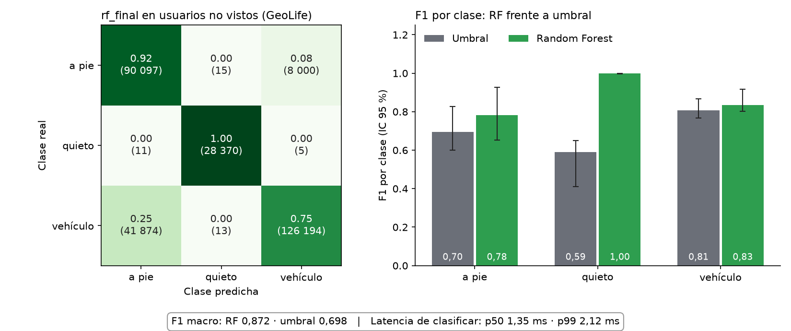

# S4 · Sesión 1 · Pablo: Modelo final congelado y *model card*

## 1. Resumen en 5 líneas

Se entrenó y **congeló** el modelo definitivo `rf_final` (Random Forest de 100 árboles, 48 MB), se fijó con su
SHA-256 y se documentó con una *model card*. A diferencia de `rf_v1`, el ruido GPS ahora se aplica a las **posiciones**
y las características se recalculan, y se usan episodios reales de SUMO (semillas 201 y 202) en vez de trazas simuladas
a mano. En usuarios no vistos de GeoLife mantiene el F1 macro (0,872) y en SUMO normal sube de 0,562 a 0,738.
`ia/inferencia.py` carga `rf_final` por defecto, verifica el hash y, si falla, cae al umbral. Tyrone usa este modelo en la
corrida final.

## 2. Conceptos clave

- **Modelo congelado:** un archivo cuyo contenido no cambia; se identifica por su SHA-256. Cualquier cambio sería `rf_final_v2`.
- **SHA-256:** una "huella" del archivo: si cambia un solo byte, la huella cambia. Permite comprobar que se usa el modelo correcto.
- **Entrenamiento determinista:** con `random_state = 42`, el mismo orden de filas y las mismas entradas, dos entrenamientos dan
  exactamente el mismo archivo (se comprobó: mismo hash).
- **Aumentación con ruido de verdad:** en S2 el "ruido" solo multiplicaba algunas características por factores al azar. Aquí se
  añade ruido AR(1) (error GPS que se parece al del instante anterior, ρ = 0,8, σ de 3 a 15 m) a las posiciones de cada ventana
  y se recalculan las 18 características con el mismo código de producción. El modelo ve en entrenamiento lo que verá en uso.
- **Ventana *golden*:** una ventana fija con su salida guardada; un test comprueba que el modelo siga dando exactamente lo mismo.
- ***Model card* (Mitchell et al., 2019):** ficha que describe para qué sirve el modelo, con qué datos se hizo, cómo se midió y qué límites tiene.

## 3. Cómo se generó cada cosa

| Resultado | Comando | Entradas → salidas |
|---|---|---|
| Episodios de SUMO de entrenamiento | `ia/grabar_episodios.py --semilla 201 --hasta 4800` (y 202), dentro del contenedor `van3twin` | escenario de Tyrone → `ia/sumo/salidas/episodios_s201.csv` (ignorado por git) |
| Ventanas de entrenamiento | `python3 -m ia.datos.construir_entrenamiento_final --semillas 201 202` | GeoLife + episodios → `ventanas_final.parquet`, `entrenamiento_final_datos.json` |
| Modelo congelado | `python3 -m ia.entrenar_final` | ventanas → `ia/modelos/rf_final.joblib` y `rf_final.json` |
| Evaluación final | `python3 -m ia.evaluar_final` | modelo + usuarios no vistos + SUMO 101–105 → `metricas_rf_final.json`, `curvas_sigma_final.csv`, etc. |
| Suavizado con `rf_final` | `python3 -m ia.simular_falsas --episodios ../../../S3/Pablo/codigo/ia/sumo/salidas --max-sesiones 300 --salida ia/reportes/suavizado_k_final.csv` | 300 sesiones → `suavizado_k_final*.csv` |
| Golden y referencia | `python3 -m ia.datos.generar_golden` y `python3 -m ia.datos.generar_referencia_inferencia` | → `ventanas_golden.json`, `referencia_sklearn_final.json` |
| Model card y evidencia | `python3 -m ia.model_card` y `python3 -m ia.evidencia_model_card` | JSON y CSV → `MODEL_CARD.md`, `s1_model-card-metricas.png` |

## 4. Mapa de archivos

| Archivo | Qué contiene | Quién lo usa |
|---|---|---|
| `ia/modelos/rf_final.joblib` / `.json` | modelo congelado y su ficha técnica (hash, características, fallback, métricas) | `inferencia.py`, Tyrone, Freddy |
| `ia/entrenar_final.py` | entrenamiento determinista | reproducibilidad |
| `ia/datos/construir_entrenamiento_final.py` | ventanas con ruido sobre las posiciones | entrenamiento |
| `ia/inferencia.py` | carga `rf_final`, verifica el SHA-256 y hace el fallback | controlador TraCI, backend |
| `ia/evaluar_final.py` | evaluación frente al umbral y a `rf_v1` | informe |
| `ia/MODEL_CARD.md` | ficha del modelo | informe, profesor |
| `ia/tests/test_modelo_final.py`, `ventanas_golden.json` | hash, 30 casos fijos, robustez, latencia, fallback, no fuga | CI |
| `informe/GUIA_ESTILO.md` | reglas para escribir el informe | todos |

## 5. Recorrido del código

**`construir_entrenamiento_final.py`.** `ventanas_serie` corta una serie de 1 Hz en ventanas de 30 s con paso de 5 s;
`ruido_ar1` genera el error AR(1) por ventana; `features_de_ventanas` calcula las 18 características con `_features_2d`.

```python
e[:, 0] = sigma[:, None] * z[:, 0]
innov = sigma[:, None] * np.sqrt(1 - RHO ** 2)
for i in range(1, n):
    e[:, i] = RHO * e[:, i - 1] + innov * z[:, i]      # cada error depende del anterior
```

**`inferencia._cargar_modelo`.** Verifica el hash *antes* de leer el archivo; si no coincide, falta o no hay referencia, devuelve
`None` con un aviso en el registro y el servicio usa el umbral.

```python
if _sha256(ruta) != esperado:
    return _sin_modelo(f"el SHA-256 de {ruta.name} no coincide con su JSON")
```

## 6. Cómo se conecta con los demás

- **Consume:** el escenario SUMO de Tyrone y los peatones de Freddy (para grabar episodios), GeoLife y la partición de usuarios.
- **Entrega a Tyrone:** ruta y SHA-256 de `rf_final.joblib` para la corrida final. **A Freddy:** `inferencia.py` ya carga `rf_final`;
  si corrige `REGRESANDO → A_PIE`, conviene `k = 5`. **A todos:** `informe/GUIA_ESTILO.md`.

## 7. Resultados y evidencias

F1 macro: GeoLife no vistos 0,872 (umbral 0,698); SUMO normal 0,738 (umbral 0,204; `rf_v1`, 0,562). Latencia de `clasificar`:
p50 1,35 ms y p99 2,12 ms. Con la máquina de Freddy el RF cierra bien el 48,3 % de las sesiones (antes 3,6 %), con 0,8 falsas
liberaciones por 100; con la tabla literal del contrato cierra bien el 86,6 % pero libera en falso 13,1 por 100 con `k = 1`.



## 8. Limitaciones y decisiones

- Para pesar menos de 50 MB se redujo a 100 árboles y hoja mínima 5 (con 200 y 3 pesaba 106,6 MB).
- En tráfico lento y peatón rápido `rf_final` rinde peor que `rf_v1`; son escenarios artificiales y el primero es irresoluble con solo GPS.
- Con σ de 10 a 15 m el RF sí libera en falso con la tabla del contrato: se recomienda `k = 5` si se corrige la máquina.
- Solo dos semillas de SUMO de entrenamiento; sin datos de campo; GeoLife es Beijing.

## 9. Preguntas que podría hacer el profesor

**¿Cómo se garantiza que es el mismo modelo?** Por su SHA-256, que se verifica al cargar y que no cambió en dos entrenamientos.

**¿Por qué cambió el entrenamiento respecto a `rf_v1`?** Porque el ruido de S2 no se aplicaba a las posiciones; el modelo nunca vio
características ruidosas reales y por eso fallaba en SUMO.

**¿Hay fuga de datos?** No: los 10 usuarios de prueba y las semillas 101–105 no entran al entrenamiento y un test lo comprueba.

**¿Por qué empeora en tráfico lento?** Un auto a paso de peatón es indistinguible de una persona caminando solo con GPS.

**¿Qué pasa si el archivo del modelo se corrompe?** El hash no coincide y el servicio cae al umbral con un aviso.
