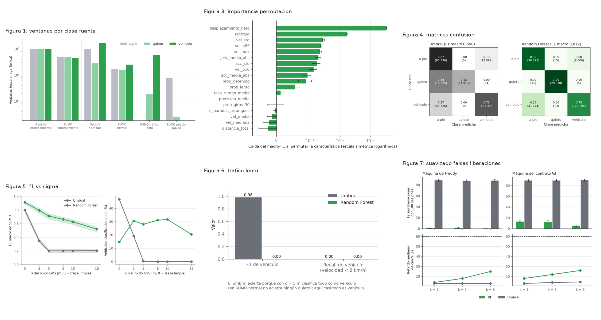

# S4 · Sesión 2 · Pablo: Sección de IA final y preguntas probables del profesor

## 1. Resumen en 5 líneas

Se reescribió la sección de IA del informe (`informe/pablo.md`, 2 385 palabras) para que todas sus cifras salgan del modelo
congelado `rf_final`, con un script que regenera las ocho figuras a 300 dpi sin reentrenar y un comentario de fuente junto a cada
cifra. Un comprobador revisó 128 cifras y un auditor independiente contrastó unas 85 a mano; las tres discrepancias que halló se
corrigieron. También se escribió un anexo con 35 preguntas probables del profesor, con respuesta corta, evidencia y responsable.
Quedan pendientes solo las cifras del sistema completo, que son de Tyrone.

## 2. Conceptos clave

- **Trazabilidad:** cada número del texto apunta al archivo de donde sale (`<!-- fuente: archivo -->`), así se puede comprobar sin confiar
  en la memoria de nadie.
- **Regenerar sin reentrenar:** las figuras se dibujan a partir de los reportes guardados; si cambia un reporte, un solo comando
  actualiza todas.
- **Importancia por permutación:** cuánto empeora el modelo si se mezclan al azar los valores de una característica; mide qué usa de
  verdad el modelo, a diferencia de `feature_importances_`, que depende de cómo se construyen los árboles.
- **Auditor independiente:** un revisor sin el contexto de la sesión que vuelve a comprobar las cifras; evita que el autor pase por alto
  sus propios errores.

## 3. Cómo se generó cada cosa

| Resultado | Comando | Entradas → salidas |
|---|---|---|
| Ocho figuras y lámina | `python3 -m ia.figuras_informe` | `ia/reportes/*final*` → `informe/figuras/pablo/f01` a `f08` y `evidencias/s2_figuras-ia.png` |
| Comprobación de cifras | `python3 informe/verificar_cifras.py informe/pablo.md` | texto y fuentes → huérfanas, imágenes rotas, claves |
| Banco de preguntas | `informe/anexos/preguntas_profesor.md` | 35 preguntas con respuesta, evidencia y responsable |

## 4. Mapa de archivos

| Archivo | Qué contiene | Quién lo usa |
|---|---|---|
| `ia/figuras_informe.py` | las ocho figuras y la lámina de evidencia | informe |
| `informe/pablo.md` | sección de IA con cifras de `rf_final` | armado del informe |
| `informe/anexos/preguntas_profesor.md` | preguntas probables con respuestas | exposición |
| `ia/reportes/busqueda_hiperparametros.csv` | búsqueda de 15 combinaciones de hiperparámetros | trazabilidad del texto |

## 5. Recorrido del código

`ia/figuras_informe.py` tiene una función por figura (`f01_ventanas`, `f03_importancia`, `f05_sigma`, `f07_suavizado`, etc.) que lee el CSV o el JSON
correspondiente y guarda el PNG a 300 dpi; `f08_penetracion` lee el `resumen.csv` de Tyrone con `git show` y, si no existe, dibuja un
panel marcado como pendiente en lugar de inventar datos.

```python
r = subprocess.run(["git", "-C", str(raiz), "show", f"origin/tyrone/s4:{ruta}"], capture_output=True, text=True)
if r.returncode == 0 and r.stdout.strip():
    return pd.read_csv(io.StringIO(r.stdout))     # si no está todavía, devuelve None
```

## 6. Cómo se conecta con los demás

Consume `rf_final` y sus reportes (S4-1), la máquina de estados de Freddy (para el suavizado) y, cuando exista, `kpis/resultados/final/resumen.csv` de
Tyrone. Entrega a Tyrone, Freddy y Miguel un anexo con sus preguntas provisionales, que deben revisar antes del sábado a las 18:00.

## 7. Resultados y evidencias

La sección de IA cita: F1 macro 0,872 en usuarios no vistos (umbral 0,698), 0,738 en SUMO normal, 88,2 falsas liberaciones por 100 sesiones con
el umbral frente a 0,8 con el Random Forest y la máquina de Freddy actual, y p99 de latencia de 2,12 ms.



## 8. Limitaciones y decisiones

- Las cifras del sistema completo y la figura de penetración son de Tyrone y quedan como `[PENDIENTE]`.
- Las preguntas de Freddy, Tyrone y Miguel son provisionales: se escribieron solo con hechos de sus bitácoras y deben confirmarlas.
- Se citan solo cifras de `rf_final`; las del primer modelo no aparecen en el informe.

## 9. Preguntas que podría hacer el profesor

**¿De dónde sale cada cifra?** De un archivo declarado junto a ella, y un script más un auditor independiente lo comprobaron.

**¿Por qué cambió la figura de tráfico lento?** Porque el umbral parece acertar solo por llamar vehículo a todo con ruido de 5 m; la figura lo dice.

**¿Qué falta?** Las cifras de la corrida final del sistema, que dependen de Tyrone.
