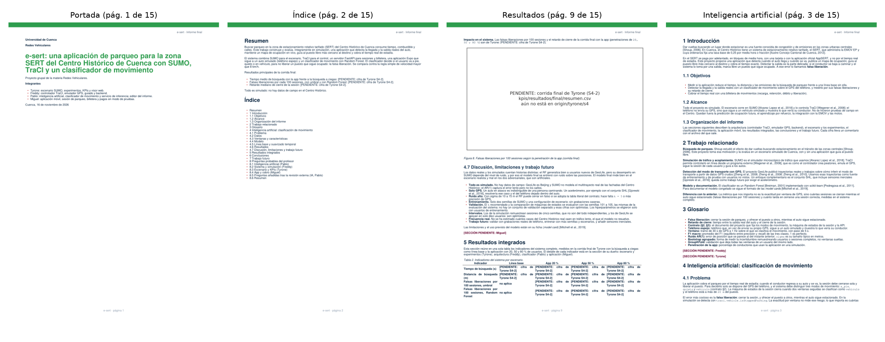

# S4 · Sesión 3 · Pablo: Integración del informe completo

## 1. Resumen en 5 líneas

Se construyó la maquinaria para armar el informe único: partes comunes (portada, resumen, introducción, trabajo relacionado,
resultados integrados, conclusiones y trabajo futuro), bibliografía de 16 referencias verificadas, un maestro (`informe.md`), un
script que une las secciones de las cuatro personas y un verificador. Hoy el armado produce un PDF de 14 páginas con la sección de IA completa; las
secciones de Freddy, Tyrone y Miguel aparecen como pendientes porque sus ramas `s4` aún no existen. El verificador falla solo por eso y
por los marcadores `[PENDIENTE]`, tal como debe. La unificación del domingo repetirá el armado con las secciones ya fusionadas.

## 2. Conceptos clave

- **Editor del informe:** una persona escribe las partes comunes y el armado; cada autor escribe solo su sección.
- **Armado por script:** el informe se genera a partir de los archivos, no a mano, así siempre refleja las secciones más recientes.
- **Modo `ramas` y modo `proyecto`:** el primero extrae cada sección de la rama `origin/nombre/s4`; el segundo lee las secciones de la
  carpeta `informe/`, que es como lo hará la unificación.
- **Verificador:** rechaza el informe si falta una sección, hay una imagen rota, un `TODO` o `PENDIENTE`, una cita inexistente o la misma métrica con valores distintos.

## 3. Cómo se generó cada cosa

| Resultado | Comando | Entradas → salidas |
|---|---|---|
| Informe armado | `python3 informe/construir_informe.py --fuentes ramas` | secciones y partes comunes → `informe/salida/informe_e-sert.md` y `.pdf` |
| Verificación | `python3 informe/verificar_informe.py` | informe armado → tabla de palabras y fallas |
| Miniaturas del PDF | `python3 informe/miniaturas_pdf.py` | PDF → `evidencias/s3_informe-paginas.png` |
| PDF semanal | `python3 herramientas/resumen_pdf.py S4 Pablo` | RESUMEN → `evidencias/resumen_S4_Pablo.pdf` |

## 4. Mapa de archivos

| Archivo | Qué contiene | Quién lo usa |
|---|---|---|
| `informe/informe.md` | maestro con el orden y marcadores de inclusión | armado |
| `informe/comun/` | partes comunes | armado |
| `informe/referencias.bib` | 16 referencias verificadas | armado, todos |
| `informe/construir_informe.py`, `verificar_informe.py` | armado y comprobaciones | unificación del domingo |
| `informe/tests/test_informe.py` | 19 pruebas con secciones sintéticas | CI |

## 5. Recorrido del código

`construir_informe.py` expande los marcadores de inclusión, numera secciones, figuras y tablas, reescribe las rutas de las imágenes y, si falta
una sección, inserta un recuadro pendiente y termina con código 2. `verificar_informe.py` reutiliza `verificar_cifras.py` para comparar las cifras que
citan la misma fuente en secciones distintas.

```python
if not seccion.existe:
    texto += f"[SECCIÓN PENDIENTE: {nombre}]"   # no inventa contenido
    codigo = 2                                    # y el proceso termina con código 2
```

## 6. Cómo se conecta con los demás

Lee las secciones `freddy.md`, `tyrone.md` y `miguel.md` de sus ramas `s4` y las imágenes que enlazan, sin copiarlas al repositorio. La
unificación del domingo 15 a las 09:00 repetirá el armado con `--fuentes proyecto`.

## 7. Resultados y evidencias

Con lo disponible hoy: 14 páginas, sección de IA de 2 328 palabras, anexo de 3 245 palabras, 19 pruebas del armado en verde. El verificador
informa 33 marcadores `[PENDIENTE]` y tres secciones ausentes; no hay imágenes rotas ni citas inexistentes.



## 8. Limitaciones y decisiones

- No hay `pandoc`: el PDF se genera con la biblioteca `fpdf2`; con `pandoc` el script usaría `--citeproc --toc`.
- Las inconsistencias y faltas de secciones ajenas se piden a sus dueños; no se corrigen aquí.
- Las tres cifras principales del resumen deben salir del `resumen.csv` de Tyrone, que aún no existe.

## 9. Preguntas que podría hacer el profesor

**¿Cómo se garantiza que el informe es coherente?** Se arma por script y un verificador comprueba secciones, imágenes, citas y cifras repetidas.

**¿Por qué no está completo hoy?** Faltan las secciones y las cifras finales de otros integrantes, y el sistema no las inventa.

**¿Qué pasa el domingo?** La unificación reconstruye el informe con las secciones fusionadas en `proyecto/informe/`.
