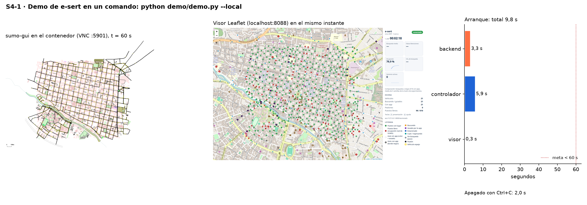
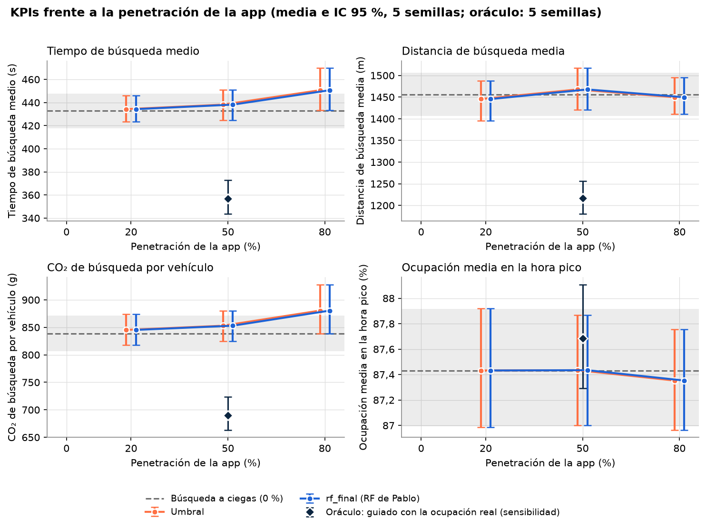
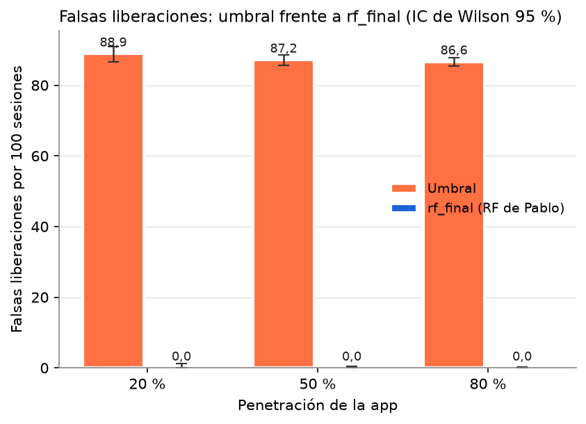
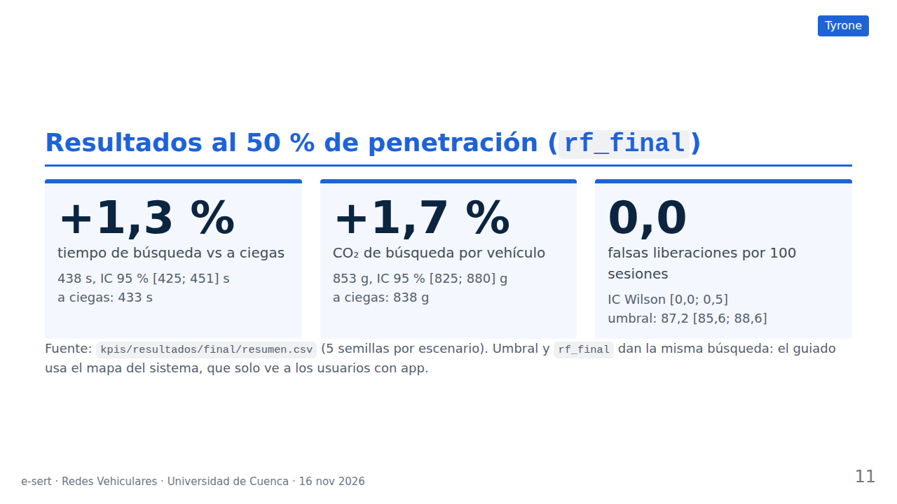
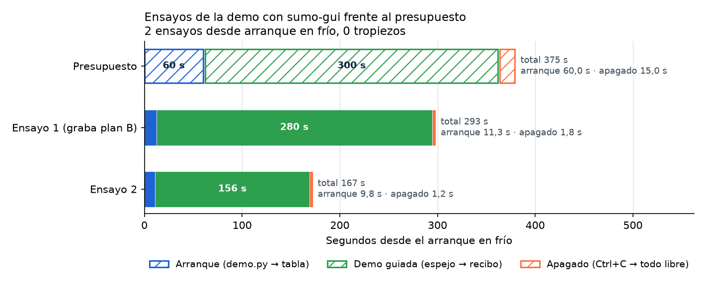

# Resumen S4 · Tyrone 🔵

## Sesión 1 · Demo en un comando (backend, sumo-gui y visor)

`python demo/demo.py` levanta en orden el backend de Freddy, el controlador con `sumo-gui` en el
contenedor y el visor. Comprueba cada pieza, imprime la URL para el teléfono espejo y lo apaga todo
con Ctrl+C, también lo que corre dentro del contenedor. Tiene modo remoto (VPS) con caída al local.

- **Arranque con GUI:** 20,6 s en el primer arranque y 9,8–11,3 s en los ensayos (meta < 60 s). Apagado en 1,2–1,9 s, con los puertos 8000/8088 libres y sin `sumo-gui`.
- **`verificar_demo.py` sale con código 0** y cumple los 7 criterios:
  - 1 151 snapshots válidos;
  - 610 puestos;
  - una sesión `CERRADA`;
  - la billetera cuadra (14,10 − 0,13 = 13,97).
- **Escenario de la demo:** semilla 2 y `ritmo: 2`, para que haya cierres con recibo durante la demo. Sin GUI, libsumo.

```bash
cd semanas/S4/Tyrone/codigo && ./demo/demo.sh --local      # Windows: .\demo\demo.ps1 --local
```



[Explicación (PDF)](explicaciones/s1_explicacion.pdf)

## Sesión 2 · Corrida final de experimentos

35 corridas (penetración × {umbral, `rf_final`} × 5 semillas, el 0 % una vez por semilla) más 5 de
sensibilidad, el "oráculo": guiado con la ocupación real. Fueron 40/40 en 2,3 h, con 21 corridas
reutilizadas de S3 por hash.

- **Búsqueda a ciegas:** 433 s (IC 95 % 418–448).
- **Con la app y el mapa del sistema:** +0,4 / +1,3 / +4,1 % al 20 / 50 / 80 %. No hay mejora, y umbral y `rf_final` dan la misma búsqueda.
- **Falsas liberaciones por 100 sesiones:** **0,0 con `rf_final`** frente a 87 con el umbral, que cobra 0,15 USD de menos por sesión.
- **Oráculo al 50 %:** búsqueda **−17,6 %** (357 s) y CO₂ −17,7 %. Falta información de ocupación de los autos sin app.
- **Controles de cordura:** los tres cumplen.
- **`informe/tyrone.md`:** 1 677 palabras, con las cifras generadas desde `resumen.csv`.





[Explicación (PDF)](explicaciones/s2_explicacion.pdf)

## Sesión 3 · Presentación, guion y ensayo de la demo

- **Diapositivas:** 15 en Marp (PDF, `marp-cli@4.2.3`), con las 37 cifras generadas desde `resumen.csv` y verificadas.
- **Guion:** 20 min por persona.
- **Ensayos:** dos desde arranque en frío con `sumo-gui`, el teléfono espejo, el halo en el visor y un recibo, sin tropiezos:

  | Ensayo | Arranque | Demo guiada | Apagado |
  |---|---:|---:|---:|
  | 1 | 11,3 s | 280 s | 1,8 s |
  | 2 | 9,8 s | 156 s | 1,2 s |

- **Plan B:** 3 escalones; la grabación de 5 min del ensayo 1 se reproduce en el visor.
- `checklist_entrega.md` para el lunes 16.





[Explicación (PDF)](explicaciones/s3_explicacion.pdf) · [Resumen semanal (PDF)](evidencias/resumen_S4_Tyrone.pdf)
