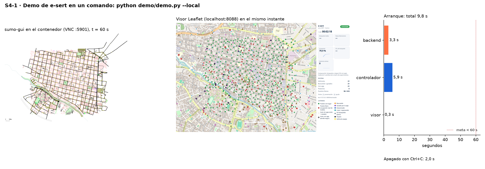

# S4 · Sesión 1 · Demo en un comando (backend, sumo-gui y visor)

## 1. Resumen en 5 líneas

`python demo/demo.py` levanta en orden el backend FastAPI de Freddy, el controlador TraCI con
`sumo-gui` (dentro del contenedor `van3twin`) y el visor Leaflet. Comprueba que cada pieza responde
y lo apaga todo junto con Ctrl+C o al cerrar `sumo-gui`, también lo que corre dentro del contenedor.
Tiene dos modos: remoto (publica en el VPS) y local (plan B, sin internet), y el remoto cae al local
si el VPS no responde o falta el token. Arranca en ~10 s con GUI y se apaga en ~2 s. `verificar_demo.py` es la
prueba de humo que usará la unificación.

## 2. Conceptos clave

- **Grupo de procesos:** cada componente se lanza en su propio grupo (`start_new_session=True` en
  Linux, `CREATE_NEW_PROCESS_GROUP` en Windows). Así, `os.killpg`/`CTRL_BREAK_EVENT` terminan el
  proceso con sus hijos. Si a los 5 s sigue vivo, recibe `kill()`.
- **`docker exec` no propaga las señales:** al matar el `docker exec`, lo que corre dentro del
  contenedor sigue vivo. La demo marca su controlador con un argumento único
  (`--subdir demo_<sello>`) y al apagar hace `docker exec van3twin pkill -INT -f "subdir demo_<sello>"`.
  El patrón no empieza con guiones, porque `pkill` lo leería como una opción. Primero manda SIGINT,
  para que el controlador cierre TraCI y `sumo-gui` limpiamente, y después `-9`.
- **Healthcheck:** el backend está listo cuando `GET /api/v1/puestos` devuelve puestos (sondeo cada
  0,5 s, máximo 20 s). El controlador está listo cuando llega el primer `snapshot` por `/ws/estado`
  (máximo 30 s).
- **Cómo ve el contenedor a la computadora:** se usa `host.docker.internal` (Docker Desktop) o la
  puerta de enlace del contenedor (Linux; aquí `172.19.0.1`). Por eso el backend escucha en
  `0.0.0.0`.
- **Pantalla virtual `:99`:** `sumo-gui` dibuja en el Xvfb del contenedor y se ve por VNC
  (`127.0.0.1:5901`). Si Xvfb se cayó, la demo lo relanza con los mismos comandos del arranque del
  contenedor. Pasó en esta sesión.
- **RF sin sklearn en el contenedor:** el controlador usa `rf_final` exportado a arrays de numpy
  (`kpis/modelo_plano.py`, S3-1).

## 3. Cómo se generó cada cosa

| Resultado | Comando | Entradas → salidas |
|---|---|---|
| Demo local con GUI | `demo/.venv/bin/python demo/demo.py --local --cronometro` | `config_demo.yaml` → backend :8000, `sumo-gui`, visor :8088, `logs/<sello>/` |
| Demo remota | `ESERT_TOKEN_SIM=… ./demo/demo.sh` | VPS `/salud` → publica en `demo.e-sert.tesisucuenca.com` (o cae a local) |
| Prueba de humo | `demo/.venv/bin/python demo/verificar_demo.py` | 120 s de WS → `demo/verificacion.json`, código 0/1 |
| Evidencia | `demo/.venv/bin/python demo/evidencia_demo.py` | captura de `sumo-gui` a los 60 s + Playwright + `tiempos.json` → `evidencias/s1_demo-un-comando.png` |

Durante la semana se pasan las copias de trabajo:
`--ruta kpis=semanas/S4/Tyrone/codigo/kpis --ruta visor=semanas/S4/Tyrone/codigo/visor`.

## 4. Mapa de archivos

| Archivo | Qué contiene | Quién lo usa |
|---|---|---|
| `demo/demo.py` | prerrequisitos, arranque, tabla de tiempos, apagado ordenado | quien presenta |
| `demo/config_demo.yaml` | rutas relativas a la raíz, puertos, escenario y VPS | `demo.py` |
| `demo/demo.sh`, `demo/demo.ps1` | envoltorios que activan el `.venv` | Linux / Windows |
| `demo/verificar_demo.py` | prueba de humo sin GUI → `verificacion.json` | unificación, S4-3 |
| `demo/evidencia_demo.py` | evidencia de 3 paneles | esta sesión |
| `demo/README.md` | prerrequisitos, comando, IP, firewall y errores frecuentes | el equipo |
| `kpis/correr_una.py` | `--publicar`, `--ritmo`, `--gui`, `--captura-gui`: lanzador del controlador de Freddy | `demo.py` |

## 5. Recorrido del código

- **`Demo.prerrequisitos`:** comprueba Python ≥ 3.11, `docker`, el contenedor, `sumo-gui`, la
  pantalla `:99`, que el repo esté en `results/` y los puertos libres. Cada fallo trae una
  solución en español.
- **`Demo.arrancar_backend`:** borra `demo.db` y lanza `uvicorn backend.api.main:app` con
  `ESERT_DB_URL`, `ESERT_VISOR_DIR` y `ESERT_PUESTOS_CSV`.
- **`Demo.arrancar_controlador`:** ejecuta
  `docker exec -w <codigo> van3twin bash -lc "exec python3 -m kpis.correr_una --id p50_rf_s1 --publicar … --gui …"`.
- **`Demo.apagar`:** recorre los componentes en orden inverso y, para el controlador, también
  dentro del contenedor.

```python
def _apagar_uno(self, p):
    if p.nombre == "controlador":
        docker("exec", self.contenedor, "pkill", "-INT", "-f", self.patron_contenedor)
        fin = time.time() + 5
        while time.time() < fin and docker("exec", self.contenedor, "pgrep", "-f",
                                           self.patron_contenedor).returncode == 0:
            time.sleep(0.3)
        docker("exec", self.contenedor, "pkill", "-9", "-f", self.patron_contenedor)
    p.terminar()
```

- **`verificar_demo.escuchar`:** valida cada `snapshot` con `MensajeSnapshot` de
  `proyecto/comun/esquemas.py` y comprueba que `t_sim` siempre crece. En paralelo sigue por
  `/ws/espejo` a los candidatos hasta ver un `recibo`, para comprobar que
  `saldo_antes − cobrado = saldo_después`.

## 6. Cómo se conecta con los demás

- **Freddy:** se lee su backend (`proyecto/backend`, `backend.api.main:app`) y su controlador
  (`proyecto/traci/correr_kpis.correr`, a través de `kpis/correr_una.py`, que le añade la GUI y la
  captura). No se editó nada de `proyecto/`.
- **Miguel:** la demo imprime la URL que usa el teléfono espejo (el VPS en remoto; la IP de la LAN
  en local) y los primeros candidatos de `GET /api/v1/espejo/candidatos`.
- **Unificación:** `verificar_demo.py` sale con código 0 o 1 y deja `verificacion.json`.

## 7. Resultados y evidencias

- Con GUI, en la evidencia: backend en 3,3 s, controlador y SUMO en 5,9 s, visor en 0,3 s; **total
  de 9,8 s** (meta < 60 s). En el primer arranque del día, con imágenes en frío, fueron 20,6 s.
- Apagado con Ctrl+C en **2,0 s**: puertos 8000 y 8088 libres y ningún `sumo-gui` ni `sumo` en el
  contenedor.
- El visor muestra los autos y los puestos en verde/rojo: 98 de 610 llenos a t = 2:18, con la
  ocupación real de SUMO.
- Sin GUI (ritmo 10×): total de 14,9 s y apagado en 0,9 s.
- **`verificar_demo.py` sale con código 0**, con los 7 criterios cumplidos:
  - 1 151 snapshots válidos y nunca más de 1 por segundo simulado;
  - 610 puestos en la API, igual que en `puestos.csv`;
  - la sesión de `sim_busca_18` pasa a `CERRADA`;
  - la billetera cuadra: 14,10 − 0,13 = 13,97 USD;
  - apagado en 1,4 s, con los puertos libres y nada vivo en el contenedor.



## 8. Limitaciones y decisiones

- **Puestos en rojo:**
  - el verificador vio que el visor nunca pintaba puestos llenos con el backend real: el mapa del
    backend (`snapshot.puestos`, `GET /puestos`) queda en 0;
  - las sesiones del controlador viven en su propio núcleo y no llegan a la base del backend
    (pedido a Freddy);
  - el visor ahora colorea con la ocupación real del mensaje `verdad` (contrato §6, `rol=visor`) y
    `?ocupacion=sistema` vuelve al mapa del sistema.
- **Sin `ESERT_TOKEN_SIM`, el modo remoto pasa a local:** el VPS rechazaría los snapshots con 401.
- **Modo remoto sin probar contra el VPS:** hace falta `ESERT_TOKEN_SIM` y que el VPS tenga el
  backend de S3 de Freddy (hoy corre `main`). La caída automática a local sí se probó.
- **Windows sin probar:** `demo.ps1`, `CREATE_NEW_PROCESS_GROUP` y `CTRL_BREAK_EVENT` están
  escritos según la documentación, pero esta máquina es Linux. Queda para el ensayo de S4-3 en la
  laptop de la exposición.
- **Cerrar una sesión en 120 s:**
  - La primera sesión de la semilla 1 cierra en t = 1 223 s, y con TraCI el controlador no pasa de
    ~7× el tiempo real: en 120 s solo llegaba a t ≈ 860 s.
  - Se cambió el escenario de la demo a la **semilla 2** (primer cierre en t = 1 014 s, según la
    corrida final de S4-2).
  - Sin GUI se usa **libsumo**, que llega a ~9× (t ≈ 1 180 s en 120 s).
  - En vivo, `ritmo: 2`.
- **`verificar_demo.py` sigue pocos espejos:** pocos candidatos más los autos cuyo conductor ya
  vuelve (`REGRESANDO`). Seguir a más de 100 a la vez frenaba al controlador, que arma ruta y
  detalle por cada espejo.
- **Error encontrado en la verificación:** el patrón `--subdir demo_<sello>` empezaba con guiones,
  así que `pkill`/`pgrep` fallaban y el controlador sin GUI quedaba vivo. Con GUI no se notaba,
  porque al cerrarse `sumo-gui` termina solo. Corregido.
- **`--ritmo` en lugar de `delay_ms`:** el controlador de Freddy ya tiene `Ritmo` (1 = tiempo real);
  `delay_ms` se pasa a `sumo-gui` como `--delay`.

## 9. Preguntas que podría hacer el profesor

1. **¿Por qué no basta con cerrar la terminal?** Porque SUMO corre dentro del contenedor y
   `docker exec` no propaga señales. Sin el `pkill` quedaría un `sumo-gui` huérfano ocupando CPU y
   la pantalla.
2. **¿Qué pasa si no hay internet en el aula?** El modo remoto prueba `/salud` del VPS durante 5 s
   y, si no responde, arranca todo local. Los teléfonos usan entonces la IP de la LAN (mejor con el
   *hotspot* de un teléfono).
3. **¿Cómo sabe la demo que SUMO ya corre?** Espera el primer `snapshot` por el WebSocket: eso
   prueba toda la cadena SUMO → controlador → backend → WS.
4. **¿Por qué el 8000 y el 8088 y no el 8080?** El 8080 lo publica el contenedor de la materia.
5. **¿Cómo se repite la verificación?** `python demo/verificar_demo.py`: 120 s de WS, criterios en
   `verificacion.json` y código de salida 0/1 (hoy 0, con una sesión cerrada y su recibo).
