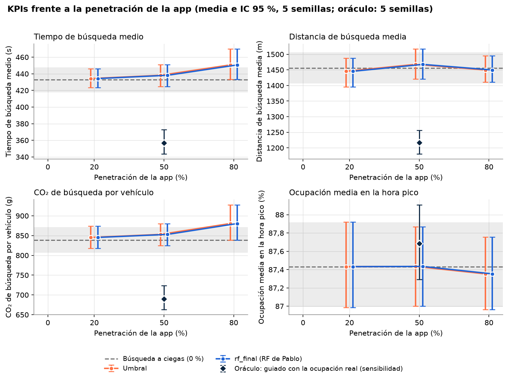
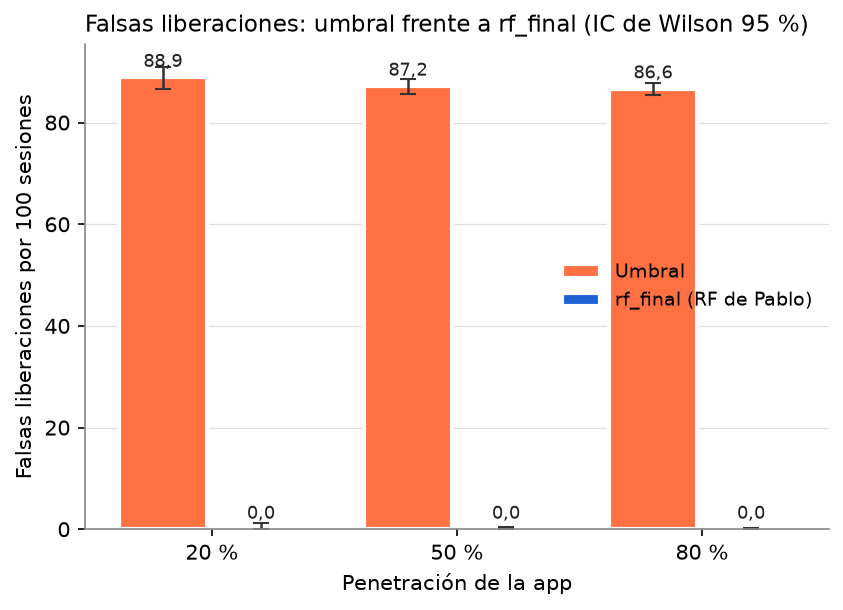

# S4 · Sesión 2 · Corrida final de experimentos con el modelo y el controlador finales

## 1. Resumen en 5 líneas

`kpis/corrida_final.py` corre la matriz final: penetración {0, 20, 50, 80} % × {umbral, `rf_final`}
× 5 semillas, con el 0 % una vez por semilla (35 corridas). Añade 5 corridas de sensibilidad
("oráculo") en las que el guiado ve la ocupación real. Reutiliza por hash las 21 corridas de S3-1, de
modo que solo las semillas 4 y 5 y el oráculo son nuevas. `kpis/estadistica_final.py` produce
`resumen.csv`/`.md` con IC 95 % *bootstrap* jerárquico, Mann-Whitney U, Wilson y los controles de
cordura. `kpis/figuras_finales.py` regenera las figuras del informe sin SUMO, e `informe/tyrone.md`
se arma desde `resumen.csv` con un generador: ninguna cifra se escribe a mano.

## 2. Conceptos clave

- **Reutilización por `hash_config`:** el hash junta la configuración de la corrida con los SHA-256
  de la red, los parqueos, la demanda de la semilla y el modelo. Si coincide con una corrida de
  S3-1, el resultado es el mismo por construcción (SUMO es determinista con la misma semilla) y se
  copia marcado `"origen": "S3-1 (mismo hash)"`.
- **IC *bootstrap* jerárquico:** en cada remuestreo se eligen semillas con reemplazo y, dentro de
  cada semilla elegida, vehículos con reemplazo. Respeta que la réplica independiente es la semilla
  y aprovecha los ~900 vehículos de cada corrida. 10 000 remuestreos, semilla 0.
- **Mann-Whitney U:** prueba no paramétrica de si los tiempos de búsqueda de un escenario y de la
  línea base vienen de la misma distribución. Los tiempos de búsqueda son muy asimétricos, por eso
  no se usa t.
- **Intervalo de Wilson:** IC de una proporción (falsas liberaciones / sesiones) que funciona bien
  cerca de 0, donde el intervalo normal daría límites negativos.
- **Oráculo de sensibilidad:** el mismo guiado de Freddy (`Guia`) con la fuente `"verdad"`
  (`parkingarea.getVehicleCount`) en lugar del mapa del sistema. No es implementable en la realidad:
  acota cuánto podría ganar la app con información perfecta de ocupación.

## 3. Cómo se generó cada cosa

Desde `semanas/S4/Tyrone/codigo`:

| Resultado | Comando | Entradas → salidas |
|---|---|---|
| Corrida final (contenedor) | `docker exec -w …/semanas/S4/Tyrone/codigo van3twin bash -lc "python3 -m kpis.corrida_final --procesos 4"` | escenarios + `rf_final.plano.npz` → `kpis/resultados/final/<id>/kpis.json`, `vehiculos/`, `sesiones/`, `manifiesto.json`, `progreso.log` |
| Estadística | `python -m kpis.estadistica_final` (computadora o contenedor) | `final/*/kpis.json`, `final/vehiculos/` → `resumen.csv`, `resumen.md`, `controles.json` |
| Figuras | `python -m kpis.figuras_finales` | `resumen.csv` → `informe/figuras/tyrone/f01–f05.png` (300 dpi), `evidencias/s2_*.png` (150 dpi) |
| Informe | `python demo/presentacion/generar_diapositivas.py --plantilla informe/tyrone.plantilla.md --salida informe/tyrone.md` | plantilla + `resumen.csv`/`.md` → `informe/tyrone.md` |
| Solo resumen | `python3 -m kpis.corrida_final --solo-resumen` | sin SUMO: manifiesto y estadística |

## 4. Mapa de archivos

| Archivo | Qué contiene | Quién lo usa |
|---|---|---|
| `kpis/corrida_final.py` | matriz de 35 + 5 corridas, reutilización por hash, `ProcessPoolExecutor`, manifiesto | esta sesión |
| `kpis/correr_una.py` | corrida aislada; `guia_fuente="verdad"` y `guia_oraculo` (guarda contra el aborto de SUMO 1.12) | `corrida_final.py`, demo |
| `kpis/estadistica_final.py` | `resumen`, `boot_jerarquico`, `wilson`, `controles`, `markdown` | figuras, informe, diapositivas |
| `kpis/figuras_finales.py` | figura 2×2, búsqueda, CO₂, falsas liberaciones y precisión del mapa | informe, diapositivas |
| `kpis/resultados/final/resumen.csv` | una fila por escenario con medias, IC y Δ | informe (Pablo), diapositivas |
| `kpis/resultados/final/manifiesto.json` | commit, SUMO, CPU, SHA-256 del modelo y de cada demanda, comandos | quien repita la corrida |
| `informe/tyrone.plantilla.md` → `informe/tyrone.md` | sección del informe con marcadores de cifras | Pablo (armado del informe) |

## 5. Recorrido del código

- **`corrida_final.todas()`:** las 35 configuraciones de la matriz más las 5 del oráculo
  (`<id>_oraculo`, `guia_fuente="verdad"`).
- **`corrida_final.ejecutar`:** salta las que ya tienen `kpis.json`, reutiliza las de S3-1 con el
  mismo hash y lanza el resto en un `ProcessPoolExecutor`. Cada tarea es un intérprete nuevo,
  porque libsumo guarda estado global. Hace un segundo intento con las fallidas.
- **`correr_una.guia_oraculo`:** subclase de la `Guia` de Freddy. Con la fuente `verdad` hay muchas
  más reasignaciones, y SUMO 1.12 abortaba (`MSBaseVehicle::replaceRoute: Assertion false`) cuando
  el puesto nuevo está en la misma arista que el auto pero detrás de él. Además, un auto sin arista
  (`getRoadID == ''`) hacía fallar `findRoute`: le pasó a `p50_rf_s2_oraculo` en el primer intento.

```python
@staticmethod
def _alcanzable(ctrl, veh, pid):
    tr = ctrl.traci
    origen = tr.vehicle.getRoadID(veh)
    if not origen or origen.startswith(":"):  # '' = fuera de la red
        return False
    destino = tr.lane.getEdgeID(tr.parkingarea.getLaneID(pid))
    if destino == origen:
        v = tr.vehicle.getSpeed(veh)
        margen = v * v / (2 * 4.5) + 5.0  # distancia de frenado (4,5 m/s²) + 5 m
        return tr.parkingarea.getStartPos(pid) > tr.vehicle.getLanePosition(veh) + margen
    return bool(tr.simulation.findRoute(origen, destino).edges)
```

- **`estadistica_final.resumen`:** por escenario calcula la media y el IC jerárquico de búsqueda,
  distancia y CO₂ por vehículo, la búsqueda de los autos con app y sin app, la ocupación, las
  falsas liberaciones con Wilson y los KPIs de sistema con t.
- **`estadistica_final.controles`:** teletransportes < 1 %, línea base a ±10 % de S3-1 y `rf_final`
  con no más falsas liberaciones que el umbral.

## 6. Cómo se conecta con los demás

- **Pablo:** `rf_final` congelado (`origin/pablo/s4`, SHA-256 comprobado con `rf_final.json`) y su
  guía de estilo del informe. Recibe `informe/tyrone.md`, `resumen.csv` y las figuras de
  `informe/figuras/tyrone/`.
- **Freddy:** el controlador, el guiado y `KPIsSistema` de `proyecto/traci/`, usados sin editar. El
  oráculo es una subclase local de su `Guia`.
- **S4-3:** las diapositivas leen sus cifras de `resumen.csv` con el mismo generador.

## 7. Resultados y evidencias

**Ejecución:**
- 40/40 corridas (35 de la matriz + 5 del oráculo): 21 reutilizadas de S3-1 por hash y 19 nuevas, en
  8 213 s (2,3 h) con 4 procesos;
- 1 reintento: `p50_rf_s2_oraculo`, por el auto sin arista, corregido;
- `manifiesto.json` con el SHA-256 del modelo igual al de `rf_final.json`.

| Escenario (5 semillas) | Búsqueda (s) [IC 95 %] | Δ vs a ciegas | p (M-W) | CO₂ por vehículo (g) | Falsas /100 [Wilson] |
|---|---:|---:|---:|---:|---:|
| A ciegas (0 %) | 433 [418; 448] | — | — | 838 | — |
| 20 % `rf_final` | 434 [423; 446] | +0,4 % | 0,865 | 845 | 0,0 [0,0; 1,3] |
| 50 % `rf_final` | 438 [425; 451] | +1,3 % | 0,125 | 853 | 0,0 [0,0; 0,5] |
| 80 % `rf_final` | 451 [433; 470] | +4,1 % | 0,054 | 880 | 0,0 [0,0; 0,3] |
| 50 % umbral | 438 [425; 451] | +1,3 % | 0,125 | 853 | 87,2 [85,6; 88,6] |
| **50 % oráculo** | **357 [344; 373]** | **−17,6 %** | < 0,001 | 690 (−17,7 %) | 0,0 [0,0; 0,5] |

- **Con el sistema real, la app no reduce la búsqueda.** Al 80 % tiende a subirla: los autos con app
  buscan 452 s frente a 445 s de los demás, porque el guiado los manda a puestos que el mapa cree
  libres.
- **El clasificador importa para el cobro, no para la búsqueda.**
  - `rf_final` deja 0 falsas liberaciones; el umbral, 87 por 100 sesiones.
  - Error de facturación al 50 %: −0,153 USD con el umbral (cobra de menos) frente a +0,018 USD con `rf_final`.
- **Con información perfecta de ocupación (oráculo), la búsqueda baja un 17,6 %.** Los autos con app
  bajan a 310 s y los sin app a 405 s, porque los usuarios guiados dejan de competir por los mismos
  puestos.
- **Controles de cordura, los tres cumplen:**
  - teletransportes, máximo 0,166 % por corrida;
  - línea base a −0,79 % de S3-1;
  - `rf_final` no tiene más falsas liberaciones que el umbral en ninguna penetración.





## 8. Limitaciones y decisiones

- **El oráculo no estaba en el prompt:** se añadió porque el resultado principal (la app no reduce la
  búsqueda) necesita una cota para interpretarse. Va aparte y rotulado, y no forma parte de las 35.
- **`--veh-hora` = 1800** es el calibrado de S1; no se recalibró, porque la ocupación cae en el
  rango pedido.
- **Puerto TraCI propio:** con libsumo no hay puerto. Cada corrida es un intérprete aparte con su
  carpeta de salidas, que cumple el mismo propósito.
- **5 semillas:** los IC jerárquicos son anchos frente a diferencias de pocos puntos porcentuales.
- **La estadística corre en la computadora:** en el contenedor, scipy no es compatible con su numpy
  (`numpy.dtype size changed`), así que `corrida_final` termina con error después del manifiesto.
  `python -m kpis.estadistica_final` se ejecuta aparte, con el entorno de la computadora.

## 9. Preguntas que podría hacer el profesor

1. **¿Por qué reutilizar corridas de S3?** Porque tienen exactamente las mismas entradas (mismo
   hash) y SUMO es determinista: repetirlas daría los mismos números y costaría 2 h de cómputo.
2. **¿Por qué la app no reduce la búsqueda?** El guiado decide con el mapa del sistema, que solo ve
   a los usuarios con app. Con ~87 % de ocupación por autos sin app, recomienda puestos ya llenos.
3. **¿Qué es el oráculo y por qué incluirlo?** El mismo guiado con la ocupación real de SUMO. Dice
   cuánto ganaría la app si conociera la ocupación completa, y separa el problema de información del
   problema del clasificador.
4. **¿Por qué *bootstrap* jerárquico y no por vehículos?** Los vehículos de una corrida comparten
   tráfico y puestos; remuestrear solo vehículos daría IC demasiado estrechos.
5. **¿Cómo se repite la corrida exacta?** `manifiesto.json` tiene el commit, la versión de SUMO, los
   SHA-256 del modelo y de cada demanda, y los comandos.
