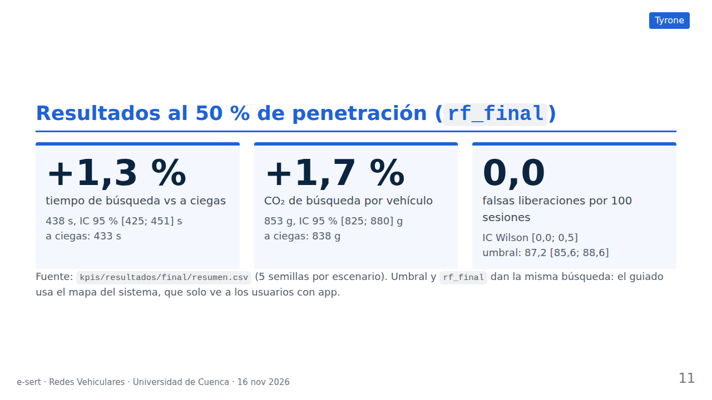
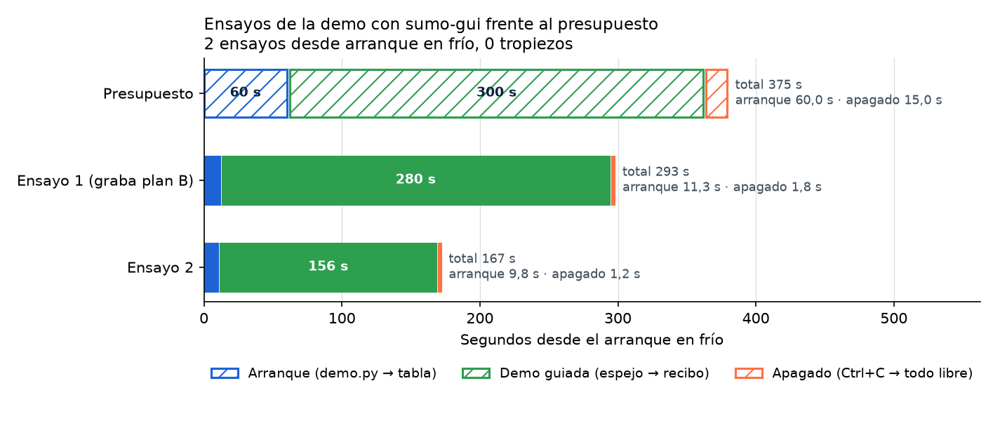

# S4 · Sesión 3 · Presentación, guion, resultados y ensayo de la demo

## 1. Resumen en 5 líneas

Quedó lista la exposición del lunes 16:
- 15 diapositivas Marp con los colores del equipo, cuyas 37 cifras se generan desde `resumen.csv`;
- su PDF;
- un guion de 20 min por persona;
- un plan B en tres escalones.

La demo se ensayó dos veces desde arranque en frío con `sumo-gui`, un "teléfono" siguiendo a un
auto por `/ws/espejo`, el halo en el visor y una sesión cerrada con recibo. Las dos vueltas se
hicieron sin tropiezos y dentro del presupuesto de tiempo. La primera vuelta grabó 5 min de
mensajes WS, que el servidor de prueba reproduce en el visor si fallan el backend o la red.

## 2. Conceptos clave

- **Marp:** diapositivas escritas en Markdown con un bloque de estilo CSS. `marp-cli` las convierte
  a PDF o PNG con un Chromium sin cabeza. Se fija la versión (`@4.2.3`) para que el PDF no cambie
  entre máquinas.
- **Cifras generadas, no escritas:** la plantilla tiene marcadores como `{{p50_rf_final.busqueda_cambio_pct|1|sig}}`.
  `generar_diapositivas.py` los reemplaza con valores de `resumen.csv` en formato español (coma
  decimal, `−` y `+` explícitos). Con `--verificar` comprueba que el `.md` guardado coincide con
  `resumen.csv`. El mismo motor arma `informe/tyrone.md`.
- **Arranque en frío:** cada ensayo empieza sin nada corriendo (backend, SUMO y visor apagados) y
  mide hasta que todo responde, igual que en el aula.
- **Plan B escalonado:** se baja de nivel solo lo que falla:
  1. sin `sumo-gui`;
  2. sin backend, con la grabación;
  3. sin nada, con el video.
- **Ritmo de la demo:** `ritmo: 2` (2× el tiempo real) y semilla 2, para que haya sesiones cerrándose
  durante los 5 min de demo. La primera cierra a t = 1 014 s simulados, unos 8,5 min después de
  lanzar la demo.

## 3. Cómo se generó cada cosa

Desde `semanas/S4/Tyrone/codigo`:

| Resultado | Comando | Entradas → salidas |
|---|---|---|
| `diapositivas.md` | `python demo/presentacion/generar_diapositivas.py` (`--verificar` para comprobar) | `diapositivas.plantilla.md` + `kpis/resultados/final/resumen.csv` → `diapositivas.md`, `cifras.json` |
| `diapositivas.pdf` | `CHROME_NO_SANDBOX=1 npx -y @marp-team/marp-cli@4.2.3 diapositivas.md --pdf --allow-local-files` (en `demo/presentacion/`) | `diapositivas.md`, `img/`, figuras de `informe/figuras/tyrone/` → PDF |
| Diapositiva de resultados | el mismo comando con `--images png`, diapositiva 11 | → `evidencias/s3_diapositiva-resultados.png` |
| Ensayos | `python demo/presentacion/ensayo.py --vuelta 1 --grabar demo/plan_b/snapshots_demo.jsonl --grabar-s 280`, después `--vuelta 2` | demo completa → `ensayos/ensayo_<n>.json`, `plan_b/snapshots_demo.jsonl.gz` |
| `ensayo.md` y cronómetro | `python demo/presentacion/evidencia_ensayo.py` | `ensayos/*.json`, `ensayo.plantilla.md`, `tropiezos_preparacion.md` → `ensayo.md`, `evidencias/s3_ensayo-cronometro.png` |
| Prueba del plan B | `python -m visor.servidor_prueba --snapshots demo/plan_b/snapshots_demo.jsonl.gz --puerto 8765` + `python -m visor.captura evidencias --url http://localhost:8765/ --sin-servidor` | grabación → visor conectado con autos, puestos y espejo |

## 4. Mapa de archivos

| Archivo | Qué contiene | Quién lo usa |
|---|---|---|
| `demo/presentacion/diapositivas.plantilla.md` | 15 diapositivas con marcadores de cifras | Tyrone |
| `demo/presentacion/diapositivas.md` / `.pdf` | la presentación final | el equipo, el lunes |
| `demo/presentacion/generar_diapositivas.py` | motor de marcadores (`|pct`, `|sig`, `|abs`, `{{tabla:…}}`, `{{seccion:…}}`) | diapositivas e informe |
| `demo/presentacion/guion.md` | minuto, persona, frase clave y transición por diapositiva; la demo paso a paso | los cuatro |
| `demo/presentacion/ensayo.py` | ensayo cronometrado automático | Tyrone |
| `demo/presentacion/ensayo.md` | herramientas, presupuesto, los dos ensayos, tropiezos y plan B | el equipo |
| `demo/presentacion/checklist_entrega.md` | lista para el lunes 16 | el equipo |
| `demo/plan_b/snapshots_demo.jsonl.gz` | 3 159 mensajes WS (1 505 snapshots) del ensayo 1 | plan B, escalón 2 |
| `demo/presentacion/img/` | figuras de Freddy (diagrama, cobro), Pablo (matrices) y Miguel (espejo) | diapositivas |

## 5. Recorrido del código

- **`generar_diapositivas.renderizar`:** reemplaza cada marcador por el valor de `resumen.csv` y
  falla en voz alta si falta una columna o es `NaN`. Así no puede quedar una cifra vieja ni inventada.

```python
def sustituir(m):
    esc, col, dec, mod = m.group(1), m.group(2), int(m.group(3)), m.group(4) or ""
    if esc not in res or col not in res[esc]:
        raise KeyError(f"marcador sin dato: {esc}.{col}")
    bruto = res[esc][col]
    valor = float(bruto)
    if math.isnan(valor):
        raise ValueError(f"marcador NaN: {esc}.{col}")
    if mod == "|abs":
        valor = abs(valor)
    elif mod == "|pct":  # fracción → porcentaje
        valor = 100 * valor
    texto = formato(valor, dec)
    if mod == "|sig" and valor > 0 and texto.strip("0,") != "":
        texto = "+" + texto
```

- **`ensayo.demo_guiada`:** cuatro tareas en paralelo:
  - graba `/ws/estado`;
  - el "teléfono" sigue a un candidato;
  - `por_cerrar` sigue a los autos cuyo conductor ya vuelve (`REGRESANDO`);
  - `visor` abre Chromium con `?espejo=<veh>` y espera el halo.

  Termina con el primer recibo.
- **`evidencia_ensayo.escribir_ensayo_md`:** arma la tabla y los eventos de cada ensayo desde sus
  JSON, sin copiar cifras a mano.

## 6. Cómo se conecta con los demás

- **Figuras de otros:** el diagrama de arquitectura de Freddy (`S1/Freddy/evidencias/s1_contrato-diagrama.png`;
  su rama `freddy/s4` no tiene aún `comun/docs/`) y su gráfica de cobro de S1-2; las matrices de
  confusión de Pablo (`origin/pablo/s4`, `informe/figuras/pablo/f04`); la captura del espejo de
  Miguel (S1-3). La figura `f08` de Pablo era un marcador "PENDIENTE: corrida final de Tyrone", así
  que se usó la figura de falsas liberaciones de la corrida final.
- **Demo:** `demo.py` (S4-1), el backend y el controlador de Freddy, y el visor (S3-3).
- **Pendiente de Miguel:** el video de respaldo (`app/plan_b/ENLACE_VIDEO.md`); su rama `miguel/s4`
  no existe todavía.

## 7. Resultados y evidencias

| Criterio | Resultado |
|---|---|
| `diapositivas.pdf` con cifras de `resumen.csv` | 15 diapositivas; `generar_diapositivas.py --verificar`: "37 cifras… coincide; marcadores sin resolver: 0" |
| Guion por persona, suma 20 min | 15 filas, total 20:00 (Tyrone 9:00 + demo, Freddy 2:30, Pablo 2:30, Miguel 1:00 + demo 5:00) |
| Dos ensayos completos | ensayo 1: arranque 11,3 s, demo guiada 280,2 s (con grabación), apagado 1,8 s; ensayo 2: 9,8 s, 156,4 s, 1,2 s; 0 tropiezos en los dos; recibo 0,13 USD frente a 0,25 USD de la tarjeta SERT |
| Plan B se reproduce en el visor | `servidor_prueba` con la grabación `.gz`: visor "conectado", autos, puestos y espejo con ruta |
| Evidencias | `s3_diapositiva-resultados.png`, `s3_ensayo-cronometro.png` |





## 8. Limitaciones y decisiones

- **Los ensayos son automáticos.** El "teléfono" es un cliente de `/ws/espejo`, el mismo canal que
  usa la app de Miguel. Falta ensayar con su teléfono físico, el proyector y Windows, lo que queda
  en `checklist_entrega.md` para el lunes.
- **Ritmo 10× en los ensayos y 2× en vivo:** a 10× el ensayo cabe en 5 min. En vivo, 2× deja ver a
  los autos y aun así produce cierres.
- **La grabación se versiona comprimida** (`.jsonl.gz`, 14 MB): el `.jsonl` crudo pesa 136 MB, por
  encima del límite de GitHub.
- **Diapositivas de resultados honestas:** muestran que la búsqueda no baja con el mapa del sistema
  (+1,3 % al 50 %) y que con el oráculo baja un 17,6 %. El mensaje es que el clasificador funciona y
  que falta información de ocupación.
- **Duración:** nadie confirmó otra con el profesor; se asumen 20 min (parámetro en `guion.md`).

## 9. Preguntas que podría hacer el profesor

1. **¿Qué pasa si la demo falla en vivo?** Plan B en tres escalones: sin `sumo-gui`, con la
   grabación del ensayo en el visor o con el video de Miguel. Ninguno detiene la exposición.
2. **¿Cómo saben que las cifras de las diapositivas son las del experimento?** Salen de
   `resumen.csv` con un generador, y `--verificar` comprueba que el PDF corresponde al CSV actual.
3. **¿Por qué la demo corre a 2×?** La estadía mínima de un auto es de 10 min simulados; a tiempo
   real no habría ningún cierre en 5 min de demo.
4. **¿El recibo de la demo es real?** El cobro y la billetera son los del backend de Freddy, con la
   tarifa SERT. El auto y el conductor son simulados.
5. **¿Por qué mostrar un resultado negativo?** Porque es lo que mide el sistema. El oráculo explica
   la causa (falta información de ocupación) y separa ese problema del clasificador, que sí funciona.
